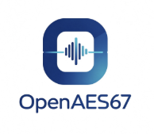

> [English](README.md) · **简体中文**



# OpenAES67

Windows 上的开源 AES67 网络音频实现，包含一块 **64 进 64 出虚拟声卡**，
任何 ASIO 程序都能像打开普通声卡一样打开它。

**MIT 许可 · 无激活 · 无许可证密钥 · 无账号 · 不联网回传。**

RTP/SDP、SAP、PTP 与音频 I/O 全部按公开标准用 C++17 独立实现
（AES67-2018、RFC 3550、RFC 4566、RFC 2974、IEEE 1588）。
仓库里没有第三方厂商的代码或二进制，本项目与任何厂商无关。

**60 秒走通一条声卡链路**

```powershell
.\build.bat                                                   # 编译 CLI 与自检
.\asio_driver\build-asio-driver.bat                           # 编译 64×64 ASIO 声卡
.\asio_driver\register-asio-driver.bat                        # 注册（需管理员）
.\build\openaes67.exe doctor --iface <有线网卡 IP>            # 检查这台机器
.\build\openaes67.exe bridge --iface <IP> --channels 64 --ptime 1 --shm OpenAES67Audio --sap
# 然后在 DAW 里选择 ASIO 设备 "OpenAES67 ASIO 64x64"，48 kHz
```

---

## 目录

| 节 | 内容 |
|---|---|
| [1](#1-项目解决什么问题) | 项目解决什么问题 |
| [2](#2-主要功能) | 主要功能 |
| [3](#3-安装方法) | 安装方法 |
| [4](#4-使用方法) | 使用方法 |
| [5](#5-输入输出示例) | 输入输出示例 |
| — | [Dante Controller 可见性](#dante-controller-里能看到什么什么永远看不到) · [目录结构](#目录结构) · [已知限制](#已知限制) · [路线图](#路线图) · [命令行参考](#命令行参考) |

English version: [`README.md`](README.md)。

---

## 1. 项目解决什么问题

Windows 本身不会说 AES67，由此产生三个实际问题，本项目都覆盖：

**把 Dante / AES67 音频录进 Windows 程序。** Dante 设备开启 AES67 模式后发的是组播
RTP，而 Audition、Reaper、Pro Tools 打不开组播流。OpenAES67 接收它，并以一块 64 路
输入的声卡呈现出来，DAW 就能按普通音频接口录音。

**把 Windows 程序的声音送上 AES67 网络。** 反方向同理：播放器或调音台只认声卡，
本项目提供 64 路输出，把它们作为 AES67 发出去。

**不依赖商业虚拟声卡。** 现有方案要么是授权产品，要么绑定特定厂商。本项目是 MIT、
纯本地运行，每个行为都能追溯到公开标准，或追溯到
[`docs/FINDINGS.md`](docs/FINDINGS.md) 里一次可复现的测量。

**它刻意不做的事：** 它不是一个 Dante 设备。原因与替代做法见
[「Dante Controller 里能看到什么」](#dante-controller-里能看到什么什么永远看不到)。

---

## 2. 主要功能

### 协议

| 功能 | 状态 | 说明 |
|---|---|---|
| AES67 RTP（L16 / L24，1 ms 包） | ✅ | 组播、网络字节序；8 kHz–384 kHz，1–64 声道 |
| SDP 生成与解析 | ✅ | `a=rtpmap`、`a=ptime`、`a=ts-refclk`、`a=mediaclk`、`a=source-filter`、`a=sendonly` |
| SAP 通告与发现 | ✅ | RFC 2974，TTL 255，±1/3 抖动，退出时发删除报文，按间隔重发 |
| PTPv2 从时钟 | ✅ | 实测偏移 0.2 ms；频率估计送入速率控制器 |
| RTCP | ✅ | `--rtcp`：每 5 s 发 SR，回 RR 带丢包与抖动 |
| 抖动缓冲与乱序容忍 | ✅ | 重复/迟到识别、丢包计数、锁定单一 SSRC |

### 音频通路

| 功能 | 状态 | 说明 |
|---|---|---|
| WAV 输入输出 | ✅ | 位精确往返（96 000 帧，0 个采样不同） |
| WASAPI 采集与播放 | ✅ | 共享模式与**独占**模式 |
| 速率控制器（重采样 + PI） | ✅ | 跟踪 ±300 ppm 的注错 |
| 闭环（PTP 驱动播放速率） | ✅ | `recv --ptp` |
| 64 × 64 ASIO 声卡 | ✅ | `asio_driver/`：48 kHz、64 进 64 出、256 帧缓冲 |
| WDM/PortCls 驱动 | ⚠️ | 工具链已打通（编译+签名+Inf2Cat）；Secure Boot 开启时无法加载 |

### 工具

| 功能 | 状态 | 说明 |
|---|---|---|
| Qt 6 图形界面 | ✅ | 实时缓冲/ppm/包数/丢包/欠载、托盘、开机自启 |
| `doctor` 环境自检 | ✅ | 网卡、组播、SAP 接收、ASIO 注册、PTP |
| `probe` 格式识别 | ✅ | 只听地址就能反推通道/编码/ptime，无需 SDP |
| `bench` 与基线门禁 | ✅ | 8 个用例；`--baseline` 退化超过 15% 即失败 |
| 配置文件 | ✅ | `--config FILE`；未知键是启动错误 |
| 单元自检 | ✅ | **283 项单元自检**，无外部框架 |

### 实测数据（可复现，详见 `docs/FINDINGS.md`）

| 测量 | 结果 |
|---|---|
| WAV 往返 | 96 000 帧，**0 个采样不同** |
| `rx` 完整性 | 3000 包 / 144 000 帧，**0 丢包** |
| PTP 偏移精度 | 0.2 ms，峰峰 0.16 ms |
| PTP 频率（单独测量） | 注入 +300 ppm，实测 +307.4 ppm（误差 2.5%） |
| 12 分钟 64 声道双工长跑 | 135 008 次回调、34.5 M 帧、0 丢包、上行 0 丢包、内存与句柄持平 |
| 该长跑中的抖动缓冲 | 均值 1435 / p95 1459 / **最大 1468** 帧（目标 1440） |
| 收包队列（优化项） | 2 声道 2276 Mframes/s，64 声道 697 Mframes/s（+71% / +76%） |

---

## 3. 安装方法

### 环境要求

- Windows 10 / 11（x64）
- Visual Studio 2022 Build Tools（C++ 工作负载）与 Windows 10/11 SDK
- Qt 6（只有图形界面需要）
- Python 3（只有 `tools/` 下的脚本需要）
- Windows Driver Kit（只有 WDM 驱动需要；ASIO 声卡不需要）

### 编译命令行工具

```powershell
.\build.bat
```

该脚本编译 CLI、自检与核心库，然后运行项目的声明校验（文档与代码必须一致）。
等价的 CMake 构建：

```powershell
cmake -S . -B build -G "Visual Studio 17 2022" -A x64
cmake --build build --config Release
```

验证：

```powershell
.\build\openaes67.exe help
.\build\selftest.exe        # 283 项断言，必须打印 ALL PASS
```

### 编译并注册 64×64 声卡

这一步只需要 MSVC 工具链，不需要 WDK —— ASIO 驱动是用户态 COM DLL。

```powershell
.\asio_driver\build-asio-driver.bat          # 生成 asio_driver\out\openaes67_asio64.dll
.\asio_driver\register-asio-driver.bat       # 需要管理员权限
```

也可以在图形界面里点 **注册 ASIO 驱动**：它会向 Windows 请求提权并执行同一个脚本。
注册写入：

```
HKLM\SOFTWARE\ASIO\OpenAES67 ASIO 64x64   -> CLSID {7C1F2E64-9A3B-4C5D-8E7F-0A1B2C3D4E5F}
HKLM\SOFTWARE\Classes\CLSID\{...}\InprocServer32 -> DLL 路径
```

卸载用 `.\asio_driver\unregister-asio-driver.bat`。

### 编译图形界面（可选）

```powershell
cmake -S . -B build-qt -G "Visual Studio 17 2022" -A x64 -DOPENAES67_WITH_GUI=ON
cmake --build build-qt --config Release
```

需要 Qt 6 MSVC 套件在 `CMAKE_PREFIX_PATH` 中；CMake 找不到 Qt 时见
[`docs/AUDIO-DEVICES.md`](docs/AUDIO-DEVICES.md)。

### 确认这台机器是否就绪

```powershell
.\build\openaes67.exe doctor --iface 192.168.1.10
```

`doctor` 无阻塞问题时退出码 0，否则 1 —— 安装脚本可以直接用它做门禁。
每一项的含义见第 5 节。

### 可选：开机自动启动

```powershell
.\build-qt\Release\openaes67_gui.exe --autostart-register
```

写一条 `HKCU\...\CurrentVersion\Run` 启动项，按当前模式启动，不需要管理员权限。
`--autostart-unregister` 删除。

---

## 4. 使用方法

### 命令一览

| 命令 | 作用 |
|---|---|
| `doctor` | 环境自检（网卡、组播、SAP 接收、ASIO 注册、PTP） |
| `probe` | 监听一个组播地址并报告它承载的格式 |
| `info` | 打印解析后的流参数 |
| `sdp` | 打印当前配置会通告的 SDP |
| `tx` | 发送测试音或 WAV 文件（不需要音频设备） |
| `rx` | 接收并存成 WAV（不需要音频设备） |
| `send` | 采集本机播放的声音（WASAPI 回环）并发送 |
| `recv` | 接收并播放到设备、WAV 或共享内存 |
| `bridge` | 一个进程同时跑双向（声卡模式） |
| `capture`、`capture-in`、`play` | 诊断用：回环录 WAV、输入端录 WAV、WAV 播放到设备 |
| `sap-listen` | 列出 SAP 通告的流 |
| `ptp` | 测量相对主时钟的偏移与漂移 |
| `shm-read` | 排空共享内存并报告收到的内容 |
| `list-devices` | 列出 WASAPI 端点与 ASIO 驱动 |
| `bench` | 测量热路径；配合 `--baseline` 做退化门禁 |
| `help` | 打印命令与参数摘要 |

### 场景一：把本机声音发到网络

```powershell
# 本机正在播放的声音 -> AES67，并用 SAP 通告，控制器能看见
.\build\openaes67.exe send --iface 192.168.1.10 --group 239.69.1.2 --port 5006 --sap
```

之后 Dante 接收端（AES67 模式）就能订阅这条流。

### 场景二：接收一条流并播放

```powershell
# 收到默认设备，独占模式保证位精确
.\build\openaes67.exe recv --iface 192.168.1.10 --group 239.69.1.1 --port 5004 `
    --channels 8 --rate 48000 --exclusive --seconds 60
```

### 场景三：当作 64×64 声卡用（DAW 场景）

```powershell
# 1. 一个进程把两个方向都桥接起来
.\build\openaes67.exe bridge --iface 192.168.1.10 `
    --group 239.69.1.1 --port 5004 `
    --channels 64 --ptime 1 --shm OpenAES67Audio `
    --send-group 239.69.1.2 --send-port 5006 --sap

# 2. 在 DAW 里选择 "OpenAES67 ASIO 64x64"，48 kHz
#    输入 1-64 = 从网络收到的
#    输出 1-64 = 要发到网络上的
```

也可以让 bridge 自己找下行流，不必手输地址：

```powershell
.\build\openaes67.exe bridge --iface 192.168.1.10 --discover --discover-name "Dante" `
    --channels 64 --shm OpenAES67Audio
```

如果 Dante 的 AES67 流没有走 SAP 通告，就从 Dante Controller（Device View → Transmit）
抄下组播地址直接用；不知道格式时让 `probe` 听一下：

```powershell
.\build\openaes67.exe probe --iface 192.168.1.10 --group 239.69.1.1 --port 5004
```

### 场景四：图形界面

```powershell
.\build-qt\Release\openaes67_gui.exe
```

- **开始** 一次启动两个方向：接收（网络 → 输出通道）与发送（输入通道 → 网络）
- **声卡模式（ASIO 64×64）** 用 ASIO 桥接替代这一对，给 DAW 用
- **环境诊断** 跑与 `doctor` 相同的检查，在独立线程里，不卡界面
- **注册 ASIO 驱动** 请求提权并注册声卡
- **按地址接收** 粘贴 Dante Controller 里的 `组播:端口`，自动探测格式并开始
- **开机自动启动** 写第 3 节那条注册表项
- 关闭窗口只是收进托盘，音频继续跑；托盘菜单的 **退出** 才真正停止

### 配置文件

所有命令都接受 `--config FILE`，命令行参数优先：

```ini
iface = 192.168.1.10
group = 239.69.1.1
port  = 5004
channels = 64          # 输出通道（接收方向）
ptime = 1
codec = l16
shm   = OpenAES67Audio
send_group = 239.69.1.2
```

未知键会以退出码 2 结束，而不是被静默忽略。
[`openaes67.example.conf`](openaes67.example.conf) 是带注释的起点。

---

## 5. 输入输出示例

以下输出均来自实际运行（Windows 10，USB 千兆网卡）。

### `doctor`：这台机器就绪了吗

```
$ openaes67 doctor --iface 192.168.1.10 --group 239.69.1.1 --port 5004
OpenAES67 doctor
  [ OK ] interface: 192.168.1.10
  [ OK ] group: 239.69.1.1:5004 is multicast
  [....] sap: listening for announcements
  [WARN] sap: none received -- no AES67 sender on this network, or UDP 9875 is blocked
  [ OK ] asio: OpenAES67 ASIO 64x64 registered (asio_driver\out\openaes67_asio64.dll)
  [WARN] ptp: no grandmaster within 3 s -- Dante will not send audio until the clock locks

READY: no blocking problems found
```

退出码 0 = 就绪，1 = 有阻塞问题。`[WARN]` 不算失败：网络上暂时没有发送端、或暂时没有
主时钟，都不是配置错误。声卡尚未注册时，ASIO 一行会显示
`[FAIL] ... run asio_driver\register-asio-driver.bat as administrator`，总结变成 `NOT READY`。

### `sdp`：会通告什么

```
$ openaes67 sdp --iface 192.168.1.10 --group 239.69.1.2 --port 5006 --channels 4
v=0
o=- 0 1 IN IP4 192.168.1.10
s=OpenAES67 stream
t=0 0
a=sendonly
m=audio 5006 RTP/AVP 96
c=IN IP4 239.69.1.2/32
a=source-filter: incl IN IP4 239.69.1.2 192.168.1.10
a=rtpmap:96 L16/48000/4
a=ptime:1
a=ts-refclk:localmac=00-1D-C1-FF-FE-12-34-56
a=mediaclk:direct=0
a=sync-time:0
a=framecount:48
a=mid:1
```

每行严格以 CRLF 结束、没有空行，所以 `> stream.sdp` 重定向出来的文件可以直接喂给
`recv --sdp-file`。

### `probe`：不知道格式的地址

```
$ openaes67 probe --iface 192.168.1.10 --group 239.69.6.6 --port 5066 --seconds 2
probing 239.69.6.6:5066 for 2.0 s
  packets    : 303
  format     : L24 4 ch @ 48000 Hz
  ptime      : 1.000 ms (48 frames/packet)
  payload    : type 97, ssrc 0xCAAD2F1C

recv command for this stream:
  openaes67 recv --iface 192.168.1.10 --group 239.69.6.6 --port 5066 --channels 4 --ptime 1.000 --codec L24
```

格式是从 RTP 时间戳反推的，完全不依赖 SDP。

### `tx` / `rx`：不经过音频设备

```
$ openaes67 tx --iface 192.168.1.10 --group 239.69.1.1 --port 5004 --seconds 2
OpenAES67 tx
  iface   : 192.168.1.10
  dst     : 239.69.1.1:5004
  format  : L16 2 ch @ 48000 Hz, 48 frames/packet
  ttl     : 32
  ssrc    : 0x8A3563C7 (random)
  source  : 1000 Hz tone, amplitude 20000
  packets : 2000
done: 2000 packets in 2.00 s (999.0 pkt/s)
```

```
$ openaes67 rx --iface 192.168.1.10 --group 239.69.1.1 --port 5004 --seconds 3 --out capture.wav
OpenAES67 rx
  iface   : 192.168.1.10
  group   : 239.69.1.1:5004
  out     : capture.wav

result
  packets    : 3002
  other ssrc : 0 (from another source, ignored)
  ssrc change: 0 (sender restarts adopted)
  frames     : 144096 (3.002 s of audio)
  lost       : 0
  duplicates : 0
  late       : 0
  jitter buf : 0 packets remaining
  wav        : capture.wav
```

### `recv`：网络到设备

```
$ openaes67 recv --iface 192.168.1.10 --group 239.69.1.1 --port 5004 --channels 64 --seconds 5
group   : 239.69.1.1:5004
sink: wasapi-shared, 64 ch @ 48000 Hz, packet=48 frames
prebuffer: reached 1440 of 1440 frames
packets    : 5086
frames out : 242688 (5.056 s)
lost       : 0
buffer     : mean=1435 target=1440 frames
```

### `bridge`：声卡模式

```
$ openaes67 bridge --iface 192.168.1.10 --group 239.69.1.1 --port 5004 --channels 64 `
    --ptime 1 --shm OpenAES67Audio --send-group 239.69.1.2 --send-port 5006 --sap
OpenAES67 bridge (AES67 <-> shared ring <-> ASIO)
  section : OpenAES67Audio, 64 ch @ 48000 Hz
  downlink: 239.69.1.1:5004 -> ring
  uplink  : ring -> 239.69.1.2:5006
  asio    : OpenAES67 ASIO 64x64 registered (asio_driver\out\openaes67_asio64.dll)
            （未注册时会提示运行 register-asio-driver.bat）
[rx] shm: section ready
[rx] ptp: slave on domain 0, waiting for a grandmaster
[sap] announcing uplink 239.69.1.2:5006
[rx] [  5.0 s] mean=  1441 corr=   +0.0 ptp=   +0.0 written=47998 Hz played=0 Hz devpad=-1
done: 2000 uplink packets (2000 without ASIO audio)
```

`without ASIO audio` 在没有 DAW 打开声卡时是正常的：共享内存里没有数据，于是发静音。
DAW 一打开就归零。

### `bench`：优化的判据

```
$ openaes67 bench
case                        value unit
ring 2ch                11263.640 Mframes/s
ring 64ch                 330.989 Mframes/s
queue 2ch                2225.622 Mframes/s
queue 64ch                677.813 Mframes/s
convert 64->2             609.861 Mframes/s
convert 64->64            447.337 Mframes/s
rtp pack+parse             30.260 Mops/s
sdp build                   4.039 us
```

与基线比较（退化超过 15% 即失败）：

```
$ openaes67 bench --baseline bench-baseline.txt
ring 64ch                 331.02 Mframes/s   was   330.99     0.0%  ok
...
BASELINE OK
```

### 图形界面日志

同样的事件也会出现在界面日志里，并且可以脚本驱动：

```
$ openaes67_gui.exe --autostart both --autostop 8
[gui] 接收：L16 2 通道 239.69.8.8:5110
[gui] 发送：L16 2 通道 239.69.1.2:5006
[gui] sink: wasapi-shared, 2 ch @ 48000 Hz, packet=48 frames
[gui] 已发送 1000 包 | 有声音的节拍 0 | 静音填充 1000
```

---

## Dante Controller 里能看到什么、什么永远看不到

Dante Controller 的列表里只有两类东西：

1. **Dante 设备** —— 用 Audinate 自己的发现协议（mDNS 系）找到；
2. **第三方 AES67 / ST 2110-30 的发送流** —— 从 SAP/SDP 学到，显示为 Routing 页最右侧的蓝色流。

非 Dante 的 AES67 **接收端不属于任何一类**，也无法加进去：AES67 没有"注册为接收端"这一步，
Dante Controller 也没有这个概念。Audinate 官方文档对每个第三方设备都是同样描述 ——
只有 RTP **transmit flow** 会出现
（[Dante Controller User Guide](https://dev.audinate.com/GA/dante-controller/userguide/webhelp/content/creating_aes67_or_st2110-30_rtp_transmit_flows.htm)）。

所以两个方向要在两端分别建立：

| 方向 | 谁创建 | 在 Dante Controller 里看到什么 |
|---|---|---|
| OpenAES67 → Dante | OpenAES67 用 SAP 通告（`tx --sap`、`bridge --sap`） | Routing 右侧的蓝色 AES67 流，把 Dante 接收端订阅到它 |
| Dante → OpenAES67 | **Dante 设备**上创建 AES67 组播发送流（Device View → Transmit → Add multicast flow → AES67） | 该 Dante 设备下的这条流；OpenAES67 再按地址接收（SAP 发现、`--group/--port` 或 `probe`） |

`bridge --sap` 通告的是**上行流**（DAW 播放到 ASIO 输出的内容），因此回程也能在
Dante Controller 里看到。下行是订阅，刻意不通告 —— 通告一条你只接收的流，
等于告诉全网自己在发送。

完整推导（含"伪装成 Dante 设备为什么更糟"）见
[`docs/DANTE-VISIBILITY.md`](docs/DANTE-VISIBILITY.md)。

---

## 目录结构

```
include/openaes67/   公共头文件（rtp、sdp、sap、jitter、net、engine、ptp…）
src/                 实现，以及 CLI 与 GUI 共用的 receive_loop.cpp
src/gui/             Qt 6 前端
asio_driver/         64 进 64 出 ASIO 声卡（用户态 COM DLL）
driver/              PortCls 虚拟声卡驱动（WDK；需要测试签名）
tests/selftest.cpp   283 项断言，无外部框架
tools/               Python 收发/主时钟、长跑与性能脚本
assets/              由 logo.png 生成的图标
docs/FINDINGS.md     每一次测量、陷阱与死胡同，按时间顺序
docs/DANTE-VISIBILITY.md  Dante Controller 为何无法列出接收端
docs/M6-DESIGN.md    内核 ↔ 用户态共享内存约定
bench-baseline.txt   性能基线，供 tools/verify-perf.ps1 使用
```

接收路径放在 `src/receive_loop.cpp`，CLI 与 GUI 共用。这是刻意的：两者各有一份实现时
曾经跑偏，排查花了整整一天。

---

## 已知限制

- **WDM 驱动在 Secure Boot 开启时无法加载。** ASIO 声卡没有这个限制（它是用户态 DLL），
  所以它是受支持的路径。
- **共享模式采集不是位精确的。** Intel SST 的扬声器保护链在 WASAPI 回环拿到数据前就做了
  增益与压缩（实测：不同幅度下比值 3.376 与 2.039）。位精确采集需要 ASIO 或自研驱动。
  独占模式播放是位精确的。
- **PTP 使用软件时间戳。** 存在约 0.17 ms 的固定不对称偏差，闭环频率估计有 11% 误差，
  因为时间戳在用户态取得。要改进需要硬件时间戳，而 ASIX AX88179 这类 USB 网卡不提供。
- **64 声道 1 ms 超过 1500 字节 MTU**（每包 6144 字节，会分片）。本机网卡与承载分片的
  网络可用；丢弃分片的交换机会失败。5 ms（30720 字节，仍分片）只在整条链路支持时使用，
  否则减少声道数。
- **AES67 接收端不会出现在 Dante Controller 里。** 见上一节；这是协议边界，不是缺失功能。

---

## 路线图

| # | 项目 | 状态 |
|---|---|---|
| M1 | 协议核心：RTP + SDP + 自检 | ✅ |
| M2 | 收发引擎：套接字、组播、抖动缓冲 | ✅ |
| M3 | WAV 输入输出 + WASAPI 采集/渲染 | ✅ |
| M4 | 独占模式、PTPv2 从时钟、速率控制器、闭环 | ✅ |
| M5 | Qt 6 图形界面 | ✅ |
| M6 | 内核驱动：环 ABI、PortCls 适配、WaveRT、签名包 | ⏳ 受限于 Secure Boot |
| M7 | 发布工程：CI、打包 | ✅ |
| M8 | **64 × 64 ASIO 虚拟声卡** | ✅ |
| M9 | 工具：`doctor`、`probe`、`bench` + 基线门禁、配置文件 | ✅ |

---

## 参与开发

见 [`CONTRIBUTING.md`](CONTRIBUTING.md)。两条规则最重要：行为必须能追溯到公开标准，
数字必须来自可复现的测量。

改动热路径（收包循环、共享环、ASIO 泵）前请先跑：

```powershell
powershell -NoProfile -ExecutionPolicy Bypass -File tools\verify-perf.ps1
```

它取三次运行的最好值，与 `bench-baseline.txt` 比较，任一用例慢 15% 以上即失败。
`set OPENAES67_PERF_GATE=1` 可让构建末尾自动运行（默认关闭：忙的机器上计时门禁会误报）。

## 许可证

MIT —— 见 [`LICENSE`](LICENSE)。

---

## 命令行参考

`openaes67 help` 打印同样的列表。

**流定义（所有命令）**

| 参数 | 默认 | 含义 |
|---|---|---|
| `--iface IP` | 第一个非回环地址 | 用于组播的本机 IPv4 |
| `--group IP` | `239.69.1.1` | 组播目的地址（须在 224.0.0.0/4） |
| `--port N` | `5004` | 目的 UDP 端口 |
| `--channels N` | `2` | 声道数（1–64） |
| `--rate HZ` | `48000` | 采样率 |
| `--ptime MS` | `1.0` | 包时长（毫秒，48 kHz 下 48 帧） |
| `--codec NAME` | `l16` | `l16`（2 字节/采样）或 `l24`（3 字节/采样，默认 PT 97） |
| `--ttl N` | `32` | 组播 TTL |
| `--ssrc N` | 随机 | RTP SSRC |
| `--config FILE` | — | 从 `key = value` 文件读默认值，命令行优先 |

**`tx`（发送测试音或 WAV）**

| 参数 | 默认 | 含义 |
|---|---|---|
| `--seconds S` | `6.0` | 时长；给了 `--wav` 时忽略（整个文件发完为止） |
| `--freq HZ` | `1000` | 测试音频率 |
| `--amplitude N` | `20000` | 测试音幅度（16 位刻度） |
| `--wav FILE` | — | 发送 WAV 文件（声道与采样率取自文件） |
| `--ptp` | 关 | 用 PTP 生成 RTP 时间戳，最多等 5 s 锁 |
| `--domain N` | `0` | 配合 `--ptp` 的 PTP 域 |
| `--pace-ppm N` | `0` | 发送端快（+）或慢（−）N ppm |
| `--rtcp` | 关 | 每 5 s 向 port+1 发 RTCP SR |
| `--sap` | 关 | 用 SAP 通告 |
| `--sap-interval N` | `30` | SAP 基础间隔（秒，带 ±1/3 抖动） |
| `--print-sdp` | 关 | 发送前打印 SDP |
| `--sdp-out FILE` | — | 把 SDP 写入文件 |
| `--refclk ptp:GMID[:domain]` | 本机 MAC | 覆盖通告的参考时钟 |

**`send`（采集本机输出并发送）**

除上面的流定义参数外：

| 参数 | 默认 | 含义 |
|---|---|---|
| `--in-device NAME` | 默认回环 | 采集设备（子串或索引） |
| `--ptp-lock` | 关 | 用 PTP 生成 RTP 时间戳 |

它没有 `--wav`：发送文件用 `tx --wav FILE`。

**`recv` / `rx` / `bridge`**

| 参数 | 默认 | 含义 |
|---|---|---|
| `--device NAME\|INDEX` | 系统默认 | 输出设备（子串或 `list-devices` 的索引） |
| `--exclusive` | 关 | WASAPI 独占模式（绕过音频引擎） |
| `--backend NAME` | `wasapi` | `wasapi`、`asio` 或 `shm` |
| `--asio-driver NAME` | — | ASIO 驱动（需要 ASIO SDK 构建） |
| `--shm NAME` | — | `recv`：写入这个共享节；`send`：从它读取 |
| `--send-group G` | 接收组 | `bridge`：上行组播地址 |
| `--send-port P` | 接收端口+2 | `bridge`：上行端口 |
| `--discover` | 关 | `bridge`：用 SAP 找下行流，而不是用 `--group/--port` |
| `--discover-name S` | — | `bridge`：只接受 `s=` 含该子串的通告 |
| `--discover-seconds N` | `4` | `bridge`：监听多久后放弃 |
| `--ptp` | 关 | 把 PTP 速率估计送给速率控制器 |
| `--domain N` | `0` | 配合 `--ptp` 的 PTP 域 |
| `--sdp-file FILE` | — | 从 SDP 推导组播、端口、通道、采样率与编码（L16/L24） |
| `--out FILE` | `rx.wav` | `rx` 的 WAV 输出 |
| `--out-bits N` | `16` | `rx` WAV 位深：16 或 24 |
| `--rtcp` | 关 | `recv`/`rx`：在 port+1 上接收 SR 并打印 |

**其他命令**

| 命令 | 含义 |
|---|---|
| `doctor` | 环境自检：网卡、组播、SAP 接收、ASIO 注册、PTP |
| `probe` | 监听地址并报告格式（通道、编码、ptime） |
| `info` | 打印解析后的流参数 |
| `sdp` | 打印该配置的 SDP |
| `list-devices` | 列出 WASAPI 与 ASIO 输出设备 |
| `sap-listen` | 列出 SAP 通告的流 |
| `ptp` | 测量相对主时钟的偏移与漂移 |
| `bridge` | 一个进程双向：AES67 → 共享环 → ASIO，ASIO → 环 → AES67 |
| `bench` | 测量热路径；`--baseline FILE --write-baseline` 记录，`--baseline FILE` 退化超过 15% 即失败 |
| `capture-in` | 把真实输入端点录成 WAV（DAW 会录到的内容） |
| `shm-read` | 排空共享节并报告收到的内容 |
| `help` | 打印参数摘要 |

**图形界面**（`openaes67_gui.exe`）

| 参数 | 含义 |
|---|---|
| `--autostart send\|recv\|both\|bridge` | 立即启动：`both` 同时收发，`bridge` 为声卡模式 |
| `--diagnose` | 启动时跑环境自检（与 `openaes67 doctor` 相同） |
| `--autostart-register` | 写 HKCU 启动项（按当前模式） |
| `--autostart-unregister` | 删除该启动项 |
| `--autostop S` | S 秒后停止并退出 |
| `--in-device NAME` | 预选发送方向的采集设备 |
| `--out-device NAME` | 预选接收方向的输出设备 |

### 接收端行为

- 播放设备按**流采样率**打开；共享模式交给 WASAPI 转换，独占模式要求一致
- 抖动缓冲最多 200 包；乱序容忍 4 包，超过即计为丢包
- 锁定单一 SSRC：同组播组上的其他源会被计数并忽略
- 发送端重启（新 SSRC）时，原源静默 200 ms 且新源连续 25 包后自动接管
- 超大包（超过期望帧数两倍）计为 `truncated` 并丢弃
- **网络断流时按墙钟补静音**，设备缓冲不会被抽干，听到的是干净静音而不是咔哒声
- payload type 不匹配的包计为 `wrongPayloadType` 并跳过，而不是按错误格式解码
