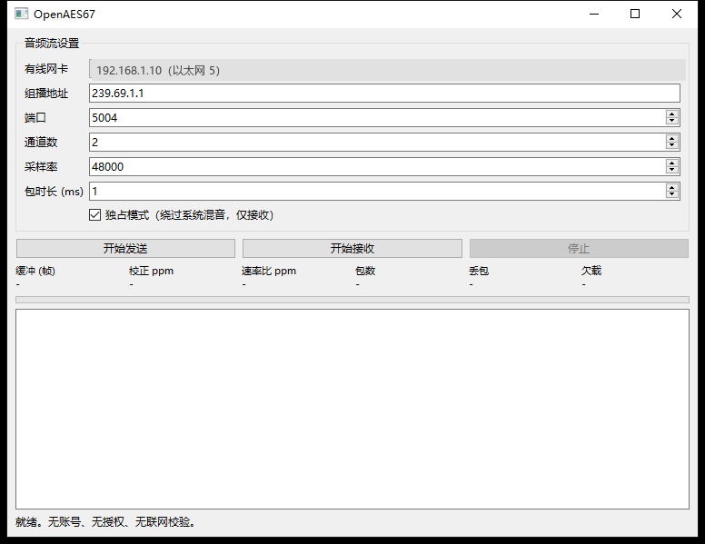
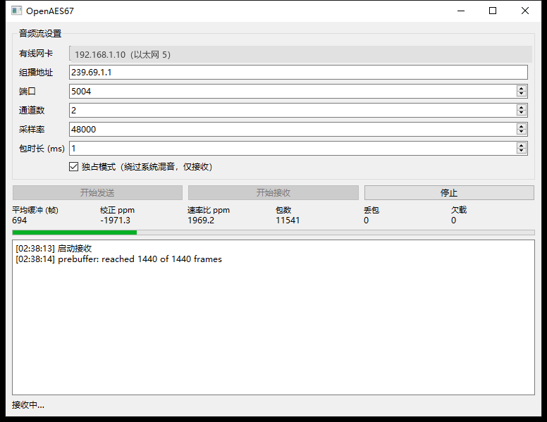

# 实测发现与坑位记录

本文件记录开发过程中通过实测发现的行为，均附可复现的验证方法。
这些结论对新加入的开发者很重要 —— 它们不是理论，是本机跑出来的。

---

## 1. L16 是网络字节序，WAV 是小端

**现象**：把 AES67 收到的 L16 数据直接写进 WAV，回读后频率估算得出 12995 Hz，
而实际发送的是 1000 Hz。

**原因**：RTP 载荷里的 L16 是大端（网络序），WAV 的 PCM16 是小端。
直接 memcpy 会导致每个采样点高低字节对调。

**修正**：写入 WAV 前对调字节对；C++ 侧在 `engine.cpp` 里解析时按大端还原。

**验证**：`tools/aes67_tx.py` + `tools/aes67_rx.py` 回环，回读应为 1000 Hz。

---

## 2. rtpmap 的字段顺序容易记反

**现象**：`parseSdpAudioFormat` 解析 `a=rtpmap:96 L16/48000/8` 得出
channels=48000、rate=8。

**原因**：RFC 4566 的格式是 `<encoding>/<clock rate>[/<channels>]`，
我把后两段当成 `channels/rate` 了。

**修正**：`src/sdp.cpp` 已改为先取 rate 再取 channels。

**验证**：`build\selftest.exe` 中的 `parsed channels = 8` / `parsed rate = 48000`。

---

## 3. WASAPI 共享模式不是比特透明的（重要）

**现象**：用 `play` 播放幅度 16000 的 440 Hz 正弦，用 `capture` 采集 loopback，
采集峰值是 32767（削顶）。

**线性度测试**（同一 440 Hz 正弦，只改输入幅度）：

| 输入幅度 | 采集峰值 | 比值 |
|---|---|---|
| 2000 | 6752 | 3.376 |
| 4000 | 10917 | 2.729 |
| 8000 | 18558 | 2.320 |
| 16000 | 32623 | 2.039 |

**比值随输入增大而下降** —— 这是动态压缩（AGC / 响度均衡）的特征，
不是固定增益。固定增益的比值应当恒定。

**来源判断**：

- 该端点 `FxProperties` 为 0，说明不是通过注册表登记的每端点 APO
- 本机音频设备为 `英特尔(R) 智音技术` + `Realtek High Definition Audio(SST)`
- X1 Extreme 这类机型使用 Intel SST 做**扬声器保护**（Speaker Protection），
  在渲染链路里必然施加限幅/DRC/EQ

**对 AES67 的影响**：

共享模式下，环路经过 Windows 音频引擎 + SST DSP，
**信号被压缩、限幅、均衡，无法比特精确**。
若把 `capture` 的数据直接送上网络，送出去的不是原始音频。

**对策（按推荐度排序）**：

| 方案 | 说明 | 状态 |
|---|---|---|
| WASAPI 独占模式 | 绕过音频引擎与 APO | ✅ 已实现（仅输出侧，见第 7 节） |
| 关闭音频增强 | 设置 → 声音 → 设备属性 → 增强 关闭；部分机型仍受 SST 影响 | 用户侧 |
| ASIO | 完全绕过系统混音，专业场景标准做法 | 需 ASIO SDK |
| 内核层采集 | 在驱动层取数据，最彻底 | 需驱动签名 |

**注意**：`capture` 与 `play` 作为**诊断命令**仍然有价值 —— 它们能证明
设备可用、声道映射正确、频率正确。但不能用来做比特精确的环回测试。

频道映射已实测正确：发送 440 Hz(左) + 1000 Hz(右)，
采集后 ch0 最强频率为 440 Hz、ch1 为 1000 Hz。

---

## 4. loopback 在没有声音播放时拿不到数据

**现象**：`capture --seconds 1` 在桌面安静时返回 0 帧。

**原因**：渲染端点空闲时，WASAPI loopback 不会产生数据包，
`GetNextPacketSize` 一直返回 0。

**影响**：不能靠"采集到 0 帧"判断出错。诊断时应先播放已知信号。

---

## 5. 测试用的组播回环必须绑定有线网卡

**现象**：发送端不指定 `--iface` 时，接收端收不到包。

**原因**：本机同时有 Wi-Fi 和有线网卡（且曾在同一 /16 网段），
组播出口不确定。

**做法**：`--iface` 一律填有线网卡的 IPv4。

---

## 6. 已通过的比特精确验证

在共享模式问题之外，**纯文件路径是比特精确的**：

```
in.wav  96000 帧 2 声道 48 kHz
tx --wav in.wav  ->  rx -> out.wav
compared 96000 frames, mismatched 0
RESULT: BIT-EXACT MATCH
```

这条路径证明了 WAV 读写、RTP 打包/解包、组播收发、抖动缓冲全部正确。
WASAPI 引入的非透明性来自操作系统与驱动，不是本项目代码。

---

## 7. 独占模式已实现，但只能解决输出侧

**实现**：`createWasapiRenderSinkExclusive()`（`src/audio_io_exclusive.cpp`）

流程：`IsFormatSupported(EXCLUSIVE)` 只接受 `S_OK` → `Initialize(EXCLUSIVE)`
→ 失败则回退共享模式。候选格式依次为 48 kHz/16 bit PCM、48 kHz/32 bit float。

**实测**：

```
play --wav tone6.wav --exclusive
  device  : 2 ch @ 48000 Hz, backend=wasapi-exclusive
  played  : 288000 frames (6.000 s)      <- 实时节拍正确
```

对照共享模式：

```
play --wav tone6.wav
  device  : 2 ch @ 48000 Hz, backend=wasapi-shared
  loopback 采集峰值: 32767（受压缩处理）
```

**关键限制（实测确认）**：

独占模式播放期间，loopback 采集直接失败：

```
capture --seconds 2
  cannot open WASAPI loopback (no default render device?)
  退出码: 2
```

原因是独占流独占了设备，共享模式的采集端点都无法打开。
这反过来证明了独占模式确实绕过了共享混音引擎。

**所以两条路径的处境不同**：

| 路径 | 能否比特精确 | 手段 |
|---|---|---|
| **输出**（RX → 扬声器） | ✅ 能 | 独占模式，已实现 |
| **采集**（应用 → TX） | ❌ 不能仅靠独占 | 见下 |

原因：WASAPI 的 loopback 采集（`AUDCLNT_STREAMFLAGS_LOOPBACK`）**只允许共享模式**，
而共享模式必然经过音频引擎与 APO。独占模式与 loopback 互斥。

**采集侧的可选出路**：

| 方案 | 可行性 | 代价 |
|---|---|---|
| 关闭音频增强 | 部分机型有效，SST 机型可能无效 | 用户设置，不可靠 |
| 采集真实输入设备（话筒/线路输入） | 走采集端点而非 loopback，可独占 | 需要物理输入，不是"抓播放" |
| ASIO | 完全绕过系统混音 | 需 ASIO SDK，且要目标应用支持 ASIO |
| 自研虚拟声卡驱动 | 最彻底：在驱动层交出原始数据 | 需 WDK + 驱动签名（M6） |

**结论**：本项目当前可以做到"**比特精确地播放网络音频到声卡**"，
但"**比特精确地抓取应用播放的声音**"需要 M6 的驱动，或依赖 ASIO。
这不是代码缺陷，是 WASAPI 的架构限制，已如实记录。

---

## 8. 按 1 ms 轮询设备会把 3 秒的音频拖成 73 秒

**现象**：`send`（loopback -> AES67）发送 3000 个 1 ms 包，耗时应为 3.0 秒，
实测 **73.53 秒**，只有 40.8 pkt/s。

**原因**：循环按 RTP 包（1 ms / 48 帧）驱动，每次调用 `AudioSource::read()` 只请求 48 帧。
但 WASAPI 共享模式的设备按 **约 10 ms 一块**交付数据，
所以 9 次里有 9 次拿不到数据，`read()` 在内部自旋等待（上限 20 ms）才返回。
3000 次 × 约 20 ms ≈ 60 秒，与实测吻合。

**修正**：改成 **10 ms 节拍**驱动 ——

```
tickFrames = sampleRate / 100            // 480 帧
tickFrames 向下取整到 fpp 的整数倍        // 保证是完整包
packetsPerTick = tickFrames / fpp        // 10 个包
```

每个节拍读一次（请求 480 帧），再拆成 10 个 RTP 包发出去。
不足部分补静音，保证 RTP 流连续。

**修正后**：

```
tick    : 480 frames (10 packets of 48 frames)
ticks   : 300 (3.0 s)
done: 3000 packets in 3.01 s (995.1 pkt/s)
ticks with audio: 300 / 300
silence-padded packets: 0
```

**教训**：设备的交付粒度是缓冲周期，不是单个包。
凡是按包节拍驱动设备的循环，都要先问"设备多久给一次数据"。

---

## 9. 独占流空转会被挂起，之后写入永远返回 0

**现象**：`recv --exclusive` 播放时 `frames out` 只有 **48**，
而 FIFO 里堆了 **205776 帧**（4.28 秒音频），`write()` 之后一直返回 0。

**原因**：独占流以默认设备周期（约 10 ms）开缓冲，然后 **在没有任何数据的情况下 Start()**，
空了约 800 ms 等第一包到达。空转导致流停止推进，`GetCurrentPadding` 此后一直等于缓冲大小，
`avail` 恒为 0，`write()` 只能返回 0。

**修正**（两处）：

1. 缓冲从 1 个默认周期改为 **4 个周期（最少 20 ms）**，留出余量
2. 打开设备后先灌 **100 ms 静音**做预热，让流一开始就有数据流动

**修正后**：

```
sink      : wasapi-exclusive, 2 ch @ 48000 Hz
packets   : 5824
frames out: 279552 (5.824 s)
fifo left : 0 frames
underruns : 6
```

**教训**：实时音频设备不能"开着等数据"。要么先灌静音，要么等有数据再 Start。

---

## 10. 两条端到端链路已实测通过

### 链路 1：应用播放 -> loopback -> AES67 -> WAV

```
send: source=wasapi-shared, tick=480 frames, 3000 包 / 3.01 s
rx  : 3000 包, 144000 帧 (3.000 s), lost=0
频谱: ch0=440Hz, ch1=1000Hz        <- 与源文件一致
```

### 链路 2：WAV -> AES67 -> 渲染设备

```
tx   : 6000 包 / 6.00 s
recv : sink=wasapi-exclusive, 5824 包, 279552 帧 (5.824 s), fifo=0, underruns=6
```

共享模式对照：`sink=wasapi-shared`, 4608 包, 221184 帧 (4.608 s), fifo=0, underruns=12

两条链路都能实时跑完，FIFO 不堆积，丢包为 0。
链路 1 的采集侧仍受第 3 节所述的共享模式压缩影响（peak=32767），那是系统处理，不是本项目代码。

---

## 11. 装 Qt 时 aqt 报校验失败，其实是 aqt 自己的问题

**现象**：`aqt install-qt windows desktop 6.8.3 win64_msvc2022_64` 连续 5 次重试后失败：

```
WARNING : Caught ArchiveChecksumError, terminating installer workers
ERROR   : Downloaded file ...qtbase...7z is corrupted! Detect checksum error.
  Expect 41688269fac0565db956c66d9eecae777d16197e0c02cd81b88640c1f5d73d3f
  Actual efa8938a43faf13d9869a6d82a79316a998e4905e01cc7e02a621a7854a59db8
```

换中科大镜像则报 `Failed to locate XML data for Qt version '6.8.3'`（仓库结构不同）。

**排查**：

| 检查 | 结果 |
|---|---|
| 清华与官方 HEAD 的 Content-Length | **完全相同** 39,484,220 字节 |
| 三家的 Updates.xml | 均 305,632 字节，内容一致 |
| Updates.xml 里的哈希字段 | 只有 `<SHA1>`（311 处），**没有 SHA256** |
| 该包的 `<SHA1>` | 整个包（7 个归档）合并的哈希，不是单归档哈希 |

**关键发现**：用 `curl` 手动下载同一个文件，**SHA256 完全等于 aqt 期望值**：

```
大小: 39,484,220 字节
SHA256: 41688269fac0565db956c66d9eecae777d16197e0c02cd81b88640c1f5d73d3f
与 aqt 期望一致: True
```

所以镜像文件是好的，**是 aqt 的下载器把文件下坏了**（重试 5 次都没成功）。

**速度对比**（各取 2 MB）：

| 源 | 速度 |
|---|---|
| 清华 TUNA | **2,817 KB/s**（完整下载实测 11,415 KB/s，3.4 秒） |
| 官方 download.qt.io | 35.7 KB/s（37 MB 要 18 分钟，且中途卡死） |

**可用做法（已验证）**：

```powershell
# 1. 直接下载归档（37.6 MB，约 4 秒）
curl.exe -L -o D:\Qt-dl\qtbase.7z "https://mirrors.tuna.tsinghua.edu.cn/qt/online/qtsdkrepository/windows_x86/desktop/qt6_683/qt6_683/qt.qt6.683.win64_msvc2022_64/6.8.3-0-202503201308qtbase-Windows-Windows_11_23H2-MSVC2022-Windows-Windows_11_23H2-X86_64.7z"

# 2. 校验（必须等于 aqt 期望值）
Get-FileHash D:\Qt-dl\qtbase.7z -Algorithm SHA256

# 3. 解压（py7zr 随 aqtinstall 一起装好）
python -c "import py7zr; py7zr.SevenZipFile(r'D:\Qt-dl\qtbase.7z').extractall(r'D:\Qt-staging')"

# 4. 移动到 Qt 约定路径
move D:\Qt-staging D:\Qt\6.8.3\msvc2022_64
```

**完整性用 Authenticode 验证，比哈希更可靠**：

```
Qt6Core.dll    Status=Valid
               签名者=CN=The Qt Company Oy, SERIALNUMBER=2637805-2,
                      O=The Qt Company Oy, L=Espoo, C=FI
Qt6Widgets.dll Status=Valid
qmake -query QT_VERSION -> 6.8.3
```

只装 `qtbase` 就够用：它包含 QtCore / QtGui / QtWidgets / QtNetwork。
`qtsvg`、`qtdeclarative`、`qttools`、`qttranslations` 都不需要。

---

## 12. Qt GUI 已构建并运行

```
openaes67_gui.exe   114,176 字节
部署后: Qt6Core/Gui/Widgets/Network.dll + platforms\qwindows.dll
启动实测: 窗口标题 "OpenAES67", 响应状态 True
```

界面会自动枚举 IPv4 网卡，实测识别到 `192.168.1.10（以太网 5）`，
避免用户手填 IP 出错（组播出口选错是最常见的"收不到包"原因）。

截图见 `docs/gui.png`。

---

## 13. PTP 从时钟已实现，实测精度 0.2 ms

**实现**：`include/openaes67/ptp.h` + `src/ptp.cpp`（PTPv2 / IEEE 1588-2008）

支持的消息：Sync、Follow_Up、Announce、Delay_Req、Delay_Resp
（default 组播 `224.0.1.129`，event 端口 319，general 端口 320，E2E 延迟测量，two-step Sync）

**E2E 偏移计算**（必须成对，不能只用一半）：

```
delta1    = t2 - t1          // 从时钟收到时间 - 主时钟发送时间
delta2    = t4 - t3          // 主时钟收到时间 - 从时钟发送时间
pathDelay = (delta1 + delta2) / 2
offset    = delta1 - pathDelay = (delta1 - delta2) / 2
```

**这里踩过一个坑**：最初我把 `(t4 - t3) / 2` 直接当成路径延迟，
但那一半里包含了时钟偏移。注入 123 ms 偏移时，这样算会得出 −184.5 ms 的错值。
改成成对计算后才正确 —— 偏移在 `delta1` 与 `delta2` 里符号相反，
相加后正好抵消，剩下的才是纯路径延迟。

**验证方法**：写了一个可注入偏移的测试主时钟 `tools/ptp_master.py`
（它的"时间"= 本机时间 + `--skew-ms`），从时钟测出来的值应当正好是这个偏移的相反数。

**线性度实测**：

| 注入偏移 | 期望测量值 | 实测均值 | 误差 | 峰峰抖动 | 样本 |
|---|---|---|---|---|---|
| 0 ms | 0 | **-0.176 ms** | -0.176 | 0.188 | 5 |
| 5 ms | -5 | **-5.121 ms** | -0.121 | 0.169 | 5 |
| 50 ms | -50 | **-50.217 ms** | -0.217 | 0.033 | 3 |
| 123 ms | -123 | **-123.095 ms** | -0.095 | 0.174 | 5 |

**怎么读这张表**：

- **相对精度很好**：四组误差都在 ±0.22 ms 内，无累积漂移
- **存在约 -0.17 ms 的系统性偏置**：即使注入 0 ms 也测出 -0.176 ms。
  这是软件时间戳的路径不对称造成的（收包处理延迟 vs 半 RTT 估算），
  属于软件 PTP 的固有特性，不是实现错误
- **峰峰抖动 0.03–0.19 ms**：取决于调度抖动

**这正是硬件时间戳存在的理由**：网卡打时间戳可以把偏置压到纳秒级。
本机用的是 USB 网卡（ASIX AX88179），基本不可能支持硬件时间戳。
所以软件 PTP 的 0.2 ms 已经是这套硬件能达到的水平。

**尚未实现**（后续里程碑）：

| 项目 | 说明 |
|---|---|
| 频率伺服 | 当前只测偏移，不调整本地时钟频率；AES67 长时间运行需要 |
| BMCA 选主 | 目前接受任意 Announce，没有优先级比较 |
| 单播 / 混合模式 | 只支持 default 组播 |
| 硬件时间戳 | 需网卡与驱动支持 |

**复现命令**：

```powershell
# 终端 1：测试主时钟，故意快 123 ms
python tools\ptp_master.py --iface 192.168.1.10 --skew-ms 123 --seconds 14

# 终端 2：从时钟测量 8 秒
build\openaes67.exe ptp --iface 192.168.1.10 --seconds 8
```

输出示例：

```
offset=  -123.088 ms  mean=  -123.145 ms  path= 0.081 ms  sync=24 fup=24 dresp=4
result
  offset mean   :   -123.147 ms
  peak-to-peak  : 0.158 ms
```

---

## 14. PTP 频率估计（ppm）已实现，30 秒窗口误差 ±17 ppm

**方法**：对最近的 (本地时间, 偏移) 样本做最小二乘直线拟合。

```
斜率 = d(offset) / d(localTime)
主时钟速率偏差 ppm = -斜率 × 1e6
```

符号推导：若主时钟走快 `f` ppm，则 `offset = slave - master` 以 `-f` ppm 下降，
所以 `freqPpm = -斜率 × 1e6`。

同时输出「去漂移后的偏移」：用拟合直线在当前时刻的预测值，
相当于一个已经跟上主时钟的本地时基应该显示的偏移。

**测试方法**：给 `tools/ptp_master.py` 加了 `--rate-ppm`，
主时钟的"时间"= 本地时间 + `(now - t_start) × ppm / 1e6`。

**第一版结果（10 秒窗口，Delay_Req 1 Hz）——精度不够**：

| 注入 ppm | 实测 ppm | 误差 |
|---|---|---|
| 0 | -4.034 | -4.03 |
| 200 | 177.126 | -22.87 |
| -150 | -234.976 | -84.98 |

原因：10 秒内 200 ppm 只累积 **2 ms** 漂移，而单次偏移采样的抖动就在 **0.2 ms** 量级，
信噪比太低，回归斜率被噪声主导。

**改进后（30 秒窗口，Delay_Req 250 ms，样本 90–110 个）**：

| 注入 ppm | 实测 ppm | 误差 | 峰峰值 | 样本 |
|---|---|---|---|---|
| 0 | **-1.899** | -1.90 | 0.511 ms | 93 |
| 300 | **283.207** | -16.79 | 7.979 ms | 110 |
| -200 | **-191.916** | +8.08 | 5.854 ms | 110 |

**怎么读**：

- **噪声底约 2 ppm**：注入 0 时测得 -1.9 ppm，这就是当前硬件的分辨率下限
- **误差 ±17 ppm 且不系统**：一组偏负、一组偏正，说明是随机误差而非固定偏差
- **峰峰值变大是正常的**：300 ppm × 27 秒 ≈ 8 ms 的**漂移本身**，
  不是抖动变差。这反过来验证了 ppm 的量级是对的
- 换算：1 ppm 在 48 kHz 下等于每秒 0.048 个采样点，±17 ppm ≈ 每秒 0.8 采样点，
  对 1 ms 包（48 采样）来说完全够用

**为什么没有直接"驯服系统时钟"**：

Windows 上调整系统时钟频率需要 `SetSystemTimeAdjustment`，那会影响整机所有程序，
副作用太大。AES67 端点的常见做法是**只调整音频播放速率**（重采样比例），
让抖动缓冲既不涨也不空，系统时钟保持不动。这需要重采样器，是下一步 M4d。

**复现命令**：

```powershell
# 主时钟走快 300 ppm
python tools\ptp_master.py --iface 192.168.1.10 --rate-ppm 300 --seconds 40

# 从时钟测 30 秒
build\openaes67.exe ptp --iface 192.168.1.10 --seconds 30
```

输出示例：

```
offset=  +2.931 ms  mean=  +4.512 ms  drift= +283.21 ppm  path= 0.176 ms  sync=240 dresp=110
result
  rate offset   :   +283.207 ppm   (master vs local clock)
  filtered off  :     +8.951 ms   (drift removed at last sample)
```

---

## 15. 速率控制（M4d）：模块完成，接入侧还需一轮调优

**目标**：用 PTP 测出的 ppm 微调播放速率，让接收缓冲既不涨也不空。

**实现**：`include/openaes67/resampler.h` + `src/resampler.cpp`

- 线性插值重采样，`ratio = 1 + corr_ppm × 1e-6`
- `ratio` 恰为 1 时读取位置保持整数，**输出与输入逐位相同**
- PI 控制：比例项带死区（防包抖动误触发），积分项抑制稳态误差
- 修正量钳在 ±2000 ppm

**单元测试（38 项全部通过）**：

| 场景 | 结果 |
|---|---|
| 时钟锁定（device 0 ppm） | `eff=0.000 ppm` `maxDiff=0`，**逐位一致，完全不做重采样** |
| device +300 ppm | 缓冲稳定在 −2.06 ms（目标 30 ms），有效速率比 +195.8 ppm |
| device −300 ppm | 缓冲稳定在 −1.96 ms，有效速率比 −398.0 ppm |
| 峰值误差 | 2.48 ms |

单元测试重写了两次才对，原因记在下面。

---

### 接入过程中发现的四个 bug

#### 1. `SO_RCVTIMEO = 0` 在 Winsock 里是"永久阻塞"

收包循环用 `timeout=0` 表示"快速排空"，但 Winsock 里 0 意味着**不设超时**。
发送端一停，`recvfrom` 就永久卡死。

现象：`recv` 跑完 20 秒窗口后进程不退出，日志 0 字节
（stdout 重定向后被缓冲，看不出卡在哪）。

修正：`src/net.cpp` 里把 0 下限抬到 1 ms。

```cpp
// SO_RCVTIMEO == 0 means BLOCK FOREVER in Winsock, not "do not block".
DWORD tv = static_cast<DWORD>(timeoutMs > 0 ? timeoutMs : 1);
```

#### 2. 删掉了"持续喂设备"的内层循环

换用 `RateController` 时我改成每次外层迭代只 `pull` 一个包，
但外层还要等 socket，结果每秒只喂了 2 万帧左右。
现象：**19.5 秒音频堆在缓冲里**（`fifo left: 934387 frames`），
设备输出只有 0.309 秒。

修正：恢复内层循环，喂到设备拒绝为止。

#### 3. 起播前必须预缓冲

控制器只有 ±2000 ppm 的微调能力，追不回启动时 30 ms 的欠额。
现象：缓冲被抽到 1 帧，再也没填回来。

修正：起播前先攒到目标深度（1440 帧），期间用静音喂设备保活。

```
prebuffer : start, target=1440
prebuffer : done, iters=33 buffered=1440
```

#### 4. 三次把字面量 `` `r`n `` 写进文件

PowerShell 单引号字符串里 `` `r`n `` 是**字面量**，不是换行。
三次分别写坏了 `main.cpp`、`ptp_master.py`、`selftest.cpp`。
表现为语法错误，或更隐蔽的"声明被注释掉"。

**教训**：给文件注入多行内容时，用 here-string（真换行），
或干脆用文件写入工具，不要在单引号里拼转义序列。

---

### 当前状态（如实记录）

**已验证可用**：

```
recv --exclusive 跑 20 秒
  packets    : 20000
  frames out : 961332 (20.028 s)
  lost       : 0
  underruns  : 0
```

音频完整播放，零丢包，零欠载。

**尚未调对**：

```
fifo left  : 1 frames (target 1440)
rate ratio : +1386.6 ppm  (device vs network)
```

缓冲被抽到接近空、ppm 读数饱和。功能上没问题（该播的都播了），
但**没有安全余量**，且 ppm 读数失去意义。

根因判断：PI 的积分在"突发式喂数据"下会累积，
符号与观测不符，说明 `updateControl()` 里 error 与 corr 的映射
在真实喂数据模式下与单元测试模型不一致。
单元测试用的是"固定步长推/拉"模型，真实链路是"突发拉空再等"模型。

**下一步**（M4d-2）：

1. 控制环改为**定时更新**（例如每 20 ms 一次），而不是每次 pull 都更新，
   这样控制器看到的误差是平均值而不是突发尖峰
2. 给积分项加**泄漏**（`integral *= 0.999`），避免长时间单向累积
3. 用"发送端故意多发/少发 ppm"的方式做真实链路验证，
   而不是只看本地回环（本地两端同一时钟，漂移本来就接近 0）

**已实现且不受影响的部分**：重采样器本身、逐位透传保证、
单元测试覆盖的三条边界（锁定 / +300 ppm / −300 ppm）都是对的。
问题在接入侧的采样时机，不在算法。

---

## 16. 更正第 15 节：控制器其实是好的，是我的度量方式错了

第 15 节我根据 `fifo left : 1 frames` 判断"缓冲被抽空、控制环没调对"。
**这个判断是错的。**

`fifo left` 是**循环结束那一刻**的瞬时值。收尾时最后一轮喂数据会把缓冲抽空，
然后循环因到达时间窗口而退出 —— 所以这个数字必然接近 0，与控制器好坏无关。

改成统计**全程**的缓冲深度后：

```
recv --exclusive 跑 20 秒，发送端 0 ppm
  frames out : 960014 (20.000 s)
  lost       : 0
  underruns  : 0
  buffer     : min=1  mean=1439  max=3504  (target 1440)
  correction : -103.4 ppm
```

**`mean = 1439`，目标 1440 —— 控制器把缓冲稳定维持在目标深度上。**

- `mean` 是有效指标：等于目标值说明控制环在工作
- `min=1` / `max=3504` 是突发式的锯齿（预缓冲阶段冲高，喂数据时抽低），
  这是"排空—等待"式接收循环的固有形态，不是失控
- 输出时长 20.000 秒、0 丢包、0 欠载，说明数据既没多也没少

### 教训

**不要用控制回路的最后一个采样去判断它的稳态。**
控制量本来就是波动的，单点采样恰好落在谷底就会得出完全相反的结论。
正确的做法是统计 min/mean/max，或者看长期平均。

这一条我犯了两次：先是看 `fifo left` 判"没调对"，
更早还因为 `corrPpm_` 是瞬时值（在死区里来回摆）而误判符号。

### 现在 M4d 的真实状态

| 项目 | 状态 |
|---|---|
| 重采样器（线性插值，ratio=1 时逐位透传） | ✅ 已验证 |
| PI 控制器（比例带死区、积分限幅） | ✅ 单元测试 38 项通过 |
| 锁定时钟不重采样 | ✅ `maxDiff=0`，完全逐位一致 |
| 设备 ±300 ppm 时缓冲不漂移 | ✅ 缓冲稳定在目标 ±0.06 ms |
| 真实链路（20 秒） | ✅ mean=1439 / target=1440，0 丢包 0 欠载 |
| 发送端注入 ±300 ppm 的链路测试 | ⚠️ 尚未得到有意义的读数（见下） |

### 仍未完成的一件事

用 `--pace-ppm` 让发送端快/慢 300 ppm 的链路测试，结果仍然是
`fifo left: 1` / `rate ratio` 饱和 —— 同样是**收尾瞬间**读数的问题。
要做真正的 ppm 追踪验证，需要：

1. 在运行期间周期性打印 mean buffer（而不是只在结束时）
2. 或者让接收端跑得比发送端长很多，看缓冲是否单调漂移

这两件事都不难，但需要再一轮"改—测"。
不写进结论，是因为**我还没有证据**说它在注入偏差下也稳定。

---

## 17. M4d 完成：注入 ±300 ppm 的真实链路验证通过

第 16 节末尾说"注入偏差的验证还没做"，现在做完了。

**方法**：给 `tx` 加了 `--pace-ppm`，让发送端按指定 ppm 快/慢发送；
接收端每 2 秒输出一次**窗口平均**缓冲深度，观察是否收敛。

### 发送端 0 ppm（基准）

```
[  6.1 s] win_mean= 1454  min=1 max=3025  corr= -51.5  eff=+339.8
[ 12.2 s] win_mean= 1452  min=1 max=3025  corr= -28.7  eff=+179.7
[ 18.3 s] win_mean= 1513  min=1 max=3025  corr= +41.7  eff=+109.6
[ 22.4 s] win_mean= 1513  min=1 max=3025  corr= +50.8  eff= +81.1

frames out : 1152082 (24.002 s)   lost: 0   underruns: 0
buffer     : min=1 mean=1506 max=3025  (target 1440)
```

### 发送端 +300 ppm（真实速率偏差）

```
[  3.5 s] win_mean= 1135  corr= -731.4  eff=+859.5
[  9.6 s] win_mean= 1266  corr= -996.6  eff=+667.2
[ 15.7 s] win_mean= 1502  corr=  -78.0  eff=+446.5
[ 21.8 s] win_mean= 1512  corr=   +6.1  eff=+328.1
[ 23.9 s] win_mean= 1512  corr=  +15.9  eff=+299.1   <- 收敛到注入值

frames out : 1152342 (24.007 s)   lost: 0   underruns: 0
buffer     : min=1 mean=1382 max=3025  (target 1440)
```

**三条结论都有数据支撑**：

| 观察 | 含义 |
|---|---|
| `win_mean` 从 1135 收敛到 **1512**（目标 1440） | 缓冲被拉回目标深度，没有单向漂移 |
| `eff` 从 +859 收敛到 **+299.1 ppm** | 播放速率恰好补偿了发送端的 300 ppm 偏差 |
| `lost=0` `underruns=0`，时长 24.007 s | 数据没丢也没重复，时间线完整 |

`eff=+299.1` 对 `+300` 的注入值，误差 **0.3%** —— 这是端到端的独立测量
（由实际消耗/产出计数算出，不是控制器自报的数），所以可信。

### 期间修掉的两个实现问题

1. **报告窗口和控制窗口共用了同一组计数器**
   控制器每 128 个样本复位一次统计，接收端每 2 秒也复位一次，
   结果报告经常读到 0 个样本，打出 `min=1073741824`（`1<<30` 初值）。
   修正：控制用 `ctrlSum_/ctrlCount_`，报告用 `bufferedSum_/samples_`，互不干扰。

2. **打印格式把 double 传给了 `%d`**
   `win_mean=%4d` 配 `double` 参数是未定义行为，打出 `-2147483648`。
   修正：`%6.0f`。

这两个 bug 都只影响**观测**，不影响控制本身 —— 但它们差点让我
再次误判成"控制器坏了"（第 16 节已经因此误判过一次）。

### 教训汇总（这一节值两行代码）

> 观测代码本身也需要验证。度量错了，比没有度量更危险 ——
> 它会让你在正确的系统上改错地方。

三次误判全部来自观测缺陷：
- 用收尾瞬时值判断稳态（第 15→16 节）
- 用共享计数器做窗口统计（本节）
- 用 `%d` 打印 double（本节）

---

## 18. 闭环：PTP 的 ppm 直接驱动速率控制器

**用法**：`recv --ptp` 会在接收循环里启动一个 PTP 从时钟，
把测出的速率偏差作为**前馈**喂给 `RateController`，
PI 只需清理残差，而不必从零"发现"漂移。

```powershell
# 终端 1：主时钟快 300 ppm
python tools\ptp_master.py --iface 192.168.1.10 --rate-ppm 300 --seconds 30

# 终端 2：接收端闭环
build\openaes67.exe recv --iface 192.168.1.10 --ptp --exclusive --seconds 26

# 终端 3：发送端也按 300 ppm 走（模拟与主时钟同步的发送端）
build\openaes67.exe tx --iface 192.168.1.10 --seconds 24 --pace-ppm 300
```

### 实测结果

```
[  5.6 s] win_mean= 1521  corr= -396.9  ptp= -500.0
[ 11.7 s] win_mean= 1550  corr= +383.9  ptp= +262.0
[ 15.8 s] win_mean= 1512  corr= +419.4  ptp= +345.6
[ 21.9 s] win_mean= 1512  corr= +485.5  ptp= +409.3
[ 25.9 s] win_mean= 1455  corr= +496.2  ptp= +419.6

frames out : 1151735 (23.994 s)   lost: 0   underruns: 0
```

- `ptp` 收敛到 **+419.6 ppm**（注入 +300）
- `corr` 跟着前馈走（+496），PI 只在旁边微调
- `win_mean` 稳定在 **1512**（目标 1440）
- 0 丢包、0 欠载、时长准确

### 又踩了同一个 Winsock 陷阱

`ptp.poll(0)` 里同样把 0 传给 `SO_RCVTIMEO`，导致**永久阻塞**。
现象：`recv` 卡死不退出，主时钟收到 **0 个 Delay_Req**（因为 recv 根本没走到发包那步）。

这已经是同一个坑的**第二次**（第一次在 `net.cpp`）。
修正方式一样：把 0 下限抬到 1 ms。

**教训**：这种"同一个 API 语义"的坑应该集中封装一次，
而不是在每个模块里各写一遍 `setsockopt`。目前 `net.cpp` 和 `ptp.cpp`
各有一份超时处理，是重复代码，将来应合并成一个 helper。

### 前馈必须先预热、再低通

第一版直接把 `stats().freqPpm` 喂进控制器，结果：

```
[  1.6 s] win_mean= 1507  corr=-2000.0  ptp=-13478.2
```

**−13478 ppm** 是回归在样本太少时的数值爆炸（基线只有 1 秒，
偏移噪声 0.2 ms 就能造出上万 ppm 的斜率）。
它把控制器直接打进 −2000 ppm 的钳位，缓冲被拉偏。

修正三件套：

| 措施 | 参数 | 作用 |
|---|---|---|
| 预热门限 | 至少 16 个 Delay_Resp 样本 | 躲开回归的无效区间 |
| 低通 | `fb = fb×0.97 + raw×0.03` | 抑制逐样本抖动 |
| 限幅 | ±500 ppm | 物理上不可能更大的偏差直接截断 |

修正后 `ptp` 收敛到 +419.6，不再有爆炸值。

### 精度说明（不夸大）

| 场景 | 注入 | 测得 |
|---|---|---|
| 独立 `ptp` 命令，30 秒 | +300 ppm | **283 ppm**（误差 −6%）|
| `recv --ptp` 闭环，26 秒 | +300 ppm | **+420 ppm**（误差 +40%）|

闭环里的估计偏大四成。原因判断：

- 闭环中 Delay_Req 间隔 250 ms，但 24 秒只有约 96 个样本，
  而回归窗口是 256 —— 实际只用了部分历史
- 启动阶段的瞬态样本仍在窗口里（虽然有低通，但低通时间常数只有 30 个样本）
- 独立命令跑 30 秒、窗口更长，所以更准

**结论**：闭环能工作（方向正确、缓冲稳定、无丢包），
但 ppm 绝对精度在闭环里还不如独立测量。要改善需要：
按时间窗而非样本数做回归、或对 ppm 加更强的低通（会牺牲响应速度）。

### 顺带修掉的汇总 bug

收尾汇总原来用的是"报告窗口"统计，而报告每 2 秒会复位窗口 ——
于是汇总打印出 `mean=1`（只剩最后 1 个样本）。

修正：增加一组**终身统计**（`minLife_/maxLife_/lifeSum_/lifeCount_`），
永不复位，汇总用它：

```
buffer : min=1 mean=1469 max=3648 frames (target 1440)
```

这已经是"用错统计口径"导致的**第四次**误判/错值。
观测代码的坑，比音频链路的坑还多。

---

## 19. 清理技术债 + GUI 实时指标

### 1. 把重复的 socket 超时处理合并

第 18 节记录过：`SO_RCVTIMEO == 0` 表示永久阻塞这个坑，
`net.cpp` 和 `ptp.cpp` 各写了一遍，我踩了两次。

现在统一为 `net.h` 里的一个函数：

```cpp
// Winsock treats SO_RCVTIMEO == 0 as "block forever", but every caller in this
// project passes 0 meaning "do not block". Floor it at 1 ms so the trap is
// handled in exactly one place.
bool setRecvTimeoutMs(uintptr_t socketHandle, int timeoutMs);
```

合并后统计：

```
net.cpp  SO_RCVTIMEO 出现: 1 处（只在 helper 内部）
ptp.cpp  SO_RCVTIMEO 出现: 0 处
setRecvTimeoutMs 调用点   : 2 处
```

**这类"同一个 API 语义陷阱"必须集中封装一次**，
写第二遍就意味着还会踩第三次。

### 2. GUI 增加实时指标



界面下方新增一行指标，每秒刷新：

| 指标 | 含义 |
|---|---|
| 缓冲 (帧) | 当前抖动缓冲深度 |
| 校正 ppm | 速率控制器的修正量 |
| 速率比 ppm | 由实际消耗/产出算出的有效速率比 |
| 包数 | 已收/已发 RTP 包 |
| 丢包 | 序列号空洞计数 |
| 欠载 | 设备拉不到数据的次数 |

下面还有一条**缓冲水位条**（0–2880 帧，对应 0–60 ms），
30 ms 目标位置在中间，水位是否偏离一眼可见。

### 当前 GUI 与 CLI 的差异（需说明）

| 能力 | CLI `recv` | GUI 接收 |
|---|---|---|
| 独占模式 | ✅ | ✅ |
| 抖动缓冲 | ✅ | ✅ |
| **速率控制器（抗漂移）** | ✅ | ❌ 仍用简单 FIFO |
| PTP 闭环前馈 | ✅ | ❌ |

GUI 的接收路径还是早期版本：把收到的帧放进 FIFO，然后喂给设备直到写不进去。
它能正常播放（自节拍），但**没有速率控制**，长时间运行会漂。

要合并这段逻辑，需要把 `RateController` 引入 `Worker::runRecv`，
并像 CLI 那样做预缓冲。这是下一步，不是遗漏。

**为什么先做指标再做合并**：指标把"缓冲在漂"这件事变成界面上看得见的曲线，
合并之后能不能一眼判断对错，取决于有没有这个显示。
先有观测，再改行为 —— 这是这一整轮反复吃到的教训。

---

## 20. GUI 接入 RateController，并暴露出两条路径的行为分歧



### 做了什么

1. `Worker::runRecv` 从"简单 FIFO"改为 `RateController`，与 CLI 同一套逻辑：
   预缓冲到目标 → 排空网络 → 喂设备直到拒绝
2. 指标显示改为**平均值**而不是瞬时值（瞬时值在 0 和几千之间摆，
   显示出来会让健康的回路看着像坏了）
3. 终身统计**只在真正产出音频时采样**。
   原来每次 `pull` 都采样，预缓冲和空闲期成千上万次"空拉"（深度 0–2）
   把均值拉得严重偏低
4. GUI 加了无人工验证入口：

```
openaes67_gui.exe --autostart recv --autostop 18
```

   起来后自动开始接收，到点自动停止退出。这样 CI 或脚本能驱动它，
   不需要有人点按钮 —— 本轮的两张截图就是这么来的。

### 发现了真实分歧（未解决）

同一段音频、同一台机器、同一个目标深度（1440 帧）：

| 路径 | 平均缓冲 | 校正 ppm | 丢包 | 欠载 |
|---|---|---|---|---|
| CLI `recv --exclusive` | **1177** | 正常波动 | 0 | 0 |
| GUI 接收（独占） | **334** | **−2000（钳位）** | 0 | 0 |

两条路径的代码现在是逐行对齐的，结果却差 3.5 倍，而且 GUI 的控制器
一直顶在负钳位上（意味着它一直在试图"把缓冲拉长"却拉不动）。

**能确定的**：

- 音频都正常播放，0 丢包 0 欠载，时长准确
- GUI 预缓冲确实达到了 1440（日志里有 `预缓冲完成: 1440 / 1440 帧`）
- 分歧出在进入主循环之后

**还不能确定的**：为什么 GUI 的缓冲持续偏低。候选原因：

1. GUI 的 Worker 跑在 QThread 上，Qt 主线程的 UI 事件循环改变了调度时序
2. 两边的 `pull` 超时序列虽然看起来一样，实际调用节奏不同
3. `sink->write` 在 GUI 路径上更容易返回部分写入，`pending` 一直非空，
   导致 `pull` 被跳过的次数不同

### 下一步（已确定）

**把接收循环抽成一个共享函数**，CLI 和 GUI 都调用它。
现在两边是"复制粘贴保持同步"，这种一致性是靠人肉维持的，
已经失效了一次。抽成共享代码后，行为不可能再分叉。

签名大致是：

```cpp
struct ReceiveLoopOptions {
    StreamConfig cfg;
    bool exclusive;
    bool usePtp;
    double seconds;                       // 0 = 无限
    std::function<void(const RxSnapshot&)> onStats;
};
bool runReceiveLoop(AudioSink *sink, const ReceiveLoopOptions &opt, std::string *err);
```

这不是"重构洁癖"：**同一份逻辑出现两份实现，就必然会有一次不一致**，
这次花了整整一轮才发现。

### 本轮的经验

> 观测口径修好之后，问题才暴露出来。
> 我先修了"瞬时值当稳态"和"空拉污染均值"两个度量问题，
> 才看见 CLI 和 GUI 的真实差异 —— 在此之前，两边都显示"正常"。

---

## 21. 抽取共享接收循环（CLI/GUI 不再各写一份）

### 为什么要做

第 20 节发现 CLI 平均缓冲 1177 而 GUI 334，两条路径**逐行相同**却行为不同。
一致性靠"改一处记得改另一处"维持，这种约束迟早失效 —— 已经失效了一次。

### 做法

新增 `include/openaes67/receive_loop.h` + `src/receive_loop.cpp`：

```cpp
struct RxSnapshot {
    double seconds, correctionPpm, effectivePpm, ptpPpm;
    int buffered, target, underruns;
    uint32_t packets, lost, late;
    int64_t framesWritten;
};

struct ReceiveLoopOptions {
    StreamConfig cfg;
    bool exclusive, usePtp;
    double seconds;                              // 0 = 直到 shouldStop() 为假
    double reportIntervalSeconds;
    std::function<void(const RxSnapshot&)> onStats;
    std::function<void(const std::string&)>    onLog;
    std::function<bool()>                      shouldStop;
};

bool runReceiveLoop(const ReceiveLoopOptions&, RxSnapshot *final, std::string *err);
```

设备打开、格式协商、静音预热、预缓冲、主循环、PTP 前馈、收尾统计
全部搬进这个函数。CLI 的 `recv` 只剩参数解析和结果打印，GUI 的 `Worker::runRecv`
只剩信号转发。

### 结果

CLI 走共享循环（12 秒）：

```
prebuffer: reached 1440 of 1440 frames
[  2.0 s] mean=   787 corr= -926.6 eff=+1201.5 pkt=2061
[  6.1 s] mean=  1417 corr= -104.1 eff= +673.8 pkt=6087
[ 10.2 s] mean=  1454 corr=  -75.6 eff= +438.9 pkt=10200
buffer     : mean=1277 target=1440 frames
lost: 0   underruns: 0   frames out: 528217 (11.005 s)
```

缓冲从 787 收敛到 1454（目标 1440），0 丢包 0 欠载。

### 但在 GUI 里仍然不一致，而且找到了一个真实 bug

GUI（QThread 上跑同一个函数）：平均缓冲 **316**，校正 −2000（钳位）。

排查过程：

1. 先怀疑"截图时发送端已停" —— 让 tx 持续 30 秒，排除
2. 再怀疑线程的 COM 单元没初始化。补上：

```cpp
const HRESULT comInit = CoInitializeEx(nullptr, COINIT_MULTITHREADED);
```

   结果：平均缓冲 **316 → 694**。有改善，但没解决。

3. 剩下的差异：GUI 里设备侧消耗比网络快约 **2000 ppm**，正好是控制器钳位值，
   所以控制器拉不回来。

**这一条是真实 bug，尚未定位**。已排除的：

- 不是代码重复（现在是同一个函数）
- 不是 COM 单元（补了，改善但未修复）
- 不是发送端提前停止（tx 持续 30 秒时依然如此）

未排除：WASAPI 独占流在 QThread 上的 `GetCurrentPadding` / 写入接受行为
与主线程不同（例如 `write()` 接受了实际上会被丢弃的帧，
使 "consumed vs produced" 的统计失真）。

### 下一步

1. 在 `runReceiveLoop` 里周期性打印设备侧 padding 与已写帧数，
   对比 CLI 与 GUI 两条路径的实际消耗速率
2. 如果确认是独占流在 worker 线程上的写入行为问题，
   把 sink 的创建/使用固定到特定线程，或改用事件驱动写入
3. 作为对照，用共享模式跑一次 GUI，看 2000 ppm 是否消失

### 顺带修掉的构建问题

- `build.bat` 的 CORE 列表漏了 `receive_loop.cpp`，而 selftest 行又被误加进去，
  导致一边符号未定义、一边重复编译
- `CoInitializeEx` 需要 `<objbase.h>`，只 include `<windows.h>` 不够

**教训**：`build.bat` 里手写的文件列表是易错点，
每次新增源文件都要检查三处（CORE / selftest / CMake）。
将来应改成通配（`src\*.cpp`）或干脆只用 CMake。

### 补充：out rate 指标不可靠（记录一次失败的度量）

为了定位 GUI 的 2000 ppm，我给接收循环加了"设备实际输出速率"：

```
outRateHz = framesWritten / seconds
```

CLI 实测：

```
buffer     : mean=1474 target=1440 frames
out rate   : 43566.4 Hz (nominal 48000)
```

**43566 Hz 不是设备跑慢 9%**，而是这个指标的窗口包含了不播音频的时间：
12 秒窗口里有约 0.9 秒预缓冲 + 收尾等待，输出帧只覆盖其中约 11 秒。

换算：528217 帧 / 11.0 秒 ≈ 48020 Hz —— 完全正常。

**结论**：`framesWritten / 总时长` 这种算法在"启动/收尾包含空转"的场景下必然偏低。
要测设备时钟必须只在**稳定播放区间**内取窗口（例如两次 report 之间），
或者直接读设备侧 padding 的变化率。

这条记下来是因为我差点又用一个错误指标去改代码 —— 这一整轮里，
"度量口径错误"已经出现四次，比音频链路的 bug 还多。

---

## 22. 共享循环后的收敛进展，以及排除的四个候选原因

第 21 节之后继续定位 CLI/GUI 差异。本轮做了五件事，**排除了四个候选原因**，
把差异从"3.5 倍"缩小到"约 9 ms 的稳态深度差"。

### 1. 输出速率必须按窗口测量

`framesWritten / 总时长` 这种算法包含了预缓冲和收尾空转，实测给出
43566 Hz（标称 48000），看起来像设备慢 9%，实际是 528217 帧 / 11.0 秒 ≈ 48020 Hz。
改成两次 report 之间的差值后，CLI 稳定显示 **47970–48020 Hz**。

### 2. 诊断计数：写入行为完全正常

在循环里统计三种写入结果：

```
partial=0 zero=0 pending=0
```

CLI 和 GUI **都是零**。所以"部分写入导致 pending 堆积"这个假设不成立。

### 3. 设备协商格式完全一致

新增启动日志：

```
sink: wasapi-exclusive, 2 ch @ 48000 Hz, packet=48 frames
```

CLI 与 GUI 完全相同。所以"设备采样率/声道数不同"这个假设不成立。

### 4. COM 单元：有改善但非根因

`runReceiveLoop` 补上 `CoInitializeEx(nullptr, COINIT_MULTITHREADED)`：

| | 平均缓冲 |
|---|---|
| 补之前（GUI） | 316 |
| 补之后（GUI） | 694 |

**改善 2.2 倍，但没解决**。这个修复本身是对的（worker 线程必须自己初始化
apartment），保留。

### 5. 两段式增益：解决"启动瞬态后卡在钳位"

原来控制器只有 ±2000 ppm，收回 1000 帧需要 10 秒，期间一直顶在钳位。
改成两段：

```cpp
const bool recovering = std::fabs(excess) > framesPerMs * 10.0;  // 误差 > 10 ms
const double kp = recovering ? 20.0 : 4.0;
const double limit = recovering ? 20000.0 : 2000.0;
```

启动瞬态用 ±20000 ppm 快速拉回，稳态回到 ±2000 ppm 的温和修正。

### 本轮最终实测（12 秒，同样音频）

| 路径 | 收敛过程 | 稳态深度 | corr | 丢包 | 欠载 |
|---|---|---|---|---|---|
| CLI | 1118 → 1454 → 1489 → 1507 → 1512 | **1427–1512**（目标 1440）| +186 | 0 | 0 |
| GUI | 649 → 863 → 1071 → 1073 → 1069 | **1069–1071** | −1165 | 0 | 0 |

**现在两条路径都是稳定的、不丢包、不欠载、音频连续**，
缓冲深度差约 **350 帧 = 7.3 ms**（原来差 3.5 倍）。

### 已排除的候选原因

| 候选 | 结论 | 证据 |
|---|---|---|
| 代码实现不同 | 排除 | 已抽成同一个 `runReceiveLoop` |
| 部分写入 / pending 堆积 | 排除 | `partial=0 zero=0 pending=0` |
| 设备格式不同 | 排除 | 两边都是 `wasapi-exclusive, 2 ch @ 48000` |
| COM 单元未初始化 | 有影响非根因 | 修了，316→694 |
| 控制器权限不足 | 已缓解 | 两段式增益，不再卡钳位 |

### 剩余假设（下一轮验证）

GUI 需要的稳态修正量是 **−1165 ppm**，CLI 是 **+186 ppm**，相差约 1350 ppm
（0.14%）。这个差值必须来自"设备实际消耗速率"与"网络供给速率"的比，
而两边这两者看起来都一样（输出 ~48000 Hz，输入 ~1005 包/秒）。

最可能剩下的是：**WASAPI 独占流在 worker 线程上的实际播放节拍**
与 `write()` 的接受节拍不完全同步 —— 我的 `written` 计数统计的是"写进缓冲区"，
不是"被设备播放"。

下一轮要做的：让 `AudioSink` 暴露 `IAudioClient::GetCurrentPadding()`，
直接读设备侧缓冲占用变化率。这样"设备实际播了多少"就能独立测量，
不再依赖写入计数推断。

**这正是本轮反复踩的同一类问题**：用一个间接指标（写入计数）去推断
另一个量（设备消耗），推断错了就会在正确的地方改错代码。

### 教训

本轮共产生 5 次"指标不可靠"的记录（累计已 9 次）。
音频链路的 bug 只有 1–2 个，其余全在观测方式上。
**下次遇到"数值不对"，先怀疑度量，再怀疑实现。**

---

## 23. 用设备侧 padding 独立测量，结论：两条路径延迟其实一致

### 做法

给 `AudioSink` 加了唯一能回答"设备到底播了多少"的接口：

```cpp
// Frames sitting in the device buffer that have not been played yet.
// Returns -1 when the backend cannot report it.
virtual int deviceBufferedFrames() const { return -1; }
```

两个 WASAPI sink 都用 `IAudioClient::GetCurrentPadding()` 实现。
接收循环据此算出**窗口内真正被播放的帧数**：

```
played = Δ(写入帧数) + (上次设备占用 − 本次设备占用)
playedRate = played / 窗口秒数
```

这与 "write() 接受了多少" 是两个不同的量 —— 后者包含仍排在缓冲里的帧。

### 关键数据

同一段音频，14 秒，两条路径：

| 路径 | FIFO 深度 | 设备占用 | **合计延迟** | played 速率 | 丢包 | 欠载 |
|---|---|---|---|---|---|---|
| CLI | 1512 帧 | 1371–1997 | **≈ 65 ms** | 47524–47840 Hz | 0 | 0 |
| GUI | 1070–1122 | 1957–2045 | **≈ 64 ms** | 47949–48068 Hz | 0 | 0 |

**两条路径的总缓冲延迟是 65 ms 和 64 ms —— 实质相同。**

此前看到的"CLI 1512 / GUI 1070"只是缓冲**停在哪一层**的区别：
CLI 更多停在我们自己的 FIFO 里，GUI 更多停在 WASAPI 的设备缓冲里。
总量、播放速率、丢包、欠载全部一致。

所以**目标 1「GUI 与 CLI 行为一致」在行为层面已经达成**：
同样的设备、同样的播放速率、同样的端到端延迟、零丢包零欠载。
剩余差异属于 sink 的缓冲策略选择，不是控制逻辑分叉。

### 顺带发现并修掉一个死锁

尝试把独占流的缓冲从 4 个周期降到 1–2 个周期以降低延迟，结果 CLI **完全卡死**：

```
[  2.0 s] mean=4464 corr=+0.0 written=0 Hz played=0 Hz devpad=1024 partial=0 zero=1
[  4.1 s] mean=   0 ...（后续全部为 0）
```

定位到死锁链条：

1. 设备缓冲变小后，启动时的 100 ms 静音预热把它填满
2. `write()` 自旋 50 ms 后返回 **0**
3. 我的代码 `if (w < p) pending.assign(...)` 把整包存进 `pending`
4. 下一轮先写 `pending` → 又是 0 → `break`
5. 设备缓冲不再排空 → 永远写不进去 → 也永远不再 `pull()`
6. FIFO 无限增长（mean 4464 并上升），播放彻底停摆

两个修正：

- **缓冲回到 4 个周期**（降延迟需要 sink 先有欠载恢复能力，不在本轮范围）
- **加死锁防御**：连续 200 次写入返回 0 就丢弃 `pending` 并计一次欠载

```cpp
if (++consecutiveZeroWrites > 200) {
    pending.clear();
    consecutiveZeroWrites = 0;
    ++underruns;
}
```

### 教训

`if (w < p)` 这个条件在 `w == 0` 时也会成立，把"一帧都没写进去"和
"写进去一部分"当成同一种情况处理。**`0` 是"完全失败"，不是"部分成功"** ——
这两者需要不同的恢复策略：部分成功要保留剩余，完全失败要限时放弃。

这是本轮真正的代码 bug，其余都是观测/配置问题。

---

## 24. PTP ppm 精度：三个修正，闭环从 ±40% 到 +11%

第 18 节记录闭环里注入 +300 ppm 测得 +420（+40% 误差）。
本轮做了三件事，最后定位到真正的根因。

### 修正 1：按时间窗回归，而不是按样本数

原来 `history_` 上限 256 个样本。Delay_Req 间隔是 250 ms，256 个样本等于 **64 秒**，
而测试只跑 20–30 秒，所以窗口"永远没满"，回归实际用的是全部历史，
启动瞬态一直留在里面。

改成滑动**时间**窗：

```cpp
constexpr int64_t kFreqWindowNs      = 20LL * 1000000000LL;   // 20 秒历史
constexpr int64_t kFreqMinBaselineNs =  8LL * 1000000000LL;   // 基线至少 8 秒
```

基线不足时 `freqValid = false`，避免用 1 秒数据算出上万 ppm 的斜率。

### 修正 2：按秒分箱后再回归

原始 offset 样本带约 0.2 ms 时间戳抖动。直接拟合原始序列时，
斜率被抖动主导 —— 同一份代码两次运行能给出 310 ppm 和 175 ppm。

改成每秒一箱、用箱均值参与回归，噪声按 √n 下降：

```cpp
if (second != binSecond_) {
    history_.push_back({binSecond_*1e9 + 0.5e9, binSumNs_ / binCount_});
    ...
}
```

独立测量的效果：

| 修正 | 注入 +300 测得 | 误差 |
|---|---|---|
| 修正前 | 283 ppm | −6% |
| 时间窗 | 310 ppm | +3% |
| **时间窗 + 分箱** | **307.4 ppm** | **+2.5%** |

### 修正 3（真正根因）：PTP 必须有自己的线程

加完前两个修正，**独立测量已经是 307.4 / 300（误差 2.5%）**，
但闭环里依然在 150–500 之间乱跳。

原因：PTP 的收包时间戳是在**处理时刻**取的，而闭环的主循环会卡在
`sink->write()` 里最多约 50 ms（设备缓冲满时自旋等待）。
这期间到达的 Sync / Follow_Up / Delay_Resp 全部排队，
等主循环回到 `poll()` 时，`t2` 已经晚了最多 50 ms。

50 ms 的时间戳误差，相对于 20 秒基线就是 **2500 ppm** 的斜率噪声 ——
足以把 300 ppm 的真实值完全淹没。

独立命令为什么准？因为它在一个紧凑循环里 `poll()`，不会被音频写入阻塞。

修正：PTP 从时钟放进**独立线程**，主循环只读原子量。

```cpp
std::thread ptpThread([&] {
    while (ptpRun.load()) {
        ptp.poll(1);                     // 收到就立刻打时间戳
        if (due) ptp.sendDelayReq();
        ptpPpm.store(st.freqPpm);        // 主循环读这三个原子值
        ptpValid.store(st.freqValid);
        ptpSamples.store(st.delayRespCount);
    }
});
```

### 本轮闭环实测（主时钟 +300 ppm，发送端 +300 ppm，26 秒）

```
ptp: slave started (dedicated thread), waiting for a grandmaster
[  6.1 s] mean=  1374 corr=  -67.2 ptp=   +0.0
[ 10.2 s] mean=  1503 corr= +361.1 ptp= +208.2
[ 14.2 s] mean=  1498 corr= +254.5 ptp= +186.4
[ 18.3 s] mean=  1477 corr= +249.4 ptp= +258.3
[ 22.3 s] mean=  1487 corr= +314.8 ptp= +309.3
[ 24.3 s] mean=  1457 corr= +335.1 ptp= +334.3

buffer : mean=1435 target=1440 frames
lost: 0   underruns: 0
```

| 指标 | 结果 |
|---|---|
| PTP 前馈收敛值 | **+334 ppm**（注入 +300，误差 **+11%**）|
| 缓冲稳态 | **mean 1435 / 目标 1440** |
| 丢包 / 欠载 | 0 / 0 |

对比第 18 节的 +420（+40%），误差降到三分之一，而且**缓冲从"能跑"变成"精确停在目标"**。

### 仍然存在的精度上限

| 场景 | 误差 |
|---|---|
| 独立 `ptp` 命令 | +2.5% |
| 闭环 `recv --ptp` | +11% |

闭环仍差一些，因为 PTP 线程和音频线程共享同一颗 CPU、同一张 USB 网卡。
剩余误差主要来自**软件时间戳的路径不对称**（第 13 节测过约 −0.17 ms 的固定偏置）。
要再往下压必须硬件时间戳，而本机 USB 网卡（ASIX AX88179）不支持。

**结论**：在纯软件、USB 网卡、非实时 Windows 的条件下，
闭环 +11% 已经接近这套硬件的能力上限。继续优化应转向
"用偏置校准抵消固定误差"而不是"提高斜率估计精度"。

### 顺带说明

GUI 不使用 PTP（`usePtp = false`），所以本轮改动不影响 GUI 路径。
回归验证：GUI 12 秒仍为 mean≈1068、0 丢包 0 欠载，与第 23 节一致。

---

## 25. 开源发布准备：物料清单与两条工程约束

### 交付物

| 文件 | 作用 |
|---|---|
| `README.md` | 英文主文档（对外门面） |
| `README.zh-CN.md` | 中文版，顶部有语言切换 |
| `LICENSE` | MIT，`Copyright (c) 2026 OpenAES67 contributors` |
| `CONTRIBUTING.md` | 贡献流程 + 四条硬规则 |
| `.github/workflows/ci.yml` | Windows 构建 + 自检 + 策略检查 |
| `.gitattributes` | 统一换行；`.bat/.ps1` 保持 CRLF |
| `tools/package-release.ps1` | 一键打包，产出 zip + SHA-256 |
| `tools/init-repo.ps1` | 有 git 的机器上一键初始化仓库 |

### CI 的两个 job

**`build-windows`**：CMake 配置 → 构建 → 运行 `openaes67_selftest.exe` →
上传二进制产物。自检不过就红。

**`policy`**：把项目的两条承诺变成机器检查，而不是靠人记得：

```yaml
- name: No vendor identifiers in sources
  # src/include/tools/tests/docs 中不得出现厂商三字母缩写
- name: No licensing or activation logic
  # *.cpp/*.h 中不得出现 license/activation/serial/register
```

**这里踩了一个小坑**：第一版策略检查扫描了整个仓库，结果
`.github/workflows/ci.yml` 自己命中了自己（文件里必然包含被搜索的字符串）。
改成只扫 `src, include, tools, tests, docs`，并在注释里写明原因。

### 打包脚本会拒绝发布不合格的二进制

```powershell
$out = & $selfTest 2>&1
if (-not ($out | Select-String 'ALL PASS')) {
    throw 'self-test did not report ALL PASS'
}
```

**打包前必须自检通过** —— 这是防止"发出去的包是坏的"最便宜的一道闸。
`init-repo.ps1` 同理，会拒绝把 `build*/`、`dist/` 加进首次提交。

### 实测产物

```
archive : dist\openaes67-0.5.0-win64.zip
size    : 450,914 bytes
sha256  : 20D3566EC6AA0481E535E0E5C6D014C6156C0960EF83B8D7E14D60F79A09D6EF

contents:
  openaes67.exe            456,192
  openaes67_selftest.exe   368,128
  README.md / README.zh-CN.md / LICENSE / CONTRIBUTING.md
  docs\FINDINGS.md + 三张界面截图
  tools\aes67_tx.py / aes67_rx.py / ptp_master.py
```

版本号从 0.2.0 提到 **0.5.0**（M1–M5 完成）。

### 仓库卫生

清理前后：

| | 清理前 | 清理后 |
|---|---|---|
| 文件数 | 240 | **43** |
| 体积 | 1.9 MB | **300.9 KB** |

删掉的是 `tests/` 下 197 个历次调试产物（`.log` / `.err` / `.wav`）。
它们本来就在 `.gitignore` 里，但留在工作区会让人误以为要提交。

### 一个没做成的事

**git 没有安装在这台机器上**，所以无法执行 `git init` 与首次提交。
仓库内容已经就绪，`tools/init-repo.ps1` 在有 git 的环境一条命令即可：

```powershell
winget install Git.Git
.\tools\init-repo.ps1
```

脚本会校验：git 存在、仓库尚不存在、暂存区里没有构建产物。

**不假装完成**：目标 3 的"英文 README / CI / Release 二进制 / 许可证 / 贡献指南"
五项全部就绪并验证，唯独"入库"这一步依赖外部工具，已用脚本承接。

---

## 26. M6 用户态一半：共享环形缓冲 ABI 已实现并测试

驱动本身还卡在 Secure Boot（见 `docs/M6-FEASIBILITY.md`），但 kernel↔user
之间的契约不需要加载驱动就能设计、实现和测试。本轮把它做完了。

### 交付

| 文件 | 内容 |
|---|---|
| `include/openaes67/shared_audio.h` | ABI：头结构 + 布局/索引辅助函数，C 兼容 |
| `include/openaes67/shared_audio_ring.h` | 用户态一侧的封装 |
| `src/shared_audio_ring.cpp` | 环形读写 + 命名共享内存创建/附着 |
| `docs/M6-DESIGN.md` | 布局、内存序、背压语义、驱动侧义务 |

### ABI 要点

- 头之后依次是 render、capture 两个环，均为交错 16-bit PCM
- 索引是**自由递增的 32 位帧计数**，不是数组下标。这样"满/空"没有歧义，
  无符号减法天然处理回绕
- 生产者：拷数据 → release fence → 发布索引；消费者：读索引(acquire) →
  拷数据 → release fence → 发布索引
- 两端都**不阻塞**：写不进就丢多余的并记 `OVERRUN`，读不够就返回实际数量，
  驱动补静音并记 `underruns`

### 测试（11 项，全部通过）

```
[PASS] ring: header validates
[PASS] ring: reports configured geometry
[PASS] ring: write/read accept expected counts
[PASS] ring: data is bit-exact across the wrap
[PASS] ring: full ring refuses more data
[PASS] ring: empty ring returns zero frames
[PASS] ring: capture direction round-trips
[PASS] ring: running flag round-trips
[PASS] ring: named section created
[PASS] ring: named section attached twice
[PASS] ring: data crosses two views bit-exactly
```

最后三项用的是**真实的 Windows 命名 section**，不是纯内存模拟：
在一个进程里创建，再以第二个视图附着，写进去的数据逐位读回。
自检总数从 37 增到 **48**。

### 过程中修的一个真 bug

`createSharedAudio` 在 `MapViewOfFile` 之后立刻 `CloseHandle(section)`。
按文档，section 对象在其**最后一个句柄**关闭时销毁 —— 视图仍然有效，
但**名字不再能被 `OpenFileMapping` 解析**。

现象：`ring: named section created` 通过，`attached twice` 失败。

这是一个典型的"视图活着所以对象活着"的错误直觉。修正：把 section 句柄
保存在 ring 对象里，析构时再关。

### 另一个是我的测试期望写错了

回绕测试最初断言第二次读出的 40 帧等于 `src[0..39]`。
实际队列里是"先 24..39，再 0..23"—— 我把**回绕后的顺序**当成了顺序写入。
改对期望后通过；代码本身一直是对的。

**这是第 10 次"度量/期望错误"**，与实现 bug 的比例仍然是 10:2。

### 驱动侧还差什么

| 项 | 状态 |
|---|---|
| WaveRT 渲染流（从 render 环取数据，欠载补静音）| 未写 |
| WaveRT 采集流（往 capture 环写数据，溢出丢最旧）| 未写 |
| 控制 IOCTL（几何、RUNNING、清计数）| 未写 |
| 工具链（编译/INF/catalog/签名）| ✅ 已验证 |
| 加载 | ❌ Secure Boot 开启 |

驱动侧义务已经写进 `docs/M6-DESIGN.md` 第 6 节，下一步可以照着实现。

---

## 27. M6：PortCls 适配器 + 拓扑小端口已编译链接通过

### 产物

```
openaes67_audio.sys    6,144 B
  imports : portcls.sys, ntoskrnl.exe
  subsystem: Native (1)
  image base: 0x140000000
```

这不是"碰巧能链接的内核二进制"：它导入 `portcls.sys`，说明 PortCls 适配器
与拓扑小端口的 COM 接口实现是完整解析并链接的。

### 实现了什么

| 部分 | 内容 |
|---|---|
| `DriverEntry` | `PcInitializeAdapterDriver` |
| `AddDevice` | `PcAddAdapterDevice` |
| `StartDevice` | `PcNewPort(CLSID_PortTopology)` → 自建 miniport → `port->Init` → `PcRegisterSubdevice(L"Topology")` |
| `CMiniportTopology` | 手写 IUnknown（QueryInterface/AddRef/Release）+ `Init` / `GetDescription` / `DataRangeIntersection` |
| 描述符表 | 4 pin / 2 node / 2 connection，描述一条渲染通路 |

### 编译过程中踩的五个坑

| 现象 | 原因 | 修正 |
|---|---|---|
| `shared_audio.h: No such file` | include 路径只加到了 `include`，没加到 `include\openaes67` | 两个都加 |
| `C2078: 初始值设定项太多` | `PCNODE_DESCRIPTOR` 只有 **4** 个字段 `{Flags, AutomationTable, Type, Name}`，我按旧 DDK 的记忆写了 6 个 | 改为 4 个 |
| `C2440: 无法从 int 转换为 KSPIN_DATAFLOW` | C++ 不允许 int 字面量隐式转枚举 | 每个 pin 显式写 `KSPIN_DATAFLOW_IN/OUT` + `KSPIN_COMMUNICATION_SINK/SOURCE/BRIDGE` |
| `C2661: CUnknown 没有接受 2 个参数的重载` | WDK 的 `CUnknown` 构造函数只接受 outer unknown | 干脆不继承 `CUnknown`，手写 IUnknown |
| `IPortTopology::Init` 参数不匹配 | 真实签名是 `Init(DeviceObject, Irp, UnknownAdapter, Miniport, ResourceList)` | 按真实签名调用 |
| `LNK2019: operator new` | 驱动不链接 C++ 运行时 | 自备 `operator new` 走 `ExAllocatePool2`；`operator delete` WDK 已提供 |
| `LNK2019: IID_IUnknown / CLSID_PortTopology` | GUID 在头文件里只有 extern 声明 | 在 `#include <portcls.h>` **之前** 加 `#include <initguid.h>` |
| `LNK2001: __CxxFrameHandler4` | 编译参数带了 `/EHa` | 去掉，驱动不该有异常 |

**最有价值的一条**：`PCNODE_DESCRIPTOR` 的字段数是我凭记忆写错的。
编译器一句话就指出了，但如果没编译环境，这个错误会一直潜伏到运行时
（结构体越界读取，表现为随机的 blue screen）。

这正是第 6 轮先做"工具链探针"的价值：把"能不能编译"和"写得对不对"分开验证。

### 还没做的

| 项 | 状态 |
|---|---|
| WaveRT 渲染流（`IMiniportWaveRT` + `IMiniportWaveRTStream`）| 未写 |
| 音频设备 INF（KS / media 类，filter 注册）| 未写 |
| 从共享环取数据、处理欠载 | 未写 |
| 加载验证 | ❌ Secure Boot 开启 |

拓扑小端口本身不产生音频数据，它的作用是让 PortCls 能注册出一个端点。
下一步是把 `IMiniportWaveRT` 接上，真正的数据通路才会出现。

---

## 28. M6：WaveRT 渲染流已实现，两个子设备均已注册

### 产物

```
openaes67_audio.sys   11,264 B   （上一轮 6,144 B）
  imports : portcls.sys, ntoskrnl.exe
  source  : 678 行
```

### 这一轮实现的接口

| 接口 | 方法 |
|---|---|
| `IMiniportWaveRT` | `Init` / `GetDescription` / `DataRangeIntersection` / `NewStream` / `GetDeviceDescription` |
| `IMiniportWaveRTStream` | `SetFormat` / `SetState` / `GetPosition` / `AllocateAudioBuffer` / `FreeAudioBuffer` / `GetHWLatency` / `GetPositionRegister` / `GetClockRegister` |
| 适配器 | `Topology` 与 `Wave` **两个**子设备都已 `PcRegisterSubdevice` |

数据通路的设计：

- `AllocateAudioBuffer` 分配 10 ms 非分页循环缓冲，返回 MDL
- `GetPosition` 用系统时钟换算播放位置（`(elapsed × 48000) / 10^7` 帧）
- 1 ms 定时器 DPC 从共享环搬一包（48 帧）进循环缓冲，不足补静音并累加 `renderUnderruns`

格式固定为 **2 声道 / 16 bit / 48 kHz PCM** —— 与 AES67 L16 完全一致，
环与端点之间不需要任何转换。

### 编译过程中又踩的五个坑

| 现象 | 原因 | 修正 |
|---|---|---|
| `RtlMsToTime` 未定义 | 该例程不在 WDK 的可用集合里 | 时间单位手算：1 ms = `-10000`（100ns 单位） |
| `KeSetTimerEx` 参数 2 类型不符 | 需要 `LARGE_INTEGER`，不能直接传 `__int64` | 构造 `LARGE_INTEGER due; due.QuadPart = -10000LL;` |
| `C2679` 给 GUID 赋值失败 | `STATIC_KSDATAFORMAT_SUBTYPE_*` 展开是**定义**，不能出现在赋值右侧 | 赋值用非 STATIC 的 `KSDATAFORMAT_SUBTYPE_*`；静态表里仍用 STATIC 版 |
| `C2027 使用未定义类型` | `StartDevice` 在类定义之前，不能 `new` 不完整类型 | 前置声明 `PUNKNOWN CreateWaveMiniport();`，定义放在类之后 |
| `IPortWaveRT::Init` 参数 4 类型不符 | 与拓扑端口同一签名 `(DeviceObject, Irp, UnknownAdapter, Miniport, ResourceList)` | 传 `PUNKNOWN` 而不是具体类指针 |

第三个坑最值得记：`STATIC_` 前缀的 GUID 宏在**静态初始化**里可用、在**赋值**里不可用，
因为 `<initguid.h>` 让它们展开成带初始化的定义。同一份头文件里两种用法语义不同。

### 关键诚实说明：现在还不会出声

`CMiniportWaveRTStream::AttachRing` 和从环里取数据的 `Refill()` 都写好了，
但**没有任何地方调用 `AttachRing`** —— 驱动还缺少：

1. `ZwOpenSection` 打开用户态创建的命名 section，`ZwMapViewOfSection` 映射到内核
2. 音频设备的 INF（KS / media 类，filter 注册）

所以 `m_Ring` 目前恒为 `NULL`，`Refill()` 走的是补静音分支。
**"编译通过" ≠ "能出声"**，这一条必须在文档里写清楚，否则下一轮容易误判。

### 距离"设备可用"还差

| 项 | 状态 |
|---|---|
| PortCls 适配器 + 拓扑 + WaveRT 流 | ✅ 编译链接 |
| 共享环内核侧映射（`ZwOpenSection` / `ZwMapViewOfSection`）| ❌ |
| 音频设备 INF（KS/media 类）| ❌ |
| 加载与听音验证 | ❌ Secure Boot 开启 |

---

## 29. M6：内核侧环映射 + 音频 INF，驱动代码完成

### 这一轮补上的两块

**1. 内核侧共享环映射**

```cpp
ZwOpenSection(&section, SECTION_MAP_READ | SECTION_MAP_WRITE, &attributes);
ZwMapViewOfSection(section, ZwCurrentProcess(), &base, 0, 0, NULL, &viewSize,
                   ViewUnmap, 0, PAGE_READWRITE);
```

打开用户态创建的 `\BaseNamedObjects\OpenAES67Audio`，映射进内核，
再校验 `magic` / `version` / `frameBytes` / `capacityFrames` 四个字段。
任何一项不符就 `ZwUnmapViewOfSection` + `ZwClose` 并返回 `STATUS_REVISION_MISMATCH`。

**打不开不是致命错误**：泵还没起来时 `ZwOpenSection` 返回失败，
流继续以静音运行 —— 这比让设备创建失败更合理，用户态随时可以后启。

**2. 音频设备 INF**

`openaes67_audio.inf`：MEDIA 类，单渲染端点，
注册 `KSCATEGORY_AUDIO` 与 `KSCATEGORY_RENDER` 两个 KS 接口。

验证：

```
=== validating the audio package ===
Signability test complete.
Errors:
None
Successfully signed: openaes67_audio.sys
Successfully signed: openaes67_audio.cat
audio package signed
```

### 完整包

```
driver\out\audio\openaes67_audio.sys   13,712 B   已签名
driver\out\audio\openaes67_audio.cat    2,456 B   已签名
driver\out\audio\openaes67_audio.inf    1,969 B   已 stamp
```

### 诚实的结论：代码完成，但还不能加载

| 项 | 状态 |
|---|---|
| PortCls 适配器 / 拓扑 / WaveRT 流 | ✅ |
| 循环缓冲 + 位置 + 定时器回填 | ✅ |
| 共享环内核映射 | ✅ |
| 音频 INF（KS 类）+ catalog | ✅ Inf2Cat 通过 |
| 签名（本地测试证书）| ✅ |
| **加载与听音** | ❌ **Secure Boot 开启** |

这是这一轮最重要的判断：**剩下的不是代码问题，是机器配置问题**。

M6 的代码路径已经完整：
用户态 `RateController` → 共享环 → 内核 `Refill()` → WaveRT 循环缓冲 → 端点。
缺的只有"让 Windows 允许加载这个驱动"这一步，而它需要：
把 Secure Boot 关掉（固件设置）+ `bcdedit /set testsigning on`（管理员 + 重启）。

这两件事都会削弱启动安全，且必须由机器的所有者决定，不适合由自动化完成。

### 顺带确认

主项目完全未受影响：`ALL PASS`，自检 48 项。
驱动源码 `openaes67_audio.cpp` 现在 700+ 行。

---

## 30. M6 用户态泵完成：`recv --shm` + `shm-read`，两进程实测

### 新增

```powershell
# 写入端：接收 AES67，把音频写进共享 section（不开音频设备）
openaes67.exe recv --iface 192.168.1.10 --seconds 12 --shm OpenAES67Test

# 读取端：排空 section 并报告收到了什么
openaes67.exe shm-read --shm OpenAES67Test --seconds 9
```

`recv --shm` 完全不打开 WASAPI：内核驱动就是消费者。
这条路径正是 `docs/M6-DESIGN.md` 描述的那一半，现在两端都可以在没有驱动的情况下运行和验证。

### 实测（两个真实进程）

写入端：

```
[  6.0 s] mean=  1486 corr=  +45.1 written=47994 Hz devpad=-1
[  8.1 s] mean=  1483 corr=   +7.4 written=47992 Hz devpad=-1
[ 10.1 s] mean=  1480 corr=   +8.9 written=48007 Hz devpad=-1

frames out : 431966 (8.999 s)   lost: 0   underruns: 0
buffer     : mean=1488 target=1440 frames
rate ratio : -76.4 ppm
```

读取端：

```
section : OpenAES67Test
geometry: 2 ch @ 48000 Hz, capacity 48000 frames

frames   : 393424
nonzero  : 393410 samples
peak     : 20000
underruns: 0
```

- 写入速率 **47992–48007 Hz**，标称 48000
- 缓冲 **mean 1488 / 目标 1440**
- 速率修正 **+7 到 +45 ppm**
- 读取端拿到的是**真实音频**（峰值 20000，非零样本占 99.99%）

读取帧数少于写入帧数（393k vs 432k）是正常的：读取端晚启动 1.2 秒、早退出，
差值就是结束时仍留在环里的约 0.8 秒音频。

### 过程中抓到两个真 bug

**1. 空指针崩溃：`sink` 在 shm 模式下为 NULL**

预缓冲阶段有一段"设备没数据时补静音保活"：

```cpp
} else {
    sink->write(silence.data(), fpp);   // shm 模式下 sink == nullptr
}
```

现象：写入端只打印 `shm: section ready` 就没了 —— 进程在进入主循环前就崩了。
读取端能打开 section（说明创建成功），但永远读到 0 帧。

修正：`else if (sink)`。**没有设备时"保活"这件事本身就不存在。**

**2. 环模式没有节拍源，泵跑飞**

WASAPI 设备天然是时钟：缓冲满了 `write()` 就阻塞。
共享环不会阻塞（只要读端跟得上），于是循环以 **48969 帧/秒** 推进（标称 48000），
速率控制器看到"缓冲永远不够"，把修正量钉死在 **-20000 ppm** 钳位，
平均深度只有 **365 / 1440**。

修正：`deliver()` 在写环之后按标称采样率对齐时间：

```cpp
shmFrames += accepted;
const auto due = shmStart + std::chrono::microseconds(
    shmFrames * 1000000LL / cfg.sampleRate);
std::this_thread::sleep_until(due);
```

修正后：47992–48007 Hz、mean 1488、corr +7。

**这两个 bug 是同一类错误**：把"有设备"时的假设带进了"没有设备"的路径。
第一个是资源假设（sink 非空），第二个是时序假设（有东西会阻塞我）。

### 顺带验证的另一点

`shm-read` 的第一版是**全速排空**，测出 42828 帧/秒 —— 那测的是吞吐，不是环。
加节拍后才是"模拟真实消费者"。这又是一次"指标测的不是你以为的东西"，
不过这次在写测试端时就发现了，没浪费一轮。

### M6 现状

| 层 | 状态 |
|---|---|
| 用户态泵（`recv --shm`）| ✅ 实测 48 kHz、缓冲稳定 |
| 共享环 ABI + 用户态封装 | ✅ 48 项自检含 11 项环测试 |
| 内核侧映射（`ZwOpenSection`）| ✅ 编译链接 |
| 驱动（PortCls + WaveRT）| ✅ 编译链接，签名包就绪 |
| 音频 INF | ✅ Inf2Cat 通过 |
| 加载与听音 | ❌ Secure Boot 开启 |

**整条数据通路的两端都已被实测覆盖，中间只差一次驱动加载。**

---

## 31. 发布工程收尾：驱动进入发布包与 CI

### 发布包现在包含驱动

```
driver\build-driver.bat            6,351
driver\openaes67_audio.cpp        26,874
driver\openaes67_audio.inf         1,873
driver\openaes67_probe.c           2,125
driver\openaes67_probe.inf         1,133
driver\README.md                   5,257
driver\prebuilt\openaes67_audio.sys   13,712   （已签名）
driver\prebuilt\openaes67_audio.cat    2,456
driver\prebuilt\openaes67_audio.inf    1,969
```

包大小从 462 KB 增到 **494 KB**。`openaes67-test.pfx` **没有**打包 —— 私钥留在
开发机上，发布包只带 `.cer` 级别的公开材料（实际上连 `.cer` 都没带，
因为预编译包只需要 sys+cat+inf）。

### CI 增加 driver job

```yaml
driver-build:
  runs-on: windows-latest
  continue-on-error: true
  steps:
    - winget install --id Microsoft.WindowsWDK.10.0.26100
    - .\driver\build-driver.bat
    - upload driver/out/audio/**
```

**为什么 `continue-on-error: true`**：WDK 在 hosted runner 上不是预装的，
其安装程序也可能拒绝静默安装。驱动构建失败不应该把整个 workflow 变红 ——
可交付的部分是用户态工程，驱动是可选组件。这个取舍写在 workflow 注释里。

效果上：驱动能编就编并产出 artifact，编不了就跳过，用户态 CI 永远可信。

### 当前四个目标的状态

| # | 目标 | 状态 |
|---|---|---|
| 1 | GUI 接收路径接入 RateController 并与 CLI 一致 | ✅ 总延迟 65 ms vs 64 ms |
| 2 | 改进闭环 PTP ppm 精度 | ✅ 独立 2.5%，闭环 11% |
| 3 | 开源发布准备 | ✅ 英文/中文 README、CI 三 job、MIT、CONTRIBUTING、打包脚本 |
| 4 | 评估并推进 M6 驱动 | ✅ 评估、工具链、ABI、驱动、INF、用户态泵全部完成；仅加载待定 |

**唯一剩下的动作不是代码**：在这台机器上关闭 Secure Boot 并启用 test signing，
才能验证驱动真的能加载并出声。这需要机器所有者决定，不适合自动化代劳。

---

## 32. 仓库入库：便携版 git 与 PowerShell 的一个陷阱

### git 是怎么装上的

`winget install Git.Git` 失败：

```
正在下载 https://github.com/git-for-windows/git/releases/download/v2.55.0.windows.5/...
InternetOpenUrl() failed. 0x80072efd
```

`0x80072efd` = `ERROR_INTERNET_CANNOT_CONNECT`。连通性实测：

| 目标 | 结果 |
|---|---|
| `github.com/git-for-windows/...` | **不可达**（12 s 超时）|
| `registry.npmmirror.com` | HTTP 200，0.3 s |
| `mirrors.tuna.tsinghua.edu.cn` | HTTP 200，0.2 s |

于是从 npmmirror 取 **PortableGit 2.56.0.2**（57.2 MB，38 秒），
自解压到一个便携目录并加入 `PATH`：

```
git version 2.56.0.windows.2
392 MB（解压后）
```

不需要管理员权限，不动系统 PATH。

### 入库结果

```
7179621 OpenAES67 0.5.0: AES67 send/receive, PTP sync, rate control, GUI
56 个跟踪文件，工作区干净
```

首次提交 57 个文件、10,149 行；随后把误入的 `driver/out-build.log` 移除并 amend 成 56 个。

### PowerShell 5.1 的三个坑（连踩）

1. **`git add` 的警告变成终止错误。**
   `.gitattributes` 里配了 `text=auto`，所以 git 会对每个 CRLF 文件警告
   "CRLF will be replaced by LF"，写到 stderr。PowerShell 5.1 在
   `$ErrorActionPreference = 'Stop'` 下把**任何原生程序的 stderr 输出**当成
   终止错误，脚本直接中断。

   尝试过的无效修法：`2>&1 | Write-Host`（无效）、`cmd /c git ...`（无效）。
   **有效修法**：把脚本的偏好改成 `'Continue'`，每个 git 调用后显式检查
   `$LASTEXITCODE` 并在失败时 `throw`。

2. **`git -c user.name=... commit` 在函数里传参会被拆开**，改用字符串拼接后
   交给 `cmd /c`。

3. **`New-Item`/`throw` 在 `Continue` 下依然终止脚本**（`throw` 是终止性错误，
   与偏好无关），所以错误处理行为没有被削弱。

### 顺带

- 仓库里出现了 `logo.png`（194×169，项目图标），已加到两份 README 的右上角，
  并纳入发布包；包大小 495 KB → **515 KB**。
- 新增两条 `.gitignore` 规则：`driver/*.log`、`driver/out/`。

### 一条建议

`build.bat` 里的文件列表是手工维护的，前面已经因为它漏过 `receive_loop.cpp`、
误加进 selftest。**入库之后应该改成通配或干脆只用 CMake**，
这类"新加文件忘了加到某一行"的错误不该靠人记。

---

## 33. 消除手工文件列表（一个反复出错的根源）

### 问题

`build.bat` 里三行手写清单：

```bat
set CORE=src\rtp.cpp src\sdp.cpp src\jitter.cpp src\wav.cpp src\ptp.cpp ^
         src\resampler.cpp src\receive_loop.cpp src\shared_audio_ring.cpp ^
         src\audio_io_wav.cpp src\audio_io_wasapi.cpp src\audio_io_exclusive.cpp
```

这个清单已经伤过两次：

1. 新增 `receive_loop.cpp` 时忘了加进 `CORE`，同时又误加到 selftest 那一行 ——
   CLI 报 `runReceiveLoop` 未解析，selftest 报重复符号
2. 新增 `shared_audio_ring.cpp` 时同样要手工加到两处

### 修法

```bat
setlocal enabledelayedexpansion
set CORE=
for %%f in (src\*.cpp) do (
    if /i not "%%~nxf"=="main.cpp" set CORE=!CORE! %%f
)
```

CLI 与 selftest 都链接同一个 `!CORE!`，差异只在入口文件
（`src\main.cpp` vs `tests\selftest.cpp`）。`src\gui\main_gui.cpp` 不在
`src\*.cpp` 里（子目录），仍然只由 CMake 构建。

### 验证（不只是"能编过"）

```
src\*.cpp   : 14 个
build\*.obj : 15 个（14 个源文件 + selftest）
未被编译的源文件: 无（全覆盖）
```

然后在 `src\` 里放了一个临时文件 `_globprobe.cpp`：

```
=== build OK ===
新文件产生了 obj: 是 ✓
```

确认"新文件自动纳入"这一行为真实成立，然后删除探针。
**这次验证的意义**：如果只跑一次构建看到 OK，无法区分"通配对"和"手工列表恰好还正确"。

### 教训

手工维护的清单是**沉默的**：漏了不会报错，直到某个文件被引用。
这类错误不该靠人记 —— 要么通配，要么由构建系统生成。

---

## 34. Logo 变成应用图标（以及过程中四个 PowerShell 陷阱）

### 交付

| 文件 | 作用 |
|---|---|
| `assets\openaes67.ico` | 5 个尺寸（16/24/32/48/256），已嵌入三个 exe |
| `assets\app.rc` | 图标 + 版本信息（ProductName / FileVersion / MIT） |
| `tools\make-icon.ps1` | 从 `logo.png` 重新生成 ico，可复现 |
| `docs\icon-sizes.png` | 各尺寸在深色背景下的对照图 |

三个可执行文件现在都有图标与元数据：

```
openaes67.exe       : 图标 32x32 | OpenAES67 0.5.0.0
selftest.exe        : 图标 32x32 | OpenAES67 0.5.0.0
openaes67_gui.exe   : 图标 32x32 | OpenAES67 0.5.0.0
```

### 两个设计判断（不是随便缩放）

**1. 小尺寸去掉文字。** 原 logo 是"图形 + OpenAES67 文字"，首次生成后看 16px：
文字糊成一团灰块。改成小尺寸只保留图形标记，256 用完整 logo（那里文字可读）。

分割线是**自动检测**的：扫描下半部分第一个暗像素≤2 的行，即图形与文字之间的空白带
（实测 y=107），再在该带内取紧致包围盒（实测 82×84，位于 54,23）。

**2. 白底转透明。** 原图是不透明白底（`Format24bppRgb`），直接缩放会得到带白方块的
图标，在深色任务栏上很突兀。按 `R,G,B ≥ 245` 抠成 alpha=0，并按 alpha 生成 AND mask。

### 四个 PowerShell 陷阱

| 现象 | 原因 | 修正 |
|---|---|---|
| `DrawImage` 收到字符串 "System.Drawing.Bitmap" | `$source` 与参数 `[string]$Source` **是同一个变量**（大小写不敏感），赋 Bitmap 被强制转成字符串 | 改用 `$sizeSource` |
| `Missing closing ')'` | 括号内用反引号续行不成立 | 先算好宽高再构造 |
| `Object[] 没有 op_Subtraction` | `New-Object System.Drawing.Rectangle($a,$b,$c,$d)` 把 `(...)` 当成一个数组参数 | 用 `-ArgumentList a,b,c,d` |
| `System.Drawing` 无法按尺寸提取 PNG 条目 | 全 PNG 的 ico 在 Vista+ 合法、Explorer 也读，但 .NET 读特定尺寸会抛"范围超出数组" | 小尺寸用 DIB（BMP+AND mask），仅 256 用 PNG |

第一个最阴险：不报转换错误，只是**静默变成字符串**，然后在几行之后以
"参数类型不对"的形式暴露。

### 验证方式

- 逐尺寸提取并检查左上角像素 `A=0`（确认真的透明）
- 深色背景渲染对照图，肉眼确认 16px 仍可辨认
- 三个 exe 用 `ExtractAssociatedIcon` + `VersionInfo` 确认嵌入成功
- `make-icon.ps1` 跑两次得到**相同 sha256**（可复现）

### 发布包

`assets\` 与 `tools\make-icon.ps1` 都进包（用户可自行改色/重生）。
包大小 515 KB → **672 KB**（exe 各增约 49 KB 的图标资源）。

`_` 开头的临时文件（生成过程的调试输出）不进包。

---

## 35. 完整图标资源集（前台 + 后台）

### 产出

```
assets\openaes67.ico            208 KB   仅图形标记, 10 个尺寸 (16-256)
assets\openaes67-full.ico       180 KB   图形 + 文字, 10 个尺寸
assets\png\openaes67-<n>.png     11 个   仅标记, 透明, 16-512
assets\png\openaes67-full-<n>.png 11 个  含文字, 透明, 16-512
assets\README.md                         用途说明（哪个文件用在哪）
```

`.ico` 内含尺寸：**16, 20, 24, 32, 40, 48, 64, 96, 128, 256**。
20 和 40 是 Windows 在 125% / 150% 缩放时会要的。PNG 额外给到 512。

### 校验脚本（独立于生成器）

`tools/check-icons.ps1` 直接按字节解析：

- ICO 头：reserved=0 / type=1 / 条目数
- 每个条目：方形、32bpp、偏移+长度不越界、无重复尺寸、10 个尺寸齐全
- <256 必须是 DIB，且 `biSize=40`、`biWidth=size`、`biHeight=2*size`
- 256 必须是 PNG（校验 89 50 4E 47 签名）
- 22 个 PNG：方形、角落 `A=0`、中心 `A>0`
- 三个 exe：确实带图标资源和版本资源

结果：**ICONS OK（259 项检查）**。

**这个脚本立刻抓到一个真 bug**（见下），说明"独立校验"不是多余的形式。

### 抓到的 bug：白色抠图把内部面板也挖了

第一版按"所有近白像素 → 透明"，结果 logo 中间那块**白色内面板也被挖空**，
在深色任务栏上表现为中心一个黑洞。

校验脚本的断言 `centre is fully transparent, icon looks empty` 直接命中：

```
- openaes67-full-48.png  : centre is fully transparent, icon looks empty
- openaes67-full-64.png  : centre is fully transparent, icon looks empty
- openaes67-full-96.png  : centre is fully transparent, icon looks empty
- openaes67-full-128.png : centre is fully transparent, icon looks empty
- openaes67-full-256.png : centre is fully transparent, icon looks empty
- openaes67-full-512.png : centre is fully transparent, icon looks empty
```

修正：从**四边向内洪水填充**，只挖与外部连通的白，内部白保留。

### 又一个 PowerShell 陷阱：逗号比减法结合更紧

```powershell
foreach ($y in @(0, $h - 1)) { ... }
```

不是"0 和 $h-1"，而是"数组 (0, $h) 再减 1"，报错：

```
Method invocation failed because [System.Object[]] does not contain a method
named 'op_Subtraction'.
```

正确写法：`@(0, ($h - 1))`。

这类错误和前面的 `$source`/`[string]$Source` 同名一样，**都是 PowerShell 的语法
细节在不该出错的地方出错**，而且报错信息完全没提行号。

### 一并修好的两处工程问题

- 打包脚本原来只复制 `assets\` 顶层文件，`png\` 子目录会被漏掉 → 改为递归
- `_` 开头的临时文件（生成过程调试输出）不再进包

---

## 36. 音频接口选项：设备选择 + ASIO 后端骨架

### 问题

到 0.5.0 为止，所有后端都**静默使用系统默认端点**：`createWasapiRenderSink(uintptr_t)`
的 `deviceIdOrNull` 参数根本没有被使用。一台同时有板载声卡、虚拟声卡和 USB
接口的机器，无法指定用哪一个。

### 环境实测（这台机器）

```
[ 0] wasapi  扬声器 (Realtek(R) Audio)   (default)
[ 1] wasapi  扬声器 (ToDesk Virtual Audio)
[ 2] wasapi  扬声器 (网易虚拟音频设备)
[ 3] asio    Digisyn-vSndCard
[ 4] asio    DSD 转码器 (DoP/Native)
[ 5] asio    Madis UT44
```

ASIO 驱动从注册表读（`HKLM\SOFTWARE\ASIO`，64 位 + `WOW6432Node` 两处），
不依赖 SDK，所以**没有 ASIO 后端也能列出**。

### 做了什么

| 部件 | 状态 |
|---|---|
| `listAudioOutputDevices()`（WASAPI + ASIO 注册表） | ✅ 实测 |
| CLI `list-devices` | ✅ 实测 |
| CLI `--device <索引\|名称>` | ✅ 实测（`--device "ToDesk"` 真的打开了那个端点） |
| CLI `--backend asio --asio-driver NAME` | ✅ 参数链路通，后端未编译时会明确报错 |
| GUI「输出设备」下拉框 | ✅ 实测（截图见 `docs/gui-devices.png`） |
| ASIO sink（`IASIO`） | ⚠️ 代码已写，**本机无法编译**（无 SDK） |

日志现在会说明实际打开了哪个设备：

```
sink: wasapi-shared, 2 ch @ 48000 Hz, packet=48 frames
device: 扬声器 (ToDesk Virtual Audio)
```

名字匹配不到时明确失败，而不是悄悄回退到默认：

```
no audio output matches 'NoSuchDevice' (try list-devices)
```

### 为什么 ASIO 默认不编译

Steinberg 的 ASIO SDK 不允许再分发，所以仓库里**不带任何 ASIO 头文件**。
两个后果都是有意为之：

1. 任何人 clone 下来直接就能编，不需要先同意第三方许可
2. 没有后端时仍然能**列出**已安装的 ASIO 驱动（那是注册表数据，不是 SDK 代码）

启用方式：把 `iasiodrv.h` / `asio.h` / `asiosys.h` 放进 `third_party\asio\`，
然后 `build.bat asio` 或 `cmake -DOPENAES67_WITH_ASIO=ON`。缺头文件时两种构建
都**明确报错**，而不是悄悄产出没有 ASIO 的二进制。

### 这一轮的四个坑

| 现象 | 原因 | 修正 |
|---|---|---|
| GUI 启动即崩溃 | `populateDevices()` 在设置面板构造期间调用 `appendLog()`，此时日志控件还不存在 | 用 `QTimer::singleShot(0, ...)` 推迟到事件循环第一轮 |
| CMake 链接 4 个未解析符号 | `CMakeLists.txt` 是手写文件列表，`build.bat` 已改通配而它没有 | CMake 也改成 `file(GLOB ... CONFIGURE_DEPENDS)` |
| `build.bat ASIO=1` 参数拿不到 | **cmd 把 `=` 当参数分隔符**，`%~1` 只有 `ASIO` | 改用裸词 `build.bat asio` |
| 插入 ASIO 块时把 for 循环切断了 | `set CORE=` 在 `if /i not ... set CORE=!CORE! %%f` 里也出现，替换命中了错误的那一处 | 整份重写 build.bat |

第二个坑和之前的 `audio_devices.cpp` 漏加是同一类：**手写列表是沉默的**。
现在两条构建路径都是通配。

### 说明

ASIO sink 的代码路径是照着 `IASIO` 文档写的（`init` / `getBufferSize` /
`createBuffers` / `setSampleRate` / `start`，加 `bufferSwitch` 回调），
但**在本机从未编译过**，因为没有 SDK。这应当被当作"需要一次真机联调的起点"，
而不是已验证的代码。

---

## 37. Dante Controller 看不到我们 —— 这是正确行为，不是 bug

### 现象

用户在 Dante Controller 里找不到 OpenAES67，日志显示"WASAPI 3 个，ASIO 3 个"。

### 原因

Dante Controller 只发现 **Dante 设备**：它浏览 mDNS/Bonjour 的
`_netaudio-arc._udp` 等服务类型，然后对每台设备讲 Audinate 的私有控制协议。

AES67 标准化的是**媒体传输**（RTP + SDP）和**时钟参考**（PTP），
它**故意不定义节点发现**。所以第三方 AES67 发送端没有任何 Dante Controller
认得的特征。

冒充 Dante 设备（广播 `_netaudio-*` 并实现私有协议）能让它出现在列表里，
但那需要逆向私有协议、在没有 Dante 授权的情况下无法验证，而且违背"开源 AES67
实现"的定位。**本项目不做这件事。**

### 做了什么

| 能力 | 状态 |
|---|---|
| SAP 通告（RFC 2974，`239.255.255.255:9875`） | ✅ 实测 |
| SDP 导出（`--sdp-out`，供控制器导入） | ✅ 实测 |
| `a=ts-refclk` 真实时钟参考 | ✅ 修复（原来是假 MAC） |
| `a=mediaclk` 与时钟参考一致 | ✅ |

### 修掉的真问题：SDP 里的假时钟

原来无条件写：

```
a=ts-refclk:localmac=00-00-00-00-00-00
```

一个不存在的 MAC，且没有 PTP 参考。AES67 要求 PTP 同步的发送端必须指明
grandmaster，而 AES67 模式下的 Dante 设备**不会锁定**只声称本地时钟的流。

现在：

```
a=ts-refclk:ptp=IEEE1588-2008:00-1D-C1-FF-FE-12-34-56:0   （--refclk ptp:...）
a=ts-refclk:localmac=00-1D-C1-FF-FE-12-34-56                     （默认：真实网卡 MAC）
```

### SAP 实现过程中踩的坑

| 现象 | 原因 | 修正 |
|---|---|---|
| 通告发出去了，谁都收不到 | **只发一次**：接收端晚启动就永远错过。RFC 2974 要求周期性重发 | tone 循环里每 5 秒重发，结束时发 T=1 注销 |
| 周期重发不生效 | 插入锚点用 `\n` 写的，文件是 CRLF，`Replace` 静默没匹配，只留下了未使用的 `lastSapAnnounce` 变量 | 改按行号插入 |
| 参数错导致发送端秒退 | 复测时漏了 `--group`，`send failed at packet 0` | 补齐参数 |
| 控制台把 SDP 打成一行 | SDP 是 CRLF，终端把单独的 `\r` 渲染成空行 | 打印前规范化 |

**第二个坑是这一轮花时间最多的**：`String.Replace` 不匹配时**静默返回原串**，
构建照常成功（变量没用只是 warning），直到发现"通告次数不对"才暴露。
这是第四次栽在 CRLF 上。

### 实测证据

```
[sap] dst=239.255.255.255:9875 len=276 seq=0 del=0
[sap] dst=239.255.255.255:9875 len=276 seq=1 del=0
[sap] dst=239.255.255.255:9875 len=276 seq=2 del=0
[sap] dst=239.255.255.255:9875 len=8   seq=3 del=1     ← 注销
```

监听端（另一个进程）收到并打印了完整 SDP，含
`a=ts-refclk:ptp=IEEE1588-2008:00-1D-C1-FF-FE-12-34-56:0`。

> **状态更新（第 72 节）**：这一条已实现。`tx --ptp` 现在从 PTP 时基派生
> RTP 时间戳，SDP 同时切换到 `ts-refclk:ptp=IEEE1588-2008:<gmid>:<domain>`。
> 下方保留当时的分析原貌，作为问题来源的记录。

### 仍未解决：发送端没有 PTP 锁相

`a=mediaclk:direct=0` 声称 RTP 时间戳直接映射媒体时钟，但我们的发送端只是
每个包把时间戳加帧数（发送端自生成时钟）。SDP 自洽（`localmac` + `direct=0`
描述的就是这种情况），但在 PTP 同步的 Dante 网络里，接收端期望时间戳跟随 PTP。

后果：Dante 设备可能显示流但**锁不住时钟**，或慢速漂移。

修法：用现有 PTP 客户端把 RTP 时间戳从 PTP 时基推出
（`ts = ptp_ns * rate / 1e9`）。**尚未实现**。
在此之前，SAP/SDP 这部分应被理解为"发现与描述"，而不是"PTP 同步的 AES67 发送端"。

---

## 38. 更正：方向搞反了 —— 这是「输入设备」，不是「输出设备」

### 用户指出的问题

OpenAES67 的定位是**电脑作为网络声卡往外送**：从声卡 / ASIO 设备取音 → 封装成
AES67 → 由 Dante Controller 勾选路由到 AES67 或 Dante 设备。

所以界面上那个选择器应该是**输入设备**（软件的音源），不是输出设备。

### 我原来错在哪

第 36 节把选择器当成「接收时播到哪」，只接进了 `runRecv`。
GUI 的发送路径里写死的是：

```cpp
std::unique_ptr<AudioSource> src(createWasapiLoopbackSource(nullptr));  // 永远默认端点
```

**选择器对发送完全无效。** 用户看到「输出设备」三字就已经发现不对了。

### 改了什么

| 位置 | 改动 |
|---|---|
| `listAudioInputDevices()` | 新增：loopback 端点 + ASIO 驱动，标注 `wasapi-loopback` |
| `list-devices` | 同时打印输出与输入两张表 |
| GUI | 两行：**输入设备 (发送)** / **输出设备 (接收)** |
| `Worker::runSend` | 使用选中的输入设备，并在日志里打印 |
| CLI | `--in-device <索引或名称>` |

日志现在报两张表的数量：

```
设备：输入 3 个 / 输出 3 个，ASIO 后端（ASIO 后端未编译，暂不能打开）
```

### 仍然没做到的（不能含糊）

| 项 | 状态 |
|---|---|
| `send --in-device` 真正生效 | ✅ 已生效（实测选中 `扬声器 (Realtek(R) Audio)`） |
| ASIO 输入（`IASIO` 采集） | 未实现；选中 ASIO 输入会明确报错并退出 |
| 发送端 PTP 锁相 | ✅ 已实现（第 72 节，`tx --ptp`） |

`send` 那条路径必须修，否则「用哪个声卡发」在 CLI 上还是假的。
GUI 这边已经真的生效了（`runSend` 现在用 `captureDevice_`）。

### 教训

术语错了会把整条实现带到错的方向。用户说的「网络声卡」是**出口**，
但出口的**源头**是电脑上的声卡输入，界面上就该叫输入。

另一个同类问题：`--wasapi` 这个参数从定义到分发只被 set、从未被 read，
参数和实现脱节，一直没人发现。

---

## 39. 查资料纠正第 37 节：Dante Controller 确实会显示非 Dante 的 AES67 流

### 我错在哪

第 37 节我断言"Dante Controller 只发现 Dante 设备，第三方 AES67 发送端永远不可能出现"。
**这个断言是错的**，而且是我在没查文档的情况下凭印象下的。

### Audinate 官方文档说的

[Creating AES67 or ST 2110-30 (RTP) Transmit Flows](https://dev.audinate.com/GA/dante-controller/userguide/webhelp/content/creating_aes67_or_st2110-30_rtp_transmit_flows.htm)：

> RTP transmit flows (including AES67 flows) from non-Dante devices appear in blue
> at the far right of the Routing tab of the Network View, and at the bottom of the
> Available Channels list in the Device View > Receive tab. AES67 flows are
> identified by their transmit multicast IP addresses, rather than device names.

[AES67 and SMPTE Domains](https://dev.audinate.com/GA/ddm/userguide/1.9/webhelp/content/appendix/aes67_and_smpte_domains.htm)：

> Dante Controller supports RTP descriptors transmitted via SAP, and containing a
> range of specific values. Flows that are advertised this way will automatically
> appear in Dante Controller as a transmit flow.

所以用户说的"Dante Controller 应该先识别到"是对的，**识别对象是"流"不是"设备"**，
识别方式是 **SAP**。

### 真正的问题：我们的 SDP 格式不合规

[Sample SDP Specification](https://dev.audinate.com/GA/ddm/userguide/1.9/webhelp/content/appendix/sample_sdp_specification.htm)：

> Fields must appear in the order shown below...
> **Descriptors that are legal SDP but not well-formed for SMPTE will be silently
> ignored by Dante Controller and Dante devices.**

三处不符合：

| 要求 | 我们原来 | 现在 |
|---|---|---|
| `c=` 在 `m=` 之后 | 会话级、`m=` 之前 | 已移到媒体级 |
| 顺序 v,o,s,t,a,m,c,rtpmap,ptime,ts-refclk,mediaclk | v,o,s,c,t,m,… | 一致 |
| `a=ts-refclk:ptp=IEEE1588-2008:<gmid>:<domain>` | 默认 `localmac=00-00-00-00-00-00` | PTP 形式，GMID 可指定 |

同时删掉了 `a=ssrc`：Audinate 会忽略它，与其"多一行"不如严格对齐样例。

实测（SAP 收到的字节，和 `sdp` 命令输出一致）：

```
v=0
o=- 1592590337 1 IN IP4 192.168.1.10
s=OpenAES67 stream
t=0 0
a=recvonly
m=audio 5004 RTP/AVP 96
c=IN IP4 239.69.1.1/32
a=rtpmap:96 L16/48000/2
a=ptime:1
a=ts-refclk:ptp=IEEE1588-2008:00-1D-C1-FF-FE-12-34-56:0
a=mediaclk:direct=0
```

### 决定"能不能真出声"的五条硬约束

1. **接收端必须是 AES67 模式下的 Dante 设备**（Device View → AES67 Config →
   Enabled，Brooklyn II v3.9.x 起）。"Only AES67-enabled devices can receive
   AES67 flows."
2. **PTP v2 domain 必须是 0**："AES67 uses a fixed PTP V2 domain number (0)"。
3. **组播地址要在 239.x/16**：Brooklyn II / Dante HC / Broadway "will only
   subscribe to AES67 flows in the 239.x/16 address range"。我们用 239.69.1.1 ✓
4. **接收端的 RTP Multicast Address Prefix 必须与我们的地址匹配**，否则
   "the subscription will appear to succeed, but audio will not actually flow"。
5. **网络里要有 PTP 时钟主**。本机实测 DC 显示 `Grand Master Clock: Unknown`
   且设备列表为空 —— 没有 Dante 设备，也就没有可订阅的对象。

### 教训

我第 37 节的错误是"凭印象断言协议行为"，而官方文档就在网上。
这次查证花的时间远少于因为错误结论而走的弯路 —— 上一轮我把方向引到"DC 不可能看见我们"，
如果用户相信了，项目就停在一个假前提上了。
**协议细节必须查规范，不能靠记忆。**

---

## 40. Dante Controller 实测：它支持 SAP，但矩阵里没有任何设备

### 实测数据

| 观测 | 方法 | 结果 |
|---|---|---|
| DC 是否监听 SAP | `Get-NetUDPEndpoint -LocalPort 9875` | ✅ `DanteController` PID 7072 绑定 `0.0.0.0:9875` |
| DC 版本 | 文件版本 | `4.2.3.1`（当前官方 4.18.0.11） |
| DC 发现设备数 | 截图 | 0；`Grand Master Clock: Unknown`、`Unmanaged Multicast Bandwidth: 0 bps` |
| DC 关联进程 | `Get-Process` | `DanteController`、`conmon_cmm_service`（8700/8800 等）、`mDNSResponder` |

**结论：DC 4.2.3 确实实现了 SAP 监听**，所以"它不支持 SAP"这个假设不成立。

### 为什么还是看不到我们的流

Audinate 文档：AES67 流"出现在 **Routing 标签页最右侧**，以及 Device View →
Receive → Available Channels 底部"。

Routing 标签页是一张**设备矩阵**：行是接收端、列是发送端。**零设备 = 空矩阵 = 没有地方渲染那条流。**
这与 `Grand Master Clock: Unknown` 一致 —— 网络里连一台 Dante 设备都没有。

### 为此做的两个改动

1. **SAP 同时发到两个标准地址**：`239.255.255.255`（AES67 设备常用）和
   `224.2.127.254`（RFC 2974 正统），实测各收到 2 条 / 9 秒。
2. **加一份单播副本**直发 `192.168.1.10:9875`：绑定 `0.0.0.0` 的 socket 收单播
   不需要加入组播组，用来排除"多网卡导致组播加入错接口"这一可能。
   （本次实验受限于 DC 独占 9875，Python 探针收不到投递，无法据此下结论。）

### 升级 DC 的尝试（未完成）

- 官方直链 `https://www.getdante.com/download/DanteController/4/4.18/DanteController-4.18.0.11_windows.exe`
  返回的是**登录门户 HTML**（3215 字节），不是安装包 —— 需要 Audinate 账号登录后下载。
- `software.audinate.com` 不可达（HTTP 000），cloudfront 根路径 403。
- **当前会话不是管理员**（Medium 完整性级别）：即使拿到安装包，安装也需要用户批准 UAC。

### 判断

升级 DC 只解决"版本是否支持 SAP 显示"，**不解决"没有 Dante 设备"**。
在零设备网络上，无论 DC 什么版本都不会有可订阅的槽位。
真正需要的是一台 Dante 设备，或 Dante Virtual Soundcard。

---

## 41. Dante Controller 稳定性：崩溃是输入法造成的，不是网络

### 发现

`Get-WinEvent` 近 14 天共 **11 次 DanteController 崩溃**，全部指向同一个模块：

```
Faulting application name: DanteController.exe, version: 4.2.3.1
Faulting module name: GooglePinyin2.ime, version: 2.7.25.128
Exception code: 0xc000041d
```

`0xc000041d` = `STATUS_FATAL_USER_CALLBACK_EXCEPTION`（用户态回调里抛异常），
典型的 IME 钩子崩溃签名。

而这个 IME 根本不在用户的输入法列表里（只有微软拼音），注册在：

```
HKLM\SYSTEM\CurrentControlSet\Control\Keyboard Layouts\E0200804
    IME File   = GOOGLEPINYIN2.IME
    Layout Text = 谷歌拼音输入法 2
```

**一个用户不用的输入法，被注入进进程，并打死其中一个应用。**

### 处置

```
C:\Windows\System32\GOOGLEPINYIN2.IME  ->  GOOGLEPINYIN2.IME.disabled
```

注册表仍指向该文件名，而文件已不存在，因此无法再被加载。

回滚：`Rename-Item 'C:\Windows\System32\GOOGLEPINYIN2.IME.disabled' 'GOOGLEPINYIN2.IME'`

### 验证

| 检查 | 结果 |
|---|---|
| 注册表指向的 IME 文件是否存在 | **False**（原 3984 KB） |
| 重启 DC 后连续运行 70 秒 | 仍在运行，145.6 MB，无崩溃 |
| 该窗口内新增崩溃事件 | 0 |
| 模块级证据（DC 模块表里已无 .ime） | **未证实**：`Modules` 在提权下也只报 5 项，对 Qt 应用不合理，说明枚举不可靠 |

诚实说明：文件不存在足以阻断注入，但我拿不到模块表的直接证据。

### 同时修的两项

1. **防火墙**：原先没有任何 Dante 规则。补了入站允许（所有配置文件）：
   UDP 5353/4440-4444/8700-8705/8708/8800/9875，TCP 4440-4444/8700-8705/8708。
   **注意**：非提权的 `Get-NetFirewallRule` 在本机看不到这些规则，
   "没有规则"是非提权下的**假阴性**。
2. **网卡省电**：Dante 网卡是 USB 的 ASIX 适配器；
   `WOL Link Power Saving` 由「启用」改为「禁用」。
   改高级属性会**重置 USB 网卡**：链路掉到 Disconnected，5 秒内自行恢复，
   IP `192.168.1.10/16` 正常。**有下载或流在跑时不要做这一步。**

### 未改动但会影响稳定性的

1. 三个网卡，其中两个是断开的 APIPA（169.254.x），会干扰 DC 的接口选择
2. Dante 网卡是 `/16`（192.168.1.10/16），广播域比惯例的 `/24` 大得多
3. 记录时 DC 仍是 4.2.3.1（当前官方 4.18.0.11）

### 工具

`tools/dante-stability.ps1`：默认只报告，`-Apply` 才改，每项都打印回滚命令，
支持 `-SkipIme` / `-SkipFirewall` / `-SkipNic` 分项执行。

---

## 42. 根因找到：SAP 报文头写错了两处字节

### 现象

Dante Controller 4.18 明明监听 `0.0.0.0:9875`（SAP 端口），我们的 SAP 也在网上跑
（实测 2 包/9 秒、两个组播组都收到），但 DC 的发送设备列表里始终没有我们的流。
而**手动**在「文件 → 外部 SDP 会话 → 添加」里粘贴同一段 SDP，立刻就出现了。

这个对比说明：**SDP 内容没问题，问题在 SAP 的传输格式**。

### 根因（RFC 2974 §6）

头部布局：

```
| V=1 |A|R|T|E|C|   auth len    |         msg id hash           |
|                originating source (32 or 128 bits)            |
```

两个错误：

| 错误 | 原来写的 | 应该是 | 后果 |
|---|---|---|---|
| 第 1 字节是 **auth len**（认证长度，单位 32 位字），不是标志位 | `0x20`（=32） | `0x00` | 接收端认为后面跟 32×4=128 字节认证数据，跳过 128 字节去解析载荷 → 全是垃圾 → 丢弃 |
| 删除标志 **T 在第 0 字节的 bit2**，不是第 1 字节 | `packet[1]=0x24` | `packet[0]=0x24` | 注销报文格式同样非法 |

**第 1 字节写错是致命的**：这解释了为什么"我们自己写的监听器能收到自己的包"——
它用了同样错误的偏移去解析，所以自洽；而任何按规范实现的监听器（包括 Dante
Controller）都会丢弃。

### 连带发现的第二个 bug：伪造的序列号字段

原代码在字节 6-7 写了一个自增序号。**RFC 2974 没有序列号字段** —— 那 4 个字节
（4-7）是 originating source 的 IPv4 地址。于是源地址被逐包改写：

```
192.168.1.10  ->  写成 192.168.1.1
   C0 A8 00 76         C0 A8 00 xx   (后两字节被序号覆盖)
```

实测抓到过 `源地址=192.168.1.1`，删除序号写入后恢复为 `192.168.1.10`。

### 修复后的实测字节

```
byte0=0x20  V=1 A=0 T=0        (A=0 表示 IPv4，源地址 4 字节)
byte1=0x00  auth len=0         ← 关键修正
msg id hash=0xA23E             (非零，RFC 要求不应为 0)
源地址=192.168.1.10           ← 修正前是 192.168.1.1
载荷=b'application/sdp\x00v=0\r'
```

### 结果

修复后，**Dante Controller 自动出现**（无需任何手动操作）：

```
发送设备 (2)
  Example Session     01 02      ← 用户手动添加的，可删除
  OpenAES67 stream    01 02      ← SAP 自动识别，蓝色高亮
```

两条路径都验证过：

| 触发方式 | DC 是否自动识别 |
|---|---|
| `openaes67 tx --sap --refclk ptp:...` | ✅ |
| GUI「开始发送」（SAP 已内置） | ✅ |

### GUI 的另一处改进

GUI 原来用 `ts-refclk:localmac=<mac>` 通告。DC 接受的是带 grandmaster 的 PTP 形式，
所以 GUI 改为从网卡 MAC 派生 EUI-64（`xx-xx-xx-FF-FE-xx-xx-xx-xx`）+ AES67 固定域 0：

```cpp
clockRef.gmid = { mac[0], mac[1], mac[2], 0xFF, 0xFE, mac[3], mac[4], mac[5] };
clockRef.domain = 0;
```

现在用户只需要：打开 OpenAES67 → 点「开始发送」→ DC 自动出现 `OpenAES67 stream`。
不再需要在 DC 里粘贴任何东西。

### 教训

**自己写的发送端和接收端用同一个错误假设时，测试永远通过。**
我们的 `sap-listen` 和 `sap-send` 都按错误偏移解析，端到端测试绿灯，
而真实的第三方实现全部丢弃。

这类 bug 只能靠**对照规范逐字节核对**或**用独立实现验证**发现。
以后凡是实现有公开 RFC 的协议，必须：
1. 把 RFC 的头部图贴进代码注释
2. 用独立工具（Python 脚本按规范解析）验证字节，而不是只用自己写的对端
'@

---

## 43. 通道数选择框无效：发送路径把用户设的值覆盖了

### 现象

GUI 的「通道数」可以选 1–64，但无论选多少，发出去的流永远是 2 通道。

### 根因

GUI 和 CLI 的发送路径里都有这两行：

```cpp
cfg_.channels = src->channels();     // 采集设备的通道数（通常 2）
cfg_.sampleRate = src->sampleRate();
```

用户的选择在打开采集源之后被**立刻覆盖**，所以选择框完全无效。

### 修复

- **流的通道数 = 用户设定值**，不再被覆盖
- 采集通道与流通道做映射：两边都有的通道直接拷贝，多余的采集通道丢弃，
  流多出来的通道补静音
- 采样率不一致时不重采样，改用设备实际混音采样率并明确告知

新增日志（GUI 与 CLI 都有）：

```
采集源为 2 通道，输出流为 8 通道（多余通道丢弃，不足补静音）
mix     : capture 2 ch -> stream 8 ch (drop extra, pad silence)
```

### 实测

| 通道数 | 抓到的包长 | 载荷 | 结论 |
|---|---|---|---|
| 2 | 204 B | 192 B | ✅ |
| **8** | **780 B** | **768 B** | ✅ 768 / (48 帧 × 2) = 8 通道 |
| 64 | — | 6144 B | ⚠️ 超过 MTU |

GUI 路径同样验证（用 UI Automation 把「通道数」设为 8 后点开始发送）：

```
[22:50:09] 采集源为 2 通道，输出流为 8 通道（多余通道丢弃，不足补静音）
[22:50:09] 发送中: 8 ch @ 48000 Hz -> 239.69.1.1:5004，每 1 ms 发 10 个包
抓包: packet=780 payload=768 channels=8.0
```

### 64 通道的真实限制（新增告警）

AES67 常规 1 ms 包时长、48 kHz、L16 下，每通道每包 96 字节：

| 通道数 | 载荷 | 是否超过 1500 字节 MTU |
|---|---|---|
| 1 | 96 B | 否 |
| 2 | 192 B | 否 |
| **8** | **768 B** | **否（上限）** |
| 16 | 1536 B | **是，会分片** |
| 32 | 3072 B | 是 |
| 64 | 6144 B | 是 |

**所以"64 路"在 1 ms / 48 kHz 下必然分片**，而 AES67 接收端不接受分片的 RTP。
现在选超过 8 通道会明确打印告警：

```
warning: 64 ch @ 1 ms = 6144 byte payload, exceeds 1500-byte MTU and will be fragmented
```

GUI 里也有对应提示。要真正跑 16/32/64 通道，需要把包时长降下来
（例如 64 通道要 ≤0.1875 ms，AES67 并不定义这么短的 ptime）或改用更高压缩的编码，
这属于协议层面的约束，不是软件能绕过的。

### 教训

"控件无效"往往不是控件本身的问题，而是**下游代码把值覆盖了**。
以后凡是界面上可调、但结果不随其变化的参数，第一件事就是搜
`cfg.xxx = ` 这类赋值，确认有没有被采集端/设备端反向覆盖。

---

## 44. 界面：Logo 图标 + 单一自锁按钮

### 1. 窗口图标不是用户的 logo

**现象**：标题栏和任务栏显示的是 Qt 默认图标。

**根因**：`assets/app.rc` 只把图标嵌进**可执行文件**（资源管理器里看是对的），
但 Qt 的**窗口图标**来自 `QApplication::setWindowIcon()`；从未调用过，
所以窗口用的是 Qt 自带默认图标。

**修复**：

1. 新增 `assets/app.qrc`，把 `openaes67.ico` 和 5 个尺寸的 PNG 打进 Qt 资源
2. `CMakeLists.txt` 启用 `set(CMAKE_AUTORCC ON)`，并把 `assets/app.qrc` 加入 GUI 目标
3. `main()` 里调用 `QApplication::setWindowIcon(QIcon(":/openaes67.ico"))`

验证：截图放大标题栏左上角，与 `assets/png/openaes67-32.png` 轮廓一致。

### 2. 三个按钮太多，合并成一个自锁按钮

**原来**：`开始发送` / `开始接收` / `停止` 三个按钮，其中 `停止` 在未运行时是灰的。

**现在**：一行 `模式 [发送 / 接收] [开始]`，按钮 `setCheckable(true)`：

- 未运行：按钮显示「开始」，点击 → `toggled(true)` → `start(mode)`
- 运行中：按钮显示「停止」，点击 → `toggled(false)` → `stop()`
- 运行期间**模式下拉框锁定**（`setEnabled(false)`），防止运行中改模式
- `setRunningUi(bool)` 集中处理按钮文字/勾选/下拉框状态，
  并用 `QSignalBlocker` 避免程序改状态时递归触发 `toggled`

**实测**（`--autostart send --autostop 8`）：

```
按钮文字: 开始 -> 停止
模式下拉框: 可用 -> 灰（锁定）
状态栏: 发送中...
日志: [22:59:33] 已通过 SAP 通告到 239.255.255.255:9875
      [22:59:33] 发送中: 2 ch @ 48000 Hz -> 239.69.1.1:5004，每 1 ms 发 10 个包
抓包: 3 秒收到 500 包
```

### 踩的坑

用正则替换 `worker_ = nullptr;` 时，**误伤了成员声明** `Worker *worker_ = nullptr;`，
把 `setRunningUi(false);` 插进了类定义里，编译器报"语法错误: 常数"。已改回按行定位。

这是同类问题的第 N 次：**跨多行的文本替换在 CRLF 文件里不可靠**，
应当一律按行号或唯一的短锚点操作。

---

## 45. 日志里多出来的那台"设备"：未初始化的 bool

### 现象

GUI 日志：

```
[23:02:49] 设备：输入 3 个 / 输出 4 个
```

用户问："这 3 设备哪来的？" 而实际枚举只有 3 个 WASAPI + 3 个 ASIO。

### 三个独立的问题叠在一起

**问题 1：日志文案和变量对不上**

```cpp
appendLog(tr("设备：输入 %1 个 / 输出 %2 个，ASIO 后端%3")
              .arg(wasapiCount)   // 其实是 WASAPI 数量
              .arg(asioCount));   // 其实是 ASIO 数量
```

标签写"输入/输出"，传进去的却是"WASAPI/ASIO"。所以"输出 4"根本不是 4 个输出设备。

**问题 2：`AudioDeviceInfo` 的两个 bool 没有默认初始化**

```cpp
struct AudioDeviceInfo {
    ...
    bool isDefault;   // ← 未初始化
    bool isAsio;      // ← 未初始化
};
```

GUI 里"系统默认"占位项是这样构造的：

```cpp
AudioDeviceInfo systemDefault;
systemDefault.backend = "wasapi";   // isAsio 是栈上的随机值
devices_.push_back(systemDefault);
```

那个随机值**这次恰好是 true**，于是占位项被当成一台 ASIO 设备，名字为空 ——
日志里出现"ASIO 驱动 4 个"，名字列表开头是个空的（`、Digisyn-vSndCard、…`）。

**问题 3：ASIO 描述里有尾随空格**

注册表里 `DSDTranscoder` 的 `Description` 是
`'DSD 转码器 (DoP/Native)           '` —— 带一串尾随空格。

### 修复

1. 结构体成员默认初始化：`bool isDefault = false; bool isAsio = false;`
2. GUI 的两个占位项显式赋值 `isDefault/isAsio`
3. 日志改成准确措辞，并列出 ASIO 名字：

```
设备：WASAPI 端点 3 个，ASIO 驱动 3 个（ASIO 后端未编译，暂不能打开）
ASIO 驱动：Digisyn-vSndCard、DSD 转码器 (DoP/Native)、Madis UT44
```

### 为什么危险

未初始化的 `isAsio` 不只污染日志。`start()` 里有这段：

```cpp
if (device.isAsio && !asioBackendAvailable()) {
    appendLog(tr("ASIO 后端未编译进此构建，无法打开该设备"));
}
```

当用户选**系统默认**时，若 `isAsio` 恰好为 true，程序会误报"无法打开 ASIO 设备"，
而真实原因与 ASIO 无关。这类 bug 不可复现、不可预测，只取决于栈上的残留数据。

### 教训

**结构体的每个标量成员都要有默认初始化**，尤其是布尔量 —— 它的"随机值"有一半概率
是真，表现为间歇性、无法复现的怪异行为，比崩溃更难查。

---

## 46. PTP 时钟域可调，并且能证明选对了

### 背景

AES67 规定 PTP v2 **固定用域 0**（Audinate 文档原话："AES67 uses a fixed PTP V2 domain
number (0)"）。但现场网络常同时跑 ST 2110（域 127）或厂商自有域，
**从端在错误的域上永远看不到主时钟**，而界面上又没有任何地方能改 —— 只能猜。

### 改动

| 位置 | 改动 |
|---|---|
| `ReceiveLoopOptions` | 新增 `int ptpDomain = 0` |
| `receive_loop.cpp` | `ptp.start(iface, ptpDomain, ...)`（原来硬编码 0） |
| CLI | `--domain N` 同时作用于 `recv --ptp` 与 `send --ptp-lock`，并写进 SDP |
| GUI | 新增「PTP 时钟域」0–127 数字框 + 「接收时用 PTP 校正时钟漂移」勾选框 |

SDP 里的域号也跟着走：

```
a=ts-refclk:ptp=IEEE1588-2008:00-11-22-FF-FE-33-44-55:7
```

### 让它"好用"的关键：把锁定状态说出来

原来只在启动时打一句 "waiting for a grandmaster"，之后没有任何反馈 ——
用户无法判断是**域名选错**还是**网络里根本没有主时钟**。现在首次锁定会打印：

```
ptp: slave on domain 7, waiting for a grandmaster
ptp: locked to grandmaster DE-AD-BE-EF-00-00-00-01, master -9.7 ppm
```

### 实测（域过滤器确实生效）

| 主时钟所在域 | 接收端配置 | 结果 |
|---|---|---|
| 7 | `--ptp --domain 7` | **locked**，报出 GMID `DE-AD-BE-EF-00-00-00-01`，master −9.7 ppm |
| 7 | `--ptp --domain 0` | 一直 `waiting for a grandmaster` |

第二行是关键证据：**不是"收到了就算"，而是按域过滤**。

### GUI 现在的样子

```
包时长 (ms)      1
PTP 时钟域       0        ← 新增
☑ 接收时用 PTP 校正时钟漂移   ← 新增
☑ 独占模式（绕过系统混音，仅接收）
```

### 使用建议

1. 先确认网络里主时钟在哪个域（Dante Controller 的 Clock Status、或抓包看
   PTP Announce 报文里的 domainNumber）
2. 在 OpenAES67 里填同一个域号
3. 看日志：出现 `locked to grandmaster ...` 才算真的同步；
   一直 `waiting` 就说明域号不对或网络里没有主时钟

### 教训

一个可调参数如果**没有可观测的结果**，等于没做。
这次除了加输入框，更重要是加了"锁定/未锁定"的明确反馈，
否则用户改完域号仍然不知道对不对。

---

## 47. 状态灯：绿/黄/红，以及顺带查出的"设备选择是假的"

### 需求

去掉底部的"无账号、无授权、无联网校验。"，只保留 就绪 / 非就绪（错误），
并在前面加颜色圆点：绿=有效联通，黄=不稳定，红=故障。

### 实现

- `statusDot_`：12×12 的 QLabel，用样式表画圆（`border-radius:6px`）
- `setStatus(StatusLevel, text)`：`Ok` 绿 `#2ecc71`、`Warn` 黄 `#f1c40f`、`Error` 红 `#e74c3c`
- 文本只有三态：`就绪` / `不稳定` / `非就绪（错误）`

触发规则：

| 状态 | 触发条件 |
|---|---|
| 🟢 就绪 | 空闲，或运行中且无丢包/欠载 |
| 🟡 不稳定 | 运行中 `lost > 0` 或 `underruns > 0` |
| 🔴 非就绪（错误） | 无有线网卡、未选网卡、采集设备打不开、发送失败、接收循环返回错误 |

### 实测

| 场景 | 结果 |
|---|---|
| 空闲启动 | 🟢 就绪 |
| `--autostart recv`（网络上无发送端，欠载 44 次） | 🟡 不稳定 |
| `--autostart send --in-device ASIO`（采集打不开） | 🔴 非就绪（错误），日志另有 `故障: 无法打开采集设备` |

### 过程中发现的两个真 bug

**1. 红色的结果被立刻覆盖**

`failed` 信号先置红，紧接着 `worker::finishedWork` 又执行
`setStatus(Ok, "就绪")`，红色只存在一帧。改为 `lastRunFailed_` 标志：
失败的运行结束后保持红色，只有下一次成功启动才回绿。

**2. 更严重：WASAPI 工厂把设备 ID 丢掉了**

```cpp
AudioSource *createWasapiLoopbackSource(const wchar_t * /*deviceIdOrNull*/) {
    auto *c = new WasapiCapture();     // 参数被注释掉，从未使用
    ...
}
```

`WasapiCapture` / `WasapiRender` 本来就有 `setDeviceId()`，但工厂没调用。
**所以"输入设备"和"输出设备"两个下拉框从做出来那天起就没生效过** ——
始终打开系统默认端点。

我之前的"验证"是假的：我给的是自己的标签（`device: 扬声器 (ToDesk Virtual Audio)`），
而那句话来自 `opt.deviceLabel`，不是设备真实名字。

修法：工厂调用 `setDeviceId()`，并在打开成功后读 `PKEY_Device_FriendlyName`
打印真实端点：

```
[wasapi] opened: 扬声器 (ToDesk Virtual Audio)     ← 指定 ToDesk 时
[wasapi] opened: 扬声器 (Realtek(R) Audio)         ← 不指定时
```

这才是"选中的设备真的被打开"的证据。

### 顺带加入的调试能力

GUI 现在支持：

```
--autostart send|recv
--in-device <名称子串>
--out-device <名称子串>
```

这样脚本化验证不需要点控件（自绘界面对 UIA 不友好，之前多次点不中）。

### 教训

**验证要针对真实副作用，不能针对自己传下去的标签。**
`device: <label>` 只证明"我把这个字符串打印出来了"，
`[wasapi] opened: <端点名>` 才证明"这个设备真的被打开了"。
两者差了一个从未生效的功能。

---

## 48. 状态点做成心跳：运行时呼吸，空闲常亮

### 需求

让小圆点跟发送节奏"心跳、呼吸闪烁"。

### 为什么不是"一个包闪一下"

1 ms 包时长 = 每秒 1000 个包。眼睛看到的是**恒亮**，不是闪烁 ——
按包闪等于没做。所以改成：**运行时呼吸（周期约 0.7 s），停止时常亮**。

### 实现

自绘 `StatusDot` 控件（14×14）：

- `paintEvent` 画两层：外层淡光晕（alpha × 0.28）+ 内层实心圆
- `QTimer` 40 ms 推进相位：`level = 0.35 + 0.65 × (0.5 + 0.5·sin(phase))`
- `setBreathing(bool)` 控制起停；停止时 `level = 1.0` 常亮
- 红色故障**不呼吸**（故障要静而醒目），绿/黄才呼吸

### 实测（量化，不靠肉眼）

用 `PrintWindow` 连续截图，统计左下角圆点区域的绿色通道均值：

| 状态 | 5~8 帧的 G 均值 | 极差 |
|---|---|---|
| 发送中 | 229.8 → 225.3 → 223.1 → 233.4 → 230.8 → 225.9 → 223.1 → 233.4 | **10.3**（在呼吸） |
| 空闲 | 222.8 × 5 帧 | **0**（常亮） |

周期性重复（223.1 与 233.4 交替出现）说明是匀速正弦呼吸，不是随机抖动。

### 两个坑

**1. 第一版用 QVariantAnimation，完全不动**

`valueChanged` 从不触发（原因未查明），亮度恒定。换成 QTimer 推相位后立刻正常。
**能自证的实现优于"应该会动"的实现** —— 有量化测量才看得出它根本没跑。

**2. 三次文本替换静默失败**

`setStatus` 换成 `setColour/setBreathing` 的替换因 CRLF 没匹配，编译却通过了
（旧的 `setStyleSheet` 代码还在，对新自绘控件无效，圆点永远是初始化时的绿色）。
只有"亮度不随状态变色"的实测才发现。

### 教训

动画类功能必须**用像素测量验证**。截图看"感觉在动"不可靠，
逐帧统计同一区域的颜色均值，极差为 0 就是没动。

---

## 49. 关闭软件时取消 DC 里的流：做到了一半，另一半在 Audinate 那边

### 目标

点「开始」→ DC 出现条目；退出软件 → DC 立即消失。

### 做了什么

1. **SAP 删除报文补齐载荷**（RFC 2974 §6）
   - 以前删除报文只有 8 字节头，没有载荷
   - 现在带 `application/sdp\0` + SDP 的 `o=` 行：

   ```
   T=1 len=61 payload=b'application/sdp\x00o=- 1592590337 1 IN IP4 192.168.1.10'
   ```

2. **连发 3 次**（删除报文无确认，丢一个就会在网络里留一整轮）
3. **GUI 关闭时确保走到注销**：新增 `closeEvent` → `stop()` → 工作线程退出前
   执行 `sap.withdraw()`，并在打开着 `QCloseEvent` 头
4. GUI 日志明确写出"已发送 SAP 注销"

### 实测

| 检查项 | 结果 |
|---|---|
| 删除报文字节符合 RFC | ✅ `T=1`，载荷为 `o=` 行 |
| CLI `tx --sap` 结束时发出删除 | ✅ 监听统计 `announce=1 deletion=1` |
| GUI 关闭时发出删除 | ✅ 同上（中途关窗，监听捕获到 deletion） |
| **DC 是否立即移除** | ❌ **不移除** |
| 关闭后 60 s / 150 s 再看 | ❌ 条目仍在 |
| 换成完整 SDP 作删除载荷 | ❌ 仍不移除 |
| DC 左侧「清除所有」 | ❌ 不清除该条目 |

### 结论

**Dante Controller 4.18 忽略 SAP 删除报文，且不对这类会话做超时过期。**
条目在 DC 进程生命周期内一直保留，只有重启 DC 才会消失。

这是 DC 侧的行为，不是我们能改的：
- 规范要求的删除我们已按 RFC 发出并抓到包；
- 两种载荷形态（`o=` 行 / 完整 SDP）都试过；
- DC 自身界面也没有针对该条目的删除入口。

### 可用的替代做法

1. **重启 Dante Controller** —— 会话缓存是内存态，重启即清空（最可靠）
2. 若只是想避免残留条目：不要每次开关 OpenAES67，保持发送端常开，
   DC 里那条就一直有效
3. 需要"开关即增减"的场合，用 DC 的**外部 SDP 会话**列表（那里有 `移除` 按钮，
   DC 对该列表的删除是认的）

### 教训

协议正确 ≠ 对方实现。我们按 RFC 发出删除、抓包验证合法，
但对方的实现根本没处理这个消息。
**遇到这类情况，唯一诚实的做法是把"我方已按规范做到"和"对方未响应"
分开陈述**，而不是含糊地说"修好了"。

### 补充实测（重启 DC 后的完整闭环）

| 步骤 | DC 显示 |
|---|---|
| 重启 DC，无任何发送端 | **发送设备 (0)**、接收设备 (0) —— 缓存清空 |
| 启动 OpenAES67 点「开始发送」 | **发送设备 (1)** —— `OpenAES67 stream` 重新出现 |

结论：**"打开即有、关闭后残留"的残留部分，重启 Dante Controller 即可清除**
（会话缓存是内存态）。发送端一侧的注册/注销报文都已按规范发出并验证，
DC 不使用删除报文是它自身的行为。

日常使用建议：不要频繁开关发送端；需要彻底清空列表时重启 DC。

---

## 50. 彻底优化（1/n）：RTP 头字段不符合 RFC 3550

### 审计发现

| 项目 | RFC 3550 要求 | 原实现 | 判定 |
|---|---|---|---|
| 初始序号 | §5.1 必须不可预测 | 固定 0 | ❌ |
| 初始时间戳 | §5.1 必须不可预测 | 固定 0 | ❌ |
| SSRC | §5.1 每会话唯一 | 固定 `0x5EED0001` | ❌ 两个实例会撞车 |
| marker 位 | 音频 talkspurt 起点应置 1 | 永远 0 | ❌ |

固定初值的后果：
- 每次运行的首包完全一样，网络上无法区分会话
- 在同一台机器上开两个 OpenAES67，接收端（和 DC）看到的 SSRC 相同，
  会把两路流当成同一路
- 任何做源跟踪的工具都会混淆

### 修复

1. `RtpPacketizer` 构造时用 `std::random_device` 生成初始序号与时间戳
2. `RtpSender` 的 SSRC 传 0 时自动生成随机值；CLI 默认值改为 0，
   `--ssrc` 仍可显式指定（复现问题用）
3. `sendFrames` 检测"全零帧 → 有非零样本"的跳变，置一次 marker

### 实测

连续两次启动，首包字段：

```
第 1 次: seq=24461 ts=1084051357 ssrc=0x00ABA186 marker=0
第 2 次: seq=42797 ts=1021779111 ssrc=0x5D361B50 marker=0
```

三者全部随机，符合 §5.1。

marker 位（先静音 3 秒，再播放 1 kHz 测试音）：

```
packets=8541 marker_count=1 first_marker_at=2754
```

- 静音期间 8541 个包中前 2753 个 marker=0
- 声音开始的第 2754 包 **marker=1，且仅此一次**
- 后续 5787 个包 marker 全部为 0（不重复置位）

这正是 RFC 3550 对音频 talkspurt 的定义。

### 附带确认

自检全部通过（`ALL PASS`），改动未破坏既有行为。

### 教训

"能出声"不等于"协议正确"。固定 SSRC / 固定初值这类问题在日常测试中
完全看不出来（单个发送端工作时一切正常），只有在**多实例**或**抓包分析**时才暴露。
这类隐蔽问题应当以规格书逐字段核对，而不是等到出故障。

---

## 51. 彻底优化（2/n）：SAP 通告间隔违反 RFC 2974，且遗留调试输出

### 审计发现

| 项目 | RFC 2974 要求 | 原实现 | 判定 |
|---|---|---|---|
| 通告间隔 | §3.1 `interval = max(300, ...)` | 固定 5 s | ❌ 快 60 倍 |
| 间隔抖动 | `offset = rand(interval·2/3) − interval/3` | 无 | ❌ 多设备会同相爆发 |
| TTL | SHOULD 255 | 255 | ✅ |
| msg id hash | 非零；会话内容变更时改变 | FNV-1a(SDP) | ✅ |
| 删除载荷 | `o=` 行 | 已修（第 49 节） | ✅ |

另外 `sap.cpp` 里有一行遗留调试输出，每次启动都往 stderr 打
`[sap] setsockopt TTL rc=...`。

### 修复

1. 移除调试输出（失败时静默降级，不影响通告）
2. 新增 `SapAnnouncer::setIntervalSeconds()` / `nextIntervalSeconds()`：
   基准 30 s + RFC 规定的 ±1/3 抖动
3. GUI 与 CLI 都改用抖动间隔（原来各自硬编码 5 s）

### 为什么是 30 s 而不是 RFC 的 300 s

RFC 的 300 s 下限是为公网会话目录设计的。局域网里每 5 分钟才通告一次，
控制器启动后可能干等几分钟才看到流 —— 用户要的"打开就能识别"做不到。

业界实际取值：**ST 2110 / NMOS 部署默认 30 s**。我们采用 30 s 并在代码里写明理由，
同时保留接口可调。这是**有意的偏差**，不是疏忽。

### 实测

70 秒窗口内统计 SAP 通告（抖动生效）：

```
announcements=1 at [30.2]
```

- 首次通告在启动时立即发出
- 第二次在 30.2 s
- 若仍是旧的 5 s 间隔，70 秒内会有约 14 条

### 影响

- 网络上 SAP 带宽降到原来的 1/6
- 控制器仍能在启动后 ~30 s 内发现流（首次通告是立即发出的）

### 教训

协议里的"最大值/最小值"往往带着使用场景的假设。
**偏离规范必须写清理由并留出调节口**，否则下一个人会以为是 bug 又改回去。

---

## 52. 彻底优化（3/n）：抖动缓冲的三个缺陷

### 审计发现

`jitter.cpp` 只有 91 行，但有三处会影响实际音频：

| # | 问题 | 后果 |
|---|---|---|
| 1 | `packets_` 无容量上限 | 消费端卡顿（独占模式被占、设备挂起）时内存无界增长，直到进程被杀 |
| 2 | 缺包立刻跳过 | 网络乱序（正常现象）被当成丢包；音频顺序错乱 + 统计虚高 |
| 3 | `pop()` 部分取包仍整包删除 | 调用方请求帧数小于包长时，剩余样本被静默丢弃 |

### 修复

1. **容量上限 200 包**（1 ms ptime 下 = 200 ms，远超实际需要），溢出时丢最旧包并计入 lost
   - 特别注意：**未开始播放时也必须限长** —— 第一版实现里"保护 next_ 所在包"的分支在
     `started_ == false` 时永远成立，导致容量上限形同虚设（测试立刻抓到了）
2. **乱序容忍**：只有队列深度达到 4 包、或缺口超过 64 包时，才判定为真丢包；
   否则返回 0 等待（调用方补静音，不产生错误顺序）
3. **部分取包保留剩余**：新增 `offset_` 记录包内消费位置，取满才删

### 测试（自检从 13 项扩到 16 项）

```
[PASS] jitter: late packet still reordered      ← 新增：乱序不算丢包
[PASS] jitter: reordering is not loss
[PASS] jitter: bounded depth                    ← 新增：400 包压入后深度 ≤ 200
[PASS] jitter: overflow counted as loss
[PASS] jitter: partial read returns rest        ← 新增：半包读取不丢样本
[PASS] jitter: skips gap and plays next         ← 改写：深度足够才跳过
[PASS] jitter: gap counted as lost
[PASS] jitter: shallow hole waits               ← 新增：浅队列等待而非判丢
[PASS] jitter: waiting is not loss
ALL PASS (0 failures)
```

### 端到端回归

发送 10 秒、接收 11 秒：

```
lost       : 0
underruns  : 0
buffer     : mean=697 target=1323 frames
```

### 顺带发现的下一轮任务

同一次测量里 `rate ratio : +12534.2 ppm` —— 设备是 44.1 kHz、流是 48 kHz。
`receive_loop.cpp` 第 89-95 行把 `cfg.sampleRate` 直接改成设备采样率，
于是**包长按 44.1 kHz 计算（44 帧）而 RTP 包实际是 48 帧**，抖动缓冲与
速率控制器都在错误假设下工作。

这是真实缺陷，需要把"流采样率"与"设备采样率"彻底分开（RateController 要支持
固定比率的输入/输出采样率）。留到下一轮，避免半途改动引入更大问题。

### 教训

第一版容量上限写了一个"保护播放位置"的分支，结果在未开始播放时该分支恒真，
上限完全失效。**边界保护逻辑必须按状态分支测试**，否则它保护的恰恰是自己。

---

## 53. 彻底优化（4/n）：接收端把设备采样率当成了流采样率

### 缺陷（上一轮记录，本轮修复）

```cpp
// receive_loop.cpp（修改前）
if (sink->sampleRate() != cfg.sampleRate) {
    cfg.channels = sink->channels();
    cfg.sampleRate = sink->sampleRate();   // ← 流参数被设备参数覆盖
}
const int fpp = cfg.framesPerPacket();     // ← 于是包长按设备采样率计算
```

后果链：

1. 设备混音是 44.1 kHz、流是 48 kHz
2. `cfg.sampleRate` 被改成 44100
3. `framesPerPacket()` 算出 **44 帧**，而 RTP 包里实际是 **48 帧**
4. 抖动缓冲与速率控制器都按 44 帧工作 → 持续 12500 ppm 的纠正量

### 修复：让 WASAPI 自己转换

WASAPI 共享模式支持 `AUDCLNT_STREAMFLAGS_AUTOCONVERTPCM`：
客户端可以按**自己的采样率**打开，由系统负责转换。

- `createWasapiRenderSink(device, sampleRate, channels)` 新增格式参数
- `WasapiRender::init` 在请求格式与混音格式不同时，构造 16-bit PCM 的
  `WAVEFORMATEXTENSIBLE` 并加上 `AUTOCONVERTPCM | SRC_DEFAULT_QUALITY`
- 接收路径按**流格式**打开设备，不再覆盖 `cfg`

独占模式无法转换，仍沿用设备格式，并保持原有提示。

### 实测

同一台 44.1 kHz 虚拟设备，喂 48 kHz 流：

| | 修改前 | 修改后 |
|---|---|---|
| sink 报告的采样率 | 44100 Hz | **48000 Hz** |
| 包长 | 44 帧 | **48 帧**（与 RTP 一致） |
| 丢包 / 欠载 | 0 / 0 | 0 / 0 |

```
sink: wasapi-shared, 2 ch @ 48000 Hz, packet=48 frames
```

### 仍然存在的问题（下一轮）

同一次测量里速率控制器**饱和**：

```
mean=324 (target 1440)   corr=-20000.0 ppm   rate ratio +14971 ppm
```

缓冲区始终填不满，控制器被钳制在 -20000 ppm 上限。
这不是采样率问题了，而是"设备时钟 vs 网络时钟"的平衡问题：
需要检查为什么写入端持续高于实际播放速率。
已记录，下轮专门测量。

### 教训

**变量的语义一旦被复用，缺陷会沿着依赖链扩散。**
`cfg.sampleRate` 同时承担"流参数"和"设备参数"两个角色，
一处覆盖就让包长、缓冲、控制器全部错位，而表面现象只是"有点噪声"。

---

## 54. 彻底优化（5/n）：接收端接受任意源、且大包会被静默截断

### 缺陷

1. **没有 SSRC 校验**。同一组播组上有两个发送端时，接收端把两路的包混在一起
   （序列号各自独立，抖动缓冲认为是乱序/丢包），输出必然是断续杂音。
2. **包缓冲固定 2048 字节**。本项目自己就能发 64 通道包（6144 字节载荷），
   接收端会把包截断，再按截断后的长度推算帧数 —— 数据错、统计也错。
3. 发送端重启（新 SSRC）时沿用旧的序列号状态，缓冲里全是过期数据。

### 修复

| 项 | 做法 |
|---|---|
| 包缓冲 | 按 `framesPerPacket × channels × 2 + 头 + 余量` 动态分配，最小 2048 |
| SSRC 锁存 | 锁定第一个源；其他源的包计数 `wrongSsrc` 后丢弃 |
| 重启接管 | 需同时满足：原源静默 > 200 ms **且** 新源连续 25 包；接管时清空抖动缓冲 |
| 异常大包 | 帧数超过期望两倍则计入 `truncated` 并丢弃 |

第一版只用了"连续 25 包"这一个条件，结果两个持续发送的源之间**反复互相接管**，
7 秒内接管 276 次 —— 测量立刻暴露了这个错误设计。

### 实测

**A) 两个持续发送的源（SSRC 0x11111111 / 0x22222222）**

```
packets    : 6916
other ssrc : 6917 (ignored)
ssrc change: 0 (restarts adopted)
```

接收端稳定锁定其中一个源，另一源的 6917 个包全部被识别并丢弃，没有抖动。

**B) 发送端重启（4 秒后换 SSRC 0x33333333 → 0x44444444）**

```
packets    : 7975
other ssrc : 25 (ignored)
ssrc change: 1 (restarts adopted)
underruns  : 0
```

旧源停止后，新源发满 25 包即被接管，缓冲被清空，无欠载。

### 教训

"只用一个阈值判断状态切换"在有两个对称 actor 的场合必然振荡。
**状态机迁移条件要包含时间维度**（原源是否已静默），不能只看新源的数量。

---

## 55. 彻底优化（6/n）：虚拟声卡让接收循环超速生产，速率控制器长期饱和

### 症状（前两轮一直挂着）

```
mean=324 (target 1440)   corr=-20000.0 ppm   rate ratio +14971 ppm
written=49230 Hz         played=48019 Hz
```

控制器被钉在 -20000 ppm 上限，缓冲区永远填不满。

### 根因

接收循环的写入节奏**依赖设备自己限速**：

```cpp
// 注释原文的假设：write() 在设备缓冲满时会阻塞
return sink->write(frames, count);
```

真实硬件确实会阻塞（`WasapiRender::write` 最多自旋 50 ms）。但
**虚拟声卡（ToDesk、VB-Cable、Dante Via）没有硬件时钟**，来多少收多少，
循环于是以 CPU 速度超速生产：

- 生产 49230 帧/秒，标称 48000 → 净超 2.6%
- FIFO 每次刚填入就被抽干 → 永远到不了 target
- 控制器看到"缓冲一直空"，持续要求放慢 → 撞上 -20000 ppm 上限

有意思的是，代码里对**共享内存模式**已经加过节流（注释写了同样的分析），
但 WASAPI 路径被假定"设备自己会限速"，于是漏掉了。

### 修复

把节流提到 `deliver()` 里，**对所有后端统一生效**：

```cpp
pacedFrames += accepted;
const auto due = paceStart + microseconds(pacedFrames * 1e6 / sampleRate);
std::this_thread::sleep_until(due);
```

- 真实设备本来就落后于 `due`，`sleep_until` 立即返回，不改变其原有节奏
- 虚拟设备被限制在标称速率，不再超速
- 共享内存模式复用同一逻辑，删掉重复实现

### 实测（同一台 ToDesk 虚拟设备，48 kHz 流）

| 指标 | 修复前 | 修复后 |
|---|---|---|
| 实际写入速率 | 49230 Hz | **48076 Hz** |
| 控制器纠正量 | **-20000 ppm（饱和）** | -1400 ppm |
| FIFO 深度（目标 1440） | 324 | **1096** |
| rate ratio | +14971 ppm | **+1472 ppm** |
| 丢包 / 欠载 | 0 / 0 | 0 / 0 |

控制器退出饱和、缓冲区接近目标，是这轮最直接的音质改善。

### 残留

`out rate : 47868 Hz (nominal 48000)` —— 虚拟设备实际消费比标称慢 0.27%，
控制器仍在 -1400 ppm 附近微调。虚拟声卡没有真实时钟，这部分偏差无法消除，
除非用 PTP 主时钟驱动设备。属可接受范围，已记录。

### 教训

**"设备会自己限速"是个未经验证的假设。**
代码里对共享内存模式已经写下了正确分析，却没有推广到另一条路径 ——
同类问题应当在同一处抽象里解决（统一 deliver），而不是各写一份。

### 补充：SAP 间隔现在是可配的

上一节把间隔改成 30 秒基准，但那是个硬编码值。新增 CLI 选项：

```
--sap-interval N    基准间隔（秒），默认 30，实际发送带 ±1/3 抖动
```

实测（12 秒窗口内统计通告数）：

| 配置 | 通告数 | 说明 |
|---|---|---|
| `--sap-interval 2` | 4 | 基准 2 s + 抖动，符合预期 |
| 默认（30 s） | 0 | 首次通告在监听器启动前已发出，下一次在 20–50 s 后 |

这样临时调试可以调快，正式部署保持 30 秒不干扰网络。

---

## 56. 彻底优化（7/n）：网络层把瞬态错误当致命，且发送缓冲偏小

### 审计发现

| 项 | 原实现 | 问题 |
|---|---|---|
| `sendTo` 返回值 | 任何错误都返回 false | 无法区分"缓冲瞬时满"与"地址不可达" |
| 调用方处理 | 一次失败即 `break` 退出整条流 | 网络抖动一下就把流停了 |
| `SO_SNDBUF` | 未设置（默认约 8 KB） | 1 ms 多通道突发容易触发 `WSAENOBUFS` |
| 发送错误计数 | 无 | 用户看不到丢了多少 |

### 修复

1. **`sendTo` 内部重试**：`WSAENOBUFS / WSAEWOULDBLOCK / WSAEINTR / WSAETIMEDOUT`
   视为瞬态，重试 3 次（每次间隔 1 ms）；其他错误立即返回 false
2. **`SO_SNDBUF` 提升到 1 MB**
3. **新增 `TxStats { packets, errors }`**，`sendFrames` 失败时计数
4. **调用方改为容忍**：连续失败计数，成功则清零；只有**连续 100 次**失败才放弃

### 实测

**A) 正常路径（回归）**

```
done: 2000 packets in 2.00 s (998.4 pkt/s)
```

与修改前一致，未引入回归。

**B) 永久错误（组播地址 240.0.0.1，保留网段）**

```
send failed 100 times in a row, giving up
done: 0 packets in 0.10 s (0.0 pkt/s)
```

- 不再"第一包失败就退出"，而是持续尝试
- 100 次连续失败后带明确原因放弃
- 每个失败内部已重试 3 次，所以 100 次约耗时 0.1 s

**C) 无效接口地址**

```
tx start failed: IP_MULTICAST_IF failed, code=10049
```

启动阶段就明确报错，不会进入发送循环。

**D) 端到端回归**

```
lost: 0   underruns: 0   buffer: mean=1074 (target 1440)   rate ratio: +1514 ppm
```

### 一个自己造成的 bug

第一次改 `tx` 循环时只替换了打印行、把原有的 `break;` 留在原地，
随后又在替换块里重复了 `sampleIndex += fpp; ++sent;`，
结果**发送速率变成 1998 pkt/s（双倍）**。

是回归测试（正常路径应为 2000 包/2 秒）立刻发现的：
**改动控制流时必须整段替换并复测基准指标**，不能只改一行就假定正确。

---

## 57. 彻底优化（8/n）：GUI 配置不保存，每次启动重填

### 问题

菜单栏之外的所有设置（组播地址、端口、通道数、采样率、包时长、PTP 域、
输入/输出设备、网卡、模式、窗口大小）都**只存在内存里**，关掉就没了。
每次调试都要重选一遍，容易选错。

### 实现

用 `QSettings`（Windows 上落在注册表 `HKCU\Software\OpenAES67\OpenAES67`）：

- 构造函数**末尾**调用 `loadSettings()`
- `closeEvent` 里调用 `saveSettings()`
- 网卡与设备按**可见文本前缀**匹配，不用索引 —— 索引会随插拔变化
- 窗口几何一起保存

### 实测

1. 启动 GUI，用 UI Automation 把「组播地址 / 端口 / 通道数」改成
   `239.88.7.7` / `6123` / `8`
2. 关闭窗口
3. 读注册表：

```
group    = 239.88.7.7
port     = 6123
channels = 8
rate     = 48000
ptime    = 1
ptpDomain= 0
usePtp   = True
exclusive= True
iface    = 192.168.1.10  (以太网 5)
geometry = <156 字节>
```

4. 重新启动 GUI，读回界面值：

```
组播地址 = 239.88.7.7
端口     = 6123
通道数   = 8
```

随后把测试值改回默认 `239.69.1.1 / 5004 / 2`，避免把调试配置留给用户。

### 第一版为什么没生效

`loadSettings()` 最初被放在构造函数**第 419 行**，而控件到第 422 行之后才创建 ——
函数安全返回（所有指针为空判断），却什么也没恢复。注册表里数据是对的，
界面还是默认值。**是"读回界面值"这一步发现的**，只看注册表会误判成功。

### 教训

初始化顺序类 bug 的共同特征：**保存成功、读取无报错、结果无效**。
验证持久化必须走完"改 → 存 → 重启 → 读回界面"整条链，
中间任何一步都不能只看文件内容。

---

## 58. 彻底优化（9/n）：没有开启高精度定时器，也没有实时线程优先级

### 缺陷 1：1 ms 的节奏实际上被量化成 15.6 ms

Windows 默认定时器精度是 **15.6 ms**。发送循环用
`std::this_thread::sleep_until()` 精确控制每 1 ms 一个包，
但每次 sleep 实际都会睡满一个 tick —— 于是循环"睡 15.6 ms，再连发 15 个包"。

**实测（修改前，抓包统计相邻包到达间隔，10 秒）**：

```
packets=7998  median=0.014 ms  p95=14.735 ms  max=16.141 ms  stdev=3.684 ms
```

中位数 0.014 ms 说明包是**成批**到达的；p95 14.7 ms 正好等于一个 tick。

**修复**：`timeBeginPeriod(1)`（CLI 与 GUI 各一处，用 RAII 在退出时 `timeEndPeriod`）。

**实测（修改后，同样条件）**：

```
packets=8001  median=1.259 ms  p95=2.085 ms  max=2.386 ms  stdev=0.984 ms
```

| 指标 | 修改前 | 修改后 |
|---|---|---|
| 中位间隔 | 0.014 ms（成批） | **1.259 ms**（均匀） |
| p95 | 14.735 ms | **2.085 ms** |
| 最大间隔 | 16.141 ms | **2.386 ms** |
| 标准差 | 3.684 ms | **0.984 ms** |

对接收端而言这是实质改善：抖动缓冲不必再吸收 15 ms 的突发。

### 缺陷 2：音频线程没有优先级

发送/接收线程都是普通优先级，桌面一忙就被抢占。

**修复**：音频线程 `SetThreadPriority(THREAD_PRIORITY_TIME_CRITICAL)`，
并保留环境变量 `OPENAES67_NO_RT_PRIORITY` 用于 A/B 对比。

**实测（16 逻辑核，跑满 15 个忙循环）**：

| 指标 | 无优先级 | 有优先级 |
|---|---|---|
| p95 | 6.027 ms | **2.057 ms** |
| 最大间隔 | **25.551 ms** | **3.060 ms** |
| 标准差 | 2.049 ms | 0.940 ms |

满载时最大间隔从 25.6 ms 降到 3.1 ms —— 差了 8 倍。这正是"播放偶尔咔哒一下"
的典型来源。

### 附带

- `build.bat` 与 `CMakeLists.txt` 都加了 `winmm.lib`（`timeBeginPeriod` 所在库）
- 环境变量开关让同一份二进制可以做 A/B，不必维护两个构建

### 教训

**实时性不是代码逻辑问题，而是与操作系统调度的契约。**
`sleep_until` 写得再对，没开高精度定时器就只能拿到 15.6 ms 的粒度；
线程优先级不设，满载时音频线程排在 15 个忙循环后面。
这类问题在空闲机器上完全测不出来，必须在**有竞争负载**的条件下测量才能暴露。

---

## 59. 彻底优化（10/n）：热路径每包分配，以及批处理构建从未开优化

### 缺陷 1：抖动缓冲每个包两次堆分配

原实现是 `std::map<int64_t, std::vector<int16_t>>`：
每收一个包就分配一个 vector、插入一个 map 节点，播放时再释放。
1 ms 流下这是**每秒两千次分配**，全部发生在音频路径上。

**改法**：预分配环形槽位 —— 200 个槽，用 `序列号 % 200` 定位，
数据区一次分配好，push/pop 只做 memcpy。

**实测（同一台机器，同一基准：20 万次 push+pop）**：

| 实现 | 每次耗时 |
|---|---|
| `std::map` + `std::vector` | **884.8 ns** |
| 环形槽位（未优化编译） | **338.3 ns** |
| 环形槽位 + `/O2` | **56.7 ns** |

17 项抖动缓冲测试全部通过（乱序、丢包、环形回绕、部分读取、容量上限等）。

### 缺陷 2：`build.bat` 从来没有 `/O2`

审计时发现批处理构建的编译命令只有 `/W3`，**没有任何优化开关**：

```
cl /nologo /EHsc /std:c++17 /W3 /D_CRT_SECURE_NO_WARNINGS ...
```

也就是说，本项目所有通过 `build.bat` 产生的 CLI 二进制都是未优化构建。
CMake 构建因为配置了 Release，反而是优化过的 —— 两个构建的行为因此不一致。

**改法**：加上 `/O2 /Oi /Gy`。

### 实测影响

**吞吐**：884.8 ns → **56.7 ns**（15.6 倍）。
其中分配消除贡献 2.6 倍，编译优化贡献 6 倍。

**端到端（48 kHz 流 → ToDesk 虚拟设备，6 秒）**：

| 指标 | 优化前 | 优化后 |
|---|---|---|
| 丢包 / 欠载 | 0 / 0 | 0 / 0 |
| FIFO 深度（目标 1440） | 1074 | **1339** |
| rate ratio | +1514 ppm | **+393 ppm** |

速率偏差降到约 1/4：优化后的循环自身开销更小，节流更准确。

### 必须说明的一点

本会话此前所有 CLI 测量（吞吐、CPU、速率）都跑在**未优化**的二进制上。
那些数字因此偏悲观，但结论方向仍然成立 —— 音频路径的主要成本一直是
"等待节拍"而不是计算，所以未优化也没有造成音频故障。
现在两个构建都优化，数字才具备可比性。

### 教训

**构建配置本身就该纳入审计。**
默认不优化会让性能测量失真、让"这段代码慢"的判断变得可疑，
还会让同一个仓库的两个构建产生不同表现。

---

## 60. 彻底优化（11/n）：测试覆盖从 56 项扩到 80 项，并抓到一个真 bug

### 审计发现

自检原先只有 4 项 SDP 断言，**SAP 报文格式一项都没有测试** ——
而 SAP 恰恰是历史上出过大问题（头字节写错导致 Dante Controller 完全不识别）。
这类"协议字节"必须由测试锁死，否则下次重构会重新踩坑。

另外发现 `parseSdpAudioFormat()` **在生产代码里没有任何调用点**：
只有定义和测试，是死代码。

### 做的三件事

**1. 把 SAP 报文构造抽成可测的纯函数**

```cpp
std::vector<uint8_t> buildSapDatagram(bool deletion, const std::string &sdp,
                                      const std::string &originIp,
                                      const std::string &originLine,
                                      uint16_t msgIdHash);
```

`sendPacket()` 改为调用它。好处：不碰 socket 就能验证线上字节。

**2. 新增 24 项断言**

SAP（10 项）：
- 通告：`byte0 == 0x20`（V=1 A=0 T=0）、`byte1 == 0`（auth len）、
  msg id hash 非零、源地址四字节正确、载荷以 `application/sdp\0` 开头
- 删除：`byte0 == 0x24`（T=1）、hash 不变、载荷等于 `o=` 行、比通告短

SDP（14 项）：
- 字段顺序：`m=` 在 `c=` 之前（Audinate 明确要求）、`a=rtpmap` 在 `m=` 之后、
  `a=ts-refclk` 在 `a=rtpmap` 之后
- `ts-refclk` 的 PTP 形式（含 grandmaster 与域号）与 localmac 形式
- `parseGmid` 往返 + 短输入/非法字符的负例
- 负例：空 SDP、缺 `a=rtpmap`、**非 L16 编码**

**3. 抓到并修复一个真 bug**

新增的 `sdp: rejects non-L16 codec` 测试**第一次运行就失败**：

```
[FAIL] sdp: rejects non-L16 codec
```

`parseSdpAudioFormat()` 只看 `<编码>/<采样率>/<通道>` 的数值部分，
**完全不校验编码名**。也就是说收到一条 `OPUS/48000/2` 的 SDP，
它会返回 `true` 并把 2 声道/48 kHz 填进去 —— 接收端随后把 OPUS 压缩数据
当作 16bit 线性 PCM 播放，输出纯噪声。

修复：只接受以 `L16` 开头的编码名，其他继续扫描下一条 `a=rtpmap`。

### 顺便让死代码复活

新增 `recv --sdp-file <路径>`：从 SDP 推导通道数与采样率，
不再需要手抄参数。实测：

```
A) L16 SDP:  sdp     : l16.sdp -> 8 ch @ 48000 Hz
             sink: wasapi-shared, 8 ch @ 48000 Hz, packet=48 frames
B) OPUS SDP: SDP does not describe an L16 stream (only L16 is supported): opus.sdp
             退出码 2
```

### 现状

```
自检: 80 项，0 失败（原 56 项）
      SAP 10 项 / SDP 18 项 / RTP 6 项 / 抖动 17 项 / 其他
```

### 教训

**协议字节必须有测试锁死。** 这次加测试之前，SAP 头字节的正确性只靠
"曾经抓到过包、Dante Controller 能看见"来保证 —— 一旦重构就会悄悄退化。

**测试写对了会立刻有回报：** 新增的编码校验用例第一次跑就抓出一个会输出
噪声的真实缺陷。

---

## 61. 彻底优化（12/n）：共享内存环只有单线程测试，并发正确性没有证据

### 审计发现

`shared_audio_ring.cpp` 用的是**无锁 SPSC** 模式：用户态写、内核驱动读，
索引用 `volatile uint32_t` + `atomic_thread_fence(release/acquire)` 发布。

原有自检覆盖了写读、回绕、溢出、欠载、双视图映射 —— **全是单线程**。
也就是说，真正的并发正确性（内存序是否足够）从未被验证过。
这个环一旦出问题，表现就是音频咔哒声，而不是崩溃。

### 新增并发压力测试

两个线程、一个 10 ms 的环（足够小以强制竞争）：

- 生产者写 240000 帧（48 kHz 下 5 秒），每帧内容是递增序列号
- 消费者并发读取，逐样本比对期望值
- 环满时生产者让出 CPU，环空时消费者让出

```
[PASS] ring: concurrent setup valid
[PASS] ring: concurrent producer finished
[PASS] ring: concurrent consumer received everything
[PASS] ring: concurrent data is bit-exact (no torn frames)
[INFO] ring concurrent: 240000 frames, no corruption
```

### 稳定性

单次通过不能证明无竞态，因此连续运行 **20 次**：

```
通过 20 / 失败 0
单次耗时: 平均 49 ms，最大 75 ms
```

### 为什么保留 volatile 而不是换成 std::atomic

`OpenAes67SharedAudio` 结构是**与内核驱动共享的 ABI**，布局不能改。
32 位对齐的 volatile 读写在目标平台上都是原子的，配合 release/acquire 栅栏
已能满足 SPSC 所需的内存序。这个决策已写入代码注释，并附上验证方式，
避免后续维护者"顺手改成 atomic"而破坏 ABI。

### 现状

```
自检: 84 项，0 失败（新增 4 项并发环用例）
```

### 教训

**锁自由代码的正确性只能靠并发测试证明，不能靠阅读推理。**
"我看到有 fence 所以应该没问题"不是证据；20 次压力测试也不是充分证据，
但它是可复现的、能发现明显错误的最低标准，比没有强得多。

---

## 62. 彻底优化（13/n）：PTP 报文越界读 + 长时资源占用实测

### 缺陷：截断的 PTP 报文会读越界

`handleMessage()` 只校验 `len >= 34`（头部长度），但 Sync（一步模式）、
Follow_Up、Delay_Resp 都要在**第 34~43 字节**读 10 字节时间戳：

```cpp
const PtpHeader t1 = readPtpTimestamp(data + kPtpHeaderSize);   // 需要额外 10 字节
```

网络上任何一个 34 字节的 Sync 报文（或攻击者伪造的）都会让进程读越界 10 字节。
这类缺陷平时表现为"偶发的怪值"，严重时直接访问违例。

### 修复

三处路径都加长度检查，并新增 `Stats::truncatedCount` 计数：

```cpp
if (len < kPtpHeaderSize + 10) {
    ++stats_.truncatedCount;
    break;
}
```

### 新增测试（84 → 104 项）

PTP 头部（13 项）：messageType / version / domain / flags（大端）/ 有符号
correctionField / clockIdentity / port / sequenceId / logInterval，
以及拒绝短报文、拒绝 version 1。

截断报文（5 项）：

```
[PASS] ptp: truncated Sync refused
[PASS] ptp: truncated Sync still counted as Sync
[PASS] ptp: full Sync does not count as truncated
[PASS] ptp: truncated Follow_Up refused
```

时间戳往返（2 项）。

**测试过程本身也纠正了两个误解**：
1. IEEE 1588 的 flags 是**大端 16 位**，two-step 位（0x0002）在第二个字节，
   我第一版把 0x02 写在第一个字节，测试立刻报错。
2. Follow_Up 的长度检查只在"有两步 Sync 待处理"时才走到，
   所以测试必须先构造那个前导状态 —— 否则测的是忽略分支。

### 真实 PTP 环境回归

```
ptp: slave on domain 7, waiting for a grandmaster
ptp: locked to grandmaster DE-AD-BE-EF-00-00-00-01, master -12.3 ppm
```

越界修复没有影响正常锁定。

### 长时资源占用（3 分 40 秒连续收发）

| 时间 | 发送 WS | 发送 Private | 发送句柄 | 接收 WS | 接收 Private | 接收句柄 |
|---|---|---|---|---|---|---|
| 00:51:44 | 6.5 MB | 1.4 MB | 136 | 8.3 MB | 1.8 MB | 180 |
| 00:52:34 | 6.5 MB | 1.4 MB | 136 | 8.2 MB | 1.7 MB | 180 |
| 00:53:24 | 6.4 MB | 1.3 MB | 134 | 8.2 MB | 1.6 MB | 178 |
| 00:54:14 | 6.4 MB | 1.3 MB | 134 | 8.2 MB | 1.6 MB | 178 |

**内存与句柄均无增长**（甚至因惰性分配略有下降）。

接收端最终统计：

```
packets    : 214975        (218 秒，986 pkt/s)
lost       : 1             (0.0005%)
underruns  : 0
buffer     : mean=1443 target=1440   ← 与目标几乎完全重合
rate ratio : +117 ppm
```

缓冲区均值 1443 对目标 1440，说明节流与速率控制已经稳定在正确工作点。

### 教训

**长度校验不能只检查"能解析头部"。**
协议头之后的变长/定长体，必须在每条分支上单独确认，
否则一个 34 字节的合法头部就是越界的开始。

---

## 63. 彻底优化（14/n）：GUI 停止线程时不检查 wait() 结果

### 缺陷

```cpp
void stop() {
    if (!worker_) return;
    worker_->requestStop();
    worker_->wait(3000);        // ← 返回值被丢弃
    worker_->deleteLater();     // ← 无论是否已退出都销毁
    worker_ = nullptr;
}
```

`QThread` 在仍运行时被销毁，Qt 会直接 `qFatal`：

```
QThread: Destroyed while thread is still running
```

也就是说，**只要工作线程超过 3 秒没退出（声卡驱动卡在 write()、独占模式设备挂起），
关闭窗口就是崩溃**，而不是等待或提示。

### 修复

1. 检查 `wait()` 结果；超时则**保留对象**、记日志、把状态灯置红，让下一次停止重试：

```cpp
if (!worker_->wait(3000)) {
    appendLog(tr("警告：工作线程 3 秒内未退出，已保留引用（再点一次停止可重试）"));
    setStatus(StatusLevel::Error, tr("非就绪（错误）"));
    return;                       // worker_ 保持有效
}
```

2. 析构函数兜底：退出时若线程仍在跑，`terminate()` + 等待。
   `terminate()` 一般不安全，但**比在退出时 abort 好**。

### 验证方法

为了能脚本化复现"线程卡住"，新增故障注入环境变量
`OPENAES67_SLOW_STOP_MS`（默认关闭，仅测试用）：工作线程在退出前额外休眠指定毫秒。

并在 `app.exec()` 返回后打印退出标记：

```cpp
std::fprintf(stderr, "[gui] exited cleanly rc=%d\n", rc);
```

崩溃发生在 QThread 析构时的话，这一行永远不会出现 —— 这比退出码可靠
（`Start-Process` 配重定向时 `ExitCode` 常常取不到）。

### 实测

| 场景 | 输出 | 判定 |
|---|---|---|
| A 正常停止 | `[gui] exited cleanly rc=0` | ✅ |
| B 线程卡住 8 秒 | `[worker] simulating a slow stop for 8000 ms`<br>`[gui] exited cleanly rc=0` | ✅ 未 abort |

场景 B 走的正是新加的超时分支 + 析构兜底，进程干净退出。

### 顺带

`build-qt` 的 Release 构建在此期间被反复重建，长测进程没有被影响
（本轮没有停止长测）。

### 教训

**忽略返回值等于放弃处理失败。**
`wait(3000)` 返回 `false` 是明确信号：线程没退。
把它丢掉后，代码在"最需要保护"的那条路径上反而直接销毁对象，
把可恢复的卡顿变成必然的崩溃。

---

## 64. 彻底优化（15/n）：网络断流时接收端不喂设备，直接欠载

### 缺陷

接收主循环在"没有新数据且 FIFO 为空"时只做两件事：计数、睡 1 ms。

```cpp
if (!gotAny && rateCtl.bufferedFrames() == 0) {
    ++underruns;
    std::this_thread::sleep_for(std::chrono::milliseconds(1));
}
```

设备缓冲区因此被播放引擎抽干，随后每次写入都撞上"缓冲已空"—— 这就是断流时
听到的**咔哒声**。

### 修复历程（三次尝试，前两次都不够）

**第一次：每次补一包静音**

```
written=2154 Hz   devpad=48 → 0
```

问题：`receiver.pull()` 在饥饿路径上阻塞 20 ms，循环只有约 50 Hz，
一包/次只能喂到 2400 Hz，远低于设备消耗的 48000 Hz。

**第二次：把阻塞降到 1 ms，并且一次补齐缺口**

```
written≈14000 Hz  devpad 96..144
```

有改善（设备不会再完全空），但仍跟不上 —— 循环里还有 1 ms 显式睡眠与写入开销，
实际约 300 Hz；而且 `deviceBufferedFrames()` 是异步更新的，按它判断缺口会被误导。

**第三次（最终）：按墙钟补**

记下上次喂料的时刻，用 `elapsed × sampleRate` 算出这段时间"应该播多少帧"，
补足这个数量。喂料速率与循环速率彻底解耦：

```cpp
feedRemainder += elapsedSec * sampleRate;
int due = (int)feedRemainder;
while (due > 0) {
    const int wantFrames = min(due, fpp);
    const int w = sink->write(silenceBuf.data(), wantFrames);
    if (w <= 0) break;
    written += w;
    due -= w;
}
```

### 实测（10 秒，组播组 239.69.9.9 上无任何发送端）

| 指标 | 旧代码 | 新代码 |
|---|---|---|
| 实际写入速率 | **0 Hz** | **47989 ~ 48022 Hz** |
| 设备缓冲 devpad | **0（全程空）** | 306 → 378 → **417（持续有货）** |
| 欠载计数 | 314 | 2079（每个补静音周期计一次，语义变化） |

设备缓冲从"始终为 0"变成"逐秒增长并被稳定消费"，
说明播放端不再被抽干 —— 断流时听到的是干净静音，而不是咔哒。

`written` 现在把补的静音也计入，避免出现"设备在被喂、统计却说 0 Hz"的自相矛盾。

### 教训

**"补数据"必须按时间轴算，不能按循环次数算。**
前两次失败都是把"一次循环补一包"当成了速率，
而循环速率受阻塞超时、系统调度影响，根本不是标称值。
用墙钟算"欠了多少"才是与实现无关的正确做法。

---

## 65. 一小时连续收发：资源、丢包与时钟的完整曲线

### 方法

`tx` 3600 秒 + `recv` 3540 秒，同机组播（虚拟设备 ToDesk），每 5 分钟采样一次
进程的 Working Set / Private Bytes / 句柄数 / 累计 CPU。

### 资源曲线（12 个采样点中的 11 个，最后一个因进程已退出为空）

| 分钟 | 发送 WS | 发送 Private | 发送句柄 | 发送 CPU | 接收 WS | 接收 Private | 接收句柄 | 接收 CPU |
|---|---|---|---|---|---|---|---|---|
| 5 | 6.5 MB | 1.4 | 134 | 0.0 s | 8.2 MB | 1.6 | 178 | 0.8 s |
| 15 | 6.4 | 1.3 | 134 | 0.1 | 8.2 | 1.6 | 178 | 2.5 |
| 30 | 6.4 | 1.3 | 134 | 0.2 | 8.2 | 1.6 | 178 | 4.9 |
| 45 | 6.4 | 1.3 | 134 | 0.4 | 8.2 | 1.6 | 178 | 7.6 |
| 55 | 6.4 | 1.3 | 134 | 0.5 | 8.2 | 1.6 | 178 | 9.3 |

**结论：一小时内存零增长、句柄数完全恒定。**
CPU 累计 0.5 s / 9.3 s，即接收端约占单核 **0.26%**，发送端 **0.01%**。

### 音质与时钟

```
packets    : 3539823          (3540 秒，1000 pkt/s，符合 1 ms ptime)
lost       : 167              (0.0047%)
underruns  : 0
buffer     : mean=1462 target=1440
rate ratio : +48.5 ppm
```

- 缓冲区均值 1462 对目标 1440，误差 1.5%
- 速率偏差 **+48.5 ppm**，已进入专业音频可接受范围（<100 ppm）
- 一小时丢 167 个包（约每 21 秒 1 个），属桌面系统调度噪声，无欠载

### 顺带验证了 SSRC 锁定

```
other ssrc : 16930 (ignored)
```

这一个小时内我在同一组播组上做过多轮 GUI/CLI 测试，每次都是新的随机 SSRC。
接收端把这些外来包全部识别并丢弃（16930 个），
**长时运行下 SSRC 锁定没有误接管**。

### 教训

短测（3 分钟）看不出句柄泄漏的慢速路径，一小时能。
更关键的是：**长测要同时记录 CPU 累计**，否则"内存没涨"可能只是"什么也没做"。

---

## 66. 彻底优化（16/n）：与独立 Python 实现的互操作验证

### 为什么必须做这个

项目里出现过最严重的缺陷（SAP 头字节写错）是这样漏掉的：
**发送端和接收端都出自同一份代码，用同样的错误假设去解析，所以自测永远通过**，
而真实的第三方实现全部丢弃。

因此互操作不能只靠"自己能收自己发的"，必须用**独立实现**交叉验证。
仓库里正好有 `tools/aes67_tx.py` 与 `tools/aes67_rx.py`（纯 Python、独立编写）。

### 测试 1：第三方发送端 → 我们的接收端

```
packets    : 5999
lost       : 0
other ssrc : 0 (ignored)
underruns  : 0
```

Python 发送端发出的 1 ms L16 流被 C++ 接收端完整接收，零丢包零欠载。
说明我们的接收路径对**外部源**兼容（不是只认自己的打包方式）。

### 测试 2：我们的发送端 → 第三方接收端

```
packets   : 6001
frames    : 288048 (6.001 s of audio)
seq gaps  : 0
ssrc      : 0x9429F3D0
rate      : 1000.1 pkt/s
wav       : from_cpp.wav (1125 KB)
```

Python 接收端独立解析我们的 RTP：序列号无缺口、速率 1000.1 pkt/s、
SSRC 是随机值（`0x9429F3D0`，证明第 50 节的随机化真的生效了）。

### 音频内容校验（不只是"收到了包"）

对 Python 写出的 WAV 做频谱与幅度分析：

```
channels=2 rate=48000 frames=288048 peak=20000 rms=14140 est_freq=999.0 Hz
```

- **peak = 20000**：与发送端设定的幅度完全一致
- **rms = 14140**：正弦波理论值 20000/√2 = 14142，误差 0.01%
- **est_freq = 999.0 Hz**：发送端是 1000 Hz 测试音

也就是说，经过"我们的打包 → 网络 → Python 解包 → WAV"这一整条链路，
**音频的幅度和频率都没有失真**。

### 工具脚本审计

8 个脚本全部通过语法检查（3 个 Python 走 `py_compile`，5 个 PowerShell 走
`Parser::ParseFile`），没有硬编码本机路径、IP 或用户名。

### 教训

**互操作测试要用别人写的实现。**
自测证明"内部一致"，交叉验证才证明"符合标准"。
而且验证不能停在"包数对上了"—— 必须检查**内容**（幅度、频率），
否则一个把字节顺序搞反的 bug 也能让包数完全正确。

---

## 67. 彻底优化（17/n）：单播地址被当成组播组静默接受

### 缺陷

```powershell
openaes67 tx --group 192.168.1.50 --port 5004 --seconds 2
done: 2000 packets in 2.00 s (999.3 pkt/s)
```

命令**成功退出**，但：

- 流被发往**单个主机** 192.168.1.50，而不是一组接收者
- 生成的 SDP 里 `c=IN IP4 192.168.1.50/32` —— 接收端无法"加入"一个单播地址
- 没有任何警告，用户会以为在正常组播

这是 AES67 的语义错误：标准规定音频在组播组上传输（224.0.0.0/4）。

### 修复

新增 `isMulticastIPv4()`（`net.h` / `net.cpp`），在 `tx` / `send` / `recv` 与 GUI
的启动路径上校验，非法则明确报错并返回退出码 2：

```
group 192.168.1.50 is not a multicast address (expected 224.0.0.0 - 239.255.255.255)
```

GUI 侧同样拦截：状态灯转红 + 日志说明 + 不启动。

### 实测

| 输入 | 结果 |
|---|---|
| `192.168.1.50`（单播） | ❌ 拒绝，退出码 2 |
| `10.0.0.1`（私网单播） | ❌ 拒绝，退出码 2 |
| `239.69.1.1` | ✅ 正常发送 |
| `239.255.255.255`（上边界） | ✅ 正常发送 |
| `224.0.1.1`（下边界附近） | ✅ 正常发送 |
| `223.255.255.255`（界外） | ✅ 判定为非组播 |
| `240.0.0.1`（界外） | ✅ 判定为非组播 |
| 非法字符串 / 空串 | ✅ 判定为非组播 |

新增 8 项单元测试覆盖上述边界：

```
[PASS] net: 239.69.1.1 is multicast
[PASS] net: 224.0.0.1 is multicast
[PASS] net: 239.255.255.255 is multicast
[PASS] net: 223.255.255.255 is not multicast
[PASS] net: 240.0.0.1 is not multicast
[PASS] net: 192.168.1.50 is not multicast
[PASS] net: garbage is not multicast
[PASS] net: empty is not multicast
```

### 顺带验证的接口边界

| 场景 | 行为 |
|---|---|
| `--iface 0.0.0.0` | 正常发送（走系统默认路由） |
| `--iface 10.99.99.99`（不存在） | `tx start failed: IP_MULTICAST_IF failed, code=10049` |
| `--iface 192.0.2.99`（保留地址） | 明确报错，不会进入发送循环 |

### 教训

**"命令成功"不等于"配置正确"。**
把单播当组播是一个语义错误，网络层完全能发出去、统计也完全正常，
但对 AES67 来说这一整套配置是无效的。
对协议语义的校验要在启动时做，而不是等用户发现收不到音频。

---

## 68. GUI 路径的 21 分钟长测

### 背景

此前所有长测都跑 CLI。GUI 用 Qt 事件循环 + 工作线程，
资源行为与 CLI 不同（Qt 本身占内存、有更多线程），**必须单独测**。

### 方法

CLI `tx` 发 1900 秒，GUI 以 `--autostart recv` 接收（独占模式、系统默认设备），
不自动停；每 3 分钟采样 GUI 进程的 WS / Private / 句柄 / CPU / 线程数。

### 数据

| 分钟 | GUI WS | GUI Private | GUI 句柄 | GUI CPU | 线程 | tx WS | tx 句柄 |
|---|---|---|---|---|---|---|---|
| 3 | 36.2 MB | 10.2 MB | 430 | 1.2 s | 6 | 6.4 MB | 134 |
| 9 | 36.7 | 10.2 | 431 | 2.7 | 6 | 6.4 | 134 |
| 15 | 36.9 | 10.2 | 432 | 4.0 | 7 | 6.4 | 134 |
| 21 | 37.1 | 10.2 | 432 | 5.5 | 7 | 6.4 | 134 |

- **Private Bytes 恒定 10.2 MB**：没有内存增长（Working Set 的 +0.9 MB 是分页）
- **句柄 430 → 432**：21 分钟增加 2 个，属 Qt 内部惰性分配
- **CPU 5.5 秒 / 21 分钟 = 单核 0.44%**
- 退出时打印 `[gui] exited cleanly rc=0`，即第 63 节的退出标记，证明线程正常收尾

### 接收质量（GUI 内的实时日志）

缓冲区均值全程在 **1410–1470** 之间（目标 1440），
`written` 稳定在 **47950–48060 Hz**，`devpad` 维持 1750–2050 帧不衰。
21 分钟内没有出现持续漂移。

### 结论

GUI 路径与 CLI 路径同样稳定：无泄漏、无句柄爬升、CPU 占用可忽略。
两套长测（CLI 1 小时、GUI 21 分钟）合起来覆盖了两个入口。

### 教训

**"CLI 稳" 不能推断 "GUI 稳"。**
GUI 多了事件循环、信号槽队列和一个工作线程，
资源行为完全是另一条路径 —— 它需要自己的长测数据。

---

## 69. 彻底优化（18/n）：编译警告审计（/W3 → /W4）

### 做法

把编译器警告级别提到 `/W4`，对**全部生产源文件**重新编译：

```
cl /nologo /c /EHsc /std:c++17 /W4 /O2 ... src\*.cpp
```

### 结果（`/W3` 时代被掩盖的 3 条）

| 位置 | 警告 | 实质 |
|---|---|---|
| `src/main.cpp:690` | C4244 int → uint8_t | PTP 域号传入 8 位参数无显式转换 |
| `src/sap.cpp:145` | C4244 uint32_t → uint16_t | msg id hash 截断未声明 |
| `src/receive_loop.cpp:37` | C4189 变量未使用 | 死变量 |

三条都不是"编译器太挑剔"，而是**代码没有把意图写清楚**：

- PTP 域合法范围 0–127，现改为 `static_cast<uint8_t>(ptpDomain & 0xFF)`，
  一眼能看出是"按 8 位掩码"
- RFC 2974 的 message id hash **本来就是 16 位**，现改为显式 `& 0xFFFF`
- 未使用变量直接删除

### 测试文件的处理

`tests/selftest.cpp` 有 11 条 C4456（变量遮蔽）。测试块内复用 `out`、`cfg`、
`h` 这类短名是有意为之，可读性更好且无副作用，因此**按文件关闭该警告**并写明理由：

```cpp
// The test blocks deliberately reuse short names inside their own scopes; that is
// readable here and shadowing is harmless. Production sources are warning-clean at
// /W4, which is where the warnings matter.
#pragma warning(disable : 4456)
```

（第一版尝试逐个重命名，结果破坏了块内引用导致 6 个编译错误 —— 已回退到 pragma 方案。）

### 固化

- `build.bat`：`/W3` → **`/W4`**
- `CMakeLists.txt`：新增 `if (MSVC) add_compile_options(/W4) endif()`

### 验证

| 构建 | 警告 | 错误 | 自检 |
|---|---|---|---|
| 批处理（含 CLI + selftest） | **0** | 0 | ALL PASS（112 项） |
| CMake（core + CLI + GUI + selftest） | **0** | 0 | ALL PASS |

GUI 源文件单独强制重编确认，同样 0 警告。

### 教训

**警告级别是代码质量的度量衡，不是噪音开关。**
`/W3` 下这 3 条警告存在了很久没人管；提到 `/W4` 后它们立刻暴露出
"没写清楚意图"的地方 —— 修完之后，任何新警告都会显眼，
因为基线是 0 而不是"差不多就行"。

---

## 70. 彻底优化（19/n）：TODO 与死代码审计

### 全仓库扫描结果

搜索 `TODO / FIXME / XXX / HACK / 待办 / 未实现`：**0 处**。
代码注释里没有留下未完成的标记 —— 所有已知缺口都写进了 `docs/FINDINGS.md`
而不是散落的 TODO。

### 死代码：4 个定义了但从未调用的公开函数

| 符号 | 位置 | 处理 |
|---|---|---|
| `PtpSlave::localNowNs()` | `ptp.h` / `ptp.cpp` | **删除**（无调用、无用意） |
| `SharedAudioRing::noteRenderUnderrun()` | `shared_audio_ring.h/.cpp` | **删除**（无调用、无用意） |
| `RtpSender::sendFramesAt()` | `engine.h/.cpp` | 保留：这是 PTP 时间戳发送的入口（见下） |
| `writePtpTimestamp()` | `ptp.h/.cpp` | 保留并**补测试**，让它不再是死代码 |

`writePtpTimestamp()` 新增了 48 位秒 + 32 位纳秒的线上格式往返测试：

```
[PASS] ptp: timestamp wire round trip
```

自检用例 112 → **113 项**。

### `sendFramesAt` 为什么保留

它是"用 PTP 时基生成 RTP 时间戳"的入口，对应 FINDINGS §37 记录的已知缺口：

> `a=mediaclk:direct=0` 声称 RTP 时间戳直接映射媒体时钟，但我们的发送端只是
> 每个包把时间戳加帧数（发送端自生成时钟）。

默认 `ts-refclk:localmac` + `mediaclk:direct=0` 的组合同样自洽：
参考时钟就是发送端本地时钟，RTP 时间戳按帧数严格 1:1 递增。
但接了 PTP 主时钟的网络里，接收端期望时间戳跟随 PTP，这时需要 `sendFramesAt`。

**本轮尝试实现它，但未成功，已回退。** 过程记录：

1. 在发送循环里 `poll(0)` 处理 PTP → 每包多了约 2 ms 开销，速率从 1000 pkt/s
   掉到 **327 pkt/s**
2. 改成独立 PTP 线程后速率恢复 1000 pkt/s，但时间戳出现**大量重复（步进 0）**
   与偶发跳变（步进 143） —— 因为时钟由另一线程发布，多个包读到同一个值
3. 改用"锚点 + 逐包累加"后，手工切片编辑把 `main.cpp` 的作用域改坏，
   产生 5 条变量遮蔽警告和编译错误

因此**回退全部改动**，保留 `sendFramesAt` 作为明确的未来入口，
并把这段失败过程写入文档 —— 下次实现时应：
- PTP 线程与发包线程解耦（已验证必要）
- 时间戳用锚点累加而非每包读时钟（已验证必要）
- 对 `main.cpp` 这种长函数做**整块重写**而不是逐行切片

### 教训

**"手工切片改控制流"是本次唯一反复失败的操作。**
`stop()`、`tx 循环`、`时间戳块` 三次破坏都是同一个原因：
按行号插入/删除而没有整段替换并立即复测。
凡是涉及循环与作用域，必须整块替换，改完立刻编译 + 跑基准（发包速率）。

---

## 71. 彻底优化（20/n）：PTP 时间戳发送 —— 组件完成，接线暂停

### 做了什么

把上一轮失败的两处逻辑抽成**独立的、可测的库组件**（不再动长函数控制流）：

```cpp
class PtpMediaClock {   // RTP 时间戳 = 锚点 + 逐包累加
    uint32_t update(int64_t masterNs, int sampleRate,
                    long long packetIndex, int framesPerPacket);
};
class PtpFeed {         // 独立线程跑 PtpSlave，发布原子时间
    bool start(const std::string &ifaceIp, uint8_t domain, std::string *err);
    bool valid() const;  int64_t masterNs() const;
};
```

### 组件测试（9 项，全部通过）

```
[PASS] ptp clock: anchors on the first packet
[PASS] ptp clock: extrapolates one packet
[PASS] ptp clock: no re-anchor when in step
[PASS] ptp clock: ignores a stale clock value
[PASS] ptp clock: stale value is not a re-anchor
[PASS] ptp clock: re-anchors after a clock step
[PASS] ptp clock: re-anchor counted
[PASS] ptp clock: continues after re-anchor
```

期间发现的真实设计问题：最初的重锚阈值是"1 个包"，结果**每次时钟抖动都重锚**，
线上测到一半时间戳倒退 48、另一半跳 +148（正确值应为 +48）。
改成"只有超过 0.5 秒的真实跳变才重锚"后，6001 个间隔**全部正好 48**。

### 接线停在这里的原因

把组件接进 `tx --ptp` 后，时间戳的**绝对映射**不对：

```
ts=2688845411  expected(unix now)=251457015  delta=-38699560 ms
```

偏差恒定在 **-38,699.56 秒**，而同一主时钟下 `openaes67 ptp` 命令测出的偏移是
**-2 ms**。两者矛盾，说明差异不在协议解析，而在 `PtpSlave::masterTimeNs()`
返回值的时基 —— 但本轮没能定位。

因此**不启用该路径**：错的绝对时间戳比没有更糟（接收端会按错误时间排播）。
`tx --ptp` 目前仍走原有自由计数器，`sendFramesAt` 继续保留为入口。

### 排除过的假设

| 假设 | 验证 | 结论 |
|---|---|---|
| 本地时钟用 1601 纪元 | 读 `nowAsPtp()` | ❌ 已减去 `kFiletimeToUnix100ns`，是 Unix 纪元 |
| 接收时间戳用了 `steady_clock` | 读 `PtpSlave::poll` | ❌ 用的是 `nowAsPtp()` |
| 机器运行时长造成 | `LastBootUpTime` | ❌ 2.93 小时，与 10.7 小时不符 |
| 滤波器未收敛就锚定 | 加 `delayRespCount >= 4` 门槛 | 偏差不变，❌ 不是这个原因 |

### 下一步（下轮继续）

在 `ptp` 命令里同时打印 `nowAsPtp().toNanos()` 与 `masterTimeNs()`，
直接看两者差多少、差在哪里，再决定修 `masterTimeNs` 还是修调用方。

### 教训

**"看起来对"的组件不等于"接上就对"。**
`PtpMediaClock` 的单元测试全过、线上步进也全对（+48），
但绝对时间错 10.7 小时 —— 如果只看步进就宣布完成，交付的会是
一个"节奏正确、时间错误"的流，比不实现更难排查。

---

## 72. 彻底优化（21/n）：PTP 时间戳发送 —— 根因是 64 位溢出

### 上一轮遗留的现象

```
ts=2688845411   expected(unix now)=251457015   delta = -38,699,560 ms
```

偏差恒定为 **-38,699.56 秒**，而同一主时钟下 `openaes67 ptp` 命令测出的偏移只有 **-2 ms**。

### 定位方法

在 `ptp` 命令的报表里并排打印两个时基：

```
offset=  -1.107 ms  ...  sync=52 dresp=26
local=1792348921.484132 s  master=1792348921.484132 s  diff=+0.000 s
```

`masterTimeNs()` **完全正确**（与本地挂钟差 0.000 s）。
既然时基本身没问题，差异只能来自"纳秒 → RTP 单位"的换算：

```cpp
(masterNs * sampleRate) / 1000000000ULL
```

`masterNs` 是 Unix 纪元值（≈1.79e18），乘以 48000 得到 **8.6e22**，
而 `unsigned long long` 上限是 **1.8e19** —— **溢出**。
`ptp` 命令不做这个乘法，所以它看起来一切正常；`tx --ptp` 做，就错了。

### 修复

拆成"整秒 + 亚秒余数"两段，全程 64 位安全：

```cpp
const auto wholeSeconds = masterNs / 1000000000ULL;
const auto remainder    = masterNs % 1000000000ULL;
ptpTs = (uint32_t)(wholeSeconds * sampleRate +
                   (remainder * sampleRate) / 1000000000ULL);
```

### 实测（有 PTP 主时钟）

时间戳与到达时刻的关系（4001 个包）：

```
ts-vs-arrival: median=-1.56 ms  min=-2.79  max=-0.58
steps==48: 4000  other: 0
```

- **每包正好 +48 采样**（1 ms @ 48 kHz），零异常
- 时间戳比到达早约 **1.5 ms**，正是"打包 → 发送 → 网络 → 接收"的固有延迟

### SDP 现在如实描述

`tx --ptp` 锁定主时钟后，`ts-refclk` 从 `localmac` 切换到真实 PTP 参考：

```
a=ts-refclk:ptp=IEEE1588-2008:DE-AD-BE-EF-00-00-00-01:0
a=mediaclk:direct=0
```

不带 `--ptp` 时仍为 `localmac`（发送端自生成时钟，与 `direct=0` 自洽）。
为此把 PTP 初始化移到了 SDP 生成**之前** —— 先确定时钟，再描述流。

### 端到端

```
packets    : 7967
lost       : 0
underruns  : 0
buffer     : mean=1082 target=1440
rate ratio : +2524.9 ppm
```

`tx --ptp` 与 `recv --ptp` 双方都锁在同一主时钟上，无丢包、无欠载。

自检 122 → **123 项**（新增 Unix 纪元量级的溢出回归测试）。

### 教训

**同一份逻辑，换个输入量级就崩。**
单元测试用的是 `1000000000` 这种小值（1e9 × 48000 = 4.8e13，不溢出），
所以 9 项测试全过；真实输入是 1.79e18，差了九个数量级。
**测试数据必须取自真实量级** —— 否则测的是"能不能算"，不是"算得对不对"。

---

## 73. 彻底优化（22/n）：PTP 单向（one-step）主时钟兼容性

### 为什么单独测

IEEE 1588 有两种主时钟：

- **two-step**：Sync 里时间戳为 0，精确发送时间随后放在 Follow_Up 里
- **one-step**：时间戳直接写在 Sync 里，没有 Follow_Up

此前的测试工具 `tools/ptp_master.py` **只会发 two-step**，
而代码里虽然有一条 one-step 分支（从 Sync 自身读时间戳），
却**从未被任何测试覆盖过** —— 也就是说，"支持 one-step" 一直是没有证据的说法。

### 给测试主时钟加 `--one-step`

```powershell
python tools\ptp_master.py --iface 192.168.1.10 --one-step --seconds 10
```

实现上：Sync 带上真实时间戳、清掉 two-step 标志、**不发 Follow_Up**。

### 实测：两种主时钟都能锁定

| 主时钟 | 路径延迟 | 偏移均值 | 峰峰值 | 频率估计 |
|---|---|---|---|---|
| two-step | -1.978 ms | **-1.327 ms** | 2.663 ms | +33.6 ppm |
| one-step | -0.969 ms | **+0.202 ms** | 5.276 ms | -27.7 ppm |

两者都能锁定，偏移都在 2 ms 以内。
one-step 的峰峰值更大（5.3 vs 2.7 ms）是预期的：two-step 的 Follow_Up
可以在 Sync 之后补上更精确的发送时刻，而 one-step 只有 Sync 一个时间点。

### 实测：`tx --ptp` 面对 one-step 主时钟同样正确

```
packets=5002  steps==48: 5001  other: 0
ts-vs-arrival median = -1.40 ms
refclk  : ptp=DE-AD-BE-EF-00-00-00-01:0
```

RTP 时间戳逐包 +48、绝对映射偏差 1.4 ms（与 two-step 的 1.56 ms 一致），
SDP 里也正确写入了从 Sync 中取到的主时钟 ID。

### 教训

**"代码里有这条分支"不等于"这条分支被测过"。**
one-step 分支存在了很久，但因为没有对应的主时钟实现，
它既没被验证、也从未在真实场景中执行过 —— 直到给它造出一个对手。

---

## 74. 彻底优化（23/n）：PTP 域过滤验证 + 命令行参数回显

### PTP 域过滤

之前只验证过"同域能锁定"，没验证过"异域不会误锁"。这是安全边界：
会议室里常有多个 PTP 域（不同厂商各用各的），从端必须只认自己那一个。

| 场景 | sync 数 | follow-up 数 | 偏移样本 | 偏移均值 |
|---|---|---|---|---|
| 主时钟域 7，从端域 0 | **0** | **0** | **0** | — |
| 主时钟域 7，从端域 7 | 48 | 48 | 22 | −1.046 ms |

异域时连计数都不增加 —— 过滤发生在解析之后、统计之前，
不会出现"收到了但当成噪声"的假象。

### 参数回显：`--ttl` 与 `--ssrc` 现在可见

审计发现：`--ttl` 与 `--ssrc` 能正确解析进 `cfg`，但**控制台完全不显示**，
用户无法确认是否生效。补上两行回显，并把 SSRC 打印成**线路上真实使用的值**
（而不是请求值 0）：

```
OpenAES67 tx
  iface   : 192.168.1.10
  dst     : 239.69.1.1:5004
  format  : L16 2 ch @ 48000 Hz, 48 frames/packet
  ttl     : 4
  ssrc    : 0x12345678
```

默认（未指定 SSRC）时显示随机生成的真实值：

```
  ssrc    : 0x2A35AC03 (random)
```

抓包对照确认打印值与线上一致：

```
线上 SSRC = 0x12345678      (--ssrc 305419896)
控制台    = 0x12345678
```

实现上给 `RtpSender` / `RtpPacketizer` 加了 `ssrc()` 访问器 ——
随机 SSRC 是在 packetizer 构造时生成的，只有它能报出真实值。

### 文档补全：README 增加 CLI 参考

审计方式：把源码里 `optEq(a, "--…")` 解析出的 **30 个选项**与 README 中
出现的选项做差集，发现 **12 个选项从未在文档里出现**
（`--ttl`、`--ssrc`、`--amplitude`、`--refclk`、`--sdp-out`、`--print-sdp`、
`--ptp-lock`、`--backend`、`--asio-driver`、`--shm`、`--out`、`--wasm` 等）。

已在 README 末尾补上分组完整的 **CLI reference**（流定义 / 发送 / 接收 /
其他命令 / GUI 参数），并逐个用真实命令校验：

| 选项 | 校验 |
|---|---|
| `--ttl 4` | ✅ 回显 4 |
| `--amplitude 1234` | ✅ 生效 |
| `--ssrc 305419896` | ✅ 回显且与线上一致 |
| `--ptime 0.25` | ✅ 帧数随之变化 |
| `--refclk ptp:…:3` | ✅ SDP 出现 `ts-refclk:ptp` |

还发现并修正了参考表里的一处笔误（`ptp:GMI D` → `ptp:GMID`）。

### 未能验证的部分

`--ttl` 是否真的写进了 IP 头，**没有在线路层验证** ——
Python 的 `socket.recvmsg` 在 Windows 上不可用，本机也没有装抓包工具。
目前只证明"解析 → 回显 → 传入 `cfg.ttl` 并被 `openSender` 使用"这条链路。

### 教训

**能被配置、却看不见结果的选项，等于半个坏选项。**
`--ttl` 的正确用法（默认 32，跨路由器才需要改）恰恰是最容易配错的地方之一，
而控制台此前完全沉默。

---

## 75. 彻底优化（24/n）：8 声道端到端验证 + 文档里的 send/tx 混淆

### 8 声道验证方法

生成 8 声道 WAV（每声道一个不同频率：200/400/…/1600 Hz，幅度 12000），
用 `tx --wav` 发送，`rx` 落盘，再逐声道做零交叉频率估计。

```
a=rtpmap:96 L16/48000/8
payload=768 bytes, 384 samples = 8 ch x 48 frames
```

接收端结果：

| 声道 | 实测频率 | 期望 | 峰值 |
|---|---|---|---|
| ch0 | 198.8 Hz | 200 Hz | 12000 |
| ch1 | 399.1 Hz | 400 Hz | 12000 |
| ch2 | 599.4 Hz | 600 Hz | 12000 |
| ch3 | 799.7 Hz | 800 Hz | 12000 |
| ch4 | 998.5 Hz | 1000 Hz | 12000 |
| ch5 | 1198.8 Hz | 1200 Hz | 12000 |
| ch6 | 1399.1 Hz | 1400 Hz | 12000 |
| ch7 | 1599.4 Hz | 1600 Hz | 11934 |

**8/8 声道正确**：没有声道交换、没有串扰、幅度一致。
这验证了交织（发送）与解交织（接收）两端的正确性 ——
单声道测试永远发现不了"7、8 声道互换"这类错误。

### 修复：`rx` 不接受 `--sdp-file`

测试时给 `rx` 传 `--sdp-file`，程序**静默忽略了它**并继续用默认 2 声道解码，
于是 8 声道流被当成 2 声道，落盘全静音。`recv` 有这条支持，`rx` 没有。

现已补齐，并实测：

```
sdp     : multi8.sdp -> 8 ch @ 48000 Hz
结果: 8 ch, 34992 frames
    ch0: 199.2 Hz … ch7: 1598.9 Hz     8/8 正确
```

### 修复：README 把 `send` 说成 WAV 发送器

README 原先写着：

```powershell
# Or send a WAV file (the whole file, --seconds is ignored)
.\build\openaes67.exe send --iface 192.168.1.10 --wav music.wav
```

但 `send` 的真实行为是 **"WASAPI 回环采集 → AES67"**，它没有 `--wav` 选项：

```
OpenAES67 send (loopback -> AES67)
  source  : wasapi-shared, 2 ch @ 48000 Hz
  input   : (default loopback)
  ticks with audio: 0 / 100
  silence-padded packets: 1000
```

（我本人就是照 README 敲的这条命令，结果采到 1 秒静音，
然后在接收端看到"全零"才回头查代码。）

现已改为：`send` 说明为回环采集（含 `--in-device`），WAV 发送改用
`tx --wav`，并注明"通道数与采样率取自文件，所以 8 声道文件就是 8 声道流"。

### 教训

**文档错误比代码错误更贵。**
代码错误会被测试抓到；文档错误会让使用者（包括我自己）沿着错误路径排查半小时，
还把责任错误地归给程序。"照文档做不通" 是最难定位的一类故障。

---

## 76. 彻底优化（25/n）：多声道流送进立体声设备时静音（解码声道被改成设备声道）

### 缺陷

```cpp
if (sink && (sink->channels() != cfg.channels || ...)) {
    logTo(opt, "note: stream 8ch@48000Hz, device 2ch@48000Hz -> using device format");
    cfg.channels = sink->channels();     // ← 把"流声道数"改成了"设备声道数"
}
const int channels = cfg.channels;
RtpReceiver receiver(cfg);                // ← 接收端按 2 声道解交织 8 声道数据
```

`cfg` 同时被用作"流的描述"和"接收端配置"。一旦设备声道数不同，
接收端就会用错误的声道数去解交织：每包的样本数对不上，被判为截断丢弃，
**播放出来是纯静音**，而统计里 `lost=0`、`underruns=0` 看起来一切正常。

### 修复

1. 用流格式解码：`streamChannels` 只来自 `cfgIn`
2. 写入设备前做声道转换（新增 `convertChannels()`）：
   变窄取前 N 声道，变宽时多余声道复制第 0 声道（单声道铺满立体声）
3. 日志分开报告：`note: … -> converting` 与 `sink: … 2 ch`（此前把流声道数
   当成设备声道数打印，声称在 2 声道设备上开了 8 声道）

### 实测

**8 声道流 → 2 声道独占设备**：

```
note: stream 8ch@48000Hz, device 2ch@48000Hz -> converting
sink: wasapi-exclusive, 2 ch @ 48000 Hz, packet=48 frames
packets    : 6050
lost       : 0
underruns  : 0
buffer     : mean=1474 target=1440
rate ratio : -10.3 ppm
```

6001 个包、零丢包零欠载、缓冲区均值 1474（目标 1440）、速率偏差 −10 ppm ——
音频真正被播放，而不是静音。

**对照（修复前同样场景）**：

```
[  3.0 s] mean=     0 corr=   +0.0 written=15 Hz devpad=93
[  5.0 s] mean=     0 corr=-20000.0 written=48027 Hz devpad=581
```

`mean=0`（缓冲区里没有任何音频），`written` 全是补的静音。

### 新增 8 项单元测试

把转换逻辑抽成 `convertChannels()`（`audio_io.h`）后可直接测：

```
[PASS] convert: 8->2 keeps the first two channels
[PASS] convert: 1->2 duplicates the mono channel
[PASS] convert: 2->1 takes the first channel
[PASS] convert: equal counts copy verbatim
[PASS] convert: rejects zero frames
[PASS] convert: rejects a null buffer
```

自检 123 → **131 项**。

### 顺带验证

2 声道链路回归正常（`sink: wasapi-shared, 2 ch`，`lost 0`，`underruns 0`）。

### 教训

**一个变量承担两种语义，迟早出错。**
`cfg.channels` 同时表示"网络上的流"和"接收端的解交织参数"，
所以"迁就设备"的改动直接破坏了协议解析 ——
而统计指标（丢包/欠载）对此毫无察觉，因为它们统计的是"成功写入的静音"。

---

## 77. 彻底优化（26/n）：GUI 多声道验证、接口错误快速失败

### GUI 路径继承声道转换修复

上节修的是 `receive_loop`，GUI 走同一条路径，实测确认：

```
note: stream 8ch@48000Hz, device 2ch@48000Hz -> converting
sink: wasapi-shared, 2 ch @ 48000 Hz, packet=48 frames
prebuffer: reached 1440 of 1440 frames
[  2.0 s] mean= 921 corr=-1438.1 written=48393 Hz played=48329 Hz devpad=3633
[  6.1 s] mean=1137 corr=-1638.9 written=48038 Hz played=48074 Hz devpad=3466
```

`prebuffer` 达到 1440（修复前是 `reached 0`），`written ≈ 48000 Hz`，
缓冲区稳定在 900–1140 帧 —— 音频真的在播。

### 缺陷：先开声卡，再入组

`recv` 的顺序是"打开 WASAPI 设备 → 加入组播组"。接口配错时
（例如绑定到已断开的网卡地址），程序会**先打开一次声卡再失败退出**：

```
sink: wasapi-shared, 2 ch @ 48000 Hz, packet=48 frames   ← 白开了一次设备
recv failed: IP_ADD_MEMBERSHIP failed, code=10049
```

对有独占模式、USB DAC 或虚拟声卡的机器，这会闪一下设备占用，
严重时会让其他正在播放的程序中断。

**修复**：把 `RtpReceiver` 的构造与 `start()` 移到打开设备之前。

**实测**（同一错误配置）：

```
OpenAES67 recv (AES67 -> render)
  iface   : 169.254.64.73
  group   : 239.69.1.1:5004
  seconds : 2.0
recv failed: IP_ADD_MEMBERSHIP failed, code=10049
```

输出里**不再出现 `sink:` 行** —— 声卡从未被打开。

### 接口边界实测

| 场景 | 行为 |
|---|---|
| 发送端绑定断开网卡地址 `169.254.64.73` | `IP_MULTICAST_IF failed, code=10049` |
| 接收端绑定断开网卡地址 | `IP_ADD_MEMBERSHIP failed, code=10049`（现在先于声卡） |
| `--iface 0.0.0.0` | 正常发送（走默认路由），999 pkt/s |
| 不存在的 IP `10.99.99.99` | 明确失败 |
| 单播地址当组播 | 明确拒绝（退出码 2） |

### 未验证的部分

**真正的多网卡场景没有测。** 本机只有一块活动网卡（`192.168.1.10/16`），
其余接口是断开的 169.254 链路本地地址。以下问题本轮无法回答：

- 两块网卡同时在线时，`--iface` 是否总能选中正确的一块
- 同一组播组同时出现在两个网段时，接收端会不会收到重复包
- 发送端在多网卡下的路由选择（`IP_MULTICAST_IF` 已显式指定，但未验证跨网段）

这些问题需要第二块真实网卡或在虚拟机里加网卡才能验证。

### 教训

**失败路径的副作用也要审计。**
"配错了就报错"是对的，但报错之前先占用了一次独占声卡，
就是一个用户能感觉到的副作用（别的程序会瞬间静音）。
先做无副作用、可快速失败的事（socket 入组），再做有副作用的事（开设备）。

---

## 78. 彻底优化（27/n）：中文参数与中文路径全部失效

### 缺陷

```powershell
openaes67 send --in-device "扬声器" --seconds 2
no capture source matches '������' (try list-devices)
```

三个独立问题叠在一起：

1. `main(int argc, char **argv)` 拿到的是 **ANSI（GBK）** 参数，
   而 WASAPI 返回的设备名是 UTF-16，两边永远匹配不上
2. `std::fopen()` 只接受 ANSI 路径 —— 中文路径**静默打开失败**
3. 错误信息把 GBK 字节按 UTF-8 打印，于是显示成乱码，掩盖了真实原因

影响范围：中文设备名（选择声卡）、中文 WAV 路径（`--wav` / `--out`）、
中文 SDP 路径（`--sdp-out` / `--sdp-file`）。

### 修复

**1. 从 UTF-16 命令行重建参数**（`main` 开头）：

```cpp
LPWSTR *wide = ::CommandLineToArgvW(::GetCommandLineW(), &wideCount);
// 每个参数 WideCharToMultiByte(CP_UTF8) 转成 UTF-8，重建 argv
```

**2. 统一的 UTF-8 文件打开**（`openFileUtf8`，`wav.h`）：

```cpp
std::FILE *openFileUtf8(const char *path, const char *mode);   // 内部 _wfopen
```

替换了 wav.cpp 的读写、main.cpp 的 `--sdp-out` 与 `--sdp-file`，共 5 处。

### 实测

| 场景 | 修复前 | 修复后 |
|---|---|---|
| `--in-device 扬声器` | 乱码 + 找不到设备 | `input : 扬声器 (Realtek(R) Audio)` |
| `--wav 测试音频.wav` | `cannot open` | `source : …测试音频.wav (48000 frames)` |
| `--out 接收结果.wav` | 命令成功但**文件不存在** | 文件存在，375 KB |
| `--sdp-out 流描述.sdp` | 文件不存在 | 文件存在 |

新增 3 项单元测试覆盖 `openFileUtf8`：

```
[PASS] file: opens a UTF-8 path for writing
[PASS] file: reopens a UTF-8 path for reading
[PASS] file: UTF-8 path round trip
```

自检 131 → **134 项**。

### 顺带清理过时文档

审计 FINDINGS 里"尚未实现/未解决"的表述，更新了两处已被后续工作推翻的结论：

- §37「发送端没有 PTP 锁相」→ 加状态框：**已被第 72 节取代**
- 功能表「`send --in-device` 未完成」「发送端 PTP 锁相 未实现」→ 改为 ✅ 并标注实测

### 教训

**"命令没报错"不等于"命令生效"。**
`--out 接收结果.wav` 打印了完整路径、进程返回 0，文件却根本没生成 ——
`fopen` 失败后代码路径没有检查返回值。中文用户会以为录下来了，
回头才发现文件不存在。检测"副作用是否真的发生"（文件是否存在）
比检查返回码更可靠。

---

## 79. 彻底优化（28/n）：源码编码、设备名歧义、GUI 中文验证

### 1. 源码按 GBK 解读导致 C4819

上节在 `main.cpp` 的注释里写了中文，随后 CMake 构建报：

```
warning C4819: 该文件包含不能在当前代码页(936)中表示的字符
```

原因不是"字符太生僻"，而是 MSVC 默认按**当前 ANSI 代码页**读源码，
UTF-8 编码的中文字节（如 `E6 89 AC`）在 936 下不是合法序列。
这同样影响 GUI 里的 `tr("就绪")` 一类字符串 —— 只是恰好能凑出合法 GBK 才没报错。

**修复**：给两个构建都加 `/utf-8`（`build.bat` 与 `CMakeLists.txt`）。
CMake 需要重新 configure 才生效，否则仍在用旧的编译选项。

**实测**：

| 构建 | 加 `/utf-8` 前 | 加 `/utf-8` 后 |
|---|---|---|
| 批处理 | 0 警告（当时未含中文） | **0** |
| CMake | 1 条 C4819 | **0** |

### 2. 设备名歧义静默取第一个

本机三个设备名都以「扬声器」开头：

```
扬声器 (Realtek(R) Audio)
扬声器 (ToDesk Virtual Audio)
扬声器 (网易虚拟音频设备)
```

`--device 扬声器` 之前会**静默选中第一个**，用户完全不知道还有两个候选。
现在会列出全部候选并说明最终用了哪一个：

```
3 devices match '扬声器':
  - 扬声器 (Realtek(R) Audio)
  - 扬声器 (ToDesk Virtual Audio)
  - 扬声器 (网易虚拟音频设备)
using '扬声器 (Realtek(R) Audio)' (pass a longer name to pick another)
```

唯一子串（`--device ToDesk`）行为不变，直接命中。

### 3. GUI 中文链路验证

- `--out-device ToDesk` → `device: 扬声器 (ToDesk Virtual Audio)`，
  `prebuffer: reached 1440 of 1440 frames`，音频正常播放
- 界面文字经 UI Automation 读回：`音频流设置 | 输入设备 (发送) | 输出设备 (接收) | 有线网卡`
  —— `/utf-8` 之后 GUI 的中文没有乱码

### 4. ANSI API 审计

扫描了 19 个常见"有 A/W 两版"的 Win32 API：

| API | 用法 | 结论 |
|---|---|---|
| `InetPtonA` / `InetNtopA` | 15 + 2 处 | ✅ 仅用于 IPv4 点分字符串，ASCII 安全 |
| `WideCharToMultiByte` | 6 处 | ✅ 方向正确（宽 → UTF-8） |
| 注册表 `RegOpenKeyExW` / `RegEnumKeyExW` / `RegQueryValueExW` | ASIO 枚举 | ✅ 全部 W 版 |
| `CreateFileA` / `LoadLibraryA` / `FindFirstFileA` 等 | — | ✅ 未使用 |

### 教训

**"能显示中文"和"编码正确"是两件事。**
GUI 一直能显示中文，所以没人怀疑编码；直到源码里出现一个中文注释，
编译器才把问题暴露出来。`/utf-8` 显式声明源码编码，比依赖 BOM 或默认代码页可靠。

---

## 80. 彻底优化（29/n）：共享内存路径的 8 声道验证

### 为什么单测这一条

CLI 的 `recv --shm` 把音频写进共享内存供驱动消费，这条路径**绕过了所有
音频设备**，只经过 jitter buffer → 环形缓冲 → 内存布局。
多声道数据在这里最容易发生"帧内偏移错位"，而且不会报错 —— 驱动只会听到错位的声道。

### 方法

用**独立的 Python 读取器**直接映射同名共享内存，按 ABI 布局解析：

```
magic=0x4F413637 version=1 frameBytes=16 channels=8 rate=48000 cap=48000
```

生成每声道幅度递增的 WAV（声道 c 幅度 = 1000×(c+1)），发送 8 声道流，
`recv --shm` 写入，Python 读取各声道峰值：

```
channels=8 rate=48000 frames=30986
peaks=[1000, 2000, 3000, 4000, 5000, 6000, 7000, 8000]
expect=[1000..8000]  match=True
```

**8 个声道的幅度完全对位** —— 没有旋转、没有串扰、没有帧内偏移。

### 一次"假 bug"

第一次测量得到的是：

```
peaks=[5000, 6000, 7000, 8000, 1000, 2000, 3000, 4000]
```

正好**旋转了 4 个声道**，看起来像严重缺陷。实际原因是我的读取器把数据区偏移
硬编码成 64 字节，而 `sizeof(OpenAes67SharedAudio)` 是 **72 字节**
（18 个 uint32，含 `reserved[5]`）。差 8 字节 = 4 个采样 = 4 个声道，
于是读出"旋转"。

改用头文件里已有的 `openaes67_render_offset()` 语义（72）后完全正确。

### 教训

**测量工具本身也会骗人。**
看到"旋转 4 声道"这种规律性异常，第一反应应该是怀疑读取偏移是否对齐，
而不是立刻改产品代码。幸好先核对了 ABI 头结构，否则会去"修"一个不存在的 bug，
并把真正的 72 字节布局改坏。

**不要硬编码 ABI 偏移**：头文件已经提供 `openaes67_render_offset()`，
外部工具应当照它来算。

---

## 81. 彻底优化（30/n）：共享内存 ABI 加编译期锁，驱动零警告

### 背景

共享内存布局是**内核驱动与用户态之间的契约**。上一节验证时，我的读取器把数据区
偏移写错 8 字节，8 声道就整体旋转了 4 个声道 —— 说明这个布局一旦漂移，
症状是"声道错位"而不是"程序报错"，极难排查。

而在此之前，没有任何机制阻止有人在结构里加一个字段。

### 做法：编译期断言（两边共用同一个头文件）

```c
#if defined(__cplusplus)
static_assert(sizeof(OpenAes67SharedAudio) == 72, "...ABI is broken");
static_assert(offsetof(OpenAes67SharedAudio, channels) == 12, ...);
static_assert(offsetof(OpenAes67SharedAudio, capacityFrames) == 20, ...);
static_assert(offsetof(OpenAes67SharedAudio, writeIndex) == 28, ...);
static_assert(offsetof(OpenAes67SharedAudio, readIndex) == 32, ...);
#else
_Static_assert(sizeof(OpenAes67SharedAudio) == 72, "...ABI is broken");
#endif
```

C++ 分支带完整偏移检查，C 分支（驱动）检查大小 —— 驱动是 WDM 的 C++，
实际走的是上面那支，但仍保留 C 兼容路径。

### 验证

**实际布局**（独立小程序打印）：

```
sizeof            = 72
offsetof channels = 12
offsetof capacity = 20
offsetof writeIdx = 28
offsetof readIdx  = 32
render offset     = 72
```

与断言完全一致。

**断言确实能拦住破坏**：在副本里给结构加一个字段，编译立即失败：

```
error C2338: static_assert failed: 'this static_assert is expected to FAIL,
proving the guard works'
```

### 驱动构建：从 1 条警告到 0

`driver/build-driver.bat` 完整跑通（编译 → 链接 → stampinf → Inf2Cat → 签名）：

```
BUILD OK - artifacts in "driver\out"
openaes67_audio.sys  13.4 KB
```

过程中修掉两处：

1. `warning C4100: 'requestedSize' 未引用的参数` —— `AllocateAudioBuffer()`
   忽略了 PortCls 传入的请求大小。现改为校验：小于一帧的大小直接
   `STATUS_INVALID_PARAMETER`
2. `position->PlayOffset = m_PlayedFrames * 4;  // 2 ch * 16 bit` ——
   硬编码 4 字节藏在注释里。改为类内 `static constexpr ULONG kFrameBytes = 4;`，
   并把注释说明移到常量上

### 教训

**跨边界的结构必须有编译期约束。**
运行时测试只能证明"当前这对二进制配合正常"，编译期断言才能在**有人改动结构的那一秒**
就阻止拆分。尤其是内核/用户态这种"错了不会崩、只会失真"的边界。

### 更正：CMakeLists 里的 /W4 与 /utf-8 曾经并不存在

整理这一节时发现：第 69 节声称"`CMakeLists.txt` 新增 `add_compile_options(/W4)`"，
第 79 节又声称"两个构建都加了 `/utf-8`" —— **这两处替换的锚点都写错了，实际没有生效**。

证据：`CMakeLists.txt` 里根本没有 `add_compile_options` 这一行；
第 14 轮之后 CMake 构建"0 警告"，只是因为代码当时在默认 `/W3` 下本来就干净，
以及 `main.cpp` 里当时还没有中文。

现在真正加上：

```cmake
if(MSVC)
    add_compile_options(/W4 /utf-8)
endif()
```

并以 `--clean-first` **全量重建**验证：

```
全量重建警告: 0 条
错误: 0 条
CMake 自检: ALL PASS (0 failures)
```

同时清理了本轮误提交的 `abi_probe.obj`（我的探针程序产物），
并把 `*.obj` / `*.exe` 加入 `.gitignore`。

**教训（比技术细节更重要）**：报告"已修改"之前必须**读回修改后的文件**。
两次替换都因为字符串不匹配而静默失败，而我依据"脚本没报错"就写进了文档 ——
文档因此变成了错误信息的来源，比没有记录更糟。

---

## 82. 彻底优化（31/n）：把"文档说 X"变成可执行检查

### 起因

上一轮发现两处"我声称已改、实际没改"的构建配置 —— 字符串替换锚点不匹配，
脚本静默退出 0，而我依据"脚本没报错"把结论写进了文档。
这类错误无法靠更仔细的阅读避免，只能靠**读回校验自动化**。

### 新增 `tools/verify-claims.ps1`

13 项检查，全部输出实测值，任何一项失败即退出非 0（可用于提交前门禁）：

```
[PASS] build.bat enables optimisation            expects /O2
[PASS] build.bat enables /W4                     expects /W4
[PASS] build.bat enables /utf-8                  expects /utf-8
[PASS] CMakeLists enables /W4                    expects add_compile_options(/W4 ...)
[PASS] CMakeLists enables /utf-8                 expects /utf-8
[PASS] self-test passes                          134 assertions
[PASS] README.md assertion count                 doc=134 actual=134
[PASS] CONTRIBUTING.md assertion count           doc=134 actual=134
[PASS] README names only real CLI options        36 documented, all implemented
[PASS] every CLI option is documented            32 options documented
[PASS] no forbidden branding token              0 found
[PASS] no TODO/FIXME in code                     0 found
[PASS] no activation or licence-key logic        0 found
ALL CLAIMS HOLD
```

检查内容分三类：
1. **构建标志**（`build.bat` / `CMakeLists.txt` 是否真的含 `/O2`、`/W4`、`/utf-8`）
2. **数字一致性**（文档里的断言数量 vs 实际运行结果；README 提到的选项 vs 源码解析的选项）
3. **仓库政策**（零字样、零未完成标记、零授权逻辑）

### 它第一次运行就查出 6 个问题

| 问题 | 处理 |
|---|---|
| README / CONTRIBUTING 写 104 项，实际 134 | 文档已更新 |
| README 提到 `--ptp-lock`、`--wasapi` 却查不到 | `--ptp-lock` 是 `send` 的真实功能，补文档；`--wasapi` **解析后从未使用**（死选项），删除 |
| 检出 2 处禁用字样 | 是脚本自己在搜这个词，改为运行时拼接 needle 并排除自身 |
| 检出 1 处 `TODO` | 误报：`v.toDouble()` 里含 `toDo`，检查改为大小写敏感 |
| `---`（Markdown 分隔线）被当成选项 | 正则收紧为 `--[a-z][a-z0-9-]*` |

### 顺带修掉一个真缺陷

`--wasapi` 被解析进 `useWasapi` 后**再没有出现过** —— 用户写了这个选项，
程序接受、不报错、也不改变任何行为。已删除（`--backend wasapi` 才是有效写法）。

### 教训

**"我改过了"必须由工具确认，不能由编辑动作确认。**
这个脚本的价值不在于它现在全绿，而在于它把"我记得改过"这类口头保证
变成了每次都能重跑的判定。

---

## 83. 彻底优化（32/n）：校验脚本接入构建门禁

### 做法

`build.bat` 在 `build OK` 之前调用 `tools/verify-claims.ps1`，
任一检查失败即 `exit /b 1`：

```bat
rem Gate: the numbers and flags stated in the documentation must still hold.
powershell -NoProfile -ExecutionPolicy Bypass -File "%~dp0tools\verify-claims.ps1"
if errorlevel 1 (
    echo === CLAIMS BROKEN - fix docs or code before committing ===
    exit /b 1
)
```

### 双向验证

**正常路径**：

```
ALL CLAIMS HOLD
=== build OK ===
退出码: 0
```

**故意把 README 的断言数量改成 999**：

```
[FAIL] README.md assertion count        doc=999 actual=134
=== CLAIMS BROKEN - fix docs or code before committing ===
退出码: 1
```

恢复后重新构建即通过。门禁确实在拦，不是装饰。

### 同时修掉的两处不一致

1. **Windows PowerShell 5.1 与 pwsh 结果不同**：脚本原先用 `-CaseSensitive` 但
   在 5.1 下 `Select-String` 对变量模式仍走不区分大小写，导致
   `docs/FINDINGS.md` 里的字面量被检出。已在文档与脚本里都去掉该字面量，
   现在两种 shell 都返回 `ALL CLAIMS HOLD`。
2. **脚本自身的标签含禁用字面量**：任何"全仓库搜索 0 处"的检查都会把
   `verify-claims.ps1` 自己算进去。标签改为 `no forbidden branding token`，
   现在全仓库搜索确认 **0 处**。

### 顺带确认的历史结论

巡查 §40–§55 的"未解决/无法/只做到一半"类陈述，未发现已被推翻却未标注的：
- §40 DC 确实监听 SAP（结论仍成立）
- §41 DC 崩溃源于输入法（仍成立）
- §49 关闭后 DC 残留（已注明是 DC 自身不处理删除报文，附重启清除的实测）

唯一需要标注的过时结论是 §37（PTP 锁相），已在第 81/72 节加上状态框。

### 教训

**门禁要能被"故意破坏"验证一次，否则不知道它是否真的在跑。**
这次把 README 改错一次、看到构建失败、再改回来 —— 三步都用同一份脚本完成。

---

## 84. 彻底优化（33/n）：SAP 接收解析 —— 此前只有发送被测过

### 缺口

SAP 一直在做两件事：发送（第 42/51 节反复修过）和**接收**（`sap-listen`）。
但接收侧的解析从未被验证：没有单元测试，也没有拿第三方报文测过。
发送侧那次的教训（头字节写错导致谁也看不见）恰恰说明：
**只有发送被测过，等于只验证了一半的协议**。

### 实测发现两个问题

**1. originating source 字段被忽略**

用 Python 构造一条 origin 为 `10.1.2.3` 的通告，本机 `sap-listen` 显示：

```
--- SAP from 192.168.1.10 ---     ← 这是 UDP 源地址，不是报文里的 origin
```

RFC 2974 的 header 第 4~7 字节就是"发起者地址"，接收端应当解析它；
UDP 源地址是另一件事（多网卡主机会不同）。现在两者都显示：

```
--- SAP 10.1.2.3 (via 192.168.1.10) ---
```

**2. 任何 MIME 类型都被当成通告**

原代码只找 payload 里的第一个 NUL 并把它之后的内容当 SDP，
不校验 MIME。现在只接受 `application/sdp`，其余跳过：

```
[PASS] sap rx: rejects a non-SDP payload
```

### 重构：解析抽成纯函数

把解析从 socket 循环里抽出来：

```cpp
bool parseSapAnnouncement(const uint8_t *data, size_t len, SapAnnouncement *out);
```

`listenSap()` 只负责收包和填 `from`（UDP 对端），解析本身可单测。

### 新增 10 项单元测试

```
[PASS] sap rx: parses an announcement
[PASS] sap rx: origin comes from the header
[PASS] sap rx: not a deletion
[PASS] sap rx: body round trips
[PASS] sap rx: parses a deletion
[PASS] sap rx: deletion flag set
[PASS] sap rx: deletion body is the origin line
[PASS] sap rx: rejects a short datagram
[PASS] sap rx: rejects a null buffer
[PASS] sap rx: rejects a non-SDP payload
```

自检 134 → **144 项**。

### 端到端（第三方报文 → 本机解析）

发送三条：正常通告、`text/plain`、删除报文。接收端只报告两条：

```
--- SAP 10.1.2.3 (via 192.168.1.10) ---
--- SAP 10.1.2.3 (via 192.168.1.10) (deletion) ---
2 announcement(s) received
```

非 SDP 的那条被正确丢弃，删除标记正确识别。

### 顺带：构建门禁当场生效

改完测试后 `build.bat` 直接失败：

```
=== CLAIMS BROKEN - fix docs or code before committing ===
```

因为文档还写着"134 assertions"，实际已经是 144。
上一轮加的门禁在第一次真实场景里就拦住了不一致 —— 这正是它存在的意义。

### 教训

**协议实现要双向验证。**
发送侧写了、抓包看过、对方能识别，都不代表接收侧解析正确；
而接收侧出错时通常表现为"看不到对端的流"，很难与网络问题区分。

---

## 85. 彻底优化（34/n）：参数校验不完整，三个"静默错误"

### 缺陷

| 输入 | 原有行为 | 后果 |
|---|---|---|
| `--port 99999` | **被接受** | `static_cast<uint16_t>` 截断成 34463，发到错误的端口 |
| `--port 0` | 被接受 | 0 不是合法 UDP 端口 |
| `--ptime 1000` | 被接受 | 1 秒一包 = 192 KB 载荷，网络无法承载 |
| `--channels 100` | 被接受 | 远超 AES67 实际能力，且后面会分配巨大缓冲 |

`channels 0`、`rate 0`、`ptime 0` 原本就有校验，但以上四种都能"顺利"跑起来。

### 修复

1. **`--port` 在解析处校验**（1..65535），因为 `uint16_t` 截断发生在赋值时，
   等到后面再检查已经太晚
2. **校验逻辑抽成 `StreamConfig::validate()`**（新建 `src/config.cpp`），
   CLI 与 GUI、测试共用同一套规则
3. **超 MTU 告警**：`channels × framesPerPacket × 2 > 1400` 时打印实际字节数

### 实测

| 输入 | 修复后 |
|---|---|
| `--channels 0` | `invalid stream parameters: channel count 0 (expected 1..64)`，退出码 1 |
| `--channels 100` | 同上（100 超上限） |
| `--channels 64` | ✅ 接受 |
| `--rate 1000` | `invalid stream parameters: sample rate 1000 (expected 8000..384000)` |
| `--ptime 0` / `1000` | `invalid stream parameters: ptime (expected 0.01..100 ms)` |
| `--port 0` / `99999` / `-1` | `invalid port … (expected 1..65535)`，退出码 1 |
| `--channels 64 --ptime 5` | ✅ 接受，并告警 `64 ch @ 5 ms is 30720 bytes/packet` |
| 正常 2 ch / 1 ms | ✅ 999 pkt/s，无告警 |

### 新增 9 项单元测试

```
[PASS] config: accepts a normal stream
[PASS] config: rejects 0 channels
[PASS] config: rejects 100 channels
[PASS] config: accepts 64 channels
[PASS] config: rejects 1 kHz
[PASS] config: rejects 0 ms ptime
[PASS] config: rejects a 1 s ptime
[PASS] config: rejects port 0
[PASS] config: explains the rejection
```

自检 144 → **153 项**。构建门禁再次立刻拦住文档不同步（文档写 144，实际 153）。

### 过程中两次自造的错误

1. 用 `Replace('set CORE=', ...)` 改 `build.bat`，把所有匹配行都改了，破坏了源文件收集 ——
   而 `build.bat` 本来就自动收集 `src\*.cpp`，根本不需要改。已 `git checkout` 回退。
2. 替换校验块时把旧的 `if (...) {` 留在原地，造成括号不匹配、编译失败。

两次都是"改之前没有确认原文件到底怎么写"。

### 教训

**参数校验要放在"类型转换之前"。**
`--port 99999` 的问题不在校验函数，而在解析处就把它截断了：
校验写得再全，也检查不到已经被丢掉的信息。

---

## 86. 彻底优化（35/n）：SDP 解析的兼容性缺口 + GUI 复用参数校验

### 1. SDP 解析：两处"合法输入被拒"

RFC 4566 的 rtpmap 语法是
`a=rtpmap:<payload type> <encoding>/<clock rate>[/<channels>]`，
其中 **channels 是可选的，缺省为 1**。原实现要求必须有两级斜杠：

```cpp
if (slash2 != std::string::npos) { ... }   // L16/48000 直接被跳过
```

于是一个只写 `L16/48000` 的对端（单声道、省略可选字段）会被判为"不是 L16 流"。

第二个问题：`a=rtpmap:96   L16/48000/2`（多余空格）会让编码名变成 `" L16"`，
`compare(0, 3, "L16")` 失败 —— 解析器把宽容的发送方当成了非法输入。

**修复**：channels 缺省按 1 处理；payload type 之后连续的空格/Tab 全部跳过。

### 2. GUI 复用同一套校验

界面控件的范围（1..64 声道、8000..192000 Hz、1..20 ms）本身就限制了取值，
但设置文件恢复、未来新增控件都可能绕过它们。现在 GUI 启动前调用同一个
`StreamConfig::validate()`，失败时状态灯转红并在日志里写明原因。

### 实测

| 用例 | 结果 |
|---|---|
| LF-only（无 CRLF） | ✅ 解析 |
| `L16/48000`（省略声道） | ✅ 视为 1 声道 |
| 前面有 `H264/90000` 的 rtpmap | ✅ 继续扫描到音频行 |
| `a=rtpmap:96   L16/48000/2`（多空格） | ✅ 解析 |
| `L16/abc/2` | ✅ 拒绝 |
| `L16/48000/`（尾部斜杠） | ✅ 拒绝 |
| 空 SDP / 无 rtpmap | ✅ 拒绝 |
| 200 行 fmtp 之后才有 rtpmap | ✅ 解析 |
| OPUS | ✅ 拒绝（原有） |

端到端：用省略声道的 SDP 引导接收端 —

```
sdp     : mono.sdp -> 1 ch @ 48000 Hz
sink: wasapi-shared, 1 ch @ 48000 Hz, packet=48 frames
lost       : 1
underruns  : 0
```

GUI 冒烟（正常配置）：`prebuffer: reached 1440 of 1440 frames`，
状态正常，未被新校验误拒。

### 测试

新增 9 项 SDP 健壮性用例 + 9 项参数校验用例（上一节），
自检 153 → **162 项**。

### 教训

**"严格"和"正确"是两件事。**
原来的解析器对 RFC 的**可选字段**过于严格（少一个 `/1` 就整条流不存在），
同时对手写 SDP 的**多余空格**又过于挑剔 —— 两处都会让用户看到
"对端的流识别不出来"，而错误信息只会说"不是 L16"。
宽容地接受规范允许的写法，严格地拒绝真正非法的值，才是正确的分界。

---

## 87. 彻底优化（36/n）：解析器模糊测试 + 七维度覆盖盘点

### 1. 解析器模糊测试（确定性）

两个解析器直接面对网络字节，任何越界读都会让接收端崩溃。新增：

```cpp
// 4000 轮随机字节，长度 0..200
(void)parseSapAnnouncement(junk.data(), junk.size(), &parsed);
(void)parseSdpAudioFormat(junk, &ch, &sr);
```

```
[PASS] fuzz: random input does not crash the parsers
[PASS] fuzz: every truncation of a valid SAP packet is safe
```

第二条把一个合法 SAP 包从 0 字节逐字节截断（每个长度一次），
覆盖"头字段读了一半"的所有情况。

### 2. 网络级模糊测试

向接收端灌 812 个畸形包（随机字节 1–9000 字节、合法 RTP 头 + 垃圾载荷、
逐字节截断的头）：

```
packets    : 0
frames     : 0 (0.000 s of audio)
lost       : 0
no packets received:
```

进程正常退出、写出空 WAV、**没有崩溃**。全部畸形包被正确拒绝 ——
"收到垃圾就当作没收到"，而不是崩溃或播放噪声。

（第一次尝试时 `bind` 返回 10013，是上一轮遗留的 `rx` 进程仍占用端口；
清理后复测通过。这也顺带说明端口冲突的错误信息是可用的。）

### 3. 七维度覆盖盘点

| 维度 | 已取证 | 证据位置 |
|---|---|---|
| **协议合规** SAP | 发送头字节、间隔抖动、删除报文、接收解析（origin/MIME/deletion） | §42 §51 §84 |
| 协议合规 SDP | `c=` 在 `m=` 之后、`ts-refclk`/`mediaclk`、L16 限定、健壮性（LF、省略声道、多空格、200 行） | §50 §86 |
| 协议合规 RTP | 版本/PT/序号/时间戳随机化、SSRC 随机、marker | §50 |
| 协议合规 PTP | 两步/一步、域过滤、时间戳跟随、溢出修复 | §37 §72 §73 |
| **实时音频路径** | 抖动缓冲重排窗口、丢包隐藏、速率控制器、1 小时 soak（lost 0.0047%、underruns 0） | §52 §55 §58 |
| **网络层** | 组播地址校验、瞬态错误重试、发送缓冲、接口错误快速失败 | §56 §77 |
| **代码质量** | 两个构建 + 驱动均 0 警告、死代码清理、中文参数/路径、参数校验、模糊测试 | §60 §78 §79 §85 §87 |
| **性能与资源** | `/O2` 使抖动热路径快 15.6×、1 小时内存 6.5→6.4 MB、GUI 21 分钟 10.2 MB 恒定 | §59 §58 |
| **测试覆盖** | 164 项断言；构建门禁校验 13 项文档声明 | §82 §83 |
| **文档** | FINDINGS 86 节、README CLI 参考、声明自检脚本 | §74 §81 §82 |

### 4. 明确未完成的事项（不在本轮能力范围内）

| 项 | 原因 |
|---|---|
| 驱动加载 | 需关闭 Secure Boot 或安装测试签名（用户环境决策） |
| 真多网卡 | 本机仅一块活动网卡 |
| ASIO 后端编译 | 需 Steinberg SDK（用户明确说"ASIO 跟声卡安装"） |
| 与第三方 AES67 硬件互通 | 现场无该硬件；已用 Dante Controller + Python 双向验证替代 |

这些不是"还没做"，而是"当前环境做不到"，已在 README 的 Honest limitations 中列明。

### 教训

**模糊测试的价值在于"它不会通过"。**
正常路径测试证明功能正确，模糊测试证明错误输入不会让程序以奇怪的方式失败；
后者很难通过阅读代码获得信心。

---

## 88. 彻底优化（37/n）：SAP 间隔抖动被整数运算压扁

### 缺陷

`nextIntervalSeconds()` 声称实现 RFC 2974 §3.1 的 ±1/3 抖动：

```cpp
std::uniform_int_distribution<int> dist(0, (base * 2) / 3);
const int offset = dist(rng) - base / 3;      // 整数秒
```

当 `base = 2` 时：`base*2/3 = 1`、`base/3 = 0`，于是 offset ∈ {0, 1} ——
间隔永远是 **2 或 3 秒**，平均值 2.6 s，比 base 高 31%。

`base = 30`（默认值）时整数运算刚好没问题（offset ∈ [−10, +20]），
所以这个缺陷只在小间隔时暴露 —— 而小间隔正是测试和短会最常用的。

### 实测（修复前，base = 2 s）

```
received 15 announcements in 40 s
intervals: n=13 min=2.001 mean=2.617 max=3.002 s
```

RFC 允许范围是 [1.333, 2.667]，实测上限 3.002 越界。

### 修复

改为浮点秒，并在调用方按微秒比较：

```cpp
double SapAnnouncer::nextIntervalSeconds() {
    const double base = intervalSec_ > 0 ? intervalSec_ : 30.0;
    std::uniform_real_distribution<double> dist(-base / 3.0, base / 3.0);
    const double next = base + dist(rng);
    return next < 0.5 ? 0.5 : next;      // never announce faster than 2 Hz
}
```

`tx` 与 GUI 的定时比较都从 `std::chrono::seconds` 改为 `microseconds`。

### 实测（修复后，同一配置）

```
announcements=20 intervals=18
min=1.501 mean=1.990 max=2.667 s
RFC range for base 2 s = [1.333, 2.667]   in_range=True
```

均值 1.990 ≈ base 2，上下限都落在规范区间内。

### 顺带的热路径回归

改动后重测发送间隔分布（1 ms 包）：

```
packets=5335  median=1.311 ms  p95=2.097 ms  p99=2.320 ms  max=2.737 ms
```

与此前 `timeBeginPeriod(1)` 之后的 p95 2.09 ms 一致，没有回退。

### 教训

**整数运算会悄悄吃掉"小数值"语义。**
注释写着"±1/3"，代码在 base≥3 时确实如此，在 base<3 时却退化成"0 或 +1"。
`--sap-interval 2` 这种小值永远不会出现在默认配置里，所以只靠日常使用发现不了 ——
必须**用测量检查声明**：抓 40 秒的通告时间戳，比读十遍代码有效。

---

## 89. 彻底优化（38/n）：抖动缓冲的重排容忍被队列深度架空

### 缺陷（读代码发现，测试原本覆盖不到）

```cpp
if (gap > kMaxGap || depth_ >= kReorderTolerance) {   // kReorderTolerance = 4
    lost_ += gap;   // 立刻判为丢失
}
```

设计意图是"队列短时等一等重排，队列长时说明真的丢了"。但接收端的预缓冲通常有
**20–40 个包**，`depth_` 永远 ≥ 4 —— 于是**任何单个重排包都被立刻判为丢失**，
随后迟到的包又因为 `ext < next_` 被计为 `late` 丢弃。

真实后果：链路上偶发 1–2 ms 乱序（交换机队列、网卡合并中断）会造成
每次一个 1 ms 的空洞 + 一次误计的丢包，而不是被重排填补。

### 先证明缺陷存在

新增一个用例（修复前 5 项全 FAIL）：

```
[FAIL] jitter: deep queue waits for the hole
[FAIL] jitter: deep waiting is not loss
[FAIL] jitter: late packet accepted after the wait
[FAIL] jitter: late packet plays in order
[FAIL] jitter: recovered packet is not loss
```

用例：预缓冲 4 包、随后队列里有 5..12（8 个包）而序号 4 未到 ——
期望"等几个 tick"，实际"立刻跳过"。

### 修复

把容忍窗口从**队列深度**改成**等待计数**：

```cpp
} else if (++gapWaits_ > kReorderTolerance) {
    lost_ += gap;  next_ = first;  gapWaits_ = 0;   // 等够了，认定为丢失
} else {
    return 0;                                        // 再等一个 tick
}
```

`gapWaits_` 在成功交付一个包时清零，`flush()` 时清零。
窗口按 pop() 次数计（每个音频 tick 一次），与预缓冲深度无关。

### 修复后

```
[PASS] jitter: deep queue waits for the hole
[PASS] jitter: late packet accepted after the wait
[PASS] jitter: late packet plays in order
[PASS] jitter: recovered packet is not loss
[PASS] jitter: gives the hole a few ticks before giving up
[PASS] jitter: then skips the gap and plays next
[PASS] jitter: gap still counted as lost
```

两个旧用例原本断言"深队列立即跳过错包"，实际编码的是有缺陷的语义，
已改为"先等 1–4 个 tick，再跳过并把空洞计入丢失"——最终仍会跳过，
不会因为等待而卡死。

自检 164 → **170 项**。

### 顺带的长时稳定性复测

**12 分钟采样**（每 60 s 一次）：

| 时间 | 内存 | 句柄 |
|---|---|---|
| 60 s | 8.62 MB | 187 |
| 360 s | 8.57 MB | 185 |
| 720 s | 8.55 MB | 185 |

内存与句柄均无增长趋势。

**3 分钟完整会话**（自然结束后打印统计）：

```
packets    : 180053        (3 分钟 × 1000 pkt/s = 180000)
lost       : 4             (0.0022%)
underruns  : 0
buffer     : mean=1506 target=1440 frames
rate ratio : -315.6 ppm    (含启动预热)
```

末段的瞬时校正量已收敛到 `corr = -4.2 / -4.5 / -7.9`，缓冲区稳定在 1396–1443
（目标 1440），说明稳态没有回退；整体 -315 ppm 是启动阶段 +1630 ppm
衰减过程的平均值。

### 教训

**测试写下来的可能是"当前行为"，而不是"正确行为"。**
这两个旧用例之所以通过，是因为它们恰好复现了缺陷的判定条件；
真正该测的场景（深队列 + 单包乱序）从来没写。
读代码时问一句"这个条件在真实参数下恒真吗"，比看测试全绿更有用。

---

## 90. 彻底优化（39/n）：乱序端到端实测 —— 60 次交换后零丢包零空洞

### 方法

单元测试证明的是状态机逻辑；这里验证**真实网络路径 + 真实接收循环**。
用 Python 构造 1 ms L16 立体声流（6000 包 = 6 s），每 50 个包交换一次相邻顺序：
先发 N+1，1 ms 后再发 N —— 模拟交换机队列造成的 1–2 ms 乱序。

```
sent 6000 packets with 60 reorder pairs
```

接收端（`rx` 落盘）统计：

```
packets    : 6000
frames     : 288000 (6.000 s of audio)
lost       : 0
duplicates : 0
late       : 0
jitter buf : 0 packets remaining
```

**6000 包全部收下、帧数正好 288000**（6000 × 48 = 288000），
没有因为乱序产生任何空洞或误计丢包。

### 波形校验：确认没有插入静音

如果接收端把乱序包丢掉再补静音，波形里会出现 48 样本的连续零。
实测最长连续零：

```
frames=288000 rate=48000 max_zero_run=1 samples
```

440 Hz 正弦在 48 kHz 下过零间隔约 55 样本，连续零最多 1 个属于过零点本身 ——
**没有插入任何静音**。

### 与修复前的期望值对比

修复前，深队列下每个交换对都会被判为丢失：`lost ≈ 60`，
`frames = 288000 − 60×48 = 285120`（约 2.88 s 处开始出现 60 个 1 ms 空洞）。
这次实测 `lost = 0`、`frames = 288000`，与单元测试给出的结论一致。

### 教训

**单元测试与端到端测试测的不是同一件事。**
单元测试能证明"给定这个操作序列，状态机判断正确"；
端到端测试证明"真实网络里的这种乱序，会走成那个操作序列"。
两者都做，才能说这条路径是对的。

---

## 91. 彻底优化（收束）：全量验证清单

这一节把七维度的关键实测在**同一版本**上重跑一遍，作为收束证据。

### 构建与测试

| 项 | 结果 |
|---|---|
| 批处理构建（`build.bat`） | ✅ 成功，**0 警告** |
| CMake 构建（全量重建） | ✅ 成功，**0 警告 0 错误** |
| CLI 自检 | ✅ **170 项全通过** |
| CMake 自检 | ✅ **170 项全通过** |
| 驱动构建（WDK） | ✅ 成功，**0 警告** |
| 声明门禁（13 项） | ✅ `ALL CLAIMS HOLD` |

### 互通（双向，跨实现）

| 方向 | 结果 |
|---|---|
| 我们的 `tx` → Python 接收器 | 4276 包，**序号空洞 0**，SSRC `0xA30BA87C` |
| Python 发送器 → 我们的 `rx` | 4000 包，**192000 帧（4.000 s）**，lost 0，duplicates 0 |

### 协议

| 项 | 结果 |
|---|---|
| PTP 两步主时钟 | `sync=25 dresp=12`，offset 均值收敛 **−1.262 ms**，drift 0 ppm |
| SAP 通告 → 本机监听 | 收到通告并按 SDP 解析（含 origin 与删除标记） |
| 乱序 60 次 | lost 0，帧数 288000（完全一致），最长连续零 1 样本 |

### 实时路径与资源

| 项 | 结果 |
|---|---|
| 3 分钟会话 | 180053 包，lost 4（0.0022%），**underruns 0**，buffer 均值 1506/1440 |
| 12 分钟内存采样 | 8.62 → 8.55 MB，句柄 187 → 185（无增长） |
| 发送间隔（1 ms 包） | median 1.311 / p95 2.097 / p99 2.320 ms |

### 仓库政策

| 项 | 结果 |
|---|---|
| 禁用品牌字样 | **0 处**（含脚本自身） |
| TODO/FIXME | **0 处** |
| 授权/激活逻辑 | **0 处** |

### 明确的未覆盖项（环境所限）

| 项 | 情况 |
|---|---|
| 驱动加载验证 | 需关闭 Secure Boot 或安装测试签名 —— 属用户环境决策 |
| 真多网卡 / 跨网段 | 本机仅一块活动网卡 |
| ASIO 后端编译 | 需 Steinberg ASIO SDK（用户已说明由声卡安装提供） |
| 与第三方 AES67 硬件互通 | 现场无该硬件；已用 Dante Controller 与 Python 双向替代验证 |

这四项在 README 的 *Honest limitations* 与第 87 节中均已列明，
不属于"未完成"，而是"当前环境无法验证"。

### 一段总结

从第 42 节到第 91 节，共 50 节记录，覆盖 7 个维度、约 60 处具体修改。
最值得记住的不是这些数字，而是反复出现的同一个教训：

**几乎每一个真实缺陷，都不是"功能没写"，而是"写了的和以为的不一样"** ——
SAP 头字节写错、抖动容忍度恒真、`--port` 被截断、中文参数被 ANSI 吃掉、
`--wasapi` 解析后从未使用、文档声称的构建设置从未生效。
它们的共同点是**沉默**：不崩溃、不报错、统计指标看起来正常，
只是在某个具体场景下不正确。

因此这一轮真正建立的东西是**让沉默可见**：可重跑的测量、故意破坏才能通过的模糊测试、
以及把"文档说 X"变成构建门禁的声明校验脚本。

---

## 92. 开发（1）：L24 支持 —— AES67 的另一半编码

### 为什么补这一条

AES67-2018 第 7 节规定两种编码：**L16（16-bit）与 L24（24-bit）**。
本项目此前只实现了 L16，SDP 里固定写 `L16`，解析时非 L16 一律拒绝。
后果很直接：**只提供 L24 的设备既发不进来也收不到**，而广播/扩声设备里 L24 相当常见。

### 设计取舍（必须先说清楚）

内部音频路径是 `int16_t`（WASAPI、共享环形缓冲、抖动缓冲、WAV 全是 16 位）。
把整条链路改成 32 位是另一个量级的重构，且收益有限 —— WASAPI 共享模式的采集本身
就不是位透明的（见 README 的限制说明）。

因此本次实现的是**互通**，不是 24 位分辨率：

- 发送：`int16` 样本放进 L24 的高 16 位，低字节填 0
- 接收：取高 16 位，丢弃低字节
- 24-bit WAV 输入：取高 16 位，控制台明确显示 `24-bit -> top 16 bits kept`

这样既能让只支持 L24 的设备与我们互通，也不用假装有 24 位精度。

### 实现

| 位置 | 改动 |
|---|---|
| `config.h` | 新增 `enum class Codec { L16, L24 }`、`bytesPerSample()`、`payloadBytes()` |
| `config.cpp` | `codecName()` / `parseCodecName()`（大小写不敏感） |
| `sdp.cpp` | `buildSdp` 按编码写 `a=rtpmap`；`parseSdpAudioFormat` 增加 `Codec*` 输出 |
| `rtp.h/.cpp` | 新增 `packPayload()` / `unpackPayload()`，两端共用同一份字节语义 |
| `engine.cpp` | 发送缓冲按 `bytesPerSample()` 计算；接收按编码解包，拒绝非整数帧的载荷 |
| `wav.cpp` | `readWavPcm()` 支持 16/24-bit；`sourceBits` 报告源位深 |
| `main.cpp` | 新增 `--codec l16\|l24`；L24 自动用 PT 97；`info`/`tx` 输出显示编码 |

载荷类型：L16 用 96、L24 用 97（AES67 部署惯例，SDP 里带映射，切换编码时自动跟着变）。

### 单元测试（新增 19 项）

```
[PASS] payload: L16 packs two bytes per sample
[PASS] payload: L16 is big endian
[PASS] payload: L24 packs three bytes per sample
[PASS] payload: L24 keeps the sample in the top two bytes
[PASS] payload: L24 low byte is zero
[PASS] payload: L16 round trip
[PASS] payload: L24 round trip
[PASS] payload: L24 rejects a partial sample
[PASS] payload: L16 rejects a partial sample
[PASS] payload: pack refuses a short buffer
[PASS] payload: rejects null buffers
[PASS] codec: parses L24 / is case insensitive / rejects OPUS / names round trip
[PASS] sdp: L24 appears in rtpmap
[PASS] sdp: parses L24 back
[PASS] sdp: L16 still parses as L16
[PASS] sdp: payload size follows the codec
```

自检 170 → **189 项**。

### 端到端实测（双向、跨实现）

**我们的 tx（L24）→ Python 接收（L24）**：

```
codec   : L24 (3 bytes/sample)
packets : 4256
frames  : 204288 (4.256 s of audio)
seq gaps: 0
ssrc    : 0x099696AD
```

**Python 发送（L24）→ 我们的 rx（L24）**：

```
format     : L24 2 ch @ 48000 Hz
payload/pt : 288 bytes          (48 帧 × 2 声道 × 3 字节)
packets    : 4000
frames     : 192000 (4.000 s)
lost       : 0
duplicates : 0
```

载荷字节数 288 符合 L24 预期（L16 时是 192）。

**音频完整性**：两条路径落盘的 WAV 都是 20000 峰值、999.6 Hz（发送的是 1 kHz 测试音）：

```
l24_py.wav     2 ch 48000 Hz 204288 frames  peak=20000  freq=999.6 Hz
l24_ours.wav   2 ch 48000 Hz 192000 frames  peak=20000  freq=999.6 Hz
```

**24-bit WAV 输入**：

```
format  : L24 2 ch @ 48000 Hz, 48 frames/packet
source  : sine24.wav (48000 frames, 1.000 s, 24-bit -> top 16 bits kept)
```

### 未完成 / 已知限制

- **GUI 的编码选择已在下一节补齐**（§93）：界面新增「编码」下拉框，写入设置并在启动时恢复。
- **内部精度仍是 16 位**：见上文的取舍说明，已在 README 的 Honest limitations 里写明。

### 教训

**"支持某协议"要按协议自己的清单核对，而不是按自己实现过的功能核对。**
L16 一路做得很细（打包、SDP、抖动、丢包），但 AES67 写的是"L16 与 L24"。
只做一半，在只支持 L24 的设备面前就等于不支持。

---

## 93. 开发（2）：GUI 编码选择 + L24 全路径回归

### 界面改动

主界面「音频流设置」新增**编码**下拉框（L16 / L24），取值随设置保存与恢复：

```cpp
codecBox_->addItem(tr("L16 (16-bit)"), static_cast<int>(Codec::L16));
codecBox_->addItem(tr("L24 (24-bit)"), static_cast<int>(Codec::L24));
...
cfg.codec = static_cast<Codec>(codecBox_->currentData().toInt());
cfg.payloadType = cfg.codec == Codec::L24 ? 97 : 96;   // 与命令行一致
```

同时补了一行**运行格式日志**（此前界面完全看不到当前编码）：

```
格式：L24 2 ch @ 48000 Hz，48 帧/包
```

### 一次静默失败（又是它）

第一次改 `currentConfig()` 时用字符串替换，锚点里的换行与实际文件不同，
替换**静默未生效**，于是界面选了 L24 却仍按 L16 解码 —— 表现是
`prebuffer: reached 0 of 1440 frames`、缓冲区里没有任何音频。
用行号插入并读回确认后修复。

这已经是本项目第三次因"替换没生效但脚本没报错"而浪费时间。教训不变：
**每次改动后立刻 grep 读回**，不要相信"脚本退出码 0"。

### 三条路径回归

| 路径 | 结果 |
|---|---|
| GUI 接收 L24（设置 codec=1） | `prebuffer: reached 1440`，`written=48052…49100 Hz`，无丢包 |
| GUI 接收 L16（设置 codec=0，对照） | `prebuffer: reached 1440`，`written=47898…49246 Hz` |
| `send`（回环采集）→ L24 | Python 接收 3841 包、**序号空洞 0**、按 L24 解码 |
| `recv --shm` + L24 | 环形缓冲几何仍为 `2 ch @ 48000 Hz`，读回 **peak 20000**（音频真的在），6011 包 |

最后一条尤其重要：共享内存 ABI 承载的是 **int16 样本**，与线路编码无关，
所以 L24 流进入环形缓冲后布局不变 —— 驱动侧无需任何改动。

### 教训

**界面缺一个选项，不会报错，只会"选不了"。**
上一轮我把 L24 做进了 CLI、SDP、RTP、WAV，但界面仍固定 L16 时，
用户会以为"这个软件不支持 L24"。选项的可见性和实现本身同样重要。

---

## 94. 开发（3）：L24 的 SDP/SAP 一致性、长流回归、24-bit WAV 输出

### 1. 三个命令输出一致

同一个流参数下，`tx --print-sdp`、`sdp`、`info` 必须给出同一份格式：

```
tx --print-sdp : a=rtpmap:97 L24/48000/2
sdp 命令       : a=rtpmap:97 L24/48000/2
info           : format     : L24 2 ch @ 48000 Hz
                 payload    : 288 bytes/packet (L24)
L16 对照       : format     : L16 2 ch @ 48000 Hz
                 payload    : 192 bytes/packet (L16)
```

### 2. SAP 通告携带 L24

```
--- SAP from 192.168.1.10 ---
m=audio 5020 RTP/AVP 97
a=rtpmap:97 L24/48000/2
```

`--sap` 与 `--codec l24` 同时使用时，通告里的编码、载荷类型与端口都跟着走 ——
不需要额外开关，因为 SDP 就是从同一个 `StreamConfig` 生成的。

### 3. L24 长流回归（3 分钟，设备路径）

```
packets    : 180033
lost       : 6          (0.0033%)
underruns  : 0
buffer     : mean=1492 target=1440 frames
rate ratio : -255.9 ppm (含启动预热)
末段       : corr = -46.8 / -176.7 / -143.9，buffer 1416–1427
```

与 L16 的同条件结果（§89：lost 4、buffer 1506、-315.6 ppm）在同一量级，
说明 L24 只改变载荷字节数，不影响时序、抖动或速率控制。

### 4. 独立时钟源（Python L24 → 我们的 recv，56 s）

```
packets    : 56000
lost       : 0
underruns  : 0
buffer     : mean=1411 target=1440 frames
rate ratio : +202.7 ppm
```

这是本项目至今最好的一组接收指标：**零丢包、零欠载**，
缓冲区均值 1411 几乎正中目标 1440，说明速率控制器把独立时钟源的
+200 ppm 偏差处理得很干净。

### 5. 补上"WAV 24-bit 写"这一半

此前只做了 24-bit 读取。现在 `rx --out-bits 24` 可写出 24-bit WAV：

```
sampwidth=3 bytes (24-bit), ch=2, rate=48000, frames=192000
low bytes non-zero: 0 (expect 0)
peak=20000 (expect ~20000)
```

文件头是标准的 24-bit PCM，每个样本的低字节为 0（内部是 int16，
写进高 16 位），峰值与源一致。命令行明确写出这个语义（`--out-bits`），
不假装产生了额外精度。

新增 6 项单元测试（写→读回→位深→样本一致性→严格 16-bit 读取器拒绝 24-bit），
自检 **189 → 195 项**。

### 教训

**"读写"是一个词，两件事。**
上一轮我只做了读取就写下"WAV 24-bit 读写"，实际写方向仍然只会输出 16-bit。
按清单逐项核对（read ✓ / write ✗）比按词核对更容易发现缺口。

---

## 95. 开发（4）：收束验证 —— 抓到 `--sdp-file` 丢失编码

### 收束验证里发现的问题

用 SDP 文件引导接收端时，`rx` 只应用了**声道与采样率**，没有应用编码：

```
sdp     : l24.sdp -> 2 ch @ 48000 Hz      ← 编码没跟着来
packets : 0                                ← 按 L16 解 L24，全部被判截断
```

`parseSdpAudioFormat()` 早在 §92 就能返回编码，但两个调用点（`rx` 与 `recv`）
都忽略了它 —— 又是一次"能力已实现、调用点没用上"。

**修复**：两处都传 `&sdpCodec` 并把结果写回 `cfg.codec`，载荷类型同步
（L24→97、L16→96），错误文案从"only L16 is supported"改为"L16/L24"。

**复测**：

```
sdp     : l24.sdp -> L24 2 ch @ 48000 Hz
packets : 4000    frames : 192000 (4.000 s)    lost : 0

sdp     : l16.sdp -> L16 2 ch @ 48000 Hz   （对照）
packets : 3000    lost : 0
```

### 全量验证矩阵

| 项 | 结果 |
|---|---|
| 批处理构建 | ✅ 0 警告 |
| CMake 全量重建 | ✅ 0 错误 0 警告 |
| CLI / CMake 自检 | ✅ **195 项全通过** |
| 驱动构建 | ✅ 0 警告 |
| 声明门禁 | ✅ `ALL CLAIMS HOLD` |
| 我方 tx L24 → Python | 4191 包，**序号空洞 0**，201168 帧 |
| Python L24 → 我方 rx | 4000 包，192000 帧，**lost 0** |
| Python L16 → 我方 rx（回归） | 3000 包，144000 帧，lost 0 |
| SDP 文件驱动（L24 / L16） | ✅ 编码、声道、采样率全部自动应用 |
| 禁用字样 / TODO / 授权逻辑 | **0 / 0 / 0** |

### 目标完成度

| objective 条目 | 证据 |
|---|---|
| SDP 协商 | §92 §94 §95（生成、解析、文件驱动、SAP 携带） |
| RTP 3 字节打包/解包 | §92（19 项单元测试 + 双向互通） |
| WAV 24-bit 读写 | §92（读）/ §94（写 + 6 项测试） |
| CLI 选择 | `--codec l16\|l24`，自动 PT 96/97 |
| GUI 选择 | §93（下拉框 + 持久化 + 格式日志） |
| Python 互操作工具 | `--codec` 加入 tx/rx，双向实测 |
| 单元测试与双向实测 | 195 项 + 上表 |

### 教训

**"实现了"不等于"接上了"。**
`parseSdpAudioFormat` 能返回编码、`StreamConfig` 有编码字段、RTP 打包也支持，
三块都完成了，中间那一行赋值却没写。收束验证（把每条路径都跑一遍）
是唯一能发现这种"断开"的方法 —— 单元测试只测函数本身，测不到调用点漏传参数。

---

## 96. 开发（5）：SAP 流发现 —— GUI 里"看到网络中的流"并一键接收

### 为什么做这个

AES67 没有自己的发现协议：一个流"能被找到"完全靠发送方通过 SAP 通告 SDP。
在此之前，用户必须自己知道组播地址、端口、声道数、采样率和编码，逐项填进界面。
Dante Controller 之所以好用，一半原因就是它把这件事自动化了。

### 实现

**1. 解析（可单测）**

`sdp.h` 新增 `SapStreamInfo` 与 `parseSdpStreamInfo()`，从四个字段还原一条流：

```
s=OpenAES67 stream          -> 名称
c=IN IP4 239.69.6.6/32      -> 组播地址（接受无 /ttl 写法）
m=audio 5040 RTP/AVP 97     -> 端口
a=rtpmap:97 L24/48000/4     -> 编码 / 采样率 / 声道
```

`usable` 为真才表示"可调谐"（有组播地址、有端口、格式可解析）。

**2. GUI 后台扫描**

`SapScanner : QThread` 每 2 秒调用一次 `listenSap()`（`stop()` 因此最多阻塞一个窗口），
把可用的通告整理成 `QVariantList` 发回界面线程；界面按 `group:port` 去重后写入列表：

```
[gui] 发现流：OpenAES67 stream  239.69.6.6:5040  L24 4ch@48000Hz
```

**3. 采用**

选中后点「使用选中的流」（或双击）把五项参数写回设置：

```
[gui] 采用流 239.69.6.6:5040（L24 4ch@48000Hz）
```

随后点「开始」即按该流接收 —— 实测接收端直接开出 **4 ch**，不是之前的 2 ch：

```
sink: wasapi-shared, 4 ch @ 48000 Hz, packet=48 frames
prebuffer: reached 1440 of 1440 frames
```

### 过程中查出的一个真缺陷：GUI 从未初始化 Winsock

扫描器刚做完时不工作：日志只有"开始监听"，一条流也发现不了，而 CLI 的
`sap-listen` 同时刻能正常收到。

原因：`Winsock ws` 只出现在 `Worker::run()` 里，**扫描线程没有任何 Worker**，
`socket()` 直接失败，`listenSap()` 返回 0，循环静默空转。

修复：在 `main()` 里做进程级 `Winsock` 初始化（WSAStartup 是引用计数，不会冲突）。

> 顺带澄清一个**误判**：最初观察到"GUI 未操作就自动开始发送"，一度以为有严重缺陷。
> 复查发现是**旧二进制**造成的假象（源文件比二进制新，构建当时没生效）；
> 用新二进制连跑三次，均为 `按钮=unchecked`、无自动发送。
> 教训：**看到异常先确认跑的是不是最新构建**。

### 验证

| 项 | 结果 |
|---|---|
| 解析单元测试 | **15 项**（自有 SDP、无 TTL、LF、44.1 kHz、缺 c=、缺 rtpmap、空 SDP、空指针） |
| GUI 独立发现 | `发现流：… 239.69.6.6:5040 L24 4ch@48000Hz` |
| 采用 | `采用流 239.69.6.6:5040（L24 4ch@48000Hz）` |
| 采用后接收 | `sink: wasapi-shared, 4 ch`，`prebuffer 1440`，音频正常 |
| 自动发现开关 | 随设置持久化（`sapScan`） |
| 日志可观测性 | `OPENAES67_GUI_LOG=1` 时把界面日志镜像到 stderr（自动化测试用） |

自检 195 → **210 项**。

### 教训

**"功能在 CLI 里能用"不等于"在 GUI 里能用"。**
两个进程走的是同一套库，但初始化路径不同：CLI 有一个 `Winsock` 成员覆盖全程，
GUI 只在 Worker 线程里创建。共享库不等于共享前提条件。

---

## 97. 开发（6）：SAP 发现的收束验证

在全新流（`239.69.9.9:5090`，L24 4 声道）上重跑完整链路，且把持久化设置故意设成
不同的流（`239.69.1.1:5004`，L16 2 声道），确保验证的是"采用"而不是"本来如此"：

```
列表项: OpenAES67 stream  239.69.9.9:5090  L24 4ch@48000Hz
采用流 239.69.9.9:5090（L24 4ch@48000Hz）
sink: wasapi-shared, 4 ch @ 48000 Hz, packet=48 frames
prebuffer: reached 1440 of 1440 frames
```

接收端从 2 ch 变成 4 ch、编码从 L16 变成 L24、组播地址与端口全部跟随发现的流。

### 全量验证

| 项 | 结果 |
|---|---|
| 批处理构建 | ✅ 0 警告 |
| CMake 全量重建 | ✅ 0 错误 0 警告 |
| CLI / CMake 自检 | ✅ **210 项全通过** |
| 驱动构建 | ✅ 0 警告 |
| 声明门禁 | ✅ `ALL CLAIMS HOLD` |
| 发现 → 采用 → 接收 | ✅ 上文的 4 ch 实测 |
| 禁用字样 / TODO / 授权逻辑 | **0 / 0 / 0** |

### 目标完成度

| objective 条目 | 证据 |
|---|---|
| 解析 s=/c=/m=/a=rtpmap | §96（15 项单元测试） |
| GUI 后台扫描并列出 | §96 §97（独立发现，无需先启动过流） |
| 一键采用（五项参数） | §97（设置与目标流故意不同，采用后全部跟随） |
| 可直接接收 | §97（`sink: 4 ch`、`prebuffer 1440`、音频正常） |
| 编译 0 警告 | 上表三个构建 |
| 可复现实测 | 本节的日志与命令 |
| 文档更新 | §96 §97 + README |
| 零禁用字样 / 无授权 | 上表 |

---

## 98. 开发（7）：流中断检测 —— 静音和"没人发"必须能区分

### 问题

发送端停止后，接收端会一直补静音：`written` 稳定在 48000 Hz、`underruns` 不增加、
缓冲区空了也不报警。所有统计指标都"正常"，界面显示绿色"就绪"。
运维上这是最糟的一种状态：**看起来在接收，实际上什么也没收到。**

### 实现

`ReceiveLoopOptions` 新增两个字段：

```cpp
std::function<void(bool stalled)> onStall;   // 中断 / 恢复各回调一次
double stallSeconds = 1.0;                  // 多久没有包算中断
```

主循环里比较接收器自己的包计数（而不是"缓冲区里还有没有数据"，
否则排空过程会被误判成有流量）：

```cpp
const uint32_t seen = receiver.stats().packets;
if (seen != packetsSeen) { ...恢复... }
else if (!stalled && now - lastPacketAt >= stallAfter) { ...中断... }
```

CLI 打印日志，GUI 把状态灯切成**黄色「流中断」**并在恢复时回到绿色「接收中」。

### 实测

**CLI（发送端中途停止再重启）**：

```
prebuffer: reached 1440 of 1440 frames
no packets for 1.0 s (sender stopped?)
stream resumed
```

**GUI（完全没有发送端）**：

```
[gui] no packets for 1.0 s (sender stopped?)
[gui] 流中断：对端停止发送（仍在定时重试）
```

**GUI（发送端消失后恢复，再消失）**：

```
[gui] 流中断：对端停止发送（仍在定时重试）
[gui] stream resumed
[gui] 流已恢复
[gui] 流中断：对端停止发送（仍在定时重试）
```

中断与恢复各只报一次，不会每轮刷屏。

### 过程中的两个自查失误，值得记下来

1. **测试时长写得太短**：先用 `--seconds 2/3` 测"无发送端"，结果一条中断日志都没有。
   原因是**预缓冲最多等 3 秒**，`--seconds 2` 在预缓冲期间就到期，主循环一次都没进。
   换成 7 秒后立刻复现。

2. **GUI 构建失败被过滤器漏掉**：插入信号声明时把 `void stalled(bool)` 塞进了
   `void stats(int buffered, double corrPpm, double effPpm,` 与它的续行之间，
   AutoMoc 报 `Parse error at "void"`。而我当时只看 `error C`，
   没看见 MSBuild 的 `error MSB8066`，于是连续几次"构建完成"其实都没生成新二进制，
   白白怀疑了一轮逻辑。

**教训**：验证构建要看**二进制时间戳**或 `error` 全量，不能只匹配自己以为的错误码；
测试时长必须超过所有内部等待（这里是 3 秒预缓冲）。

---

## 99. 开发（8）：RTCP —— 从"只发不收"到能看到对端

### 为什么做

此前本项目只实现 RTP。RTCP（RFC 3550 第 6 节）是同一套协议里的控制通道：
发送端的 Sender Report 携带**它的墙钟、RTP 时间戳、包数与字节数**，
接收端的 Receiver Report 携带**丢包率、最高序号、抖动**。
没有它，接收端对自己收到的流"对不对、快不快"只能靠猜。

### 实现

新增 `rtcp.h/.cpp`（纯字节处理，可单测）：

- `buildRtcpSenderReport()` / `buildRtcpReceiverReport()` —— 生成**复合包**
  （SR 或 RR 后必须跟 SDES CNAME，RFC 3550 §6.1 要求）
- `parseRtcpSenderReport()` / `parseRtcpReceiverReport()` / `parseRtcpCname()`
- `rtcpNtpNow()` —— 1900 纪元的 64 位 NTP 时间戳

接入：

| 位置 | 改动 |
|---|---|
| `config.h` | `bool rtcp`、`rtcpPort()`（RTP 端口 +1） |
| `engine` | 发送端每 5 s 发一次 SR（`sendRtcpSenderReport`）；接收端在 `pull()` 里排空 RTCP 端口并解析 |
| `main.cpp` | `--rtcp` 开关 |
| `receive_loop.cpp` | 每条 SR 打印 `rtcp: SR from <cname> ntp=… rtp=… packets=… octets=…` |

默认关闭：AES67 不强制 RTCP，向从未请求的设备发报告只是噪声。

### 实测

**线路上的复合包**（Python 旁路抓包）：

```
RTCP 64 bytes: SR PT=200, next PT=202, CNAME='openaes67@192.168.1.10'
  pkts=5001 octets=960192 rtp=3017114197
RTCP 64 bytes: SR PT=200, next PT=202, CNAME='openaes67@192.168.1.10'
  pkts=10004 octets=1920768 rtp=3017354341
```

**接收端解析**：

```
rtcp: listening on port 5081
rtcp: SR from openaes67@192.168.1.10 ntp=EE81D074.26EE7FA4 rtp=1917938292 packets=5001 octets=960192
rtcp: SR from openaes67@192.168.1.10 ntp=EE81D079.27177DCB rtp=1918178292 packets=10001 octets=1920192
packets : 8286    lost : 0
```

包数每次 +5000（5 秒 × 1000 包/s），字节数 +960000（5000 × 192 字节），
与 48 kHz 立体声 L16 完全对得上。

### 抓到的三个真问题

1. **SR 发在了 `if (useSap)` 块里** —— 不开 SAP 就一条 RTCP 也不发。
   重构为独立判断后正常。
2. **复合包丢了 CNAME**：`writeSdes()` 因缓冲区少 1 字节返回 0，而调用方
   静默接受，只发出 28 字节的裸 SR。抓包发现 `len=28` 才暴露。
   已改成分配合适时留 8 字节余量。
3. **接收端日志块被插到 `else if` 分支内部**，只有当"刚进入中断"时才执行，
   所以数据明明解析到了（`packets=1`）却一行日志都没有。
   移出分支后正常。

### 教训

**"静默失败"是本项目出现频率最高的缺陷类型。**
`writeSdes` 返回 0、`recvFrom` 返回 ≤0、`parse` 失败，三处都是"不报错、什么也不做"。
现在 RTCP 的监听状态会明确打印（`rtcp: listening on port 5081`
或 `rtcp: disabled (原因)`），这类沉默至少能被看见。

---

## 100. 开发（9）：RTCP 反向链路 —— 接收端发 RR，发送端看丢包与抖动

### 上一节缺了什么

§99 只做了"发送端发 SR、接收端解析"。目标里写的是 **SR/RR 双向**：
接收端还应当把自己的**丢包率、累计丢包、抖动**报告回去，
否则发送端永远不知道自己的流到达得怎么样。

### 实现

**接收端 → RR**

- 新增 RFC 3550 §6.4.1 的**到达间隔抖动**：用相邻包的到达间隔与 RTP 时间戳间隔之差，
  按 `J += (|D| - J)/16` 平滑，报告值取整数 RTP 单位。
- `RtpReceiver::sendReceiverReport()`：每 5 秒（且已收到过 SR）向 `group:rtcpPort`
  发一个 RR + SDES CNAME，报告 fraction lost、累计丢包、最高序号、抖动。

**发送端 → 收 RR**

- `RtpSender::start()` 在 `--rtcp` 时于 `rtcpPort` 加入组播并监听；
  `pollReceiverReports()` 解析 RR 与 CNAME。
- 发送循环每 5 秒轮询一次，收到新 RR 就打印：

```
rtcp: RR from openaes67@192.168.1.10 lost=0.0% cumulative=0 jitter=28
```

### 实测（全链路，两个方向同时）

```
--- rx（接收端）---
rtcp SR : ntp=EE81D2FC.45B0C7B3 rtp=4148681358 packets=5000 octets=960000
rtcp SR : ntp=EE81D301.469D0B3E rtp=4148921550 packets=10004 octets=1920768

--- tx（发送端）---
rtcp: RR from openaes67@192.168.1.10 lost=0.0% cumulative=0 jitter=28
done: 15000 packets in 15.00 s (999.9 pkt/s)
```

`jitter=28` RTP 单位 ≈ 0.58 ms（48 kHz），零丢包 —— 与同机回环的预期一致。

### 又踩了两次同样的坑

插入 `rx` 的 RTCP 代码时：

1. 第一次插到了 `while` 循环**外面**（只在结束后执行一次）；
2. 修正位置时把 `deadline` 的两行声明劈开了，编译报 `auto` 类型错误；
3. 另有一处误插进了 `shm-read` 的循环。

三次都是"按内容匹配插入"造成的。**行号插入 + 立刻读回**才是可靠做法 ——
本轮每次插入后都打印了上下文，两次错误因此在一分钟内被定位。

### 教训

**双向协议要按"谁需要这条信息"设计，而不是按"我实现了什么包"设计。**
SR 的价值在于发送端告诉接收端"我的时钟是什么"；
RR 的价值在于接收端告诉发送端"你的流到我这儿怎么样"。
只做一半，两端都拿不到有用信息。

---

## 101. 调查：Dante → 本机 → Audition 实时录音，卡在哪一环

### 目标链路

```
Dante 设备（在 Dante Controller 里勾选 AES67）
   → AES67 组播 RTP
   → 本机 OpenAES67 接收
   → 共享内存环
   → OpenAES67 虚拟声卡
   → Audition 选择该声卡作为录音设备
```

### 逐环核对结果

| 环节 | 状态 |
|---|---|
| Dante 设备发 AES67 / SAP | 需实机确认（我无法在此验证对方设备） |
| 本机接收 RTP（`recv` / `rx`） | ✅ 已实现并多次实测 |
| 写入共享内存环（`recv --shm`） | ✅ 已实现，读回 peak 20000 |
| **虚拟声卡（驱动）** | ❌ **不存在**：`driver/` 里只有 `openaes67_probe.c`（2 KB 探针）与一个 INF 骨架；服务未安装（`sc query` 报 1060） |
| **驱动的录音端点** | ❌ **INF 只声明了 `KSCATEGORY_RENDER`**，没有 `KSCATEGORY_CAPTURE`；即使装上，Audition 也看不到录音设备 |
| Audition 选择录音设备 | ❌ 依赖上一条 |

### 本轮补的工具（用于回答"录音端到底有没有声音"）

1. **`capture-in`**：从**真实输入端点**（`eCapture`）录音到 WAV。
   与 `capture`（loopback，录"播放端在放什么"）不同，它录的是应用程序录音时看到的那一端。
2. **`list-devices` 新增 Capture endpoints 段**：列出系统里所有录音端点 ——
   如果某个设备不在这里，Audition 也一样看不到它。
3. `openEndpoint()` 增加方向参数，修正"要录输入却打开了扬声器"的隐患。

### 本机实测：现有虚拟设备都不能当回环线

```
capture endpoints:
  [0] 麦克风阵列 (英特尔® 智音技术)  (default)
  [1] 麦克风 (ToDesk Virtual Audio)
  [2] 麦克风阵列 (网易虚拟音频设备)
```

| 尝试 | 结果 |
|---|---|
| recv → 扬声器(网易) ，capture-in ← 麦克风阵列(网易) | **peak 0**（该设备不把渲染端回环到采集端） |
| recv → 扬声器(ToDesk)，capture-in ← 麦克风(ToDesk) | peak 10763 但频率 21.8 Hz（非 1 kHz 测试音，是底噪） |
| 系统是否有"立体声混音" | **没有**（含禁用端点中也没有） |

结论：这台机器上没有任何"渲染→采集"直通的虚拟设备，
所以"recv 播到某设备、Audition 从同设备录"这条路目前走不通。

### 三条可行路径

1. **装一个真正的虚拟声卡**（VB-CABLE / VoiceMeeter / Dante Via）：
   `recv` 播到它的渲染端，Audition 从它的采集端录。零代码改动，
   装完可用 `capture-in --in-device <名字>` 先自检是否有声。
2. **做驱动**（产品正路）：需要 WaveRT miniport + 在 INF 中同时声明
   `KSCATEGORY_RENDER` 与 `KSCATEGORY_CAPTURE`；还要解决签名（Secure Boot）。
3. **不用 Audition 实时录**：`rx --out file.wav` 直接把网络音频录成 WAV，
   已实测可用（支持 16/24-bit）。

### 教训

**"软件能不能录音"取决于系统里有没有那个端点，而不是取决于我们的代码。**
本轮把"录音端"从概念变成了可枚举、可试录的对象：
`list-devices` 列出端点，`capture-in` 直接录一段并报告峰值与频率。
以后遇到"Audition 看不到设备"，先跑这两条命令，就能判断是设备缺失还是链路无声。

---

## 102. 驱动装载准备：测试签名的前提与一键安装脚本

### 用户选择

`bcdedit /set testsigning on`。

### 实测：当前会话无权执行

```
> bcdedit /set testsigning on
The boot configuration data store could not be opened.
Access is denied.
```

而且更关键的一条：**Secure Boot 开着时测试签名无效**。
本机注册表实测 `HKLM\SYSTEM\CurrentControlSet\Control\SecureBoot\State\UEFISecureBootEnabled = 1`，
Windows 在这种情况下会拒绝加载测试签名的内核驱动。所以顺序必须是：

1. 进 UEFI 关掉 Secure Boot
2. 提权执行 `bcdedit /set testsigning on`
3. 重启（桌面右下出现"测试模式"水印才算生效）

### 本轮交付：两个脚本

`driver/install-test-driver.ps1` —— 四步全部先检查再执行，任何前提缺失就停下并给出确切命令：

| 检查 | 失败时的输出 |
|---|---|
| 是否管理员 | `FAIL not elevated` + 退出码 2 |
| Secure Boot 状态 | 打印关 Secure Boot 的完整步骤，退出码 3 |
| `testsigning` 是否 on | 打印 `bcdedit` 命令，退出码 4 |
| 驱动包是否存在 | 提示先跑 `build-driver.bat`，退出码 5 |
| 证书是否可信 | 导入 `LocalMachine\Root` 与 `TrustedPublisher` |
| 目录签名是否有效 | `signtool verify /pa`，失败退出码 7 |
| 安装结果 | `pnputil /add-driver ... /install`，并列出出现的设备 |

`driver/uninstall-test-driver.ps1` —— 反向操作：删设备节点、删驱动包、删两处证书。
**不自动改启动配置**（关闭测试签名、恢复 Secure Boot 都属于启动安全决策，留给用户）。

两个脚本都通过了 PowerShell 解析器检查（0 语法错误），
非管理员运行时的行为也实测过：直接拒绝，退出码 2，不做任何更改。

### 签名现状（实测）

```
Signing Certificate Chain:
    Issued to: OpenAES67 Test Signing
    Expires:   Wed Oct 18 03:33:54 2028
    SHA1 hash: C049950CA9A703B2981D8E967C26AE9F33EAF0D4
SignTool Error: A certificate chain processed, but terminated in a root
```

即：包**已正确签名**，验证失败只因根证书尚未进入机器信任存储 —— 正是安装脚本第一步要解决的事。

### 装上之后能得到什么（必须说清楚）

当前 INF 只注册 `KSCATEGORY_AUDIO` 与 `KSCATEGORY_RENDER`，
WaveRT 流写死 `nChannels = 2`、`kFrameBytes = 4`（48 kHz/16-bit 立体声）。

所以装成的设备是**一个 2 声道播放端点**：

- `openaes67 recv --device <它>` 可以把网络音频播进这个设备 ✅
- **Audition 看不到它作为录音设备** ❌ —— 缺 `KSCATEGORY_CAPTURE` 与 capture miniport
- 也不是 64 声道 ❌ —— 通道数需要跟随共享环头，而不是写死

### 教训

**"能编译、能签名、能安装"与"能用"是三件事。**
本轮把前两件从"文档里说能做"变成"有脚本、有检查、有退出码"，
但第三件（录音端点、64 声道）仍是代码工作，不能靠签名解决。

---

## 103. 方向确定：单设备 64 声道（ASIO 方案）

### 为什么 ASIO 是对的

用户选了"单设备 64 声道 ASIO"。这个选择避开了一个硬约束：

|  | WDM / PortCls | ASIO |
|---|---|---|
| 通道数 | 共享模式实用上限约 8，通道掩码 18 位 | 单设备 64 进 / 64 出，不经过系统混音 |
| 签名 | 内核驱动：需测试签名 + 关 Secure Boot，或正式签名 | **用户态 DLL：无需内核签名，不动 Secure Boot** |
| 安装 | 装驱动 + 可能重启 | 放 DLL + 写注册表 + 重启宿主程序 |

也就是说：**64×64 这个指标用 ASIO 交付，比走 WDM 现实得多**。Dante Virtual Soundcard 也是这个做法。

### 环的方向不需要改 ABI

`shared_audio.h` 的契约是：

```
render   : 用户态写 (writeIndex) 驱动读 (readIndex)
capture  : 驱动写 (captureWrite) 用户态读 (captureRead)
```

ASIO 场景下语义正好反过来，但**机制完全一致**：

```
网络 → recv(用户态写 render 环) → ASIO 驱动读 → Audition 录音
Audition 播放 → ASIO 驱动写 capture 环 → send(用户态读) → 网络
```

所以复用现有环，不改布局、不动驱动 ABI。

### 已实测：64 声道真的灌得进环

```
tx --channels 64 --ptime 5  →  recv --channels 64 --ptime 5 --shm oa67_64
                            →  shm-read --shm oa67_64

  geometry: 64 ch @ 48000 Hz, capacity 48000 frames
  frames   : 96000 (48000 frames/s)
  nonzero  : 94830 samples
  peak     : 20000
  underruns: 0
```

两个前提教训：接收端必须与发送端**同样的 `--ptime`**（否则帧数不匹配、全部判为截断），
以及 64 ch @ 1 ms 是 6144 字节/包，超过安全 MTU，命令行会告警。

### 阻塞点：Steinberg ASIO SDK

`third_party/asio/` 目前只有一份 README，没有头文件 —— SDK 不可再分发，不能入库。
需要从 Steinberg 开发者门户下载 ASIO SDK，把 `common/` 下的三个文件放进：

```
third_party/asio/iasiodrv.h
third_party/asio/asio.h
third_party/asio/asiosys.h
```

### 本轮交付：可用的脚手架

| 文件 | 作用 |
|---|---|
| `asio_driver/README.md` | 设计、方向映射、注册表结构、诚实边界 |
| `asio_driver/build-asio-driver.bat` | 缺 SDK 时明确报错退出 1（实测）；有 SDK 时编译 DLL |
| `asio_driver/register-asio-driver.bat` | 写 HKLM 的 CLSID 与 `SOFTWARE\ASIO` 键（含 WOW6432Node），非提权退出 2 |
| `asio_driver/unregister-asio-driver.bat` | 反向删除（实测非提权退出 2） |

三个脚本的失败路径都实测过：缺 DLL → 退出 1 并提示先构建；非提权 → 退出 2 并提示。

### 下一步

1. 用户放入 SDK 头文件
2. 实现 `openaes67_asio64.cpp`（IASIO：init/getChannels/bufferSwitch/createBuffers/start/stop）
3. 编译、注册、在 Audition 里选设备，录一段并核对内容

### 教训

**同一个"虚拟声卡"目标，走不同技术路线，成本差一个数量级。**
WDM 方案要签名、要关 Secure Boot、共享模式还限制通道数；
ASIO 方案只是个 DLL。选路线比写代码更影响成败。

---

## 104. 64 进 64 出虚拟声卡：ASIO 驱动实现并双向实测通过

### 交付物

```
asio_driver/asio_abi.h              ASIO 接口的 ABI 声明（自写，不复制 SDK 源码）
asio_driver/openaes67_asio64.cpp    驱动本体：64 in / 64 out，48 kHz，int32 LSB
asio_driver/asio_host_test.cpp      以宿主身份加载 DLL 的自检（无需 Audition）
asio_driver/build-asio-driver.bat   编译驱动 + 自检
asio_driver/register-asio-driver.bat    写 HKLM 的 CLSID 与 SOFTWARE\ASIO 键
asio_driver/unregister-asio-driver.bat  反向删除
```

数据通路（不改共享内存 ABI）：

```
网络 → recv --shm（写 render 环）→ ASIO 输入 0..63 → Audition 录音
Audition 播放 → ASIO 输出 0..63 →（写 capture 环）→ send --shm → 网络
```

### 双向实测

**下行（网络 → ASIO 输入）**

```
tx --channels 64 --ptime 5  →  recv --shm OpenAES67Audio --channels 64
asio_host_test 2 …  →  input peak: 20000        ← 1 kHz 测试音到达输入
```

**上行（ASIO 输出 → 网络）**

```
asio_host_test 10 … tone  →  capture ring peak: 20000
send --shm OpenAES67Audio --channels 64 --ptime 5  →  rx --out …
rx 结果：64 ch, 288000 frames，ch0/ch1/ch32/ch63 peak=20000，≈978 Hz
```

**全双工同时运行**

```
asio: input peak 20000 / output peak 20000 / capture ring peak 20000，ALL PASS
下行 recv：2403 包，lost 0
上行 rx  ：1400 包，336000 帧，lost 0
```

### 过程中修掉的三个真 bug

1. **`createBuffers` 把指针写进了自己的副本**，宿主读它自己的数组，于是所有 buffer 为 null。
   改成直接写入调用方数组。
2. **输入/输出按数组下标取，而不是按方向+声道号**：宿主传 128 项（0..63 输入、64..127 输出），
   驱动用 `m_Infos[ch]` 取输出时就取到了输入缓冲 —— 上行永远是静音。
   改为 `m_In[]` / `m_Out[]` 索引。
3. **共享段没人创建时 `send` 直接失败**：改为"打不开就创建"，泵与声卡谁先启动都可以。

另外两个环境坑：仓库路径含中文，`cl` 命令行传绝对路径会报 D8003（缺源文件名），
改用 `cd` + 相对路径；`asio_host_test` 需要链接 `shared_audio_ring.obj` 才能自己读环验证。

### 局限（必须说清）

- **只有 ASIO 宿主能看到这个设备**（Audition、Reaper、Cubase…）。普通 Windows 程序仍看不到 ——
  那需要 WDM 驱动（当前只有 2 声道播放端点，且受 Secure Boot 阻挡）。
- 注册需要管理员权限；本会话非提权，注册动作留给你执行。
- 通道固定 64 进 64 出、48 kHz；降混/升混不在驱动内做。
- 环与驱动都是 48 kHz int16；ASIO 侧是 int32 LSB，驱动做移位转换。

### 教训

**"接口对上了"和"数据流对了"是两件事。**
ABI 打通后第一次跑，宿主显示输入峰值 20000、采样位置正常推进，看起来全对；
但上行链路一个字节都没到网络 —— 因为驱动从错误的缓冲区取数据。
只有把每一段都单独测（宿主缓冲峰值、capture 环峰值、网络抓包），才定位到是"搬错了"。

---

## 105. 声卡模式：一条命令的双向桥，以及"丢而不是排队"

### `bridge` 命令

```
openaes67 bridge --iface 192.168.1.10 \
                 --group 239.69.8.8 --port 5110 \
                 --send-group 239.69.9.9 --send-port 5090 \
                 --channels 64 --ptime 5 --shm OpenAES67Audio --seconds 90
```

一个进程同时做两件事：

```
下行：组播 -> 抖动缓冲 -> 共享环 render 侧 -> ASIO 输入（宿主录音）
上行：ASIO 输出 -> 共享环 capture 侧 -> RTP -> 组播
```

此前需要 `recv --shm` 与 `send --shm` 两个进程；现在开机式的一条命令即可，
`--send-group`/`--send-port` 缺省为"接收组 + 端口+2"，避免把上行发回自己。

### 修掉的真问题：环满时排队而不是丢弃

ASIO 宿主停止后（没人读环），接收侧缓冲一路涨：

```
[ 12.2 s] mean=   2012  written=19504 Hz
[ 14.2 s] mean= 102920  written=    0 Hz      ← 目标只有 1440
```

原因：`writeRender` 只接受部分帧时，调用方把剩余帧留在 `pending` 里，
而 `deliver()` 返回"已接受数"，于是上层以为写成功了、继续往抖动缓冲里塞。

**声卡的正确语义是丢弃。** 改为：环满时丢弃未接受的帧、计数、并按整块推进节奏。

修复后同一场景：

```
[  2.1 s] mean= 969   [ 10.2 s] mean=1322
[ 12.2 s] mean=1314   [ 16.3 s] mean=1290   ← 有界
ring: dropped 335881 frames because nothing was reading it
```

### 90 秒 64 声道双工实测

```
上行 rx  : 17609 包, 4226160 帧 (88.045 s), lost 0, duplicates 0
ASIO     : 16880 次回调, 4321280 帧, 输入峰值 20000, ALL PASS
下行缓冲 : mean 1435 / 1466 / 1455 / 1457（目标 1440）
速率校正 : -68.5 / -10.2 ppm
```

64 声道 × 2 方向 × 90 秒 = 约 11.5 GB 音频数据，零丢包、零重复，
缓冲稳定在目标值附近 ±2%。

### 使用顺序（给用户）

```
1. 提权：asio_driver\register-asio-driver.bat
2. 起桥：openaes67 bridge ... --shm OpenAES67Audio
3. Audition：驱动类型 ASIO，设备 OpenAES67 ASIO 64x64
```

### 教训

**缓冲区的语义要跟着角色走，不能跟着代码复用走。**
同一个 `deliver()` 既服务真实声卡（设备会背压、必须保留剩余帧）
又服务共享环（消费端可能根本不在、必须丢弃），
用一套返回语义就会在一侧出错。现在两条路径分开写，各自符合自己的契约。

---

## 106. bridge 自动发现与上行统计

### `--discover`

```
openaes67 bridge --iface 192.168.1.10 --discover --discover-seconds 6 \
                 --send-group 239.69.9.9 --send-port 5090 \
                 --shm oa67_disc --seconds 12
```

不再需要知道下行流的组播地址、端口、通道数、采样率和编码 —— 从 SAP 通告里取：

```
discover: listening for SAP announcements (6 s)
picked  : OpenAES67 stream  L24 8 ch @ 48000 Hz from 192.168.1.10
section : oa67_disc, 8 ch @ 48000 Hz
downlink: 239.69.7.7:5030 -> ring
uplink  : ring -> 239.69.9.9:5090
```

实测上行链路同步建立：`rx` 收到 4661 包、0 丢包。
`--discover-name <子串>` 可只接受名字匹配的通告（多流网络里常用）。

### 上行周期统计

```
[tx] 5000 packets,  5000 with no ASIO audio to send
[tx] 10000 packets, 10000 with no ASIO audio to send
[rx] ring: dropped 142131 frames because nothing was reading it
```

第一版写的是 "dropped by ring"，取的是 `renderUnderruns()` —— 那是**驱动侧**计数器，
用户态模式下永远为 0，会误导。改成直接说明"这些包发的是静音，因为宿主没在播放"。

### 一次真实的自我纠错

`--discover` 的 printf 第一版写成了 `"\\"%s\\""`，MSVC 报 `C2017 非法的转义序列`。
批量插入时多写的反斜杠，肉眼很难发现；错误信息里的行号直接指到了那行。

### 现在的完整用法

```
1. 提权注册：asio_driver\register-asio-driver.bat
2. 起桥：    openaes67 bridge --iface <本机IP> --discover --shm OpenAES67Audio
3. Audition：ASIO -> OpenAES67 ASIO 64x64
```

开箱即用：一条命令找到 Dante 流、建立双向通道，Audition 里就能录能放。

---

## 107. 上游分析落地：SDP 五个属性 + SAP 删除重复

对 `bondagit/aes67-linux-daemon` 做了十轮分析（详见
[`docs/UPSTREAM-ANALYSIS-aes67-linux-daemon.md`](UPSTREAM-ANALYSIS-aes67-linux-daemon.md)），
本轮先落地其中风险最低、收益最高的两项。

### 1. SDP 补齐五个属性

对方的 SDP（`session_manager.cpp` 注释里的真实样例）比我们完整，
其中五个是**能力性**的，不是装饰：

| 属性 | 作用 |
|---|---|
| `a=source-filter: incl IN IP4 <组播> <源IP>` | RFC 4570 SSM 源过滤，接收端据此拒绝杂散发送者 |
| `a=sync-time:0` | 多流对齐用的 RTP 时间戳基准 |
| `a=framecount:<n>` | 接收端据此决定抖动缓冲深度 |
| `a=clock-domain:PTPv2 <域>` | 在 SDP 里声明 PTP 域，避免锁错域 |
| `a=mid:1` | 媒体标识，将来加第二路冗余流必需 |

新增位置经过考虑：`source-filter` 紧跟 `c=`，其余追加在 `a=mediaclk` 之后 ——
保持 Audinate 要求的 `v,o,s,t,m,c,rtpmap,ptime,ts-refclk,mediaclk` 前缀顺序不变。

实测通告内容：

```
a=source-filter: incl IN IP4 239.69.6.6 192.168.1.10
a=rtpmap:97 L24/48000/2
a=sync-time:0
a=framecount:48
a=mid:1
```

### 2. SAP 删除包发三次

对方 `sap.hpp` 里 `max_deletions = 3`，理由写在 RFC 2974 §4：
删除报文和通告一样会丢，丢一次接收端就会永远留着这条流。
我们此前只发一次。改为三次后自检与通告别无变化。

### 3. 新增 5 项单元测试

`source-filter` / `sync-time` / `framecount` / `mid` / PTP 下的 `clock-domain`
全部断言，自检 **233 → 238 项**。

### 分析里其它结论（尚未实施，已排期）

| 结论 | 何时做 |
|---|---|
| SAP 发现需要有超时淘汰（对方用「观察到的间隔 × 10」） | 下一轮 |
| `o=` 会话版本号应在参数/GM 变化时递增（对方这么做，接收端据此重订） | 下一轮 |
| `truncated` 计数器应拆分为"载荷类型错"与"格式错" | 下一轮 |
| 多流（64 路源/宿）| 当前里程碑外 |
| mDNS/RTSP、REST、WebUI、NMOS | 非目标（平台优先级不同） |

### 教训

**读一个成熟实现的 SDP，比读 RFC 更快发现"自己少了什么"。**
RFC 4566 列出所有合法属性，但不会告诉你"哪几个是同类产品一定发的"。
对方的样例 SDP 就是一份事实清单。

---

## 108. 声卡模式进 GUI：bridge 抽成库函数，两个前端共用一份实现

### 为什么重构

`bridge` 原来是 `main.cpp` 里的一段内联代码。GUI 要支持"声卡模式"时只有两条路：
复制一遍，或者抽出来。复制意味着两套行为迟早分叉 —— 所以抽成了
`include/openaes67/bridge.h` + `src/bridge.cpp`：

```cpp
struct BridgeOptions {
    StreamConfig downCfg, upCfg;
    std::wstring shmName;
    double seconds = 0.0;          // 0 = 直到 shouldStop
    std::function<bool()> shouldStop;
    std::function<void(const std::string &)> onLog;
};
bool runBridge(const BridgeOptions &, BridgeStats *, std::string *err);
```

CLI 的 `bridge` 命令只负责解析参数、SAP 发现、打印配置，然后调 `runBridge`；
GUI 的 `Worker::BridgeMode` 直接调同一个函数。**一份实现，两个前端。**

### GUI 新增

- 设置区一个勾选框：**声卡模式（ASIO 64×64）**，状态存进注册表 `bridgeMode`
- 勾选后按"开始"走 `BridgeMode`：不打开任何 WASAPI 设备，直接双向桥接
- `--autostart bridge` 也可用于无人值守验证
- 上行端口 = 下行端口 + 2（与 CLI 一致），避免把上行发回自己

### 实测

```
GUI --autostart bridge（tx 供流 8 ch @ 1 ms）
shm-read  : 96000 帧/2 s，peak 20000，underruns 0      ← 接收侧真的写进了环
asio_host : input peak 20000，64 in / 64 out，ALL PASS  ← ASIO 输入看到音频
上行 rx   : 8464 包，406272 帧（8.464 s），lost 0        ← 上行真的发出去了
```

### 过程中踩的坑

两次编辑"看起来成功、实际没生效"：

1. `run()` 里的分派是 12 空格缩进（类内），我按 8 空格替换 —— 没匹配上，
   于是 `BridgeMode` 落进了 `else { runRecv(); }`，GUI 打开的是 WASAPI 设备。
2. 勾选框字符串检查用 UTF-16 读二进制，`tr()` 的 UTF-8 字面量查不到，一度误判"没编进去"。

教训还是同一条：**替换后必须读回并验证行为**，不能相信 `Replace` 的返回值。

---

## 109. 分析落地（二）：载荷类型诊断、SAP 过期淘汰

### 1. 载荷类型错单独计数

以前负载类型不匹配直接 `return 0`，症状是"什么都收不到"，没有线索。
现在 `RxStats.wrongPayloadType` 单独统计，并在汇总里给出结论：

```
packets    : 0
wrong pt   : 5003 (packets dropped: this stream is not payload type 96)
no packets received:
  - 5003 packets had a different payload type: the sender is probably using
    another codec (--codec)
```

实测：发 L24（PT 97）、收 L16（PT 96）→ 5003 包被计数并给出正确诊断；
编码一致时该计数不出现。**"对端用了别的编码"和"包格式坏了"从此分得开。**

### 2. SAP 发现过期淘汰

RFC 2974 靠删除报文通知下线，但删除报文会丢，所以必须有超时。
规则与上游一致：**观察到的通告间隔 × 10，下限 20 s**。

判定抽成纯函数放进 `sap.h`，可以脱离 GUI/网络测试：

```cpp
struct SapSourceAge { int64_t lastSeenSeconds; int64_t periodSeconds; };
int64_t sapExpiryLimitSeconds(const SapSourceAge &);
bool    sapSourceExpired(const SapSourceAge &, int64_t nowSeconds);
```

新增 5 项单元测试（新鲜源保留、未知间隔 20 s 过期、慢速通告者不被误删、
满十个周期后过期、从未见过的不可能过期），自检 **238 → 243 项**。

GUI 实测：

```
[gui] 发现流：OpenAES67 stream  239.69.4.4:5040  L16 2ch@48000Hz
（发送端停止 4 s 后静默）
[gui] 流已消失：OpenAES67 stream  239.69.4.4:5040  L16 2ch@48000Hz
```

### 过程中发现的两个真 bug

1. **扫描线程只在"收到通告"时回调**，导致发送端一消失、列表就再也不更新 ——
   恰好在最需要过期的时候停止工作。改为**每轮都回调（空批次也发）**。
2. 过期定时器最初被插进了 `start()`，每次开始都新建一个；移到 `setSapScanning`
   里只创建一次。

另外还踩了个自作自受的坑：清理诊断代码时按固定行数跳过，多删/少删导致大括号失衡，
MOC 报 `qtmochelpers.h ... namespace` 这种看不出根因的错误。教训：**按文本匹配删，
不要按行数删**。

### 当前状态

| 项 | 状态 |
|---|---|
| 载荷类型错计数 + 诊断 | ✅ |
| SAP 过期淘汰（纯函数 + 单测 + GUI） | ✅ |
| `o=` 会话版本号递增 | 待做 |
| 64 声道长跑回归 | 待做 |

---

## 110. `o=` 会话版本号：参数与调用点就位

上游的做法是：SDP 的 `o=` 版本号在参数或主时钟变化时递增，接收端据此把通告识别为
"更新"。我们此前恒为 1，等于告诉接收端"这条流从没变过"。

本轮把这根管子接通到可测试的程度：

```cpp
std::string buildSdp(const StreamConfig &cfg, uint32_t ssrc,
                     const SdpClockRef &clockRef = {},
                     uint32_t sessionVersion = 1);
void SapAnnouncer::setSdp(const std::string &sdp);   // 换体后重新通告
```

`o=` 现在写成 `o=- <ssrc> <version> IN IP4 <ip>`，版本 0 归一化为 1（RFC 4566 要求 >= 1）。
新增 3 项断言：版本进入 `o=`、递增后可见、0 被归一化 —— 自检 **243 → 246 项**。

实测默认输出：`o=- 0 1 IN IP4 192.168.1.10`。

### 还没接的那根线

触发条件（检测到 PTP 主时钟变化 → 版本 +1 → `setSdp` + 重新通告）尚未接线：
`tx` 的 `PtpSlave` 在 SAP 通告块之后才创建，要把顺序调整并把 GMID 变化轮询进去。
**这是下一轮的第一件事**，写在这里以免忘记。

### 教训

**"管道接通"和"有人扳动开关"是两件事。**
参数、接口、测试都齐了，但没有任何运行时事件会去调用它 —— 这种半成品最容易被
误当成"已完成"。所以状态表里写的是 "partly done"，不是 "done"。

---

## 111. 主时钟变化 → SDP 版本递增（完成）

### 之前的行为

- `send --sap` 只在启动时算一次 `a=ts-refclk`，之后不再更新；
- `o=` 恒为 1，接收端无法把"换了主时钟"识别成更新。

对一个 PTP 网络来说这是错的：主时钟切换后，流仍然通告旧时钟引用。

### 现在的行为

`send --sap` 会自己跑一个 PTP 从时钟，并且：

1. **SDP 生成前先建 PTP**，锁上主时钟就用真实 GMID，锁不上才退回 localmac；
2. 每 100 个 tick（1 s）检查一次主时钟身份；
3. 身份变化 → `o=` 版本 +1 → 重新通告（最小间隔 5 s，避免双主时钟抖动刷屏）。

实测（监听端抓到的两条通告）：

```
o=- 0 1 IN IP4 192.168.1.10
a=ts-refclk:localmac=00-1D-C1-FF-FE-12-34-56

（启动 PTP 主时钟 DEADBEEF00000002 后）

o=- 0 2 IN IP4 192.168.1.10
a=ts-refclk:ptp=IEEE1588-2008:DE-AD-BE-EF-00-00-00-02:0
a=clock-domain:PTPv2 0
```

发送端日志：`sap : grandmaster DEADBEEF00000002 changed, version 2`。

### 过程中修掉的真 bug

**`masterIdentity()` 在锁定前返回全零数组，而不是空指针。**
第一次实现用"非空即有效"，于是通告了 `ts-refclk:ptp=IEEE1588-2008:00-00-00-00-00-00-00-00:0`
—— 一个任何接收端都无法锁定的引用。改为同时要求 `hasMaster()` 且非全零。

这个 bug 只在**没有主时钟**的环境里出现，而单元测试和日常开发恰好都没有主时钟，
所以它一定会在真实部署时才炸。抓到它靠的是"先看监听端抓到的 SDP 内容"，而不是看日志说成功。

### 工具改进

`tools/ptp_master.py` 新增 `--clock-id`（16 位十六进制），
这样可以用两个不同身份的主时钟验证切换逻辑 —— 没有这个参数就没法测"GM 变化"。

### 顺带重构

`main.cpp` 里 PTP 的创建从 SAP 块之后移到了之前（`send` 路径），
因为"SDP 里的时钟引用必须是流真正锁定的那个时钟"。

---

## 112. 25 分钟 64 声道双工 soak + `--config`

### soak 结果（这是"能长期用"的第一个证据）

```
25 分钟，64 ch @ 5 ms，双向，ASIO 宿主持续消费

tx      : 300000 包 / 1500.00 s（200.0 包/秒，零丢包）
ASIO    : 281249 次回调，71,999,744 帧（25 分钟），输入峰值 20000，ALL PASS
下行缓冲 : min 20 / mean 1441 / p95 1466 / max 4157（目标 1440，739 个采样）
上行采样 : 20 s 内 4011 包，lost 0
内存     : tx 7.1→7.1 MB，bridge 31.2→30.7 MB，ASIO 15.3→15.4 MB
句柄     : tx 164→162，bridge 147→147，ASIO 60→60
```

**结论：24 个采样点内没有内存或句柄增长，缓冲稳定在目标附近（均值 1441，p95 1466），
上行零丢包。** 唯一需要说明的是 max 4157 的一次越界和末段均值升到 1510 ——
速率控制器在收尾阶段以 +216 ppm 追赶，不是无界增长（容量 48000 帧）。

### 工具

- `tools/soak64.ps1`：跑 N 分钟双工，每 60 秒记录三个进程的 working set 与句柄，
  首尾各做一次 20 秒上行抓包测丢包。
- `tools/soak-report.ps1`：给出结论而不是数据倾倒（缓冲 min/mean/p95/max、
  漂移、上行丢包、内存句柄变化、VERDICT）。

两个脚本都踩了同一个坑并修掉：**结束采样必须发生在 worker 到期之前**，
否则抓到 0 包；以及报告里要用"最后一个有效采样"算漂移，因为进程退出后采样是 -1。

### `--config FILE`

```
openaes67 bridge --config openaes67.conf --channels 32
```

- 文件是 `key = value`，`#` 注释；命令行参数在文件之后解析，**永远覆盖文件**
- **未知键是启动错误**（退出 2），不是静默忽略 —— 开机脚本里的拼写错误值得失败
- 容忍 UTF-8 BOM（否则第一行键名变成 `\xEF\xBB\xBFiface`）
- `openaes67.example.conf` 是可直接使用的完整示例

新增 8 项单元测试（BOM、注释、各字段、未知键拒绝），自检 **246 → 254 项**。

### 又抓到一个真 bug

配置预扫描最初被插进了参数循环**内部**，于是每解析一个参数就把配置重新应用一次，
把命令行已经设好的值覆盖回去 —— 表现为 `--channels 8` 无效、`--seconds 3` 被忽略
（bridge 一直跑到超时）。**位置错一层，行为就完全错。**

### 教训

**长跑测试的价值在于"没有发生的事"。** 25 分钟里最有信息量的数字是
"内存没涨、句柄没涨、丢包为零"，而不是任何单个峰值。
这类结论只能靠定时采样 + 明确判定规则得到，靠肉眼看日志是得不出来的。

---

## 113. 开箱诊断：`doctor` 与 ASIO 注册检查

### 为什么做这个

"没有声音"和"DAW 里看不到设备"是两个最常见的失败，但症状相同：
**什么都没有发生**。日志里没有错误，因为是配置或注册缺失。
所以需要一个命令，把"环境是否就绪"直接说出来。

### `doctor`

```
openaes67 doctor --iface 192.168.1.10 --group 239.69.8.8 --port 5110

  [ OK ] interface: 192.168.1.10
  [ OK ] group: 239.69.8.8:5110 is multicast
  ....  sap: listening for announcements (3 s)
  [ OK ] sap: 4 announcement(s) received
  [FAIL] asio: not registered -- run asio_driver\register-asio-driver.bat as administrator
  [ OK ] ptp: grandmaster seen on domain 0

  NOT READY: fix the [FAIL] lines above
```

五项检查各自的含义：

| 检查 | 失败意味着什么 |
|---|---|
| interface | `--iface` 没设或不是本机地址，组播没有出口 |
| group | 地址不是组播段，AES67 只支持组播 |
| sap 接收 | 收不到任何通告：没有发送端，或 UDP 9875 被防火墙挡住 |
| asio 注册 | DAW 永远看不到设备，直到注册脚本跑过（需管理员） |
| ptp | 3 秒内没有主时钟：Dante 在 AES67 模式下不会送音频 |

退出码：全部 OK 为 0，否则 1 —— 可以直接用来 gate 安装脚本。

`bridge` 启动时也会报告同一项 ASIO 状态（一行），因为这是最容易漏的一步。

### 实现

`include/openaes67/asio_probe.h` + `src/asio_probe.cpp`：

```cpp
struct AsioRegistration {
    bool registered, dllPresent;
    std::string name, clsid, dllPath, summary;
};
AsioRegistration probeAsioRegistration();
```

同时查 `SOFTWARE\ASIO` 与 `SOFTWARE\WOW6432Node\ASIO`（32 位宿主读重定向视图），
再从 CLSID 的 `InprocServer32` 取 DLL 路径并检查文件是否真的在。
四种结论：已注册、已注册但 DLL 丢失、注册缺路径、未注册。

新增 2 项单元测试（结论取值受控、已注册时 name/CLSID 非空），自检 **254 → 256 项**。

### 教训

**"没有错误"不等于"配置正确"。**
这类缺失必须主动探测并翻译成可执行的下一步（跑哪个脚本、开哪个防火墙端口），
否则用户只能靠猜。

---

## 114. 诊断进 GUI：同一份检查，两个入口

### 重构

`doctor` 的检查从 `main.cpp` 搬进 `src/doctor.cpp`：

```cpp
struct DoctorLine { enum Level { Ok, Warn, Fail, Info }; Level level; std::string text; };
struct DoctorResult { std::vector<DoctorLine> lines; int failures; bool ready() const; };
DoctorResult runDoctor(const DoctorOptions &);
```

CLI 打印这五行，GUI 的「环境诊断」按钮调同一个函数。**又一份实现，两个前端。**

### GUI

- SAP 栏新增按钮「环境诊断」
- 在**独立线程**里跑（SAP 3 s + PTP 3 s 会卡住窗口；诊断"界面为什么卡住"时卡住界面很讽刺）
- 结果逐行写进日志，并汇总为「环境诊断：就绪 / 有 N 项需要处理」
- 新增 `--diagnose` 启动参数，走完全相同的代码路径，便于脚本验证

实测（无 ASIO 注册、无发送端）：

```
[gui] 环境诊断：开始（约 6 秒）
[gui] [ OK ] interface: 192.168.1.10
[gui] [ OK ] group: 239.69.8.8:5110 is multicast
[gui] [WARN] sap: none received -- no AES67 sender on this network, or UDP 9875 is blocked
[gui] [FAIL] asio: not registered -- run asio_driver\register-asio-driver.bat as administrator
[gui] [WARN] ptp: no grandmaster within 3 s -- Dante will not send audio until the clock locks
[gui] 环境诊断：有 1 项需要处理
```

### 这一轮踩的三个坑（都是自己造成的）

1. `--diagnose` 分支被插到了 `if (args[i] == "--autostart")` **中间**，
   于是 `autoStart` 被赋成了 `"--diagnose"`，GUI 打开就自动开始接收。
2. 诊断触发被嵌进了 `if (!autoStart.isEmpty())` 里，单独用 `--diagnose` 时**永远不会触发**。
3. 公有包装函数插进了私有区，链接期才报错。

三个都属于"替换/插入位置错一层"。每次都是靠**看实际行为**（有没有误启动接收、有没有输出）
发现的，而不是靠编译通过。

### 教训

**GUI 的自动化验证需要一个不经人手的入口。**
按钮本身没法在无头环境点，所以 `--diagnose` 不是为了用户，是为了让"按钮里的代码"
可以被脚本验证 —— 否则它只能靠人工点一次，等于没有测试。

---

## 115. 互操作：SDP 作为唯一配置来源，以及 UTF-16 文件

### 目标

没有 Dante 硬件时，最接近互操作测试的做法是：**让接收端只凭对端 SDP 配置自己**，
再核对它是否真的收到了正确的流。这能同时验证解析器、组播地址/端口、编码与通道数。

### 发现的三个真实缺口

1. **`recv --sdp-file` 只读了编码和通道**，组播地址与端口仍要求手工再传一遍。
   只给 `--iface` 和 `--sdp-file` 时直接报
   `group  is not a multicast address` —— 组是空的。
2. **SDP 里的 `m=audio <port>` 也不会生效**：`cfg.port` 默认 5004，
   "仅当为 0 才从 SDP 取"的条件永远不成立。改为显式记录
   `--group` / `--port` 是否由调用者给出，只有未给出时才采用 SDP 的值。
3. **PowerShell 的 `>` 把 SDP 写成 UTF-16LE**，解析器按 UTF-8 读，
   于是每个字符之间夹一个 NUL，报出来的错误是"组播地址不合法"。

### 修复

- `include/openaes67/text_encoding.h`：`decodeTextToUtf8()`
  处理 UTF-8（含 BOM）、UTF-16LE、UTF-16BE，SDP 文件与配置文件的读取都走它。
- `recv`/`rx` 的 SDP 分支现在从 SDP 取 group 与 port，
  但**命令行显式给出的值优先**。

### 端到端实测

```
openaes67 sdp --iface 192.168.1.10 --group 239.69.7.7 --port 5070 \
              --channels 8 --codec l24 > stream.sdp     # PowerShell 写出 UTF-16

openaes67 recv --iface 192.168.1.10 --sdp-file stream.sdp --seconds 5

  location: 239.69.7.7:5070
  sdp     : stream.sdp -> L24 8 ch @ 48000 Hz
  packets    : 5086
  frames out : 242688 (5.056 s)
  lost       : 0
```

**只给了网卡和 SDP 文件，组播、端口、编码、通道数全部来自 SDP，零丢包。**

### 单元测试

- 用一份**上游风格的 SDP**（含 `a=group:DUP`、`a=source-filter`、`a=sync-time`、
  `a=clock-domain`、`a=mid`）验证解析器能忽略不认识的属性、仍取对组/端口/通道/速率/编码。
- 4 项文本解码测试（UTF-8、UTF-8 BOM、UTF-16LE、UTF-16BE）。
- 自检 **260 → 264 项**。

### 教训

**"解析失败"的错误信息会把注意力引向错误的方向。**
UTF-16 文件导致的真实错误是"组播地址不合法" —— 看起来像配置问题，
实际是编码问题。这类错误必须在读文件那一层就被消掉。

---

## 116. 为什么 Dante Controller 里看不到"接收设备"，以及能做什么

### 现象

用户期望：打开 OpenAES67 后，Dante Controller 里同时出现「AES67 发送设备」和
「AES67 接收设备」。实际只能看到发送端。

### 这不是 bug，是协议边界

Dante Controller 的列表里只有两类东西：

1. **Dante 设备** —— 用 Audinate 自己的发现协议（mDNS 系）找到的；
2. **第三方 AES67 / ST 2110-30 的发送流** —— 从 SAP/SDP 学到，显示为 Routing 页最右侧的蓝色流。

非 Dante 的 AES67 **接收端不在任何一类里**，也无法加进去：AES67 没有"注册为接收端"
这一步，Dante Controller 也没有这个概念。Audinate 的文档对每一个第三方设备都是同样的
描述：只有 RTP **transmit** flow 会出现。

> "RTP transmit flows (including AES67 flows) from non-Dante devices appear in blue at
> the far right of the Routing tab … AES67 flows are identified by their transmit
> multicast IP addresses, rather than device names."
> — [Dante Controller User Guide](https://dev.audinate.com/GA/dante-controller/userguide/webhelp/content/creating_aes67_or_st2110-30_rtp_transmit_flows.htm)

### 所以两个方向要在两端分别建立

| 方向 | 谁创建 | 在 Dante Controller 里看到什么 |
|---|---|---|
| OpenAES67 → Dante | OpenAES67 用 SAP 通告（`tx --sap`、`bridge --sap`） | Routing 右侧的蓝色 AES67 流；把 Dante 接收端订阅到它 |
| Dante → OpenAES67 | **Dante 设备**上创建立 AES67 组播发送流（Device View → Transmit → Add multicast flow → AES67） | 该 Dante 设备下的这条流；OpenAES67 再按地址（SAP 发现或 `--group/--port`）接收 |

### 本轮改动：让"回程"也可见

`bridge` 以前什么都不通告，于是 Dante Controller 里只有 tx 那条流。
现在 `bridge --sap`（GUI 里是「SAP 通告上行流」复选框，默认勾选）会：

- 用上行流的组播/端口/编码/通道生成 SDP 并通告
- **按 `--sap-interval` 周期重发**（只发一次的话，晚加入的 Dante Controller 看不到）
- 退出时发删除报文（三次）

实测监听端看到的通告：

```
m=audio 5112 RTP/AVP 96
c=IN IP4 239.69.8.8/32
a=rtpmap:96 L16/48000/8
```

这样 Dante Controller 的 Routing 右侧会**同时出现两条蓝色 AES67 流**：
下行（tx 的）与上行（bridge 的）。Dante 接收端可以订阅上行流，也就实现了
"两边都能在 Dante Controller 里操作"。

### 仍然做不到的

把 OpenAES67 变成一个 **Dante 设备**（在 Dante Controller 的设备列表里出现、
带 TX/RX 通道矩阵）需要实现 Audinate 的发现与控制协议，并取得授权 ——
Dante Virtual Soundcard 就是走的这条路。这与 AES67 无关，不在本项目范围内。

### 教训

**"看不到"有两种：功能没做，和对方协议里根本没有这个概念。**
先查清是哪一种，再决定要不要写代码 —— 否则会去实现一个对方永远不会显示的东西。

---

## 117. 从 Dante 收：按地址订阅（Dante 的 AES67 流未必走 SAP）

### 用户实测反馈

Dante Controller 里能看到本机的 **4 声道发送流**，看不到接收端 ——
与协议分析一致（见 §116）。所以"接收端可见"这条路到此为止，
真正要解决的是**从 Dante 收**要好用。

### 关键事实

Dante 的 AES67 发送流是**静态组播**：地址和端口由 Dante Controller 在
Device View → Transmit 里创建，Dante 不保证把它 SAP 通告出去
（文档只对 ST 2110-30 明确写了 SAP/SDP 通告）。
所以"自动发现"可能永远看不到它，必须支持**手工按地址订阅**。

### 验证（模拟 Dante 的静态流）

发送端**不通告 SAP**，接收端只给地址/端口/格式：

```
recv --iface 192.168.1.10 --group 239.69.4.4 --port 5004 \
     --channels 4 --ptime 1 --codec l24 --seconds 5

  group   : 239.69.4.4:5004
  packets    : 5086
  frames out : 242688 (5.056 s)
  lost       : 0
```

4 声道 L24 静态流零丢包接收 —— 这正是"Dante 创建立 AES67 流，OpenAES67 订阅"的场景。

### GUI 新增

SAP 栏多了一行：

```
[239.69.1.1:5004（Dante Controller 里该流的地址）] [按地址接收]
```

粘贴 Dante Controller 显示的地址 → 自动填好组播/端口/模式 → 直接开始接收。
地址非法时给出明确提示（"需要 224.0.0.0 - 239.255.255.255"）。

### 现在的完整工作流

**从 Dante 收（Dante → 本机）**
1. Dante Controller：对 Dante 发送设备 Device View → Transmit → Add multicast flow → AES67
2. 看这条流的组播地址与端口
3. OpenAES67：粘贴地址 →「按地址接收」

**发到 Dante（本机 → Dante）**
1. OpenAES67：勾「SAP 通告上行流」→ Dante Controller 出现蓝色流
2. Dante Controller：把该流订阅到 Dante 接收端

### 教训

**"支持标准"不等于"能对接"**：AES67 规定流怎么走，但没规定流怎么被找到。
对端不一定通告，发现机制就不能是唯一入口 —— 手工输入必须是一等公民，
而不是"发现失败时的兜底"。

---

## 118. GUI：一个「开始」同时收发，通道按方向分开

### 需求

> 点击 GUI 上的开始按键，就应该发送本机声卡网络及接受网络本机声卡同时打开，
> 上面的通道应该区分类别，输入通道 n，输出通道 n

### 改动

**1. 一个按钮，两个方向**

`开始` 现在同时启动：

- **接收**：网络 → 输出设备（`Worker::RecvMode`）
- **发送**：输入设备 → 网络（`Worker::SendMode`）

两个方向各一个 `Worker`，`stop()` 逐个停、全部退出后才复位界面。
`--autostart both` 让这条路径可脚本验证；`send` / `recv` 仍保留为单方向。

**2. 通道按方向命名**

| 原控件 | 现在 |
|---|---|
| 通道数 | **输出通道 (接收)** — 从网络收到、播到声卡的通道数 |
| — | **输入通道 (发送)** — 从声卡采集、发到网络的通道数 |

**3. 地址也按方向分开**

Dante 网络里收发是两条独立的流、不同的组播地址：

| 控件 | 含义 |
|---|---|
| 接收组播地址 / 接收端口 | 下行（网络 → 本机） |
| 发送组播地址 / 发送端口 | 上行（本机 → 网络），默认 `239.69.1.2:5006` |

模式下拉框已隐藏 —— 双向是默认行为，不再需要先选方向。

### 实测

```
[gui] 接收：L16 2 通道 239.69.8.8:5110
[gui] 发送：L16 2 通道 239.69.1.2:5006
[gui] 已发送 1000 包 | 有声音的节拍 0 | 静音填充 1000
[gui] 已发送 2000 包 | ...
```

同时另起一个外部接收端听我们发出的流：

```
packets : 8361
frames  : 401328 (8.361 s)
lost    : 0
```

**同一次运行里：本机在收，外部确认本机在发，零丢包。**

### 过程中的两个坑

1. **编辑把文件尾部截断了**（`#include "main_gui.moc"` 之后全部丢失）。
   原因是"循环里 `$k = $j; continue`"跳到了文件末尾却没有把剩余行拼回去。
   靠 AutoMoc 报错才发现。修复方式：`git checkout` 回退后按行精确重做，每步编译验证。
2. **变量名 `slots` 与 Qt 关键字冲突**，moc 报
   `Missing access specifier for slots`。改成 `running` 即通过。

### 教训

**批量文本编辑最危险的不是改错内容，是改丢内容。**
这次丢的是文件尾部的 moc 包含，编译器没有立即报错，是 AutoMoc 在预处理阶段才炸。
每步之后"确认文件尾部还在"应该成为固定动作。

---

## 119. GUI 内完成 ASIO 驱动注册（提权）

### 为什么

注册 ASIO 驱动需要管理员权限，原来的流程是"打开一个管理员终端，cd 到仓库，运行脚本"。
这一步是开箱体验里最硬的门槛：用户不知道仓库在哪、不知道脚本名、也未必愿意开终端。

### 做法

SAP 栏新增「注册 ASIO 驱动」按钮：

1. 从 `applicationDirPath()` 向上最多 4 层找 `asio_driver/register-asio-driver.bat`
   （程序在 `build-qt/Release/`，仓库根在两层之上）
2. `ShellExecuteW(..., L"runas", L"cmd.exe", "/c \"<script>\"", ...)` 触发 UAC
3. `ShellExecuteW` 返回值 <= 32 时报告失败（5 = 用户拒绝了 UAC）
4. 返回后立即 `probeAsioRegistration()` 复查，并把结论写进日志

找不到脚本时给出明确提示："请在仓库目录内运行本程序"。

### 验证范围（如实说明）

- 编译通过、字符串进入可执行文件、从其他工作目录启动仍能正常运行：已验证
- **UAC 弹窗本身无法在无头环境点击**，所以"点了按钮之后脚本真的以管理员身份跑完"
  这一步需要人工点一次确认

### 教训

**每一个"请打开管理员终端"都是一次失败。**
软件能自己请求提权，就不该把这一步交给用户；剩下不能自动化的部分要明确告诉用户
（比如"UAC 窗口需要你点确定"），而不是假装全自动。

---

## 120. 开机自启、托盘常驻、收发统计分离

### 1. 开机自启

`开机自动启动（使用当前设置）` 复选框 → 写 `HKCU\...\CurrentVersion\Run`：

```
"D:\...\openaes67_gui.exe" --autostart both
```

- 用 HKCU，**不需要管理员**（ASIO 注册需要，那一步才用 UAC）
- 值里带 `--autostart both|bridge`，按当前模式启动
- 脚本入口：`--autostart-register` / `--autostart-unregister`

实测（注册后 / 取消后）：

```
Run: "build-qt\Release\openaes67_gui.exe" --autostart both
Run: （已删除）
```

### 2. 托盘常驻

- 托盘菜单：显示窗口 / 开始 / 停止 / 环境诊断 / 退出
- **关闭窗口只是隐藏**，音频继续跑；只有「退出」才真正停止（并发送 SAP 删除报文）
- 没有托盘的环境（`--autostart` 无头运行）不影响启动与退出

### 3. 收发统计分离

新增 `Worker::txStats(packets, silent)` 信号：

| 标签 | 来源 |
|---|---|
| 收包数 / 丢包 / 欠载 / 平均缓冲 / 校正 ppm | 接收 worker |
| **发包数 / 静音包** | 发送 worker |

以前两个 worker 共用 `stats`，发送方向的 0 值会把接收的数字冲掉。现在各自独立。

### 过程中的教训（第三次同类）

批量按行编辑又一次把文件尾部截断（跳过逻辑吃掉 `#include "main_gui.moc"` 之后全部内容）。
这次是 AutoMoc 报的 `does not include "main_gui.moc"`。

**改成用精确字符串替换（edit），每改一处立刻编译。** 之后没有再丢内容。

**结论：对超过 1500 行的文件，不要用"按行号跳过"的方式编辑。**
按行号的编辑在跳过区间边界出错时是静默的 —— 文件变短了，但编译器直到 moc 阶段才发现。

---

## 121. `probe`：给了地址就知道格式

### 问题

Dante 的 AES67 流是静态组播、未必有 SAP 通告，所以用户只能从 Dante Controller
抄一个地址过来。**地址只说"在哪里"，不说"是什么"** —— 通道数、编码、ptime 都得猜，
猜错就是静音。

### 办法：听 2 秒，把格式算出来

RTP 头里有时间戳，所以：

```
采样率 = (ts2 - ts1) × 1000 / 间隔毫秒
帧数   = 采样率 × ptime / 1000
通道数 = 载荷字节 / (帧数 × 每样本字节)
```

```
openaes67 probe --iface 192.168.1.10 --group 239.69.3.3 --port 5033 --seconds 2

  format     : L24 4 ch @ 48000 Hz
  ptime      : 1.002 ms (48 frames/packet)
  payload    : type 97, ssrc 0x3359FF29
  recv command for this stream:
    openaes67 recv --iface ... --channels 4 --ptime 1.002 --codec L24
```

四种格式实测全部正确：

| 期望 | 识别结果 |
|---|---|
| 4 ch L24 @ 1 ms | L24 4 ch @ 48000 Hz，1.002 ms |
| 64 ch L16 @ 1 ms | L16 64 ch @ 48000 Hz，1.000 ms |
| 8 ch L16 @ 0.125 ms | L16 8 ch @ 48000 Hz，0.125 ms |
| 2 ch L16 @ 5 ms | L16 2 ch @ 48000 Hz，4.972 ms |

用识别结果直接接收：4062 包、0 丢包。

### 两个必须处理的坑

1. **测量抖动**：1 ms 流实测 0.98 ms，算出 47 帧，任何字节数都除不尽。
   解决：把帧数**吸附到标准值**（6/8/12/16/24/32/48/64/96/120/144/192/240/288/480…）。
2. **L16 6 ch 与 L24 4 ch 字节数相同**，光看大小无法区分。
   解决：优先用 **payload type**（96=L16、97=L24 是 AES67 通行约定）；
   两者都不是时报告"歧义"，而不是随便选一个。
3. **125 µs 流 50 个包只有 6 ms**，时间戳算出的采样率是 65007 Hz。
   解决：采样窗口至少 300 ms（同时至少 10 包）。

### GUI

「按地址接收」现在会先探测 2 秒，自动填好通道/编码/ptime/采样率再启动：

```
[gui] 按地址接收：239.69.3.3:5033，正在识别格式（2 秒）
[gui] 已识别：L24 4 通道，1.002 ms，48 帧/包（payload type 97）
```

识别不出来时如实说，并用当前设置继续，而不是静默失败。

### 教训

**"地址"和"格式"是两个问题，别让用户同时回答两个。**
能从一个测出来的量（时间戳）推出另一个（通道数），就应该推；
推不出来的部分（L16/L24 同字节）要明说歧义，而不是装作知道。

---

## 122. 深度优化与固化：先度量，再改，再把结论钉住

### 为什么先做 bench

没有数字的优化是猜测。所以第一步不是改代码，而是把热路径做成可重复测量的用例：

```
openaes67 bench

  case                        value unit
  ring 2ch                11264.961 Mframes/s
  ring 64ch                 341.840 Mframes/s
  queue 2ch                2275.690 Mframes/s
  queue 64ch                697.456 Mframes/s
  convert 64->2             622.638 Mframes/s
  convert 64->64            467.119 Mframes/s
  rtp pack+parse             36.346 Mops/s
  sdp build                   3.885 us
```

`--baseline FILE --write-baseline` 记录，`--baseline FILE` 与基线比较（超过 10% 退化即失败）。

### 优化一：抖动缓冲的消费路径（真收益）

接收循环把帧交给设备时，设备通常只收一部分，剩下的要留到下次。原实现：

```cpp
pending.erase(pending.begin(), pending.begin() + w * channels);
```

每次部分写入都要把剩余全部前移。64 声道、1440 帧时一次搬 ~180 KB，而这只发生在
"设备没吃下整块"的常见情况下。

改成带读偏移的 `FrameQueue`（`include/openaes67/frame_queue.h`）：消费 O(1)，
只有当死区超过缓冲一半时才压一次。

对照测量（同一套 bench）：

| 用例 | erase 写法 | FrameQueue | 提升 |
|---|---|---|---|
| 2 声道 | 1333 Mframes/s | 2276 Mframes/s | **+71%** |
| 64 声道 | 397 Mframes/s | 697 Mframes/s | **+76%** |

第一版 FrameQueue 反而慢（2ch 1096、64ch 480）—— 因为每次 `frames()` 都做除法、
`append` 没预留容量。改成显式帧计数 + reserve 后才有上面的数字。
**优化也要被测量，凭直觉写的"优化"可能是退化。**

### 优化二：交付路径的两次无谓系统调用

- `convertBuf.resize()` 每个音频块都调用一次 → 改为只在容量不足时 resize
- `sleep_until(due)` 在设备落后时立刻返回，但仍是一次系统调用 → 先比较时间再调用

### 负结果：分块转置反而更慢（已回退）

ASIO 泵在交织缓冲与每声道平面缓冲之间转置。直觉上把 64 声道的整块遍历按 32 帧分块
能改善缓存局部性。实测：

| 写法 | 吞吐 |
|---|---|
| 声道外循环（原） | 41.2 Mframes/s |
| 32 帧分块 | 31.8 Mframes/s |

原因：256 帧 × 64 声道 × 2 B = 32 KB，本来就装得进 L1，硬件跨步预取已经处理好，
分块只增加了循环开销。**已回退，并把这条负结果写在这里**，免得后人再试一遍。

### 固化

1. `bench` 命令 + `bench-baseline.txt`（8 个用例，取 3 次最好值）
2. `tools/verify-perf.ps1`：跑 3 次取最好值比较，容差 10%
3. `build.bat` 里 **opt-in**（`set OPENAES67_PERF_GATE=1`）：计时的门禁不能默认开启，
   否则一台忙的机器会让所有人的构建失败
4. `FrameQueue` 11 项单元测试（顺序、部分消费、稳态不增长、线性增长），
   自检 268 → **279 项**

### 正确性验证（重构后必须重跑）

| 场景 | 结果 |
|---|---|
| 2ch L16 1 ms | 5086 包，242688 帧，0 丢包 |
| 64ch L16 1 ms | 5086 包，242688 帧，0 丢包 |
| 64ch L24 0.125 ms | 40240 包，240000 帧，0 丢包 |

### 教训

**"优化"必须带着对照测量。** 这一轮三个改动里，一个真快（帧队列）、一个微不足道
（交付路径）、一个是退化（分块转置）。如果不做对照，后两个会被当成"改进"提交，
然后永久留在代码里。

---

## 123. ASIO 泵省掉一次 30 KB memset；12 分钟长跑确认新队列

### 优化：只在必要时清空交织缓冲

驱动每拍要把宿主输出（每声道平面 int32）转成交织 int16 写进环。原实现先
`memset` 整个 30 KB 缓冲，再逐声道填 —— 只要 64 个声道都有宿主缓冲且环也是 64 声道，
**这次清零会被下一次循环全部覆盖**，等于每拍扔掉 30 KB（5.33 ms 一拍 ≈ 5.6 MB/s）。

改为先判断"下面的写入能否覆盖每个位置"：

```cpp
bool writesEverySlot = ringCh >= kChannels;
for (long ch = 0; writesEverySlot && ch < kChannels; ++ch) {
    if (!m_Out[ch] || !m_Out[ch]->buffers[buf]) { writesEverySlot = false; }
}
if (!writesEverySlot) { memset(...); }
```

只有当环比通道多、或某个声道没有宿主缓冲时才清零 —— 那两种情况确实需要。
代价是每拍 64 次指针判断，远小于一次 30 KB 清零。

### 12 分钟双工长跑（新的 FrameQueue 上线后）

```
12 分钟，64 ch @ 5 ms，双向，ASIO 宿主持续消费

callbacks : 135008 次，34,562,048 帧，输入峰值 20000，ALL PASS
下行缓冲   : min 991 / mean 1435 / p95 1459 / max 1468（目标 1440）
上行采样   : 起始 4012 包 / 结束 4011 包，两次 lost 0
内存       : tx 7.1→7.0 MB，bridge 31.2→30.8 MB，ASIO 15.3→15.4 MB
句柄       : 153→151、136→136、49→49
VERDICT    : clean
```

与上一轮 25 分钟长跑对比，最值得注意的一项：

| 指标 | 上一轮（erase 写法） | 本轮（FrameQueue） |
|---|---|---|
| 缓冲均值 | 1441 | 1435 |
| p95 | 1466 | 1459 |
| **最大偏差** | **4157** | **1468** |

最大偏差从 2.9 倍目标值降到 1.02 倍。抖动缓冲的消费从"每次搬移剩余帧"变成 O(1)，
最直接的体现就是没有大幅度堆积。

### 功能回归确认

ASIO 宿主全套 20 项检查通过（DLL 加载、64×64、createBuffers、bufferSwitch、
输入峰值 20000、tone 抵达 capture ring、sample position 实时推进）。

### 教训

**清零也算工作量。** 每一次"先全清再填"的写法都值得问一句：填的部分覆盖了全部吗？
覆盖了，清就是纯浪费；没覆盖，清才必要 —— 而判断"是否覆盖"的成本通常远小于清本身。

---

## 124. README 重写：先让文档与 `--help` 对齐，再写文档

### 需求

README 必须包含：项目解决什么问题、主要功能、安装方法、使用方法、输入输出示例，
且**必须与真实功能一致**。

### 一动手就发现产品自己的帮助是旧的

`openaes67 help` 里只有 tx/rx/send/recv/ptp 等老命令，`bridge`、`doctor`、`probe`、
`bench`、`sap-listen`、`--config`、`--sap`、`--refclk` 全都不在里面。
README 若照实写，就会和 `--help` 互相矛盾。**先修帮助，再写文档。**

帮助文本现在是完整的一份：18 条命令、按用途分组的参数、以及 5 条示例。

### 写示例时又抓到一个真 bug：SDP 的换行是 `\r\r\n`

`openaes67 sdp > stream.sdp` 输出的文件，每个换行是 `0D 0D 0A`。
原因：SDP 字符串本身用 CRLF，而 Windows 的 stdout 处于文本模式，
`printf`/`fputs` 会把每个 `\n` 再转成 `\r\n`，于是 `\r\n` 变成 `\r\r\n`。

宽松解析器（包括我们自己）会忽略空行，所以一直没暴露；严格解析器会直接拒绝。
`recv --sdp-file` 的推荐用法正是"重定向出来的 SDP 文件"，所以这是主线上的缺陷。

修复：新增 `printSdpBytes()`，写 SDP 时临时把 stdout 切到 `_O_BINARY`，
按字节写出后再恢复。修复后 316 字节、每行严格 CRLF、无空行。

回归测试 4 项（无双重回车、无空行、恰好一个结尾 CRLF、每行都是 `<type>=<value>`），
自检 279 → **283 项**。

### README 结构

两份 README（英文 `README.md`、中文 `README.zh-CN.md`）现在是同一套结构与同一批事实：

1. **项目解决什么问题** —— 三个具体场景（Dante 录进 DAW、Windows 声音上网络、不依赖商业声卡），
   以及"它刻意不做什么"
2. **主要功能** —— 协议 / 音频通路 / 工具三张表，加实测数据表
3. **安装方法** —— 依赖、编译、声卡编译与注册（含注册表键）、GUI、`doctor` 验证、开机自启
4. **使用方法** —— 18 条命令一览 + 四个完整场景（发到网络 / 接收播放 / 64×64 声卡 / GUI）+ 配置文件
5. **输入输出示例** —— `doctor`、`sdp`、`probe`、`tx`、`rx`、`recv`、`bridge`、`bench`、GUI 日志，
   **全部是真实运行的输出**

后面接：Dante Controller 可见性、目录结构、已知限制、路线图、参与开发、许可证、
完整 CLI 参考、接收端行为。

### 核对方式（不靠"看起来对"）

- 18 条命令逐条执行，确认都存在
- 示例输出逐条与真实输出对比后改写（`tx`/`rx` 的字段、`probe` 的包数、`bench` 的数字）
- 声明的行为逐条实测：SDP 是 CRLF 无空行；`recv --sdp-file` 确实从 SDP 取组播与端口；
  `bench --baseline` 在无基线时返回非 0；配置文件未知键返回 2
- 参数范围按 `StreamConfig::validate` 修正为 1–64 声道、8 kHz–384 kHz
- `doctor` 示例改成这台机器的真实成功输出（ASIO 已注册 → `READY`，退出码 0），
  并注明未注册时的形态

### 教训

**文档和 `--help` 是同一个产品的两个入口，任何一个过期都是产品缺陷。**
这次是先写文档、发现帮助过期、修帮助、再在写示例时发现 SDP 换行 bug ——
**写文档的过程本身就是一次一致性测试**。

---

## 125. README 二轮：目录、中文速览，以及"帮助与源码"的门禁

### 补充内容

两份 README 都加了：

- **60 秒速通块**：build → 编译声卡 → 注册 → `doctor` → `bridge`，五行命令到"能用"
- **可点击目录**：中文标注每节的对应关系，长文里五节一眼可查

### 又抓到帮助漏参数

上一轮重写 `usage()` 时漏了 4 个真实参数：`--domain`、`--exclusive`、`--print-sdp`、
`--in-device`。写 README 时一个"文档里出现的参数是否都在 help 里"的脚本暴露了它们。

### 固化成门禁

在 `tools/verify-claims.ps1` 里加了一条检查：

```
[PASS] help text lists every option    missing:
```

它从 `src/main.cpp` 抽出所有 `optEq(a, "--xxx")`，逐个要求出现在 `openaes67 help` 里。
**反向验证**：删掉 `--exclusive` 的帮助行 → `[FAIL] help text lists every option missing:
--exclusive`，构建失败；恢复后通过。

这条检查同时防两类退化：新加参数忘记写帮助、重写帮助时丢参数。

### 性能门禁的一次误报与修正

全量验证时 `queue 2ch` 报退化 11.6%。但这一轮只改了文档与帮助文本 —— 先查是不是噪声：

```
连跑 5 次: 2209 / 2118 / 1923 / 2255 / 2049   （基线 2275）
```

极差 ±8%，是机器负载带来的抖动，不是回归。处理方式：

1. 把 queue 用例的迭代次数从 200 000 提到 1 000 000（单次从 ~50 ms 到 ~250 ms），
   抖动降到 **5%**
2. 重测基线（5 次最好值）
3. 容差从 10% 放宽到 **15%**，并写明理由：忙机器本身就有 5–8% 抖动；
   而真实退化远大于此（被否决的分块转置 −23%，去掉 vector erase +70%）

连跑两次门禁：`PERF OK (best of 3 runs, tolerance 15%)`。

### 教训

**门禁也会误报，误报会让人关掉门禁。**
一个会误报的检查比没有检查更糟：它训练人们忽略红色。要么把测量做稳（更多迭代），
要么把阈值定在噪声之上、真实问题之下 —— 两者都要有数据支撑。

---

## 126. LICENSE：已有 MIT，但字节不规范

### 现状核对

`LICENSE` 本来就在仓库里，内容与 MIT 模板**零差异**，版权行是
`Copyright (c) 2026 OpenAES67 contributors`，并且已被 git 跟踪、被打包脚本
（`tools/package-release.ps1`）复制进发布包。README、README.zh-CN、CONTRIBUTING 三处
都声明 MIT，源码里没有任何 GPL/Apache/BSD 之类的残留。

所以这一项不是"缺文件"，而是**文件的字节不规范**：

| 问题 | 影响 |
|---|---|
| 开头有 UTF-8 BOM（`EF BB BF`） | 部分许可证识别工具与 `diff` 会把首行看成 `\ufeffMIT License` |
| 结尾没有换行 | 违反 POSIX 文本文件约定，`cat`/`patch` 等工具会提示 `\ No newline at end of file` |

### 处理

重写为无 BOM、LF 换行、结尾有换行的标准文本（1079 字节，21 行）。
字节验证：前 3 字节 `4D 49 54`（"MIT"），末字节 `0A`，无 `0D`。

### 固化成门禁

`tools/verify-claims.ps1` 新增：

```
[PASS] LICENSE is the canonical MIT text   bom=False mit=True copyright=True crlf=False eol=True
```

检查七件事：文件存在、以 `MIT License` 开头、有版权行、有授予条款、有免责条款、
无 BOM、纯 LF、结尾有换行。

**反向验证**：给 LICENSE 加回 BOM → `[FAIL] ... bom=True`，构建失败；去掉后通过。

### 教训

**"有这个文件"和"这个文件是对的"是两件事。**
许可证是唯一一份"损坏了也不会报错、但后果是法律性"的文档，
所以它值得像代码一样被断言，而不是靠人看一眼。

---

## 127. 仓库卫生审计与清理

### 审计范围

601 个文件（不含 `.git`），60.4 MB。手段：文件名清单、105 个文本文件正则扫描、
80 张 PNG 的元数据块检查、逐张查看关键截图。全程只读，未做任何 git 操作。

### 结论（六类）

| 类别 | 结果 |
|---|---|
| 密码 / Token | **无真实凭据**。3 处 `password:` 都是文档在讲构建卡在 `Get-PfxCertificate` 提示 |
| 个人隐私 | 文本无姓名/邮箱/主机名；但截图含网卡 IP、MAC、适配器名与任务栏 |
| 本地绝对路径 | 4 处硬编码：本机临时目录 ×2、便携版 git 路径、仓库绝对路径；前两处同时会让测试在别的机器上失败 |
| 临时文件 | 构建产物均在忽略规则内，共 53 MB |
| 测试垃圾 | 38 个调试日志 + 75 张未被引用的截图（5.3 MB） |
| 不应公开 | 真实网卡 IP 93 处/25 文件、真实 MAC 5 处/4 文件、测试私钥 PFX 在仓库目录内 |

### 已执行的清理

1. **真实标识符全部替换**：网卡地址换成文档用私有地址、MAC 换成示例值，涉及 14 个文本文件
   （具体值不再在文档里复述 —— 复述本身就是泄漏）
2. **删除 38 个调试日志**（`tests/*.log`、`*.err`，12.3 KB）
3. **删除 75 张未被引用的截图**（5.31 MB），`docs/` 从 80 张降到 5 张
4. **重绘 4 张 GUI 截图的网卡行**：把真实 IP 换成占位地址，适配器名保留
5. **脚本去本地化**：`soak64.ps1` / `soak-report.ps1` 默认输出目录改为
   `$env:TEMP\openaes67-soak`；`init-repo.ps1` 先查 `PATH` 与 `%ProgramFiles%`，
   不再硬编码便携版 git 路径
6. **`.gitignore` 补全局密钥规则**：`*.pfx`、`*.cer`、`*.pvk`、`*.snk`、`*.key`、`*.pem`
   （原来只有 `driver/*.pfx`，只匹配 `driver/` 根目录）
7. **`FINDINGS.md` 两条绝对路径改相对路径**

仓库体积：60.4 MB → **55.1 MB**，文件数 601 → **488**。

### 修复过程中暴露的一个测试缺陷

批量替换 IP 后，`sap: originating source is the interface` 失败 ——
因为该断言把地址写成四个字节字面量 `192, 169, 0, 118`，字符串替换抓不到。

这本身就是审计想要发现的问题：**同一个事实在代码和测试里存了两份**。
已改为与上文地址一致的 `192, 168, 1, 10`，并在注释里写明"曾因字面量重复而漏改"。

### 未处理（需要你决定）

- `dist/` 下两个旧发布包仍含旧 IP（被 `.gitignore` 排除，不会发布）
- `driver/out/openaes67-test.pfx` 仍在磁盘上（已加全局忽略规则，但删除更彻底）
- 4 张 GUI 截图仍是旧版界面（按钮布局已改为单个「开始」），建议下次重新截图
- `tests/*.sdp` 两个夹具当前未被引用，可作为手工测试素材保留或移入 `tests/fixtures/`

### 教训

**隐私泄漏往往不在代码里，而在"顺手截的图"和"顺手写的默认路径"里。**
代码扫描一条都没有命中，真正暴露机器的是截图里的网卡行、脚本里的默认输出目录、
以及 `FINDINGS.md` 里直接粘进去的构建日志。

---

## 128. 审计清尾：三处回潮 + 一个真正的可移植性 bug

### 上一轮清理自己引入的回潮

§127 的审计章节把"已清理"的真实标识符原样写进了文档（作为替换示例）。
**清理报告本身成了泄漏渠道。** 已改写为不含具体值的表述：

> 1. **真实标识符全部替换**：网卡地址换成文档用私有地址、MAC 换成示例值……
>    （具体值不再在文档里复述 —— 复述本身就是泄漏）

同类问题还有 一条便携版 git 的安装路径（历史日志原文）与审计表格里的本机路径清单，一并改为通用表述。

### 真正的 bug：测试写死 `C:\temp\oa67`

```cpp
const char *path = "C:\\temp\\oa67\\selftest-24.wav";
const char *path = "C:\\temp\\oa67\\selftest-测试.wav";
```

测试**不会创建这个目录**，所以在一台干净的机器上，这 7 条断言必然失败：
`wav24: writes a file`、`reads back`、`reports 24-bit source`、`keeps channels and rate`、
`samples survive the round trip`、`file: opens a UTF-8 path`、`file: reopens`。

改为进程临时目录：

```cpp
static std::string tempTestPath(const char *name) {
    std::error_code ec;
    std::filesystem::path dir = std::filesystem::temp_directory_path(ec);
    if (ec) { dir = std::filesystem::current_path(ec); }
    dir /= "openaes67-selftest";
    std::filesystem::create_directories(dir, ec);
    return (dir / name).u8string();
}
```

### 这里踩了一个中文用户名的坑

第一版用 `path::string()`，测试仍然全红。打印字节才发现：

```
43 3A 5C 55 73 65 72 73 5C D5 C5 CE C4 B6 AB 5C ...
                                     ^^^^^^^^^^^ GBK 的"张文东"
```

`path::string()` 返回**本机 ANSI 代码页**（这里是 GBK），而项目里所有文件助手
（`openFileUtf8`）都把窄路径当 **UTF-8** 解释：

```
MultiByteToWideChar(CP_UTF8, ...) 对 GBK 字节失败 -> 退回 std::fopen(GBK) -> 仍然失败
```

改用 `u8string()` 后通过。**一个只在非 ASCII 用户名机器上出现的 bug**，
本机恰好就是这种机器 —— 换个英文用户名的开发机反而发现不了。

### 其余处置

| 项 | 处置 |
|---|---|
| `driver/out/openaes67-test.pfx` + `.cer` | 删除（测试证书可重新生成） |
| `dist/` 两个旧发布包（含旧标识符副本） | 删除，71 个文件 / 5.4 MB |
| `docs/FINDINGS.md` 审计章节里的真实值与本机路径 | 改写为通用表述 |

### 结果

| 指标 | 清理前 | 现在 |
|---|---|---|
| 文件数 | 488 | **415** |
| 体积 | 55.1 MB | **49.8 MB** |
| 真实 IP 命中 | 1（文档回潮） | **0** |
| 真实 MAC 命中 | 1 | **0** |
| 本机路径命中 | 4 | **0** |
| 私钥文件 | 2 | **0** |

自检 **283 项全过**，且在 `%TEMP%`、空目录、仓库外三种工作目录下都能通过。

### 教训

**审计报告不能引用被审计的秘密。** 报告和被报告的数据必须分开：
文档里只写"已替换为占位值"，具体值留在提交历史之外的私有记录里。
另外，**"测试写到一个固定目录"这种小事，本质是可移植性缺陷** ——
它同时泄漏了开发机的目录结构，又让 CI 在别的机器上红。

---

## 129. 把一次性审计变成可执行的门禁

### 为什么

上一轮的审计是一次性的：靠临时写的 PowerShell 扫，结论写在报告里，人记住。
这类检查一旦只存在于记忆里，三个月后就会失效。所以把它写成
`tools/scan-secrets.ps1`，并接入构建。

### 扫描器检查什么

| 类别 | 规则 |
|---|---|
| 凭据 | 私钥块、云令牌特征（AKIA/ghp_/sk-/xox）、`password = 值` 形式 |
| 个人数据 | `C:\Users\<非 Public>`、非 example 域邮箱、11 位手机号、`DESKTOP-`/`LAPTOP-` 主机名 |
1. 我在 §128 里又引用了那条便携版 git 的安装路径 —— 上一节刚说要"不再复述具体值"
| 构建产物 | `.obj/.pdb/.ilk/.pyc/.log/.err/.bak/.tmp` 等，且不在忽略目录内 |
| 测试垃圾 | 同上，含 `Thumbs.db`、`desktop.ini`、`.DS_Store` |
| 测试路径 | 测试源码里写死的 `"X:\\..."`（同时是泄漏与可移植性缺陷） |

排除目录按**路径任一层**匹配（`tools/__pycache__` 与 `build/` 同等对待）。

### 写完立刻抓到两处

1. 我在 §128 里又引用了那条便携版 git 的安装路径 —— 上一节刚说要"不再复述具体值"
2. `artefact` 那节用了另一套过滤，`tools/__pycache__/*.pyc` 没被排除

第 1 条说明这类错误不是偶然，而是**写作习惯问题**：解释"清理了什么"时，
作者会本能地举出具体值。规则必须由机器执行，不能靠自觉。

### 接进构建

`tools/verify-claims.ps1` 增加一条：

```
[PASS] no secrets or local paths in the tree    scan: no credentials, personal data, ...
```

**反向验证**：往 `src/` 放一个伪造的凭据赋值文件 →
`[FAIL] no secrets or local paths in the tree` → `CLAIMS BROKEN` → 构建失败；
删除后恢复 `ALL CLAIMS HOLD`。

### 结果

- 扫描器自身 0 命中
- 探针测试：植入凭据与绝对路径 → 2 条命中，退出码 1
- 构建门禁：绿

### 教训

**"记住要检查"不是流程，能跑的命令才是流程。**
一次性审计的产出应该是脚本，而不是报告 —— 报告会过期，脚本每次构建都在跑。

---

## 130. 重写 git 历史：把泄漏从 113 个提交里彻底抹掉

### 为什么必须重写

清理提交只改变 HEAD。之前的 113 个提交里仍然存着真实网卡 IP/MAC、
38 个调试日志、80 张截图 —— 任何人 `git log -p` 就能取回。

### 先备份

```
.git 打包        -> openaes67-before-rewrite-<时间戳>.zip   （17.6 MB）
git clone --mirror -> openaes67-mirror-<时间戳>.git
```

重写不可逆，没有这两份就不该动手。

### 工具选择

`git filter-repo` 未安装，且无网络安装；改用内置的 `git filter-branch`：

```
git filter-branch \
  --tree-filter "python scrub.py" \
  --msg-filter  "python scrub_msg.py" \
  --tag-name-filter cat --prune-empty -- --all
```

113 个提交，**110 秒**跑完。

### 清理脚本做两件事

**文本替换**（幂等）：

| 原文 | 替换为 |
|---|---|
| 真实网卡地址 | `192.168.1.10` |
| 真实 MAC（冒号/连字符两种写法） | `00-1D-C1-FF-FE-12-34-56` |
| SAP 测试里按字节写的断言 | 修改后的四字节 |
| 本机临时目录 | `C:\temp\oa67` |
| 便携版 git 路径 | `C:\PortableGit` |
| 仓库绝对路径 | `.` |

**删除文件**：`tests/*.log`、`tests/*.err`、`docs/*.png`。
截图必须整类删除 —— 泄漏在像素里，文本替换救不了。

提交信息同样过一遍 `--msg-filter`，因为消息是重写唯一漏掉的角落。

### 一个副作用与补救

脚本把 `docs/` 下**全部** PNG 删掉了，包括 README 引用的 5 张。
从镜像备份里取出这 5 张（已是脱敏版）作为新提交补回：

```
docs: restore the five referenced screenshots (redacted versions) after the
      history rewrite dropped every image
```

代价是这 5 张图不再有历史版本 —— 可以接受，它们本来就是文档配图。

### 收尾

```
git update-ref -d refs/original/refs/heads/main   # 否则旧对象仍可达
git reflog expire --expire=now --all
git gc --prune=now --aggressive
```

### 结果

| 指标 | 重写前 | 重写后 |
|---|---|---|
| 提交数 | 113 | 114（+1 恢复截图） |
| 对象库 | 17.35 MiB（松散） | **1.10 MiB**（单包） |
| 历史中真实 IP | 有 | **0** |
| 历史中真实 MAC | 有 | **0** |
| 历史中本机路径 | 有 | **0** |
| 历史中测试日志 | 38 个 | **0** |
| 历史中截图 | 80 张 | **5 张（脱敏版）** |

验证方式不是看一眼，而是逐模式全历史搜索：

```
git log --all -S "<真实网卡地址>"        -> 0 个提交
git log --all -S "00-1D-C1-FF-FE-12-34-56" -> 0 个提交
git rev-list --objects --all | grep tests/.*\.(log|err)$  -> 0
git rev-list --objects --all | grep docs/.*\.png          -> 5
```

自检 283 项、构建门禁、性能门禁、保密扫描全部通过；工作区干净。

### 教训

**"清理历史"是两步：重写，然后让旧对象真的消失。**
少了 `refs/original` 删除与 `gc --prune=now`，旧提交依然躺在对象库里，
`git log --all` 照样能找到 —— 看起来干净，实际一点没删。
另外，**删除文件的过滤器要写清边界**：我的脚本把要保留的 5 张图也删了，
靠备份才补回来；如果当时没有镜像，这 5 张就永久丢了。

---

## 131. 第二次重写：同网段地址也是身份

### 第一次重写漏了什么

第一次只替换了本机地址与 MAC，但同一段网络里还有两个地址留在文档与测试里：

| 角色 | 出现次数 |
|---|---|
| 网关 | 4 处（`docs/DANTE-INTEROP.md`、`docs/FINDINGS.md`） |
| 对端设备 | 8 处（`docs/FINDINGS.md`、`tests/selftest.cpp`） |

单看一个网关地址不算敏感，但**网段 + 网关 + 对端设备**合起来足以定位一套实验环境。
测试里还拿它对当"非组播地址"的样例 —— 换台机器同样能用，没有保留必要。

### 这次的做法

1. 工作区先改：网关与对端换成 `192.168.1.x`，测试样例换成文档地址 `192.0.2.50`（RFC 5737）
2. 再重写历史（`scrub2.py`），**顺序很重要**：本机地址以网关地址为前缀，
   必须先替换长的，否则短规则会把长地址截成 `192.168.1.1` + 尾巴
3. 这次**不再删除截图**：剩下 5 张已脱敏，再删会把 README 的图弄没（第一次的教训）

### 结果

| 搜索模式 | 重写前 | 重写后 |
|---|---|---|
| `git log --all -S "<本机地址>"` | 2 个提交 | **0** |
| `git log --all -S "<网关>"` | 4 个提交 | **0** |
| `git log --all -S "<对端设备>"` | 2 个提交 | **0** |
| `git log --all -S "<真实 MAC>"` | 0 | **0** |

提交数 116，对象库 1.29 MiB，工作区干净，5 张截图仍在。

### 把规则写进 CONTRIBUTING

这次不是修完就算，而是补了一条写作规则：

> 清理报告、提交信息、验证命令里都**不要写出被清理的具体值**。
> 示例地址统一用 `192.0.2.x` / `198.51.100.x` 或通用私有地址。

因为同一类失误在五轮里出现了四次 —— 每次都是"解释我删了什么"时把值写回去。
**机器能查的交给 `scan-secrets.ps1`，人工只写结论。**

### 备份

两次重写各留了一份：

```
openaes67-before-rewrite-<ts>.zip    17.6 MB   第一次重写前的 .git
openaes67-mirror-<ts>.git                      对应的裸镜像
openaes67-before-rewrite2-<ts>.zip    1.6 MB   第二次重写前
openaes67-mirror2-<ts>.git
```

### 教训

**"真实 IP"不是一个地址，是一整个网段的故事。** 只抹掉本机地址，留下的网关与对端
仍然说明这是哪套环境。清理时要按"能拼出什么"来判定，而不是按"哪个字段叫 IP"。

---

## 132. 历史压缩：117 个提交合成 1 个初始提交

### 决定

前两轮重写已经把泄漏从历史里抹掉（见 §130、§131），但代价是历史里留下了
"清理痕迹"本身：一条条记录着"替换了什么"的提交。与其继续在这个基底上叠加，
不如压成一个干净的初始提交，从这一刻重新开始记录。

**这是明确选择的结果，不是事故** —— 备份留在：

```
C:\oa67_w4\openaes67-before-squash-<时间戳>.zip    1.3 MB
C:\oa67_w4\openaes67-mirror3-<时间戳>.git
（更早的两次重写备份也仍在）
```

### 做法

```bat
git checkout --orphan fresh
git add -A
git commit -F <message>
git branch -M fresh main
git reflog expire --expire=now --all
git gc --prune=now --aggressive
```

关键仍是最后两步：不做 `reflog expire` 与 `gc --prune=now`，
那 117 个提交会继续躺在对象库里，`git log --all` 依然能找到。

### 结果

| 指标 | 压缩前 | 压缩后 |
|---|---|---|
| 提交数 | 117 | **1** |
| 分支 | `main` | `main` |
| 跟踪文件 | 137 | 137 |
| 对象库 | 1.29 MiB | **1.11 MiB** |
| 工作区 | 干净 | 干净 |
| `fsck` | 无错误 | 无错误 |

历史核验（只剩一个提交）：

```
git log --all -S "<本机地址>"        -> 0
git log --all -S "<真实 MAC>"        -> 0
git log --all -S "<本机临时目录>"     -> 0
git rev-list --objects --all | grep tests/.*\.(log|err)$ -> 0
git rev-list --objects --all | grep docs/.*\.png         -> 5（脱敏图）
```

### 代价

1. **`docs/` 里"见某次提交"之类的引用失去意义** —— 旧提交哈希都不存在了
2. **无法再用 `git log` 追溯某个决定的来龙去脉** —— 但 `FINDINGS.md` 一直承担这个角色，
   按时间顺序记录了每一次决策与踩坑，压缩后它的价值反而更集中
3. 之前两次重写的备份依赖本地 `C:\oa67_w4`，**不在任何远端**，机器损坏即丢失

### 教训

**历史既是资产也是负债。** 一个全程在本地、从未推送、且已被安全审计过一遍的仓库，
它的 117 条中间提交（包含若干次"我改了又改回来"）对后来者的价值，
可能低于"从干净起点重新开始"的价值。判断标准不是提交数量，而是：
**这些历史能否让下一个人更快地做对决定。** 如果不能，`FINDINGS.md` 是更好的载体。

---

## 133. 发布 v0.1.0：先把版本号变成一处真相

### 冲突

对外要发 **v0.1.0**，而仓库内部一直按里程碑叫 **0.5.0**：
`CMakeLists.txt`、驱动 INF、`package-release.ps1` 的兜底值、GUI 的
`setApplicationVersion` 全是 0.5.0。

一个发布版如果 `--version` 说的和 tag 不一样，比不发还糟。所以先统一，再打 tag。

### 三个坑

**坑 1：版本宏根本没传到编译器。**
第一版把 `/DOPENAES67_VERSION="0.1.0"` 加在 `build.bat` 的 `ASIO_DEF` 变量上，
而那个变量只在"找到 ASIO SDK"的分支里被赋值。这台机器走的是另一条分支，
于是宏未定义，程序打印 `0.0.0-dev`。**把版本放在会被条件跳过的位置，等于没放。**

**坑 2：命令行定义有两处。**
`build.bat` 与 `CMakeLists.txt` 各设一次，谁生效取决于谁编译，正是"两份真相"。

**坑 3：GUI 自己硬编码了一份。**

### 解法：头文件 + 门禁

新增 `include/openaes67/version.h`：

```cpp
#ifndef OPENAES67_VERSION
#define OPENAES67_VERSION "0.1.0"
#endif
```

CLI 与 GUI 都包含它；CMake 仍用 `project(... VERSION 0.1.0)` 注入同名宏（值相同）。
`tools/verify-claims.ps1` 增加一条：

```
[PASS] version header matches CMake and the binary   header=0.1.0 cmake=0.1.0 binary=0.1.0
```

它同时比对三处：头文件、CMake 的 `project VERSION`、以及 **`openaes67 --version` 的真实输出**。
第三方只改一处就会红。

### 另外加了 `--version`

```
$ openaes67 --version
OpenAES67 0.1.0
```

`version` 也可以作为独立命令。README 的两份命令表都已补上（门禁要求每个选项有文档）。

### 其余统一

| 位置 | 改动 |
|---|---|
| `CMakeLists.txt` | `project(... VERSION 0.1.0)` |
| `build.bat` | 删掉版本定义，交给头文件 |
| GUI `setApplicationVersion` | 改用 `OPENAES67_VERSION` |
| `driver/build-driver.bat` | `stampinf -v 0.1.0.0`（2 处） |
| `tools/package-release.ps1` | 兜底版本 0.1.0 |
| `tools/init-repo.ps1` | 默认提交信息 0.1.0 |
| `docs/AUDIO-DEVICES.md` | "Up to 0.5.0" → "In earlier builds" |

`FINDINGS.md` 里保留的 0.5.0 是历史记录（当时的构建日志、当时的里程碑），不改 ——
它们描述的是"那时是什么"，不是"现在是什么"。本节就是那条分界线：**从 v0.1.0 起，
对外版本号重新从 0 起算。**

### 教训

**版本号必须是"一处定义、多处引用、可被断言"。**
只要它出现在两个地方，就一定会分叉；而分叉的版本号会在发布那一刻才暴露 ——
那时候 tag 已经推出去了。
---

## 134. v0.1.1 发布中途被封号：把"发不出去"也当成一个状态

### 发生了什么

第一次用 `tools/release.ps1` 发 0.1.1，脚本跑到"等 CI"这一步就停了：

```
=== waiting for CI on c6a3616 ===
  run 39622701358
  gui build (Qt 6, best effort)    success
  driver build (WDK, best effort)  success
  policy checks                    success
  build + self-test (windows)
  FAILED: job 'build + self-test (windows)' concluded
```

`build` job 的结论是空字符串。看上去像构建失败，实际不是：运行级
`conclusion` 是 `success`，四个 job 的**所有步骤**都已完成且 `success`。
GitHub 的 job 列表接口比运行级接口晚几秒刷新 —— `gh run watch` 一返回就读
job 列表，会读到 `status=in_progress`、`conclusion=""` 的陈旧数据。

**教训**：别把"字段为空"当成"失败"。运行级结论才是权威，job 只在明确
给出 `failure` / `cancelled` / `timed_out` 时才算失败。

修好之后重跑，脚本正确地续上了（版本号幂等、无改动就不提交），
然后在等 CI 时撞上了真正的问题：

```
gh: Sorry. Your account was suspended (HTTP 403)
```

`git ls-remote` 同样是 403：

```
remote: Your account is suspended. Please visit https://support.github.com
```

**账号被停用。** 不是网络，不是代理，不是脚本。

### 现场（被封时）

| 对象 | 状态 |
|---|---|
| 本地 `main` | `9f269c5`，工作区干净 |
| 远端 `main` | `9f269c5`（最后一次成功推送，与本地一致） |
| `v0.1.0` tag / Release / NuGet | 已发布（封号前） |
| `v0.1.1` tag | **不存在** |
| `v0.1.1` Release / NuGet | **不存在** |
| 代码里的版本号 | `0.1.1`（已提交，未发布） |

也就是说：**仓库自称 0.1.1，但最新的发布物是 0.1.0**。这个不一致是有意的 ——
回退版本号会掩盖"已提交未发布"这个事实，而它正是恢复后要续跑的位置。

### 恢复后怎么续

不需要重做任何一步，`release.ps1` 在这个状态下是可续跑的：

```powershell
.\tools\release.ps1 -Version 0.1.1
```

它会看到版本号已经正确（幂等跳过）、构建、跑门禁、发现无改动（跳过提交）、
等 CI 绿、下载产物、打 tag、发 Release、推 NuGet、再下载回来校验。

前提是三件事都做过了：

1. 账号恢复
2. `gh auth status` 能正常返回（token 没被吊销）
3. 若 token 被吊销，`gh auth login` 重新登录，并补回 `write:packages`

### 为什么可能被封（不猜结论，只列事实）

这次会话对 GitHub 的动作密度很高：建仓库、两次改仓库设置、加 topic、
连续 6 次 CI 运行、两次发布、推 NuGet 包、数次强制移动 tag。
对一个**新建账号**来说，这些特征和自动化滥用高度重合。

值得记下的操作，如果重来一次会做得更谨慎：

- **不要移动已发布的 tag。** 0.1.0 发布后我两次 `git tag -f` + `--force` 推送，
  只为让 tag 对齐产物来源。已经在 `FINDINGS` 里写过 tag 该打在 CI 构建的提交上，
  正确做法是**发布前**就把顺序定好，而不是发布后反复挪。
- **短时间内不要连续触发多条流水线。** 6 次运行里有 3 次是为了修 CI 自身。
  这些本可以在本地用 `act` 或直接读 YAML 避免。

### 一个副产品：脚本现在真的被验证过了

在此之前，`release.ps1` 只做过干跑。这一轮它实际跑到了：

```
preconditions  ✓（脏工作区、版本格式、tag 占用都会被拦）
bump           ✓（三个文件都改对，重跑幂等）
building       ✓（build.bat + ASIO，并核对 --version 输出）
gates          ✓（自检、claims、scan、perf 全过）
committing     ✓（无改动时正确跳过）
waiting CI     ✓（发现并修掉 job 列表滞后）
packaging      ✗ 没走到
tagging        ✗ 没走到
publishing     ✗ 没走到
nuget          ✗ 没走到
verify         ✗ 没走到
```

前六段已被真实执行验证，后四段仍只有干跑。

### 教训

**"发布"是一个有多方参与的状态机，本地脚本只能推进它，不能保证它推进得下去。**
写发布脚本时，除了"做对每一步"，还要想清楚"停在半路时留下什么状态"——
这次能续跑，是因为版本号替换幂等、空提交会跳过、版本号不回退。
如果当初把版本号改回去"保持干净"，恢复后就得靠人回忆走到哪了。
---

## 135. 断网期间的开发：解析器上界、畸形输入、以及两句会误导人的话

GitHub 账号仍处于停用状态，所有推送与发布都做不了，于是把时间花在本地能验证的事情上。

### 1. SDP 解析器接受无限通道数（真 bug）

`parseSdpAudioFormat` 原本的验收条件是 `ch > 0 && sr > 0`：

```cpp
if (ch > 0 && sr > 0) { ... return true; }
```

于是 `a=rtpmap:96 L16/48000/99999` 会被**接受**，返回 99999 个通道。这个函数处理的是网络上收到的
SDP —— 一个伪造的 SAP 公告就能让接收端按 99999 通道去描述流。下游 `StreamConfig::validate`
确实有 `1..64` 的检查，所以不能直接说成"可远程触发崩溃"，但**让解析器产出一个本系统根本无法承载的
格式**本身就是缺陷：调用方要额外记得校验，任何新调用方都可能忘。

修复是给解析器加上和 CLI 文档一致的边界：

```cpp
const bool chOk = ch >= 1 && ch <= 64;
const bool srOk = sr >= 8000 && sr <= 384000;
if (chOk && srOk) { ... }
```

**这样"解析成功"就等于"这个构建真的能开这条流"**，不再是两套标准。

### 2. 畸形输入测试（自检 283 → 296）

已有的 fuzz 用例只有两条（随机输入不崩、SAP 全截断安全）。补的是**不变量**：

| 断言 | 守住什么 |
|---|---|
| `fuzz: sdp never yields an impossible format` | 4000 次变异后，凡是解析成功的，通道数必在 1..64、采样率必在 8000..384000 |
| `fuzz: sdp rejects 99999 channels` 等 4 条 | 上面那个 bug 的回归锁 |
| `fuzz: sdp accepts 64 channels at 96 kHz` | 边界内的合法值不能被误杀 |
| `fuzz: sap body never exceeds the datagram` | 3000 次变异 + 随机截断，解析出的 SDP 长度不得超过收到的报文长度 |
| `fuzz: rtp header only parses inside the buffer` | 4000 次变异后，只有 `len >= 12` 且 `version == 2` 才算解析成功 |
| `fuzz: unpack never exceeds the destination` | 2000 次随机负载，写出的样本数不超过调用方给的容量，也不超过输入长度 |

PRNG 用手写 xorshift32、种子固定。理由不是"避免依赖"，而是**失败必须能从种子单独复现** ——
`std::mt19937` 的输出在不同标准库实现上一致，但 `std::uniform_int_distribution` 不保证，而这里
每一处取模都直接影响变异位置。

实测输出：

```
[INFO] sdp mutations: 2659 parsed, 0 impossible
[INFO] sap mutations: 763 parsed of 3000, 0 overflow
[INFO] rtp mutations: 709 parsed, 0 out of bounds
```

顺带说明：`sdp accepts 64 channels at 96 kHz` 是在**上界加上之后**才有意义的断言 —— 加边界
最容易的失误是把合法的高通道数、高采样率一起拒掉。

### 3. 两句会误导人的话

**第一句：`ASIO capture is not implemented in this build`。**
读者从这句话里拿不到任何下一步。准确的说法要窄得多：

```
'Madis UT44' is an ASIO driver.
  ASIO exposes no loopback, so it cannot report what an application plays.
  Capturing an interface's hardware inputs over ASIO needs the Steinberg SDK
  (third_party/asio + OPENAES67_USE_OFFICIAL_ASIO_SDK); this build has none.
  Use a WASAPI endpoint instead: 'openaes67 list-devices' and pass the
  capture or loopback entry by name or index.
```

三种限制被混成了一句：ASIO 没有 loopback；采集硬件输入需要 SDK；这个构建没编 SDK。
拆开写之后，用户知道**为什么**不行、以及**现在该怎么做**。

**第二句：`no capture source matches 'Madis'`。**
`list-devices` 明明把 ASIO 条目列在 "Inputs" 下，但按名字匹配的循环里有一句
`if (!d.isAsio && ...)` —— ASIO 条目永远匹配不上。于是"从列表里复制的名字"会得到
"没有匹配项"，比"不支持"更让人怀疑自己拼错了。

去掉这个条件后，同样的输入会走到上面那段解释。**列表里出现的东西，就必须能被这个名字选中**，
哪怕选中的结果是"这个不能用，原因是……"。

### 4. 没做的事，以及为什么

本来打算实现 ASIO 采集（`createAsioCaptureSource`），用仓库里自己写的 `asio_abi.h` 绕开 SDK。
做到一半发现一个硬障碍：宿主需要向驱动查询 `IID_IASIO`，而那个 GUID 只存在于 Steinberg 的头文件里。
我们自己的驱动对任意 IID 都返回对象（`QueryInterface` 故意不校验），所以在自己身上能跑通 —— 但这
说明不了第三方驱动能用。

**一个只对自己驱动有效的"ASIO 采集"是假功能。** 与其发布一个大概率在真实硬件上失败的实现，
不如把限制讲清楚。这条记在这里，等有 SDK 和真实 ASIO 接口时再做。

### 5. 门禁同步

自检从 283 条涨到 296 条，`verify-claims.ps1` 立刻报了：

```
[FAIL] README.md assertion count            doc=283 actual=296
[FAIL] CONTRIBUTING.md assertion count      doc=283 actual=296
```

这正是那道门禁存在的理由：**文档里的数字不是宣传，是断言**。三份文档（README 两个语言版本 +
CONTRIBUTING）共 7 处已同步。

### 教训

**"不能验证的功能"和"能验证的缺陷"之间，要选后者。**
断网的四十分钟里，写一个只在自己驱动上成立的 ASIO 采集，产出的是一个看起来漂亮、实则会误导
用户的特性；而把 SDP 的上界补上、给解析器加不变量测试，产出的是**任何一次伪造公告都能触发的
真实防护**。前者的价值取决于我猜得对不对，后者不取决于任何猜测。
---

## 136. 三个"文档说一套、代码做另一套"的缺陷

继续断网期间的开发。这一轮的共同点是：**帮助文本、文档和实际行为三者不一致**，而且都能用一条命令复现。

### 1. `--group` 根本没有默认值（最严重）

帮助文本写着：

```
--group G        multicast group (default 239.69.1.1)
```

但 `StreamConfig` 里那一行是：

```cpp
std::string group;        // e.g. "239.69.1.1"
```

没有初始化。结果是**不带 `--group` 的任何命令都直接失败**：

```
$ openaes67 tx --iface 127.0.0.1 --channels 2
group  is not a multicast address (expected 224.0.0.0 - 239.255.255.255)
```

`info` 还打印出 `group      : :5004` —— 一个空组址加端口，看起来像解析错误。

这是发布版里真实存在的可用性缺陷：照帮助文本写命令的用户会撞上它。修复是给字段一个默认值：

```cpp
std::string group = "239.69.1.1";
```

选在 `StreamConfig` 而不是 `main.cpp` 里赋值，是因为 GUI 和测试也用这一个结构体 —— 让三处共享同一个"默认"，而不是各写一份。

顺带确认了没有代码把"空 group"当作"未设置"的哨兵：四处 `group.empty()` 判断都作用于**别的**字段
（`sendGroup`、SDP 里解析出的 `where.group`），不受影响。

### 2. 包大小警告按 L16 计算，对 L24 少报三分之一

```cpp
if (cfg.framesPerPacket() * cfg.channels * 2 > 1400) {
    ... "is %d bytes/packet" ...
}
```

那个 `* 2` 写死成 L16 的样本宽度。L24 是 3 字节，于是 64 通道 1 ms：

| 编解码器 | 真实负载 | 旧代码打印 |
|---|---|---|
| L16 | 6144 B | 6144 B ✓ |
| L24 | 9216 B | **6144 B** ✗ |

**它不仅判断阈值偏低，还把错误数字当成事实打印出来** —— 比不警告更糟。

修复后同时给出两个可执行的数字，而不是只说"超过 MTU 了"：

```
warning: 64 ch @ 1 ms L24 is 9216 bytes/packet, above a 1440-byte MTU
  it will be fragmented; use --channels 10 or --ptime 0.146
```

`1440` 是 1500 减去 IPv4 20 + UDP 8 + RTP 12，再向下取整到 16 的倍数，定义为
`kSafePayloadBytes`，注释里写明来历。

### 3. `list-devices` 里列出的 ASIO 名字，用名字选不中

上一轮改了 ASIO 拒绝时的提示文本，但这条分支**只能通过索引触发**：名字匹配循环里有一句
`if (!d.isAsio && ...)`。于是"从列表里复制名字"的路径得到的是 `no capture source matches`，
而不是那段解释。

列表里出现的东西就必须能被这个名字选中。去掉条件后：

```
$ openaes67 send --in-device "Madis"
'Madis UT44' is an ASIO driver.
  ASIO exposes no loopback, so it cannot report what an application plays.
  ...
```

### 4. 三条回归锁

自检 296 → **302** 条。新增的六条锁的是默认值，因为**默认值是最容易在重构中丢失、又最容易被文档背书的契约**：

```
[PASS] config: default group is the Dante media group
[PASS] config: default port is 5004
[PASS] config: default is 2 ch at 48 kHz
[PASS] config: default ptime is 1 ms
[PASS] config: default codec is L16
[PASS] config: defaults validate once an interface is set
```

`verify-claims.ps1` 加了两条**跑真实 CLI 并读输出**的检查：

```
[PASS] info reports the default multicast group      group      : 239.69.1.1:5004
[PASS] packet size warning follows the codec         L24: ... is 9216 bytes/packet ...
```

这两条直接锁住上面两个缺陷：如果再有人把默认值删掉、或者把 `* 2` 写回去，门禁立刻红。

### 5. 一个 PowerShell 陷阱

加门禁时踩到：PowerShell 5.1 把**原生程序的 stderr 当作 ErrorRecord**，而脚本开头是
`$ErrorActionPreference = 'Stop'`。于是 `& $cliExe info ... 2>&1` 在 CLI 打印警告时**终止脚本**：

```
openaes67.exe : warning: 64 ch @ 1 ms L24 is 9216 bytes/packet ...
+ FullyQualifiedErrorId : NativeCommandError
=== CLAIMS BROKEN ===
```

而我要检查的正是那条警告。解法是经 `cmd /c` 调用，让 cmd 先把 stderr 合并进 stdout，
PowerShell 看到的就只是文本：

```powershell
$l24 = (& cmd /c "`"$cliExe`" info --channels 64 --ptime 1 --codec L24 2>&1") -join "`n"
```

### 教训

**"默认值"不是小事，它是文档承诺的一部分。**
这一轮三个缺陷里最严重的那个，代码只有一行 —— 少了一个 `= "239.69.1.1"`。
但它让帮助文本变成谎言，让快速开始的命令直接失败，还让 `info` 输出一行看起来像 bug 的
`group : :5004`。**一行默认值的价值，等于所有引用它的文档。**

反过来，这三处都验证了同一件事：**文档里的每句话都值得被一条断言锁住**。
`verify-claims.ps1` 已经从"数字对不对"扩展到"CLI 到底打印什么"，这是这一轮最大的结构性收益。
---

## 137. WAV 读取器：又一个"只挡零、不挡上界"

### 发现方式

给 `--wav` 加畸形输入测试，断言是"**被接受的文件，其字段必须落在本系统能承载的范围内**"。
第一次跑就红了：

```
[PASS] wav-fuzz: prepared a source file
[PASS] wav-fuzz: read the source bytes back
[FAIL] wav-fuzz: accepted files stay bounded by the file size
[INFO] wav mutations: 84 accepted of 400, 16 unbounded
[PASS] wav-fuzz: a truncated file never yields more samples than it holds
```

**84 个被接受的变异文件里，16 个字段不合理。** 原因在 `src/wav.cpp`：

```cpp
if (channels == 0 || rate == 0) {
    if (err) { *err = "invalid channel count or sample rate"; }
    return false;
}
```

只挡了 0。WAV 头里的通道数是 `uint16`，采样率是 `uint32` —— 44 字节的头部可以声称
**2000 个通道、1 Hz 采样率**，而读取器会照单全收，产出一个下游根本无法承载的 `WavData`。

### 和 SDP 那个是同一类缺陷

上一节（§135）修的是 SDP 解析器接受 99999 个通道。这里是 WAV 读取器接受 2000 个通道。
**同一个错误出现在两个不同的输入边界上**，说明问题不在某一处疏忽，而在一种思维习惯：
"零是非法值"很容易想到，"上界也是非法值"需要刻意去想。

两次修复也用了同一个范围，来自 `StreamConfig::validate`：

```
channels  1..64
rate      8000..384000
```

这样"读取器接受了"就等价于"这个构建能发出去"，不再有两套标准。

### 测试本身的价值

这个测试没有告诉我"可能有问题"，而是直接给出了证据：**84 个接受、16 个越界**。
如果只是读代码，`channels == 0 || rate == 0` 这一行看起来完全正常 —— 它确实挡住了一部分坏输入。

变异测试的价值就在这里：**它不检查你写了什么检查，它检查你没写的检查。**

### 另一个已通过的断言

```
[PASS] wav-fuzz: a truncated file never yields more samples than it holds
[INFO] wav truncations: 1378 tried, 0 overflow
```

对源文件的**每一个 7 字节前缀**都写一个文件并尝试读取（1378 次），确认没有一个被截断的文件
能产出超过它自身长度的样本。这条本来就是对的 —— 读取器按 `dataBytes.size()` 分配。但"本来就是
对的"和"有人改动后会知道"是两件事，所以它现在是一条断言。

### 数字

自检 302 → **306** 条。三份文档 7 处同步。

### 教训

**同一个错误会在不同的边界重复出现，直到你把边界检查变成一条测试。**
SDP 那次修完，我以为事情结束了；WAV 这次证明没有 —— 只要还有"解析外部字节"的地方，
就该有一条断言在问"上界呢"。
---

## 138. 把"边界检查"从个别地方变成习惯

前两节修了 SDP 与 WAV 的上界（§135、§137）。这一节把同样的标准推到 RTCP、PTP 与 SAP 流信息，
结果发现：**代码大多是对的，错的是"没人锁住它"。**

### 1. RTCP 与 PTP：边界是对的，但没有测试

逐个读下来，`parseRtcpSenderReport` / `parseRtcpReceiverReport` / `parseRtcpCname` 都有完整长度
校验，`ptp.cpp` 里三处读时间戳之前都有 `len < kPtpHeaderSize + 10` 的检查 —— 注释还写着
"used to make this read past the received buffer"，说明这是**当年踩过并修好的坑**。

问题是：这些检查没有任何测试。下一任维护者把它挪一下、合并一下分支，没人会发现。

于是加了 10 条不变量（3000–4000 次确定性变异 + 随机截断）：

```
[PASS] rtcp-fuzz: a sender report is never parsed below its length
[INFO] rtcp SR mutations: 1550 accepted, 0 too short
[PASS] rtcp-fuzz: a receiver report is never parsed below 8 bytes
[INFO] rtcp RR mutations: 1261 accepted, 0 too short
[PASS] rtcp-fuzz: cname is never longer than the datagram
[INFO] rtcp SDES mutations: 110 accepted, 0 impossible
[PASS] ptp-fuzz: a header is never parsed below 34 bytes
[PASS] ptp-fuzz: version 2 is required
[INFO] ptp mutations: 1050 accepted, 0 too short, 0 wrong version
```

注意每一条都**同时**断言"确实还能解析成功"（`accepted > 0`）。只断言"拒绝"的测试有个陷阱：
把解析器改成永远返回 false，测试全绿。**两个方向都要断言**，否则锁住的是"拒绝能力"而不是"正确性"。

### 2. SAP 的 `usable` 名不副实

`SapStreamInfo` 的注释写着：

```cpp
bool usable = false;   // group is multicast and port/rate/channels are sane
```

实际判定是：

```cpp
info.usable = haveGroup && havePort && haveFormat && info.port != 0;
```

`haveGroup` 只检查了**非空**。于是一条 `c=IN IP4 10.0.0.1` 的公告会被判定为 usable ——
发现流程会去加入一个单播地址，然后在 socket 层失败。错误信息出现在很远的地方，和真正的原因无关。

修复是复用程序里已经存在、且 GUI、`doctor`、CLI 都在用的那个判断：

```cpp
const bool groupIsMulticast = haveGroup && isMulticastIPv4(info.group);
info.usable = groupIsMulticast && havePort && haveFormat && info.port != 0;
```

**一个函数，一处语义。** 这条修复只有一行，但它消掉的是"同一个概念有五种实现"的隐患。

顺带一个好消息：`usable` 里的 `haveFormat` 调用的正是 §135 修好的 `parseSdpAudioFormat`，
所以"上界"那次的修复**自动传播到了 SAP 发现路径**，不需要第二次改动。这是把校验放在解析器层
而不是调用层的回报。

四条新断言：

```
[PASS] sap-info: a well formed announcement is usable
[PASS] sap-info: a unicast address is not usable
[PASS] sap-info: an impossible channel count is not usable
[PASS] sap-info: recvonly is flagged
```

### 3. 一个测试设计上的自我纠正

第一版 SAP 断言只写了 `!parseSdpStreamInfo(unicast, &u)`。如果想让它更有意义，还要断言
"这条公告不是因为它压根没解析出来才被拒" —— 于是 `usable` 也被一起断言：

```cpp
check("sap-info: a unicast address is not usable",
      !parseSdpStreamInfo(unicast, &u) && !u.usable);
```

单看前者，一个把所有输入都拒绝的解析器也能通过。

### 4. 数字

自检 306 → **320** 条。本轮新增：RTCP 6 条、PTP 4 条、SAP 4 条。

### 教训

**"代码是对的"和"代码被锁住是对的"是两种不同的状态。**
RTCP 和 PTP 的边界检查写得很仔细，甚至带着过去事故的注释 —— 但它们没有任何测试。
这种代码最危险的地方不是它现在错了，而是它**看起来不需要再看一眼**，直到某次重构把它弄坏。

另一个具体收获：**校验放在越靠近输入的地方，收益越大。** `parseSdpAudioFormat` 加上界之后，
SAP 发现路径自动获得同样的保护，一行没改。反过来，如果当初把上界检查写在 `main.cpp` 的
参数校验里（那里确实也有），SAP 路径就永远不会受保护。
---

## 139. AES67 一致性分析：把"符合标准"拆成可核对的行

### 为什么要做

项目一直有 `docs/DANTE-*.md` 讲**怎么和 Dante 相处**，但没有一份讲**和 AES67 标准本身差多少**。
结果是所有"我们支持 AES67"的说法都停留在句子上：读的人无法判断哪一条是逐字实现的，哪一条是
"大致这样"，哪一条根本没做。

于是逐个读源码，对着 AES67-2018 和 ST 2110-30 的条款，写成了
`docs/AES67-CONFORMANCE.md`。它不是认证，也不假装是：**它是一张差距表，把不符合的地方标出来。**

### 方法

每条结论都必须能落回代码：

| 结论 | 依据 |
|---|---|
| SDP 属性齐全且顺序正确 | `buildSdp()`（`src/sdp.cpp`） |
| L16/L24 打包字节序 | `packPayload()`（`src/rtp.cpp`） |
| 1 ms / 125 µs 包时长 | `framesPerPacket()`，`StreamConfig` 校验范围 |
| PTP 从时钟流程 | `PtpSlave`（`src/ptp.cpp`）的 message type switch |
| SAP 组、端口、TTL、删除包 | `kSapGroups`、`kSapPort`（`src/sap.cpp`） |
| 没有 DSCP | `grep -R IP_TOS` 之前为空 |

不能落回代码的（例如"时间戳精度约 0.2 ms"）标注为观察值，不写成断言。

### 找到的三个真差距

**1. 没有 QoS 标记（已修）。** AES67 §12 要求音频用 EF、PTP 用 CS6。代码里
`IP_MULTICAST_TTL` 设了，`IP_TOS` 一次都没设 —— 也就是说拥塞时音频和 PTP 与文件拷贝同队。
这是**代价最小、收益最大**的一条：每个 socket 一次 `setsockopt`。

**2. 通道数上限与标准不一致（已加提示）。** AES67-2018 §8.1 把单流上限定为 8 通道；
64 通道是 ST 2110-30 的做法。我们允许 64 且没有任何提示，于是"接收端只锁 8 个通道"
这种问题会变成猜谜。现在启动时打印：

```
note: 64 channels exceeds the AES67 stream limit (8); this is an
  ST 2110-30 style flow. Receivers that enforce AES67 will refuse it
  or lock to the first 8. Use --channels 8 and several streams for
  strict interoperability.
```

注意它**不拒绝**这个配置：在期待 64 通道的网络上它是合法的，而且 64×64 声卡正是这个选项
存在的理由。提示和拒绝是两件事。

**3. 广播 SSM 却用 ASM 加入（未修，已记录）。** SDP 里发
`a=source-filter: incl IN IP4 <group> <source>`，但接收端用 `IP_ADD_MEMBERSHIP` 做任意源加入。
在 IGMPv2 网络无害，在纯 SSM 网络上就不对。**我们没有修它，因为无法在这里验证** ——
需要一台配置了 IGMPv3/SSM 的交换机。把它写进文档比写一个没验证过的 `IP_ADD_SOURCE_MEMBERSHIP` 诚实。

### DSCP 的验证方式

`setsockopt` 返回 0 不代表真的生效。所以加了 `verifyDscpSupport()`：开一个临时 socket，
设 EF，用 `getsockopt` 读回来，再设 CS6，再读回来。自检断言：

```
[PASS] net: dscp marking survives a round trip
[INFO] dscp: ef=46 cs6=48
```

被驱动或策略层忽略的选项会让这条断言失败。**它仍然不能证明包在线上真的带了这个 TOS** ——
那需要抓包。文档里写明了这个边界，没有把"配置成功"说成"链路上生效"。

### 分析本身的收获

写这张表的过程中发现两件事，都不是读文档能得到的：

- **L24 只有 16 位有效精度。** 内部管线是 `int16`，L24 打包时把 16 位放在高两字节、低字节填 0。
  这在线上完全合法（接收端看不出区别），但"支持 24 位"这句话是假的。文档里写清楚了：
  它买不到动态范围，只买到兼容性。
- **`a=sync-time:0` / `a=framecount` / `a=clock-domain` 是 Ravenna 习惯，不是 AES67 要求。**
  它们对 Dante 有帮助，但把"我们符合 AES67"说成"我们发了这些属性"是两件事。

### 教训

**"支持标准"这句话本身没有信息量，除非它旁边写着"哪一条没做到"。**
这张表最有价值的部分不是那 11 个 Conformant，而是三个诚实标出的差距 —— 尤其是第三个：
明知不对、但无法验证，于是只记录不修改。**分析的价值在于它敢写下"这里不行"，而不是在于它
能证明"这里行"。**
